# 做设计还学一堆软件？直接在 WorkBuddy 里召唤 TapNow，一步到位（附全套提示词）
> 💡 备注属性未写入，可能是备注属性名称或者类型被修改了，建议将字段类型设置为 rich_text，可以在小程序-操作-修改文章数据库页面进行调整
> 💡 原文链接:[https://mp.weixin.qq.com/s?__biz=Mzk0NDU5MTk3OA==&mid=2247545030&idx=1&sn=40b40c5266b7950f82619f9e0a0aec75&chksm=c271527942d5177b8dd6164dfb2c1c3bd6d1961d833f04f19a5d3997efae29e0974819fbc250#rd](https://mp.weixin.qq.com/s?__biz=Mzk0NDU5MTk3OA%3D%3D&mid=2247545030&idx=1&sn=40b40c5266b7950f82619f9e0a0aec75&chksm=c271527942d5177b8dd6164dfb2c1c3bd6d1961d833f04f19a5d3997efae29e0974819fbc250#rd)
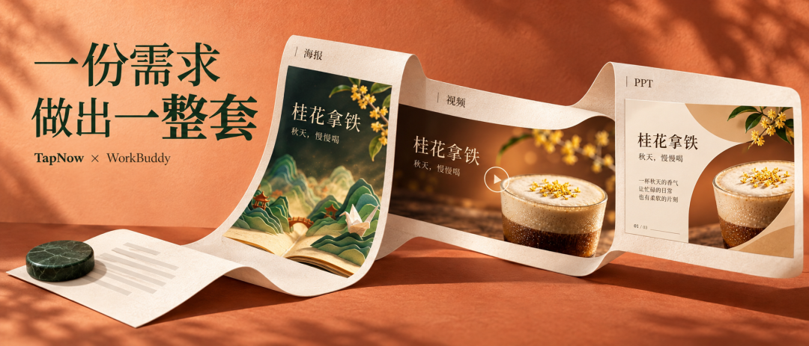
平时上班，临时要做张海报、剪段视频，谁还没碰到过。
可为了这点任务，把设计软件、视频工具重新学一遍，实在有点麻烦。
AI工具已经好用了很多，但需求怎么说、模型怎么选，还是得琢磨。做图、做视频来回换工具，也挺打断思路。
**我最近在找更省事的方案，发现TapNow接入了WorkBuddy。**
连接好后，选对应的专家或技能，把用途和想法说清楚，就能接着做图、做视频。
先看我这个视频，海报、短片和课件设计制作都很方便美观~
下面就拿课程宣传、产品上新、培训课件这三个场景，聊聊具体怎么用。
**01**
**工具接入**
TapNow算是老熟人了。大约从去年开始，我们做AI视频就在用，当时只有海外版。
1年过去它有了国内版，Agent和团队协作也陆续补齐。
能在一张画布上完成从创意构思、分镜预演、图文生成、视频渲染到迭代对比、剪辑出片的完整链路.
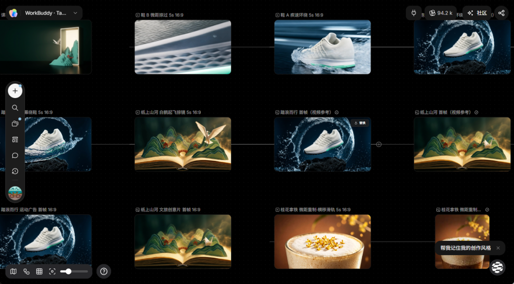
现在它以**插件形式**接入了WorkBuddy、千问办公和豆包工作。
并围绕这些能力，在WorkBuddy提供了6位专家、15个技能和1个应用。名字看着多，按手头的事来选就好。
**WorkBuddy处理方案和需求，TapNow负责生图、生成视频。**
平时在这里写方案，可以接着做成画面，少了切换平台、重新交代需求的麻烦，而且素材留在TapNow画布里，还能继续编辑、改版和复用。
我们就选腾讯家的国产Agent一哥WorkBuddy，拿做活动宣传这个实际项目，尝试一遍。
打开WorkBuddy电脑端，到左侧的专家·技能·连接器，切到连接器，搜索TapNow，按提示授权登录。
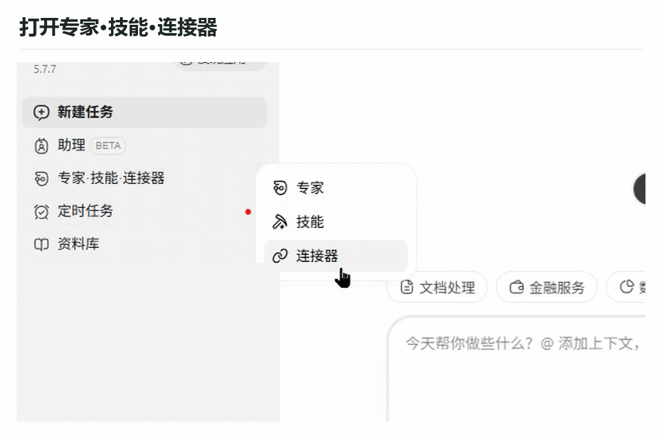
日常做海报、配图或短视频，做到这一步就可以在对话里调用专家或技能。
如果你已经明确要做影视创作、视觉设计或商业广告，连接好连接器，提前选择技能，进入TapNow Buddy应用，就能在对话框叠加使用专家、技能，享受更专业的创意操作系统。
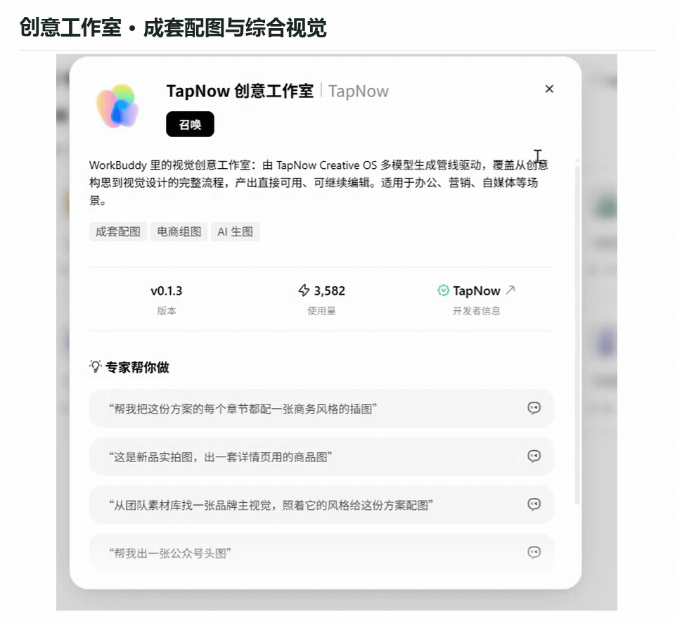
不确定连好了没有，就先发一句，检查TapNow连接状态，列出我最近的画布。
连接好后，到专家页搜索TapNow，点开专家详情，再点召唤，输入框带上专家后补充要求。
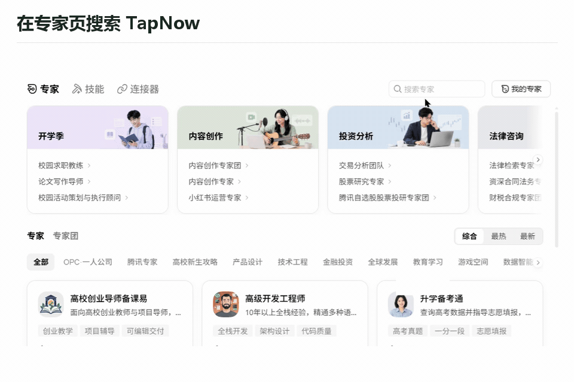
走应用入口的话，在WorkBuddy左上角的发现应用里搜索TapNow，进入后按提示完成应用授权。
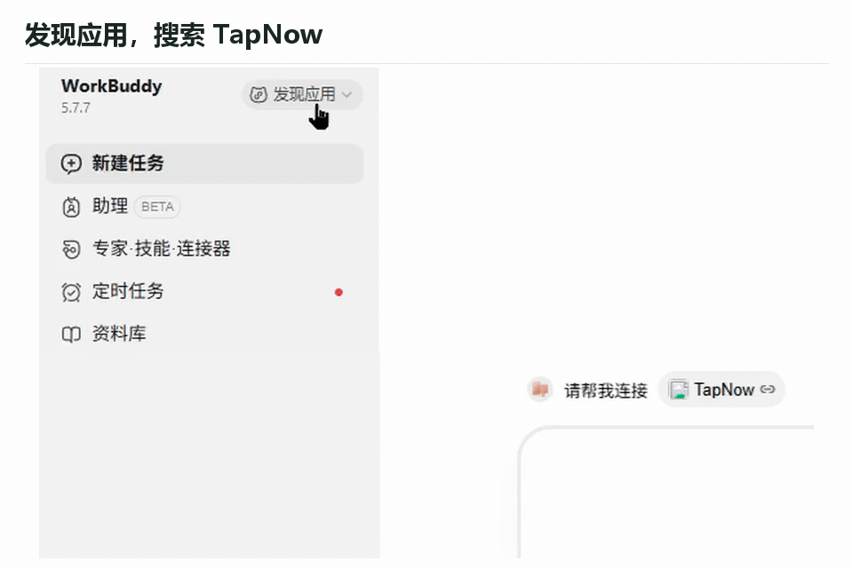
进来以后，调用跟手头工作接近的专家或技能，会带出TapNow创意工作室，接着提供素材、说清楚想做什么就行。
给AI提供上下文资料时，把这四点讲清楚就好：给谁看，拿去哪里用，必须保留什么，最后要什么文件。
**02**
**做一套课程宣传素材**
先拿我们自己的AI视频课程宣发活动举例。
群里要竖版海报，文章要横版封面，发视频还得有段预告。看着是一串活，其实可以一起交代给TapNow，先做图，确认后再做视频。
这次就围绕同一场课，把海报、封面和预告一起做完。主题也简单：把想法，拍成作品。
这套物料可以先用一句话交代。
●●●
```
帮我做一套主题为把想法，拍成作品的AI视频课程宣传物料，要发群的海报、公众号封面，还有一段发社交平台的作品混剪预告。先出海报和封面，确认画面后再做视频。
```
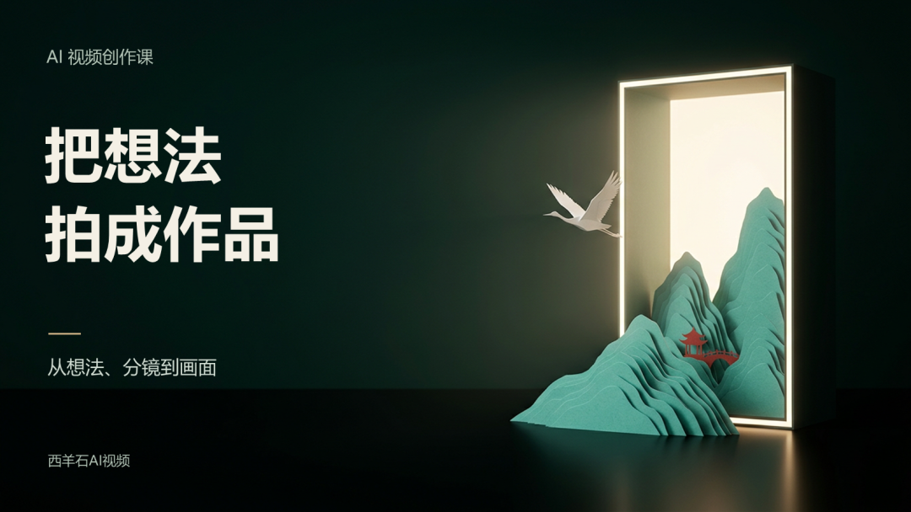
课程横版封面
封面里，一道银幕连着青绿山河，纸鹤从里面飞出来。它和后面的国风作品能呼应上，也比摆一排摄影器材更直观，提示词不难，大家可以参考如下。
●●●
```
请调用TapNow，生成16比9课程海报底图。
深墨绿摄影棚里，一道暖白竖向银幕位于右半部，青绿纸雕山峦从银幕内延伸到外面，点缀小小朱红亭桥，一只白纸鹤飞出。左侧40%留给标题，保留纸张纤维和柔和侧光。
画面简洁，不加文字、人物和摄影设备。
画面里有一道银幕，青绿纸雕山河从里面延伸出来，一只白纸鹤飞出，点缀朱红亭桥。整体简洁，保留纸张质感。
先不加文字，留好标题位置，横竖两版风格统一。
```
不清楚尺寸，就直接说画面有什么偏好，发群还是做公众号封面，TapNow会按用途匹配画幅。上面这段是我为了控制具体画面补充的要求，刚上手不用写得这么细。
我这次把底图和标题分开处理，临时改课名时，就不用跟着改背景。
底图方向定下来，再把横竖两版的构图安排好。横版让文字和画面左右分开；竖版把标题放上方，山河放下方。用同一张底图重新安排版式，颜色和主体就不会各长各的。
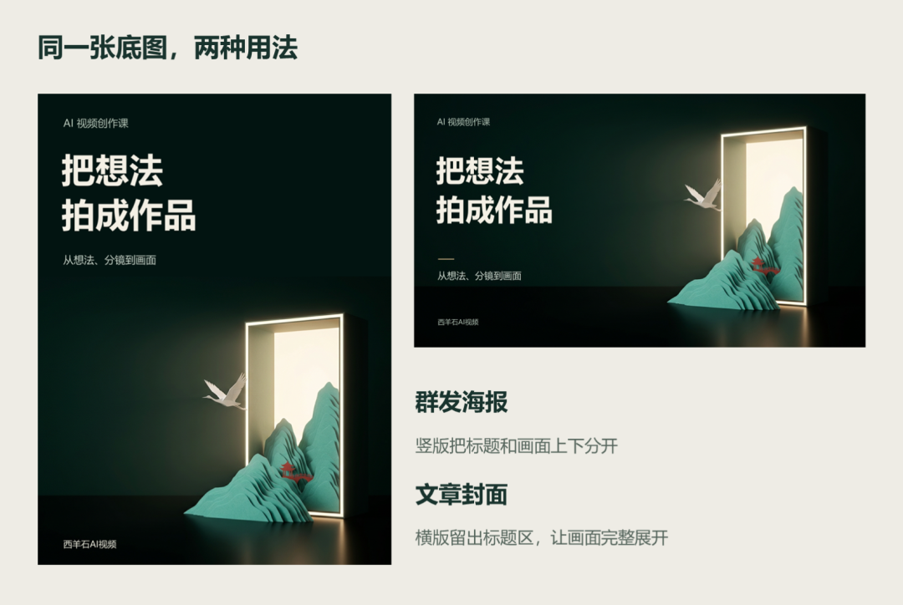
同一张TapNow底图，排成横竖两版
这一步保留了可编辑文件。文字没有焊死在图里，后面改副标题、补开课信息，都方便。
我也让AI修改了一次看是不是真的可以。把副标题从想法、分镜到画面，换成带你走完一次创作流程，其余不动。
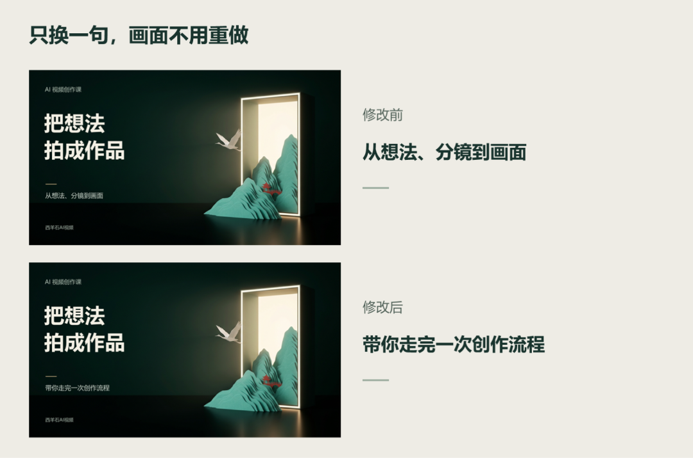
副标题修改前后
两版导出图对照后，变化确实只在副标题区域。
海报是为了把主题说清楚，预告片得让人看到作品。大家来了解AI视频课，总得先看看能做出什么。
于是我做了两条作品，一条国风文旅，一条运动产品广告。把它们剪进课程预告，中间加个叠化让画面丝滑过渡，先给人看效果。
**纸上山河**
一本翻开的书，里面藏着青绿山峦和朱红亭桥。纸鹤从山脊起飞，镜头顺着往里推，一本书就有了一个小世界。

这类画面适合文旅活动预热、文化展览开场，也适合给一段介绍文字配个能让人停下来的片头。
山水、古建、地方纹样，都可以成为创意的起点，提示词我也直接放下面分享给大家了。
●●●
```
请调用TapNow，先做一张16比9首帧。
打开的线装书里生长出青绿纸雕山峦、朱红亭桥，单只白色纸鹤站在近景山脊。暗青绿背景，暖金侧逆光，能看见纸张纤维，不加文字。
再以这张图做5秒视频，让纸鹤振翅飞向右上方，镜头轻推进入书中山河，书本和山峦保持稳定。
```
这次纸鹤先起飞，再离开画面，后半段留给山河。动作不多，但观众能看出前后发生了什么。做短片，先把这一个镜头拍明白就行。
**踏浪而行**
商品宣传又是另一种思路。与其让产品原地转一圈，不如给它安排一个有记忆点的出场。
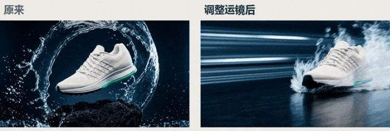
左边是第一版，水的动态很足，但是鞋却几乎不怎动。
我重做之后，鞋子先贴着水面掠过，再切到鞋面和中底的微距，最后拉开，露出完整产品。远近和速度有了变化，跑鞋才有点运动广告的意思。
●●●
```
请调用TapNow，用同一张跑鞋参考图分别生成两条16比9、5秒视频。
一条快速贴近鞋头，低机位绕过鞋侧，鞋向前上方跃起，水花向后带出；另一条沿鞋面和青绿中底掠过微距，再拉远到完整产品。
保持单只鞋和基本配色，水花不要长时间挡住鞋面，不加文字和标志。
```
两条原片并非每一秒都好用。环绕那条的后半段又回到了水环悬浮，我只取前面有动作的部分。原片生成完，我们人工还得挑选和剪辑，这两步省不了。
**03**
**做新品短片**
前面是做课程的宣发素材，再换一个小店和市场同学更熟悉的工作。
新品要上了，海报得有，视频也想发，可临时约一场拍摄，又得协调人、场地和时间。
这次我拿桂花拿铁，做一套秋季上新的视觉提案。
我给TapNow的要求很具体。深棕背景、暖色逆光、透明玻璃杯，咖啡分层和奶泡要清楚，让人一眼能看出这杯东西想卖什么感觉。
●●●
```
请用TapNow做一张3比4桂花拿铁海报。
深棕背景，暖色逆光，透明玻璃杯放在胡桃木桌面上，突出奶泡、桂花和咖啡分层。
主标题用桂花拿铁，副标题用把秋天，喝进这一杯。不要价格、二维码和额外角标。先做一张。
```

桂花拿铁 · 竖版海报
这张海报的中文标题和副标题一起生成，后期清理了角落小字。杯身的凝露、奶泡、后面的桂花枝，也有了细节。先把这杯拿铁的视觉方向定下来。
但做到一张海报，还不够。新品短片要拍哪几个地方，横版封面把字放哪儿，都得接着想。总不能让一张图包办所有工作。
接着补横版和特写。横版把杯子放在右边，左边留给标题；特写靠近奶泡和桂花，让人看见质感。

横版主视觉，留白供后期排字

参考图重做后的特写
同样一杯拿铁，主视觉负责让人记住产品，特写负责勾起食欲。给不同画面分好工，短片才有东西可剪。
再把图交给TapNow做五秒视频。整杯镜头沿用前一轮的结果，只重做不满意的特写，满意的部分留着。
●●●
```
以刚才的参考编辑图做5秒、16比9视频。镜头轻微横移，保持杯口、奶泡和细碎桂花稳定，不增加新花朵，不要文字。
```
开头先看奶泡和桂花，再看整杯产品，片尾留点时间记住名字。九秒里，细节、产品、文案各有位置。
这里换成松弛一点的爵士配乐，让节奏跟着暖光和慢镜头走。

**剪的时候还留意了一个小地方。**
片尾直接停在上一镜的末帧，要是切回最初那张图，杯子会突然变小，刚攒起来的质感就掉了。动效不用多，前后接得舒服更重要。
这里的两个动态镜头都由TapNow生成，后期再做剪接、叠化、配乐和排字。原片和成片都留着，后面想换文案、调节奏，不用全部重做。
奶茶店的上新、烘焙店的节日款、品牌的新品提案，都可以从这个顺序开始。先想好要突出什么，再做全景和细节，最后决定观众应该记住哪句话。
**04**
**配好PPT课件**
短片做完，我顺手把制作过程整理成三页课件。做培训、给团队分享经验，正好用得上。
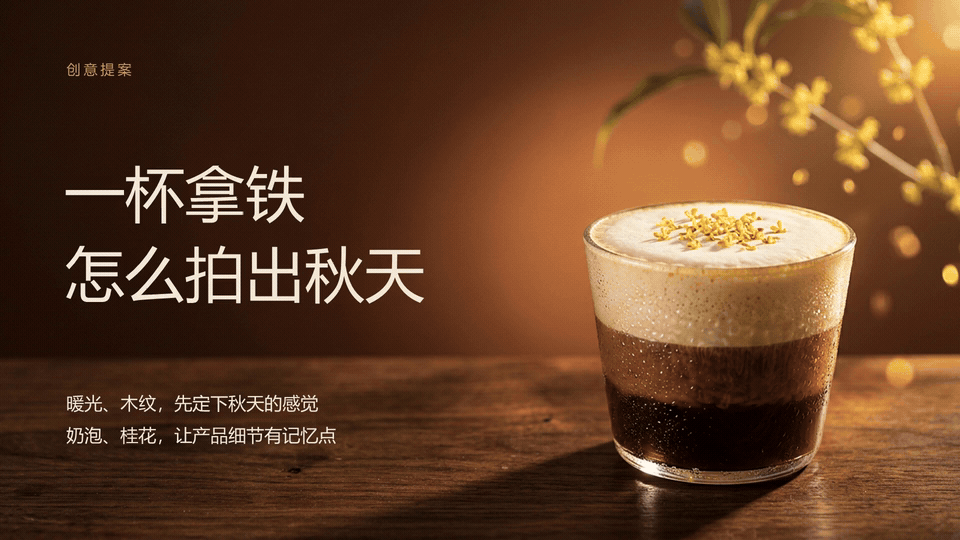
这次直接用前面TapNow生成的拿铁素材，跟WorkBuddy说需求即可，不用在不同AI工具之间切来切去，很爽。
●●●
```
用我们刚做的桂花拿铁素材，整理三页16比9教学PPT。
第一页讲创意方向，突出暖光、木纹、奶泡和桂花；第二页用实际视频截帧，排出约2.1秒细节、4.2秒全貌、2.7秒收尾；第三页讲杯型、切点和标题的检查。
沿用深棕、奶油白和暖金，标题和说明保留可编辑，不加平台署名和多余页脚。
```
**05**
**最后**
我们日常做的设计工作，没有必要再去学那么多专业的设计工具，也不用在不同的AI工具切来切去。
**直接在WorkBuddy里面连接TapNow，团队之间也能共享同一个画布，保留历史素材，同时协作管理。**
费用这块我也跟大家说清楚，WorkBuddy的对话消耗和TapNow的积分是两回事，更方便，但是需要在WorkBuddy里面消耗积分，但我整体测试下来都还好。
做完这几组，我反而觉得，普通办公人最需要的，未必是又掌握了一款新软件。
手里有活动通知，就能往下做海报；新品方向定了，可以把图片接着做成视频。项目做完，再整理进提案和课件，同一批素材就能多派几次用场。
TapNow把专业创作的能力带进WorkBuddy，省下了不少从头熟悉工具的过程。我们仍然要决定画面给谁看、重点放哪里、什么结果算好。
工具越方便，人越该把时间花在这些地方。
**总不能一下午都在研究新工具和按钮，最后连自己要做什么都忘了。**
**关注「西羊石AI视频」，一起探索 AI 创作。**
觉得有收获可以一键三连，转发给需要的小伙伴

## 摘要

（待补充）

## 我的笔记

（待补充）
