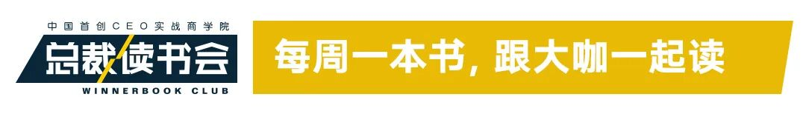
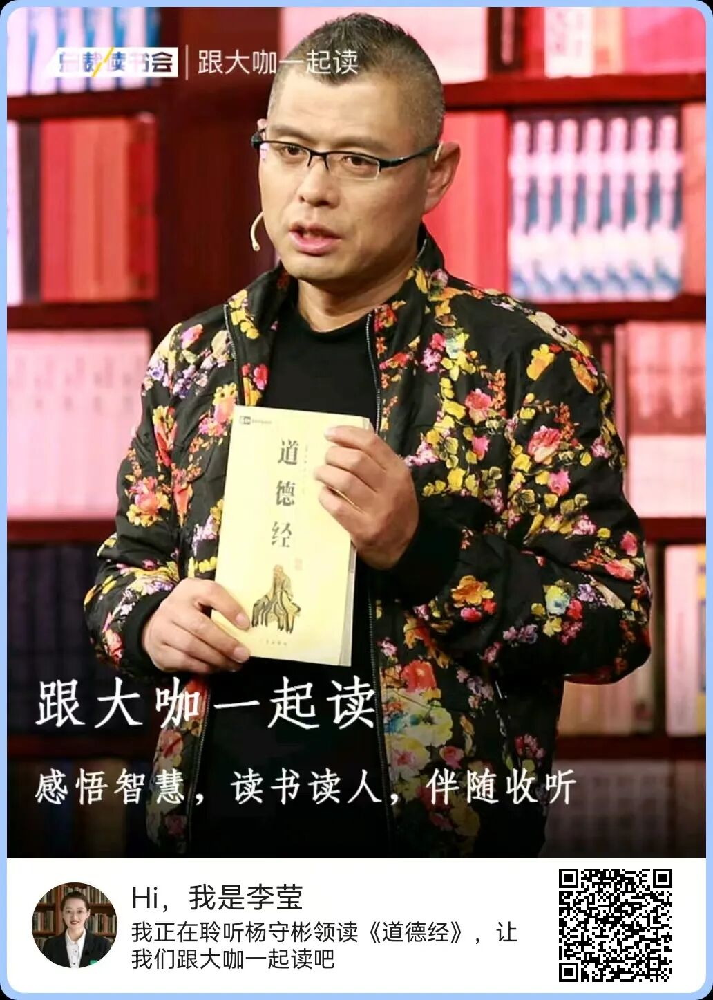
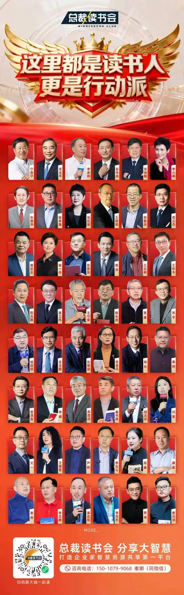

# 先做正确的事，再把事做正确
> 💡 备注属性未写入，可能是备注属性名称或者类型被修改了，建议将字段类型设置为 rich_text，可以在小程序-操作-修改文章数据库页面进行调整
> 💡 原文链接:[https://mp.weixin.qq.com/s?__biz=MzUxMDU0Mzg4Mw==&mid=2247587672&idx=1&sn=5ea9d7974744bab866dad07cfdc26923&chksm=f8568dbec59b73104def07163a12160c9919d52c4418c75b667778e51c5224f7da7cd723c4ff#rd](https://mp.weixin.qq.com/s?__biz=MzUxMDU0Mzg4Mw%3D%3D&mid=2247587672&idx=1&sn=5ea9d7974744bab866dad07cfdc26923&chksm=f8568dbec59b73104def07163a12160c9919d52c4418c75b667778e51c5224f7da7cd723c4ff#rd)

**作者：**李莹，总裁读书会小书僮，总裁读书会微信公众号责任编辑
**来源：**总裁读书会（ID：winnerbook_club），本文摘编自《高效能人士的七个习惯》一书，史蒂芬·柯维 著

你有没有过这样一天：早上打开电脑，回邮件、开会、接电话，处理一件件临时插进来的急事，一直忙到深夜。关上电脑的那一刻，你忽然愣住——这一天，到底做成了什么？
我们这一代人，最不缺的就是“努力”。我们被教导要高效、要自律、要把每一分钟都填满。可越忙，心里越慌。因为忙和忙不一样：有一种忙，是朝着一个方向全力以赴；还有一种忙，是被事情推着走，像一只被抽打的陀螺，转得飞快，却始终在原地。
三十多年前，史蒂芬·柯维在《高效能人士的七个习惯》里，把这件事一句话说透了。他借用管理学大师德鲁克的区分：**效率，是把事情做对；效能，是做对的事情。**把事情做对，是方法问题；做对的事情，是方向问题。方向错了，跑得越快，离目标越远。

**你不是不够努力，是把劲用错了地方**
柯维在书的开头，先给读者泼了一盆冷水。
他研究了两百多年来关于“成功”的著作，发现一个有趣的变化：1970年以前，人们谈成功，谈的是“品德成功论”——诚实、谦逊、勇气、公正、忍耐，这些品性是成功的根基；而1970年代以后，成功学渐渐变成了“个人魅力论”——形象、技巧、人脉、话术，仿佛成功是一套可以速成的包装术。
柯维说，**这就像你在地板上拼命擦地板，越擦越亮，可天花板在漏水。只打磨技巧，不修炼品性，地基是空的。**什么叫真正的效能？柯维讲了一个“鹅与金蛋”的寓言：一个农夫发现他的鹅每天下一只纯金的蛋，他贪得无厌，一刀剖开鹅肚子，想把里面的金子一次全取出来。结果鹅死了，金蛋也没了。
**产出（金蛋）和产能（鹅）必须平衡。只盯着产出、耗尽产能，迟早两手空空；只养鹅不下蛋，那是养老，不是做事。**我们今天的焦虑，恰恰来自这种失衡。长期熬夜、透支身体、敷衍关系、不学新东西。我们在拼命杀鹅，还责怪鹅下蛋不够多。
柯维还有一个工具，叫“时间管理矩阵”。他把所有事情按两个维度切开：**重要不重要，紧急不紧急。**于是有了四个象限。
**第一象限，既紧急又重要——救火、截止日期、突发的危机。**谁都不想待在这里，可大多数人每天就在这里泡着，累得要死。
**第二象限，重要但不紧急——锻炼身体、读书学习、规划人生、经营亲密关系。**这是效能的核心地带，却最容易被“紧急”的事情挤掉。
**第三象限，紧急但不重要——别人的临时请求、某些不痛不痒的会议、随时打断你的电话。**我们误以为这是“重要”，其实那只是别人的优先级。
**第四象限，不紧急也不重要——刷手机、漫无目的地消磨。**纯粹的浪费。
柯维一针见血地指出：**高效能的人，会主动把自己从第一象限和第三象限里抽出来，把大量精力投入第二象限。因为第二象限的事，今天不做，明天就会变成第一象限的危机；而第二象限的事做足了，第一象限的火，自然就少了。**
你看，所谓“做正确的事”，在柯维这里不是一句鸡汤，而是一个选择：你的时间和精力，到底给了哪个象限？

**什么是“正确的事”？先在心里看见终点**
要做正确的事，前提是你得知道，什么对你来说是“正确”。这就是第二个习惯以终为始。
柯维有一个根本信念：**任何事物，都被创造两次。第一次是心智上的创造，第二次是实际的创造。**盖一栋楼，先有图纸，再有钢筋水泥；做一件事，先在脑子里想清楚要去哪里，再抬脚。反过来，如果你边盖边想、走到哪算哪，那这栋楼多半是歪的。
他打过一个比方：想象你自己参加自己的葬礼。牧师念着你的生平，你的家人、同事、朋友轮流上台，他们会怎么评价你？你希望他们说，你是个什么样的人？做成过什么事？留下了什么？
**当你从终点往回看，今天那些让你焦虑的小事，很多根本不值得焦虑。这就是“以终为始”，不是盲目出发，而是先确定方向，再迈步。**
可方向从哪里来？柯维提醒我们，人很容易被各种“中心”牵着走：以配偶为中心，以家庭为中心，以金钱为中心，以工作为中心，以朋友或敌人为中心，以自我为中心，以享乐为中心……这些中心，每一个都能在某个时刻绑架你的判断。
他说，真正稳妥的做法，是以原则为中心。原则是那些不证自明、放之四海而皆准的东西，比如正直、诚信、服务、贡献、成长。**当你以原则为锚，外界的风浪就吹不歪你。**
落到行动上，柯维建议每个人写一份“个人使命宣言”：我这辈子到底想成为什么样的人？想做成什么样的事？我的原则是什么？这份宣言不是写在日记里自我感动的。它是你做每一个重大决定时的标尺。有人约你做一件事，先问自己：这和我的使命一致吗？有个机会摆在面前，先问：这是我要去的方向吗？
任何事，第二次创造（实际行动）之前，都必须先完成第一次创造（心智图景）。你没在脑子里看见终点，就永远走不到终点。这，就是“先做正确的事”的第一重含义：**方向，先于速度。**

**凭什么你来选？刺激与回应之间，有一段距离**
知道了方向，下一个问题是：凭什么由你来决定做什么？很多人会说：我也想做第二象限的事，可我身不由己啊。老板要我开会，客户要我改方案，家里一堆事等着我，我有什么办法？
柯维的第一个习惯，叫积极主动，恰恰就是来回答这个问题的。他引用了一个故事。心理学家维克多·弗兰克尔，二战时被关在纳粹集中营，父母、妻子、兄弟都死于集中营，他自己也受尽折磨。可正是在那样的人间地狱里，他发现了一个道理：**人所拥有的任何东西，都可以被剥夺，唯独人性最后的自由——在任何境遇中，选择自己态度的自由，不能被剥夺。**
在刺激和回应之间，存在一段距离。在这段距离里，就是我们选择自己回应的自由。我们的选择，决定了我们的成长和幸福。
同样是被客户当面驳回，有人暴跳如雷，有人回去反省问题出在哪，有人第二天依然冷静专业。外界的刺激是同一个，不同的回应，造就了不同的人。
柯维把人的注意力分成两个圈。**一个叫关注圈。**你关心的所有事情：健康、房价、国际形势、别人的眼光、天气、同事的一句话；**另一个叫影响圈。**你真正能做些什么、能改变的事情。
**积极主动的人，把精力聚焦在影响圈。**他们想：这件事我能做什么？我能改变什么？我能学什么？慢慢地，他们的影响圈越来越大。消极被动的人，眼睛只盯着关注圈。他们抱怨天气、抱怨制度、抱怨出身、抱怨别人对不起自己，盯着那些自己无力改变的事，越想越气，越气越无力，影响圈越缩越小。
这两种人，都在忙。但前者在做“正确的事”，后者只是在正确地浪费时间。有了这份选择的自由，才有资格谈第三个习惯**要事第一**。**柯维说的“要事第一”，不是时间管理，而是自我管理。**时间管理的潜台词是：把事情塞进日程表；自我管理的意思是：我来选择，什么事值得进我的日程表。
以终为始，告诉我要去哪里；**要事第一，告诉我今天这一步该怎么走。把第二象限的事，那些重要但不紧急、却真正决定你人生走向的事，郑重地排进时间表；对那些第三象限的、别人塞给你的“紧急”，学会温和而坚定地说“不”。**
你对一件事说“是”的前提，是对一万件其他事说“不”。这不是自私，这是对自己的使命负责。

**一个人做对了，还不够**
讲到这里，我们谈的都是“个人领域的成功”，从依赖到独立。可柯维说，独立不是终点。你再厉害，也活在人群里。你要和人合作、和人打交道、和人一起把事情做成。这就进入“公众领域的成功”，从独立到互赖。
而“把事做正确”这五个字，在这个阶段，分量格外重。因为一个人做对，靠的是自律；一群人做对，靠的是信任。
**第四个习惯，叫双赢思维**。我们从小被灌输一种**零和游戏：你赢，就意味着我输。**谈判要压价，竞争要赶尽杀绝，连和家人相处都忍不住争个高低。柯维说，这是“匮乏心态”，觉得蛋糕就这么大，你多吃一口，我就少吃一口。
可世界上真正的好事，几乎都是双赢的。一笔好生意，双方都赚；一段好关系，两个人都舒服。双赢不是软弱，它是勇气和体谅之间的平衡——有勇气为自己争取，也能体谅对方的诉求。支撑双赢的，是柯维提出的**情感账户**概念。
人和人之间的信任，像一个账户。你守信用、懂礼貌、言出必行、尊重别人、不记仇，这是往账户里存钱；你食言、当众让人难堪、无视别人的感受、出尔反尔，这是从账户里取钱。平时存得足，关键时刻哪怕你说错一句话、做错一件事，对方也愿意原谅你；平时就透支，你好心帮忙，别人都要先怀疑三分。
**第五个习惯，叫知彼解己。**这四个字要倒着读：**先理解别人，再争取被别人理解。**我们大多数人听别人说话，根本不是在听，是在等。等对方说完，好轮到我们发表意见。柯维把这叫“自传式回应”，用自己的经历去套别人的话，急着给建议、下判断、挖别人的痛处。
他说，这就像医生没问诊就开药方，荒唐透顶。知彼解己，就是先诊断，再开方。把自己的立场先放一放，真正走进对方的世界，听他没说出口的情绪，听懂他为什么这样想。
人是奇怪的动物：当你真的被听懂了，他才愿意听你说。影响力的秘诀，是先被影响。
**第六个习惯，叫统合综效。**前面五个都做到了，会发生什么？会发生1加1大于2。统合综效，就是整体大于部分之和。两个人意见不同，不是谁说服谁，而是带着彼此的尊重，一起撞出一个谁都没想到的第三种方案。
柯维说，差异不是分歧，差异是礼物。你看到我没看到的角度，我想到你没想到的路径，我们合在一起，才接近全貌。**统合综效的前提，恰恰是前面那几个习惯：你积极主动，你以终为始，你想双赢，你愿意先理解我，我们才能真正站在一起，做出一个比单打独斗好得多的结果。**
你看，“把事做正确”，从来不是一个人埋头苦干。它是在一张信任的网络里，让每个人都把力气，使在同一个方向上。

**别把斧子砍钝了，才想起要磨**
**第七个习惯，叫不断更新。**它像一个圈，把前六个习惯重新装进去，让你能一直转下去。
柯维讲了一个伐木工人的故事：一个人拼命锯树，锯子都钝得不像样了，还在咬牙硬锯。路人劝他：“你歇会儿，把锯子磨一磨吧，这样快得多。”他头也不抬：“我没空磨锯子，我忙着锯树呢！”
我们多少人，就是这个伐木工。柯维说，人要在四个维度上持续更新自己：
**身体维度**：好好吃饭、规律运动、充足睡眠。身体是1，其他都是后面的0。
**精神维度**：找到自己的精神支柱，读经典、接近自然、独处思考。这是你内心的那个“锚”。
**智力维度**：保持学习，读书、写作、练新技能。脑子像肌肉，不用就萎缩。
**社会与情感维度**：经营好你和重要的人的关系，在交往中给予、服务、贡献。
这四个维度，缺一个都不行。**身体垮了，精神无处安放；智力不更新，很快被时代淘汰；关系断裂，人会像植物离开土壤。不断更新，就是磨刀，你不磨刀，锯得再卖力，也不过是把钝木头锯出更深的印子。**
而这七个习惯，本身也是螺旋上升的：你越更新，越能积极主动；越积极主动，越能以终为始；越能以终为始，越能影响他人，就这样一圈一圈，往上走。
现在，我们可以回到开头那句话了。德鲁克说：效率，是把事情做对；效能，是做对的事情。
柯维用整整一本书告诉我们：“做对的事情”，是在做之前，先想清楚终点在哪里，先问自己这件事值不值得做，先守住自己的原则和使命；“把事情做对”，是在方向明确之后，用自律、信任、倾听和协作，一步一个脚印把它落地。
顺序不能反。你不能用“把事情做对”的勤奋，去掩盖“没想清楚做什么”的懒惰。也不能整天思考人生方向，却从不愿意真正动手。柯维有一句话，我特别喜欢，送给你作为结尾：**我不是我所处环境的产物，我是我所做决定的产物。**愿我们都能先安静下来，想清楚那件“正确的事”是什么；然后，抬起头，大步走过去。
**投稿 |李老师：15810534093（微信）**
**城市合伙人招募 |高老师：18811050287（微信）**

[五千言里见当下——总裁读书会线上共读《道德经》](https://mp.weixin.qq.com/s?__biz=MzUxMDU0Mzg4Mw%3D%3D&mid=2247587645&idx=1&sn=12a3b5a5fff0e140bc6d529df18355ca&scene=21#wechat_redirect)
[自律，是解决人生问题最主要的工具](https://mp.weixin.qq.com/s?__biz=MzUxMDU0Mzg4Mw%3D%3D&mid=2247587607&idx=1&sn=d7bec91337c70c28829240d3d41d7484&scene=21#wechat_redirect)
[宋志平对话赫尔曼·西蒙：企业经营突围与产业生态破局](https://mp.weixin.qq.com/s?__biz=MzUxMDU0Mzg4Mw%3D%3D&mid=2247587642&idx=1&sn=1e11855d491e0dc3d7e85dc700da8893&scene=21#wechat_redirect)

