# 免费AI错题本深度测评：孩子的错题，终于有"救"了
> 💡 备注属性未写入，可能是备注属性名称或者类型被修改了，建议将字段类型设置为 rich_text，可以在小程序-操作-修改文章数据库页面进行调整
> 💡 原文链接:[https://mp.weixin.qq.com/s?__biz=Mzk2NDYzMDQ1NQ==&mid=2247484106&idx=1&sn=aa334844ea27523f3cada8e74067e9cc&chksm=c57f62bba490a7889b0b8d1c7118cde5cade54e8e984fca224257de194a964981149351ee7a4#rd](https://mp.weixin.qq.com/s?__biz=Mzk2NDYzMDQ1NQ%3D%3D&mid=2247484106&idx=1&sn=aa334844ea27523f3cada8e74067e9cc&chksm=c57f62bba490a7889b0b8d1c7118cde5cade54e8e984fca224257de194a964981149351ee7a4#rd)
每天学习或者辅导作业到深夜，错题抄完还是错？这篇测评，或许能让你家的陪读时间减半。
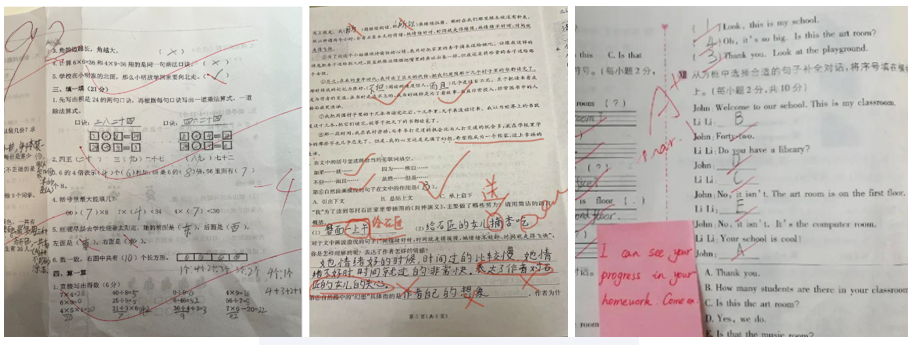
**一、为什么你需要一个AI错题本？**
不少家长都有这样的经历：孩子考完试，拿着卷子让家长签字，红叉叉看得人头疼。最让人崩溃的不是分数低，而是——‌同一类型的题，孩子错了三遍‌。
**传统错题本的困境，几乎所有家庭都经历过：**
耗时太久‌：一道几何题连抄带画要5分钟，一晚上整理10道题，一小时就过去了。
整理了不看‌：孩子花大力气抄完，本子就再也没翻开过，错题本变成"抄写本"。
分类混乱‌：数学、英语、物理错题混在一起，想针对性复习无从下手。
抄错原题‌：手抄过程中数字抄错、图形画歪，错题本本身就是错题。
2026年，AI技术在教育领域的落地已经非常成熟。
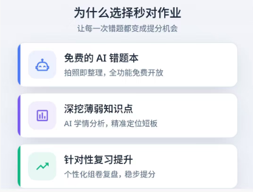
最近我实测了一款叫**「‌秒对作业」**AI错题本‌的产品，用了一周，今天就用干货测评的方式，告诉你它到底值不值得用。
**二、核心功能实测：5秒录入，AI自动整理**
- **1. 拍照录题：秒拍秒清，告别手抄**
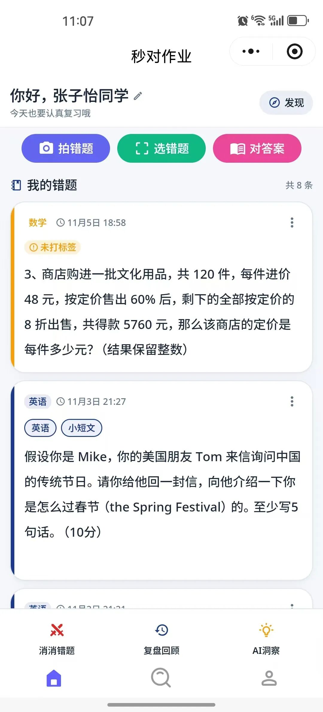
打开 "**秒对作业**"，对准作业或试卷一拍，系统会自动识别题目边缘、矫正歪斜、清除手写笔迹，还原出干净的空白题目。
>实测感受：
速度快‌：单题录入约3-5秒，整页试卷10秒左右完成框选
识别准‌：普通印刷题、手写印刷混合卷都能识别，数学公式、英语阅读、语文阅读理解均支持
自动去手写‌：孩子用铅笔、黑笔、红笔写过的答案和演算痕迹，一键清除，卷面干净如新
这一步直接解决了家长和孩子最头疼的"抄题"问题——以前整理10道题要半小时，现在3分钟全部搞定。
- **2. AI错题分析：不只是收录，更要告诉你"为什么错"**
很多错题本App或小程序到"录题"这一步就停了，但真正决定能不能提分的，是‌错因分析‌。
秒对作业在录完错题后，AI会自动做三件事：
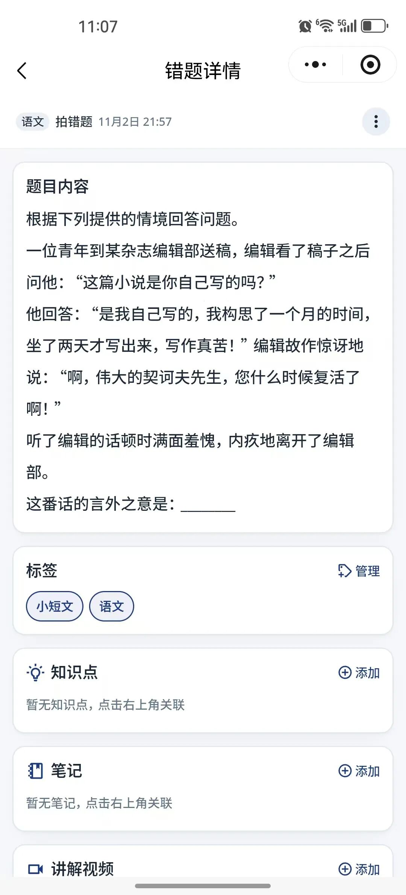
**标注知识点‌：**这道题考的是哪个章节、哪个知识点，自动打标签
**给出解析‌：**详细解题步骤，不只是答案，还有思路点拨
**错因归类‌：**是"知识点没掌握"、"计算失误"还是"审题不清"，帮孩子看清问题根源
举个例子：孩子一道"一元二次方程求根"题算错了，系统不仅给出正确解法，还会提示"是否在配方法步骤上出错"，引导孩子回忆当时的思路，而不是直接甩一个标准答案。
- **3. 复盘回顾：费曼学习错题讲解，练一道会一类**
这是我认为AI错题本最有价值的功能。
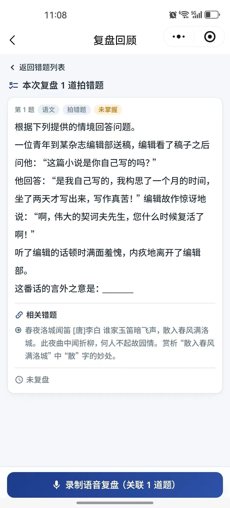
传统错题本的复习方式是"把错题再做一遍"，但孩子往往记住了这道题的答案，换个数字、换个问法又错了。秒对作业在每道错题下方，会自动推送‌3-5道同知识点、同题型的变式题‌：
原题是"已知a求b"，变式题可能是"已知b求a"
原题是基础问法，变式题可能是结合实际应用场景
难度从易到难分层，基础题巩固，提高题拔高
真正做到"错一道，会一类"，而不是在同一道题上反复打转。
- **4. 智能组卷打印：一键生成专属练习卷**
复习阶段最实用的功能。勾选想要复习的错题（或同类题），系统自动排版，生成一份标准练习卷，可以直接导出PDF打印。
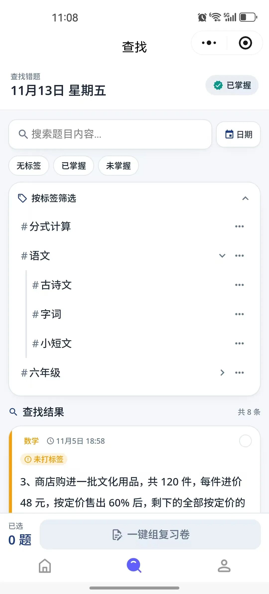
组卷时还可以自定义：
是否附带答案（自测时不带答案，家长批改时带）
预留答题空白区域
按知识点、时间范围、错误次数筛选题目
考前一周，用这个功能把本月高频错题组成一套卷子重做一遍，比盲目刷课外题效率高得多。
**三、对比传统错题本，到底省了多少时间？**
我做了一个粗略的对比：
| **环节** | **传统手抄错题本** | **秒对作业AI错题本** |
| 录入10道错题 | 约40-60分钟 | 约3-5分钟 |
| 分类整理 | 需要手动分科目、章节 | 章节 AI自动打标签 |
| 找同类题练习 | 需要翻练习册、上网搜 | 自动推荐3-5道 |
| 生成复习卷 | 手动抄题排版 | 一键组卷导出PDF |
| 每周错题复习耗时 | 3-4小时 | 30-40分钟 |
| 坚持使用门槛 | 高（太耗时易放弃） | 低（随手拍即可） |
按照这个时间差，‌一周至少能省下2-3小时‌，一个学期就是三四十个小时。
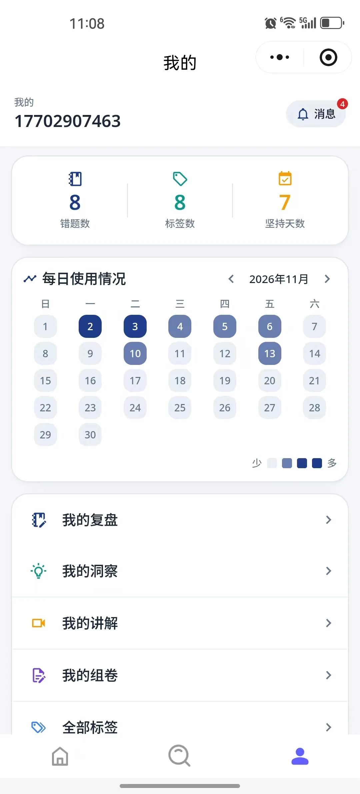
这些时间省下来，让孩子去运动、去阅读、去睡眠，都比抄题有价值得多。
**四、适合哪些人群用？**
经过实测，我认为以下几类家庭和学生最适合用：
- 1. 小学高年级至初高中学生‌
作业量增大，手动抄题时间成本太高
科目多、知识点复杂，需要系统梳理薄弱点
中高考备考阶段，错题复盘是提分关键
- 2. 没时间陪孩子整理错题的家长‌
下班晚、精力有限，没法每天帮孩子手抄整理
想帮孩子但自己也讲不明白，需要AI辅助讲解
希望孩子养成自主整理错题的习惯
- 3. 追求高效复习的学生本人‌
有自主学习意识，想把时间花在"练"而不是"抄"上
考前需要快速定位薄弱知识点，精准刷题
厌倦了厚厚一沓翻不到重点的错题本
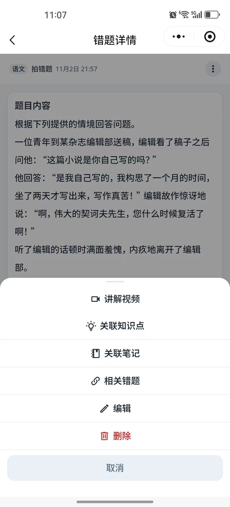
不太建议的场景：小学低年级（1-3年级）孩子，这个阶段更重要的是培养书写习惯和学习态度，手抄错题虽然慢，但本身也是一种记忆过程，可以等孩子大一些再引入AI工具。
**五、使用小技巧：让错题本真正"用起来"**
工具再好，不用也是白搭。分享几个实测下来能提高使用率的小技巧：
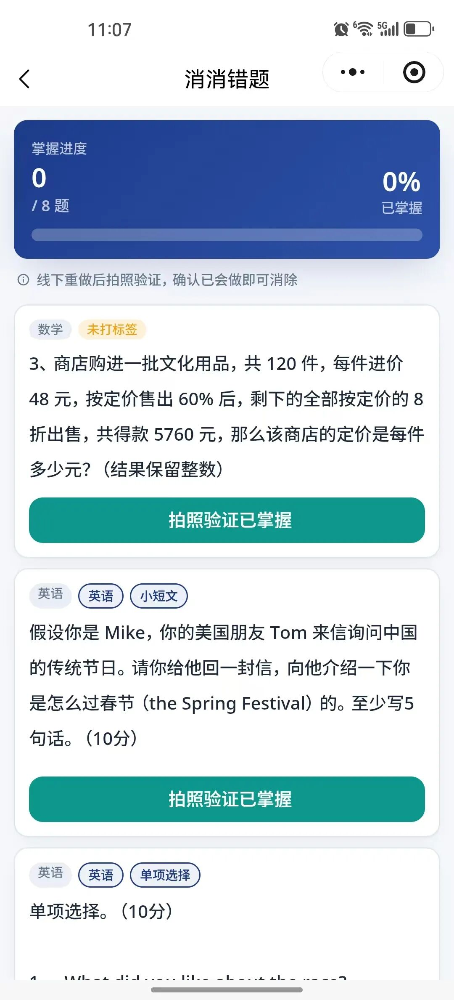
当天错题当天录‌：不要攒到周末，当天作业批改完随手拍，3分钟搞定，攒多了反而不想做
每周日固定复盘‌：花20分钟把本周错题重做一遍，AI推送的同类题选做2-3道
不要只抄不思考‌：AI给了解析之后，让孩子用自己的话讲一遍"当时为什么错"，讲得出来才是真懂了
考前两周集中刷‌：用组卷功能把当月错题打印出来，模拟考试环境做一遍，比刷新题效果好
AI时代，学习工具的本质不是让孩子"偷懒"，而是把重复、机械的劳动交给机器，把时间还给真正需要思考的部分。
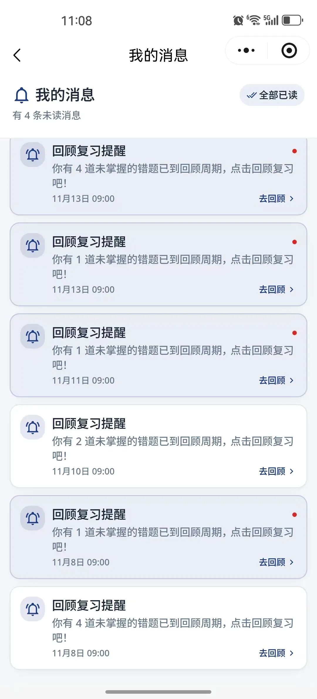
抄一道题5分钟，这5分钟里孩子没有任何思维增量，只是机械搬运。而用AI省下这5分钟，孩子可以多思考一道题的解题思路、多复盘一个错因、多背几个单词——这才是技术应该带来的改变。
**「秒对作业AI错题本」**不是什么提分神话，它只是把"错题整理"这件事，从苦力活变成了真正能驱动提分的闭环。如果你家也在为错题整理头疼，不妨试试看。
🔍 ‌微信搜索 秒对作业 ：AI错题本‌小程序，无需下载APP，手机拍照即可使用，随时随地整理错题。
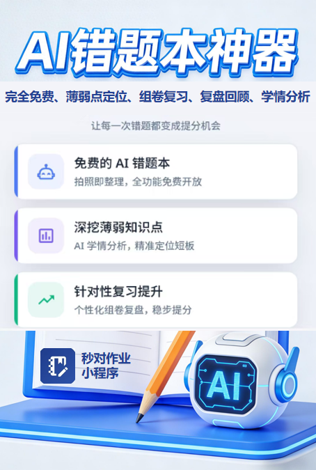
（本文为产品实测分享，功能以实际版本为准。）
