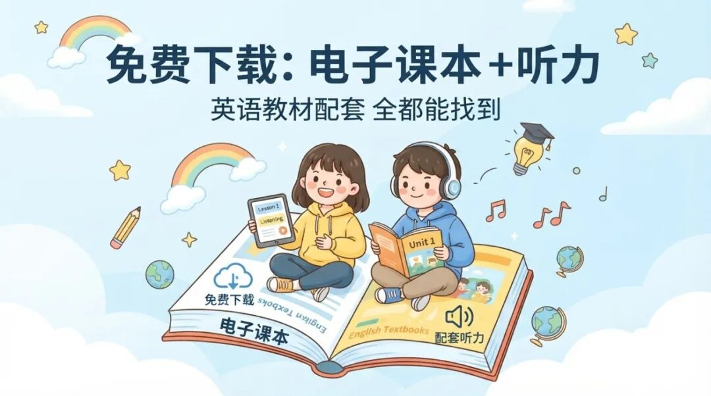

# 免费下载：电子课本下载，英语教材配套听力也能找到
> 💡 备注属性未写入，可能是备注属性名称或者类型被修改了，建议将字段类型设置为 rich_text，可以在小程序-操作-修改文章数据库页面进行调整
> 💡 原文链接:[https://mp.weixin.qq.com/s?__biz=Mzg3NTI1MjUwMA==&mid=2247488674&idx=1&sn=c629557cbed894769535fd2e9193f8b9&chksm=cf414693db43044a2bf0890fc18fda7d32af66e9b6e26a10cf8f29a680ef7549072b27881de0#rd](https://mp.weixin.qq.com/s?__biz=Mzg3NTI1MjUwMA%3D%3D&mid=2247488674&idx=1&sn=c629557cbed894769535fd2e9193f8b9&chksm=cf414693db43044a2bf0890fc18fda7d32af66e9b6e26a10cf8f29a680ef7549072b27881de0#rd)

很多家长都有过这个场景。
孩子说学校要听英语课文，家里翻箱倒柜找不到音频；网上一搜，跳出来的不是卖资料包，就是让你加群、付费、看广告。
教材明明在手上，配套听力却像失踪人口。
说白了，家长不是舍不得花钱，是不想为了几段本该配套的音频，被迫进入“付费资料包宇宙”。
我这两天找到一个挺实在的开源项目：飞翔教学资源助手。
它不是自己囤了一堆教材资源再卖给你，而是把国家中小学智慧教育平台里的教材、课程资源和英语教材配套听力，按教材页面去解析和整理。
用人话说，它像一个“找资源的导航员”。
你不用满网追着“人教版某年级英语听力”跑，也不用猜哪个网盘链接哪天失效。找到对应教材后，能用的课本资源和配套音频，按官方平台实际提供的内容来。
这事最舒服的地方在于：资源源头是官方平台，工具本身免费开源。
家长真正需要的，从来不是又一个花里胡哨的学习软件。
是孩子明天要跟读哪一课，今天晚上能不能顺利找到音频。
电子课本下载，不该只拿到一本“哑巴课本”。
英语教材尤其如此。
课文能看，单词能背，但没有标准朗读和听力材料，孩子练起来就像拿着菜谱学做饭，却不给灶台。
有的家长会在视频平台搜课文跟读。
这当然也能用，但问题是版本不一定对，章节顺序不一定一样，视频里还常夹着讲解、广告和别的内容。孩子本来只想听课本，最后点着点着去看了别的。
还有些资料包把“教材音频”包装成稀缺资源。
其实很多时候，稀缺的不是资源，是你找到资源的路径。
飞翔教学资源助手解决的就是这个路径问题。
你在 GitHub 搜索“**FlyEduDownloader**”或者“**飞翔教学资源助手**”，进入项目页面后，优先看发布页和使用说明。
下载后，先别急着见什么都点。
打开国家中小学智慧教育平台，按孩子正在用的教材版本、年级和册次，找到对应教材页面。确认封面、出版社、年级都和手里的书一致，再把页面链接交给工具解析。
这里一定要慢一点。
同一本英语教材，可能有不同版本；同一个年级，也可能分上下册。家长最容易犯的错，不是不会下载，而是“看着名字差不多就下了”。
结果孩子听着听着，发现课文完全不是学校那一篇。
那就尴尬了。
所以正确顺序很简单：先核对实体课本，再找平台对应页面，再取配套资源。
别反过来。
项目说明里写得很清楚：它能获取教材栏目中的教材、英语听力音频和课程资源信息，也支持批量处理。
但它不是魔法棒。
有些旧教材资源可能已经被平台调整或删除；有些资源需要登录后才能访问；平台权限变化时，原来的链接也可能失效。
这不是工具“突然不行了”，而是资源源头本来就在变化。
所以它最适合的使用方式，不是囤一堆文件。
而是孩子要预习、复习、跟读时，随手找到当前正在学的那本教材，把听力配齐。
这才是家长省心的版本。
如果你家电脑不方便装工具，也别急。
国家中小学智慧教育平台本身就是第一选择，适合直接在线找教材和课程资源；飞翔教学资源助手适合希望把资源路径理顺、需要整理本地学习资料的家长；视频平台上的课文跟读，可以作为某一课临时找不到资源时的补充。
这三种方式不是互相打架。
平台负责源头，开源工具负责整理，视频内容负责临时兜底。
真正好用的免费资源，不是让你下载一屋子资料，而是让孩子需要的时候，马上能打开。
还有一点要提醒。
教材和音频是给孩子学习用的。下载后自己听、自己跟读、自己整理没问题；别把资源重新打包、搬运或拿去卖。
免费的东西，最怕被人拿去做成“付费福利”。
你可以把这篇转给身边总在找英语教材音频的家长。
别再让他们花钱买一堆不知道是不是对应版本的资料包了。
觉得这类资源有用，记得点个在看和星标。以后孩子临时要教材、音频、练习资源，翻聊天记录也能更快找到。
点个关注，下次找免费资源不用再到处搜了，我帮你整理好了

## 摘要

（待补充）

## 我的笔记

（待补充）
