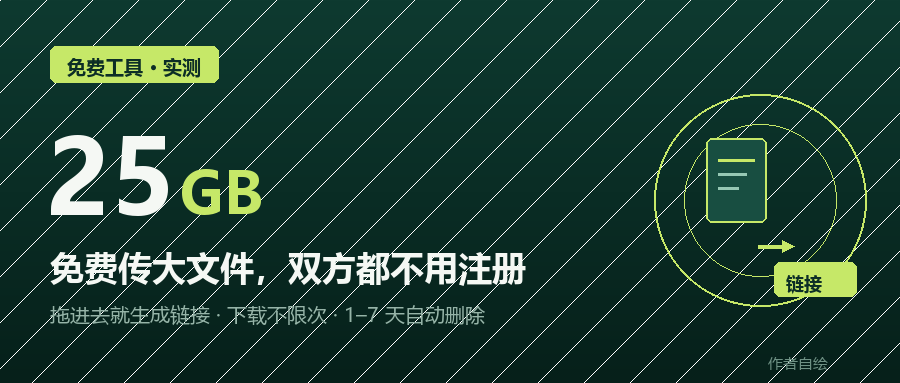
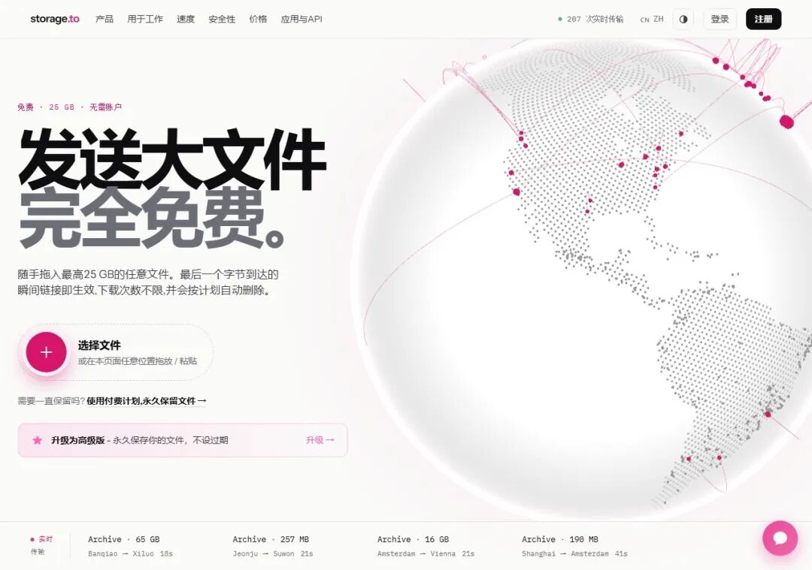
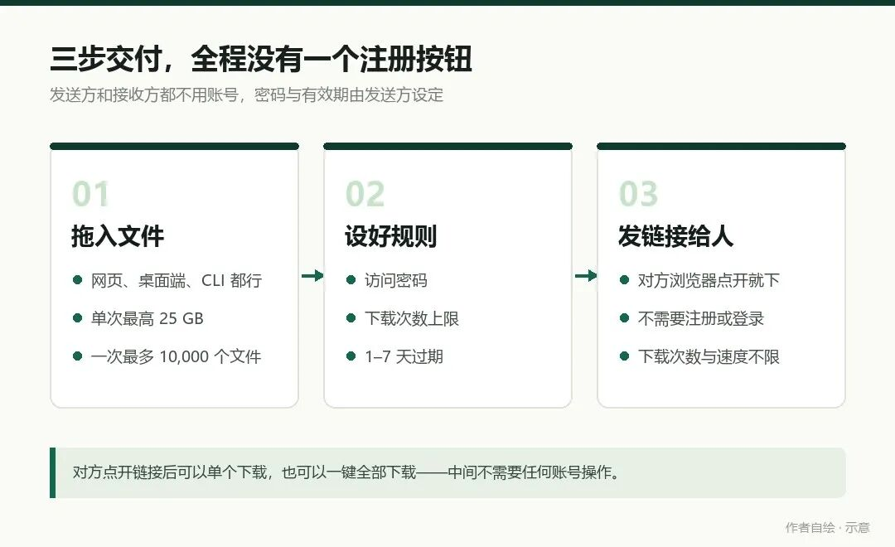
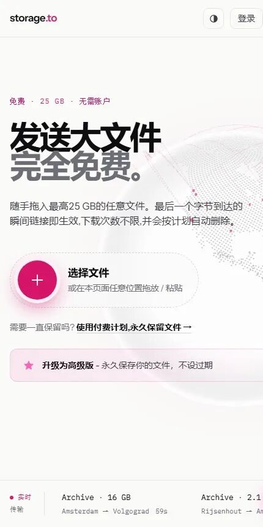
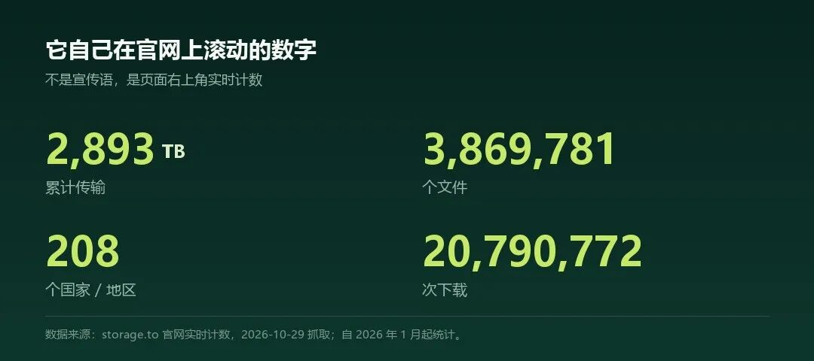

# 免费传 25GB 大文件，双方都不用注册
> 💡 备注属性未写入，可能是备注属性名称或者类型被修改了，建议将字段类型设置为 rich_text，可以在小程序-操作-修改文章数据库页面进行调整
> 💡 原文链接:[https://mp.weixin.qq.com/s?__biz=MzUwOTk0NjI0Nw==&mid=2247485750&idx=1&sn=0858d6f9eaab514524dc9e991cf5fa56&chksm=f84a0344bb7d4affa3f5315b2d5237df30c2205b856d86b6812356995d36480049567cd22aaf#rd](https://mp.weixin.qq.com/s?__biz=MzUwOTk0NjI0Nw%3D%3D&mid=2247485750&idx=1&sn=0858d6f9eaab514524dc9e991cf5fa56&chksm=f84a0344bb7d4affa3f5315b2d5237df30c2205b856d86b6812356995d36480049567cd22aaf#rd)
做设计、剪片子、跟项目的人，大概都被大文件卡过一次。
微信传到 100MB 往上就开始转圈，运气差一点直接失败；邮箱附件塞几个 G 的视频，对方邮箱直接退信；网盘倒是能传，可接收的人得先注册、先下载客户端，再陪着免费版一起限速。
这几天试了个海外的传输工具storage.to。流程短得有点不像话：文件拖进网页，链接就出来了。
没有注册，没有登录，
也没有“请先安装客户端”。

图：本文封面 · 作者自绘
## 01
## 免费版到底给了多少
先把最关键的三个数字摆出来，都是官网免费方案里写明的：
25 GB单次传输上限1–7 天自选过期时间不限次下载无上限
数据：storage.to 官网免费方案说明 · 作者整理

图：storage.to 中文首页，2026-10-29 实拍截取 · 作者截图
页面上那句“免费 · 25 GB · 无需账户”就在标题上方，右下角还有一条实时的传输记录在滚。不用等什么试用期，进站就能拖。
25GB 是什么概念？一个 4K 的十分钟成片工程包，加上素材和字体，通常也就十几 G。也就是说，大多数“要分卷压缩再分三次发”的活儿，一次就发完了。
而且它没有把“免费”做成体验阉割版——下载次数不设上限，不限速，也没有月度流量配额。官网的说法是上传直接进离你最近的节点，最后一个字节落地，链接立刻生效，不用等审核。
有效期的设计我挺喜欢：自己选 1 到 7 天，到期自动删。发出去的链接本来就是一时的，一直躺在别人服务器上才叫麻烦。
## 02
## 整个流程只有三步
它把“传文件”这件事压缩到了三个动作，中间没有任何一个注册按钮。

图：发送与接收流程，作者自绘示意

图：手机浏览器打开同一套页面，点“选择文件”即可 · 作者截图
第一步，拖。网页里直接把文件或整个文件夹拖进去，不用装任何东西，也不用填邮箱。
第二步，设规则。访问密码、最大下载次数、几天后过期，这三项免费版就能设。给客户发未公开的片子，密码这一步很实用。
第三步，把链接甩过去。对方在浏览器里点开，能看到文件列表和缩略图预览，单个下或者一键全下都行。他不需要账号，也不需要你知道他有没有账号。
还有个细节：一次最多能塞 10000 个文件进同一个链接。以前给客户发一套素材，得整理成十几个分享链接挨个贴，现在一个链接收工。
## 03
## 安全这块，它写得比多数免费工具细
文件在传输过程走 TLS，落在服务器上是 AES-256 加密。上传的内容会过一遍恶意软件和滥用行为扫描，没通过的直接下架。
这里要说清楚一句：这是传输加密加存储加密，不是端到端加密——服务器要处理文件，就必然看得到内容。凡是把这两件事混着说的宣传，都值得多看一眼。

图：官网实时计数，2026-10-29 抓取 · 作者制图
另外它有网页版、桌面客户端、命令行 CLI 和 API。CLI 和 API 在免费方案里就包含，这点在同类的免费工具里不多见——写脚本批量分发素材的人，可以直接把它接进工作流。
## 04
## 和几个熟面孔放一起比
下面这张表的数字，来自 storage.to 官网对比页，条款核实于 2026 年 9 月。各家免费政策变得快，用之前建议再核对一遍。
| **项目** | **storage.to** | **WeTransfer** | **Dropbox** | **Google Drive** |
| 免费单次上限 | **25 GB** | 3 GB，每月 10 次 | 分享 100 MB，空间 2 GB | 空间 15 GB |
| 发送要账号吗 | **不需要** | 需邮箱验证 | 必须注册 | 必须注册 |
| 下载侧限制 | **不限次、不限速** | 链接 3 天有效 | 共享链接每日 20 GB | 热门文件有配额 |
| CLI / API | **免费包含** | 无公开 API | 付费方案 | 走谷歌云 API |
表格：storage.to 官网对比页（2026 年 9 月核实），作者整理
看第一行就够了。25GB 对 3GB，还是免注册的 25GB。剩下几项只是顺带加分。
## 05
## 什么时候值得掏钱
付费方案全部是文件永不删除、单文件最高 100GB、去掉广告，按月或按年都行，也可以一次性买 90 天。计价是美元，不强制自动续费。
Personal5 美元 / 月，100GB 存储
适合自己长期放常用素材，过期文件在宽限期内还能下载回来。
Pro15 美元 / 月，500GB 存储
多了下载回执、链接访问分析、品牌化分享页面。给客户交片要凭据的人，这一档才是重点；文件请求、原链接换版本目前标着“即将上线”，别当现成功能算。
Business25 美元 / 月，1TB 存储
自定义域名、团队资料库、指定邮箱访问、Webhook，官网标注的都是“即将上线”。团队现在要用，这几项还得等。
## 06
## 三个坑，提前说
一，别把它当网盘。免费链接到期即删，1 到 7 天，没有第二次机会。项目原始素材该备份的还是要备份。
二，匿名上传有每日额度。官网 FAQ 写得很直白：额度比较宽松，登录账号后可解除。偶尔发一次完全够用，天天发大批量的就得注册了。
三，服务器在海外。国内访问的实际上传速度取决于当时的网络，20GB 这种体量建议挑网络稳定的时候传，别在开会前五分钟开始。
还有一条常识：这是第三方海外服务，上传什么、传到哪，自己心里要有数。
## 07
## 谁用得上
视频剪辑、后期给客户交几 G 到二十几 G 的成片和工程文件。
平面、摄影发 RAW 原图和 PSD 大包，对方不用装任何东西。
远程协作跨地区传素材，少一轮“你先注册个网盘”的来回。
开发者CLI 和 API 免费可用，接进脚本批量分发。
偶尔发大文件的普通人一年用两三次，不值得为它注册一个网盘。
官网在这儿：storage.to/zh。打开就能拖，不用先填任何东西。
工具是工具，选择权在你。真要发一份 15GB 的工程包，试一次就知道省了多少事。
如果这篇帮你省下一次分卷压缩，
点个「在看」，下次要用的时候翻得回来。
有什么顺手的工具，评论区聊聊。
#效率工具 #大文件传输 #设计交付 #剪辑日常

免责提示：本文为工具使用分享，非商业推广。storage.to 为海外第三方服务，请遵守当地网络与版权相关法规，勿上传违法、侵权内容。文中额度与条款以官网为准。
