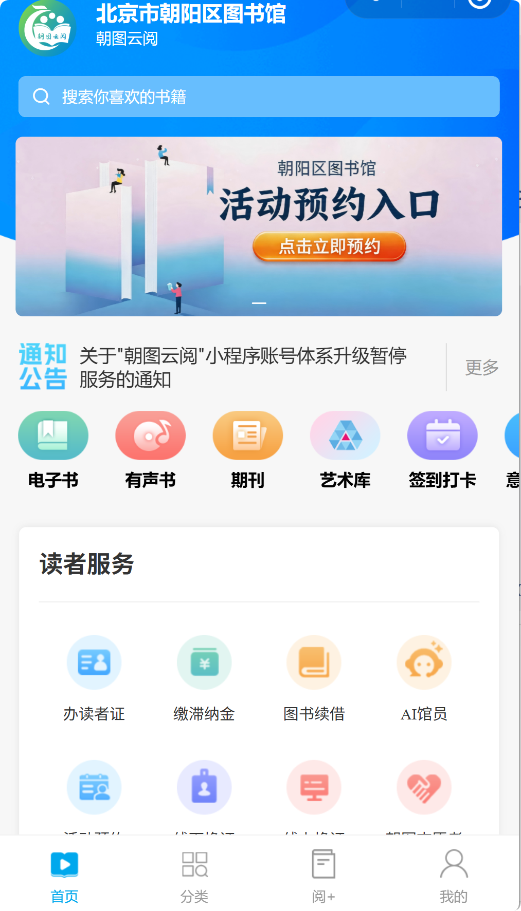

# 免费数字图书馆——朝图云阅
> 💡 备注属性未写入，可能是备注属性名称或者类型被修改了，建议将字段类型设置为 rich_text，可以在小程序-操作-修改文章数据库页面进行调整
> 💡 原文链接:[https://mp.weixin.qq.com/s?__biz=Mzg5MzUyNDIwOA==&mid=2247485316&idx=1&sn=63a208807ccbbc44529d7e29d7448ae4&chksm=c1bd38f4d55bfe439d38da5413601cef6e21adeee183c8c51ba292287fbdaa39b0b6f4b4a963#rd](https://mp.weixin.qq.com/s?__biz=Mzg5MzUyNDIwOA%3D%3D&mid=2247485316&idx=1&sn=63a208807ccbbc44529d7e29d7448ae4&chksm=c1bd38f4d55bfe439d38da5413601cef6e21adeee183c8c51ba292287fbdaa39b0b6f4b4a963#rd)
北京朝阳图书馆给大家送福利啦！您只需打开【朝图云阅】微信小程序，**20 余万册电子书、6 万余集有声书、4000 余种畅销期刊、 30 余万幅艺术作品免费看、免费听、免费学。**
---
**朝图云阅**
---
【朝图云阅】是北京朝阳图书馆打造的一站式阅读与服务管理平台。朝图云阅开放的电子资源包含电子书、有声书、期刊、艺术库四大类。其中的电子资源大部分采购自中文在线、元阅读、北京橙义科技有限公司、博看、Artlib等正版资源。**小程序不以盈利为目的，无广告，不收费。**
---
**主要功能介绍**
---
**电子书：【**朝图云阅】的电子书涵盖了文学小说、少年儿童、传记、人文社科、艺术、历史、哲学、心理学、政治军事、法律、成功励志、经济管理、计算机网络、科技、医学、教育、生活休闲、外文图书等分类，您可以根据自己的需要，搜索查看。此外，如果您不知道要看什么书的话，【朝图云阅】还设置了热门榜单、精选书单、馆员推荐等内容，供您选择。
**有声书：【**朝图云阅】的有声书涵盖了文学小说、少年儿童、传记、人文社科、艺术、历史、哲学、心理学、政治军事、法律、成功励志、经济管理、计算机网络、科技、医学、教育、生活休闲、外文图书等内容。
**期刊：【**朝图云阅**】**的期刊，主要来自博看，支持原貌阅读、文本阅读、听期刊等多种模式。
**艺术库：**【朝图云阅】的艺术库，主要来自Artlib世界艺术库。艺术库包含艺术家、艺术品、艺术故事、艺术机构、艺术专题、收藏、系统公告、活动中心等模块。
---
**如何快速找到它**
---
1.打开微信，搜索【朝图云阅】。点击【朝图云阅】小程序。

2.进入【朝图云阅】微信小程序。

