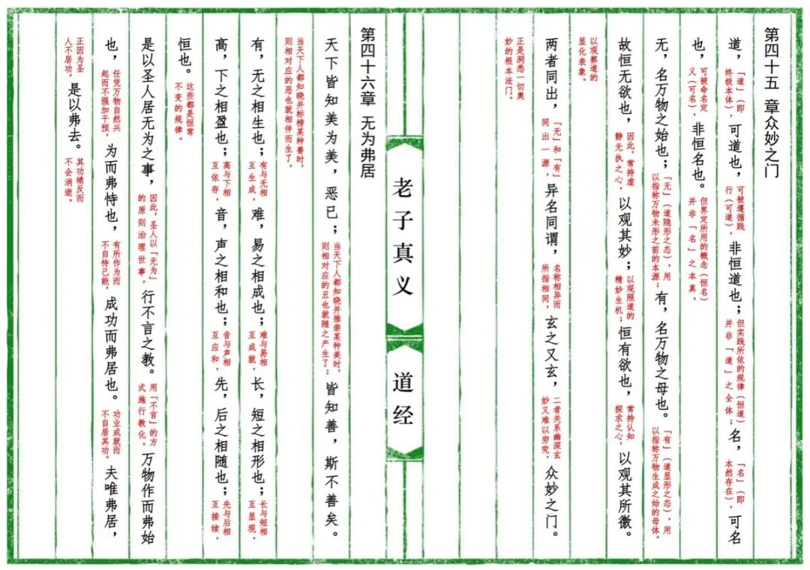
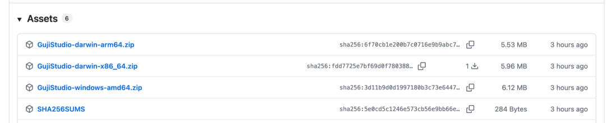

# 免费轻量简捷可视化古籍排版软件GujiStudio V1.2 发布
> 💡 备注属性未写入，可能是备注属性名称或者类型被修改了，建议将字段类型设置为 rich_text，可以在小程序-操作-修改文章数据库页面进行调整
> 💡 原文链接:[https://mp.weixin.qq.com/s?__biz=MzU2MDUyNTU3OA==&mid=2247486713&idx=1&sn=60978cad778510300d6d3bfef1fb14a9&chksm=fdbbdf7eb68636b6742593b35450300484ad94eaf6a38d66caeb45c5c120616d8bb8b5d31dc8#rd](https://mp.weixin.qq.com/s?__biz=MzU2MDUyNTU3OA%3D%3D&mid=2247486713&idx=1&sn=60978cad778510300d6d3bfef1fb14a9&chksm=fdbbdf7eb68636b6742593b35450300484ad94eaf6a38d66caeb45c5c120616d8bb8b5d31dc8#rd)
号外、号外、号外！
免费、轻量、简捷、可视化古籍排版软件GujiStudio V1.2 发布了。
这是对外发布的第一个版本。感谢大家的持续关注和耐心等待！
### 为啥会有这个免费软件
今年失业在家，一心专注《道德经》的解读，为了更好的宣传我的著作《老子真义》，使用WPS排了2版仿古籍版式的内容，其中大部分时间花在了版式调试中，很是辛苦。

不过分享后的效果不错，获得了好些朋友的点赞和支持，有些朋友还订阅了《老子真义》的合集。
6月底，道家本体论的研究终于完成，为了更好的推广老子的哲学思想，准备重新排版《老子真义》，期间试用了很多个软件工具都不太理想。
所以尝试使用AI构建自己的解决方案，没成想做成了一个软件。
后来在调试软件的过程中嘚瑟了一把，发布了《千字文》，阅读竟然过万。意外的是，平台认为我的作品有侵权嫌疑，限流了。

更意外的是没人看我的道德经解读，反而是很多人在评论区追问使用的什么排版软件？
既然这么多人喜欢，所以我决定免费开放软件，这下还让人惦记上了。最近几天又有朋友追问什么时候发布版本了。
这不，第一个版本终于来了！
能看到这里，说明我们还是有缘的。其实我想表达的是：毫不吹牛的说，我的道德经解读
[《老子真义》](https://mp.weixin.qq.com/mp/appmsgalbum?__biz=MzU2MDUyNTU3OA%3D%3D&action=getalbum&album_id=3873151853617643531&scene=126&sessionid=#wechat_redirect)
是全文最值得一读的，不想读的也希望点赞！
### GujiStudio 介绍
一款面向古籍整理与复刻的桌面排版工具：以现代输入（简体/繁体文本 + 现代标点）为源，按传统刻本的版式规范，输出竖排、句读圈点、带封页与牌记的古籍页面，并导出为 PNG / PDF。

1. 免费：无需注册，无需登录，下载即用，用完即扔，毫无负担！
1. 轻量：一个压缩包，很小不到7MB，无需安装，直接运行。

1. 简捷：选个文件夹就创建一个图书项目，所有资源都放在这个目录下，版式有默认模板，5分钟上手，可调整130多个参数，满足常用80%需求。
1. 可视化：直接在编辑器中输入文本，右侧同步可视化预览，所见即所得。
1. 可导出PDF文档，或PNG图片，满足随时分享欲望。
1. GujiStudio软件官网：`https://github.com/dinstone/guji-studio-home`
1. 点击【阅读原文】可下载最新版。上手折腾吧，万一看中了呢！
1. 好了，更多的功能介绍看官网说明吧，或者直接下载体验，我就不在这里吹牛了。
### 成果展示
使用GujiStudio排版过的项目，战绩可查：
1. 
[《百家姓》古籍竖排 | 注音](https://mp.weixin.qq.com/s?__biz=MzU2MDUyNTU3OA%3D%3D&mid=2247486574&idx=1&sn=cba91c26fb3ed0aa70c15513d949531d&scene=21#wechat_redirect)
1. [《三字经》精选典藏版 | 注音+译注| PDF可打印](https://mp.weixin.qq.com/s?__biz=MzU2MDUyNTU3OA%3D%3D&mid=2247486551&idx=1&sn=3c14e4cc8c83f9b1c141644ec13ac334&scene=21#wechat_redirect)
1. [《千字文》古籍竖排免费下载，简体 | 繁体 | 译注 | PDF文档可打印](https://mp.weixin.qq.com/s?__biz=MzU2MDUyNTU3OA%3D%3D&mid=2247486608&idx=1&sn=c7579b15b3ea3d2a18752fe9ddee27b1&scene=21#wechat_redirect)
1. [《老子真义》4.0 古籍竖排 | PDF文档可打印](https://mp.weixin.qq.com/s?__biz=MzU2MDUyNTU3OA%3D%3D&mid=2247486600&idx=1&sn=8947f50513ba67c26d47ea063a40830d&scene=21#wechat_redirect)
也欢迎各位报告使用效果。
### 更多推荐
[MDX1.4 新版本发布：持续打造简单、优雅的 Markdown 公众号排版工具](https://mp.weixin.qq.com/s?__biz=MzU2MDUyNTU3OA%3D%3D&mid=2247486335&idx=1&sn=f285edddd754a7b98e86015ed3e60555&scene=21#wechat_redirect)
欢迎点赞、收藏、转发！感谢赞赏支持，你的每一份打赏都是我坚持更新的动力。
