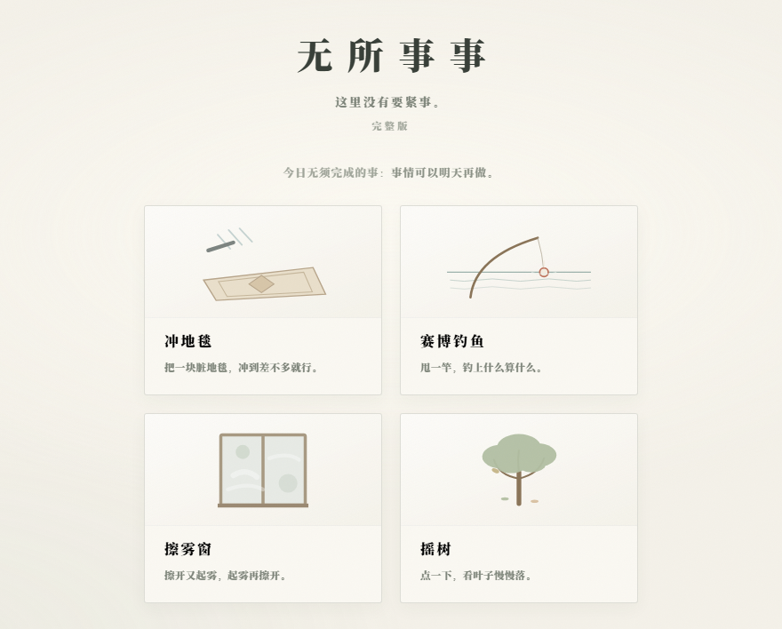
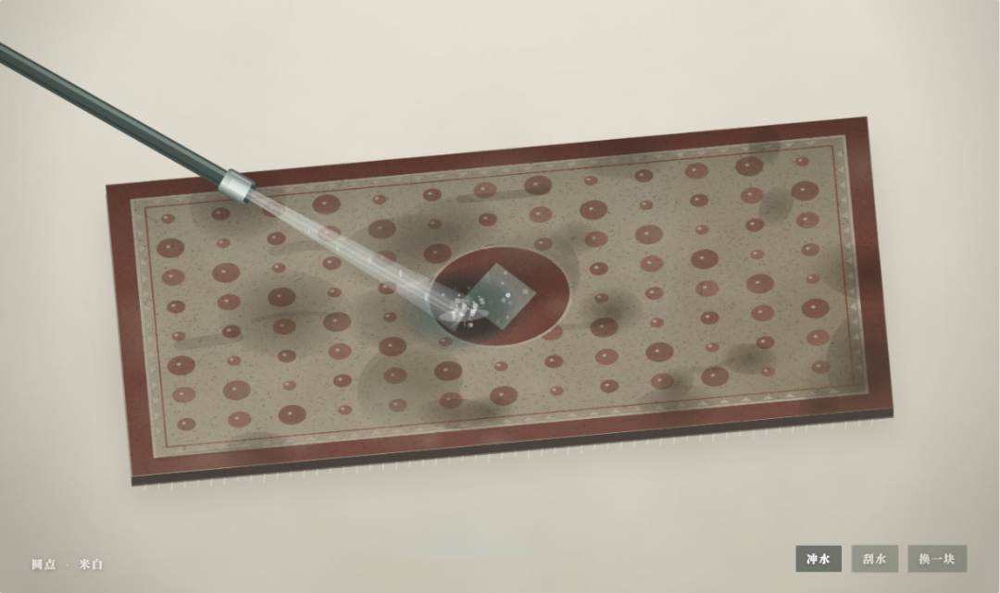
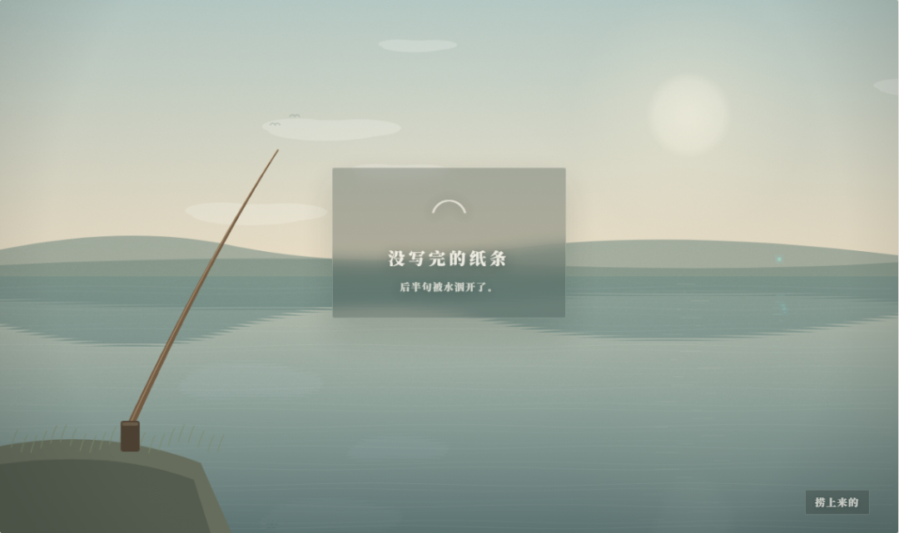
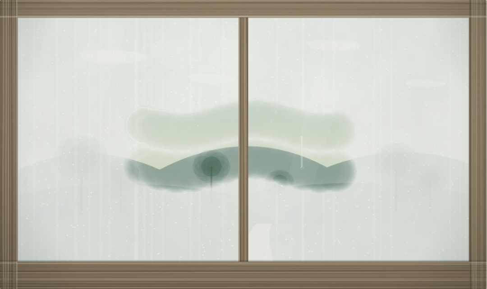
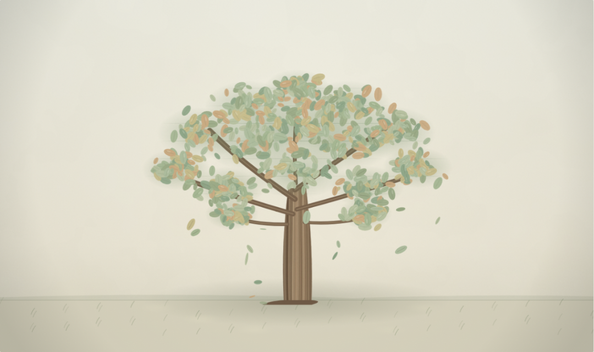
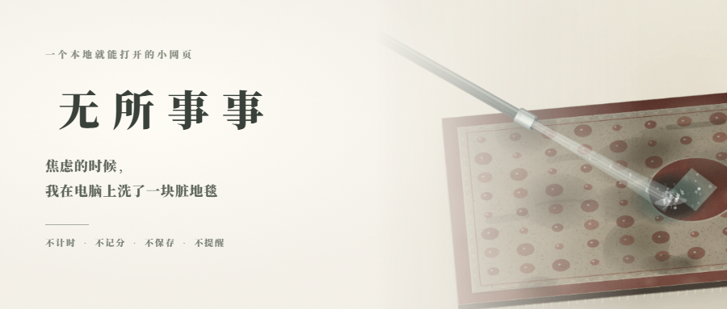

# 免费送个解压小网页，打开就能打发时间
> 💡 备注属性未写入，可能是备注属性名称或者类型被修改了，建议将字段类型设置为 rich_text，可以在小程序-操作-修改文章数据库页面进行调整
> 💡 原文链接:[https://mp.weixin.qq.com/s?__biz=MzU2NTcyOTE1MQ==&mid=2247484756&idx=1&sn=347e0486419fa1f8293ea36f135e2112&chksm=fd72d9ca686856908d661842bcde4b9d9fbe40e8e83ba83ab71d3577098081aeb9a0b1a2b6cc#rd](https://mp.weixin.qq.com/s?__biz=MzU2NTcyOTE1MQ%3D%3D&mid=2247484756&idx=1&sn=347e0486419fa1f8293ea36f135e2112&chksm=fd72d9ca686856908d661842bcde4b9d9fbe40e8e83ba83ab71d3577098081aeb9a0b1a2b6cc#rd)
焦虑上来的时候，如果我在电脑前，第一件事肯定是找文件、翻微信。咔咔就是找活干，翻文件夹，打开待办，找点能立刻做完的事。明明没什么要紧的，手却停不下来。一停就更慌，好像没在产出就是在浪费。
这种心态可能不止我一个人有，说白了缺的不是效率。缺一个允许自己不产出的地方。

所以我就做了个网页，叫「无所事事」。整合进了一个文件夹，双击 index.html 就能开，不用联网，不用登录，也不往电脑里存东西。打包起来三十 KB 出头，拷到别的电脑上一样能开。包含四种功能。

冲地毯是可以的。一块脏地毯斜铺着，水管从侧上方伸进来，按住鼠标，水斜着冲下去，泥被一点一点冲开，脏水顺着绒往下走。想换手法就点「刮水」，把水推到边上。洗完还能点「换一块」，十种图样轮着来。洗得干净不干净，没有反馈。

赛博钓鱼也可以。点一下水面抛竿，等浮标沉下去，再点一下收线。钓上来的东西都没用：空瓶子、一颗小石子、没写完的纸条，也可能什么都没有。捞过的会攒成一小摞，点开看看，也就看看。

擦雾窗是我自己点得最多的。毕竟赵本山说过，床前明月光，玻璃好上霜。用手指擦开，能看见外面的山和树。手一停，雾慢慢回来。擦开，起雾，再擦开。没有要擦完的那一刻。

摇树最简单，点一下，叶子慢慢往下落。落得慢，当然你也可以通过点击拦住一片，或者把它拖上去。然而并没有啥用，还是会落下。

四个场景都不计时，不记分，不保存，不提醒。关掉网页，刚才洗过的地毯不会留着，下次打开还是脏的。声音默认关着，想听可以拨到「轻」或「足」，水声、风声、树叶声都是打开时现算的，包里没有一个音频文件。
现在焦虑上来，有可能我还是会先去翻文件夹。翻两下，有时候就点开这个网页，冲一会儿地毯。洗到不想洗了，关掉。然后继续打工，或者回归生活。
获取方式，关注后后台回复【无所事事】。

