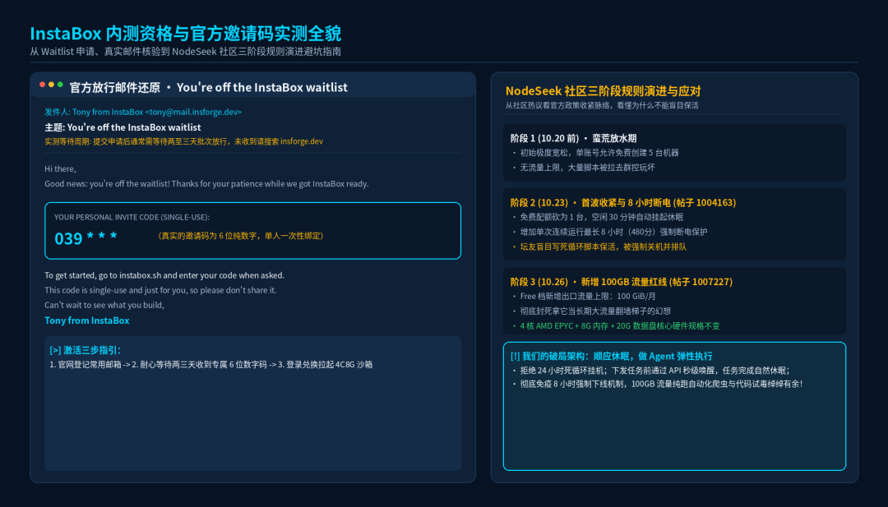
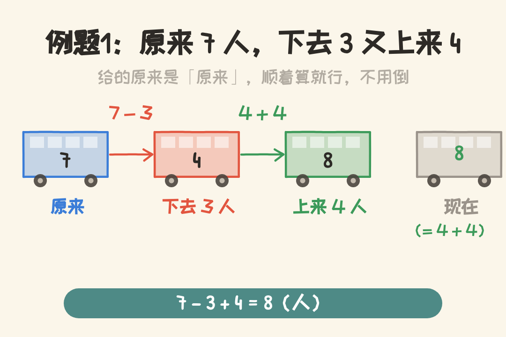
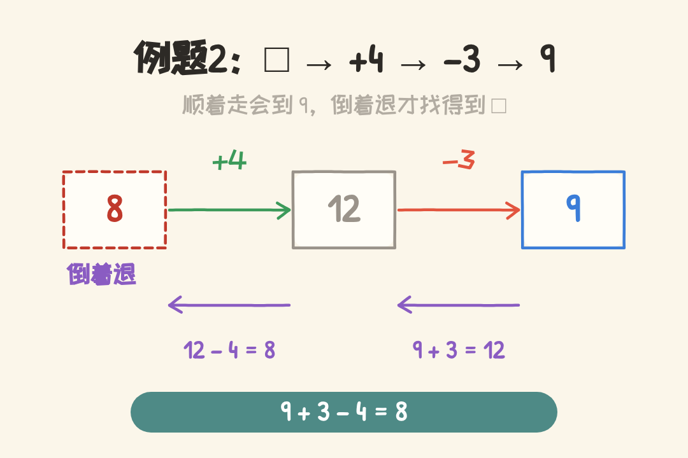

# 免费领4核8G云端电脑！专为AI智能体打造的宝藏沙箱实测
> 💡 备注属性未写入，可能是备注属性名称或者类型被修改了，建议将字段类型设置为 rich_text，可以在小程序-操作-修改文章数据库页面进行调整
> 💡 原文链接:[https://mp.weixin.qq.com/s?__biz=MjM5MzMwNTEyMA==&mid=2448450818&idx=1&sn=95c80b3ada5727b7a51ac40d857b9ff1&chksm=b36d267113b0dba5d7d3d2f83a8ff2ceb7bfc210766be3791cb98d8dcca259f4905ee9cf2928#rd](https://mp.weixin.qq.com/s?__biz=MjM5MzMwNTEyMA%3D%3D&mid=2448450818&idx=1&sn=95c80b3ada5727b7a51ac40d857b9ff1&chksm=b36d267113b0dba5d7d3d2f83a8ff2ceb7bfc210766be3791cb98d8dcca259f4905ee9cf2928#rd)

> 专为AI智能体打造的云端计算机InstaBox迎来规则调整！本文结合社区真实变迁与实测踩坑，手把手带你申请邀请码、配置API，并深度拆解4核8G沙箱的5大实战玩法与避坑指南。
> 
今天给各位搞 AI、玩 Agent 的开发者朋友们带来一个热乎的一手重磅福利！
一直以来，我们在本地或轻量云服务器上跑 AI 智能体（Agent）时，总会遇到几个令人抓狂的死穴：**本地内存不够**，跑个无头浏览器动不动就爆卡；**没有原生海外环境**，抓取境外数据各种被封；**不敢随便跑未知开源代码**，生怕脚本带毒把主战场给污染了。
最近海外专门面向 AI 智能体推出了一套全新的云端计算机基础设施 —— **InstaBox**。
官方这次开启了内测资格申请，只要拿到邀请码登录，**直接免费赠送一台 4 核 AMD EPYC + 8GB 内存 + 20GB 独立数据盘 + AWS 俄勒冈原生机房 IP 的全功能 Linux 云端微虚拟机！**
不过这两天国内各大主机论坛（尤其是 NodeSeek）上，关于 InstaBox 的讨论可谓炸开了锅，官方在短短几天内连续调整了三波免费政策。
我刚刚已经肉身全流程实测跑通：从提交 Waitlist、**实测等待两三天拿到官方发放的真实纯数字邀请码**、登录控制台、生成 API Key，到在本地写出自动化管控脚本驱动它干活，全部一次性通关。
这篇文章我不谈虚的概念，不仅手把手带你把这台高配云端计算机领到手，更结合社区最新规则变动与避坑要点，把它的 API 架构与我摸索出的 **5 大实战玩法** 全盘托出，带大家彻底把这台免费利器玩透！

---
### 01 / 规则剧变始末：官方在 NodeSeek 引爆的三波调整
在带大家动手前，必须先同步一下这台机器在社区里最真实的发展脉络。
很多朋友只看到别人晒图 4C8G 就两眼一抹黑冲进去，结果踩了一脚泥。实际上，随着海量极客涌入，InstaBox 官方在短短一周内经历了极其戏剧性的三阶段规则演进：
**1. 第一阶段（10 月 20 日前·蛮荒放水期）：**
早期注册极其宽松，官方不仅没有严格用量限制，甚至允许单个账号同时免费创建 **5 台机器**，几乎被当成了免费群控玩具。
**2. 第二阶段（10 月 23 日·首波收紧与 8 小时断电）：**
社区热帖爆发，大量用户涌入甚至动用脚本暴力保活。官方随即将免费配额缩减为 **1 台机器**（早期账号开的额外机器将在 12 月统一收回）；
同时引入了极其严格的防护机制：**空闲 30 分钟自动休眠（Auto-suspend）**，且**单次连续运行最长 8 小时（480分钟）强制关机 10 分钟**。很多想拿它当 24 小时挂机 VPS 的朋友直呼“折腾碎了”。
**3. 第三阶段（10 月 26 日最新变动·新增 100GB 流量红线）：**
就在前两天，官方 pricing 页面再次更新：Free 档明确新增了 **100 GiB/月 出口流量上限**（此前为模糊的无用量限制）。

**那么问题来了：既然官方一刀接一刀收紧，它到底还值不值得领？**
**答案是：如果你想拿它当传统 VPS 挂梯子看视频，它确实很折腾；但如果你拿它当 AI Agent 的「专属外挂云电脑」，它依然香得离谱！**
因为它的核心底座丝毫没缩水：**4 核 AMD EPYC + 8GB 内存 + 20GB 数据盘 + 原生 AWS 纯净 IP** 完全保留！正规的智能体任务本来就是“按需唤醒、干完休眠”，根本不需要 24 小时死循环挂机，100GB 流量用来抓网页和调接口更是绰绰有余。
---
### 02 / 手把手申请指南：真实邀请码与两三天的等待实测
很多网帖把邀请码写得神乎其神，甚至把格式都编错了。这里把我肉身实测收到的**真实官方邮件全细节**全盘托出：
#### 第一步：访问官网并提交内测申请
1. 打开官方入口：`https://instabox.sh`；
2. 点击页面中央醒目的 **Get Started** 或 **Request Access**；
3. 填写你的基本信息（主要是日常使用的邮箱，强烈推荐使用 Gmail / Outlook 等常用海外邮箱）；
4. 提交后系统会提示你已加入等待名单（Waitlist）。
#### 第二步：耐心等待官方发放邀请码（实测邮件原貌）
**🚨 敲黑板！真实官方邮件全貌与搜索指引：**
提交后千万别以为半小时就能收到。**我实测从提交申请到官方发放邀请码，整整等待了「两到三天」时间！**
官方采取人工审核与批次放行，当你通过后，会收到一封来自 **InstaBox 官方团队**（发件域名包含 `mail.insforge.dev`）的正式邮件，主题为：
`You're off the InstaBox waitlist`
邮件正文非常极客且简练：
```
Hi there,
Good news: you're off the waitlist! Thanks for your patience while we got InstaBox ready for you.
Your personal invite code is: 123456 (示例脱敏)
To get started, go to instabox.sh and enter your code when asked.
This code is single-use and just for you, so please don't share it.
Can't wait to see what you build,
InstaBox Team
```
**大家注意：真实的邀请码是「6 位纯数字」（比如 ****`123456`**** 这类形式），而且是一次性专属绑定的！**
如果你等了两三天还没看到邮件，强烈建议在邮箱里直接搜索发件人域名 `insforge.dev` 或关键词 `InstaBox`，大概率是掉进垃圾箱或推广邮件分类里了。
#### 第三步：兑换邀请码并登录 Dashboard
1. 收到邮件后，访问控制台入口：`https://dashboard.instabox.sh/`；
2. 选择使用 Google 账号、GitHub 账号或邮箱验证码一键登录；
3. 首次进入时，在弹出的激活窗口中输入你收到的 6 位专属数字邀请码；
4. 验证通过后，系统会在后台全自动为你拉起一台名为 `agent-browser-xxxx` 的专属实例，几秒钟后状态变为绿色的 `Running`！
---
### 03 / API 密钥生成与本地接入：开箱配置实操
拿到机器后，如果我们只在网页点点鼠标，那就太浪费它的潜力了。InstaBox 最性感的地方在于它提供了极其强大的 RESTful API，能让任何本地脚本或 AI Agent 把它当成外挂机械臂来调用。
#### 1. 提取核心凭据
在控制台左侧导航栏点击 **API Keys** ➔ **Create Key**：
系统会生成一串以 `ibk_` 开头的 API 密钥（形如 `ibk_your_api_key_here`）；
点击实例详情页，记下你的机器 ID（形如 `m_your_machine_id_here`）。
#### 2. 本地安全配置环境（.env）
为了保障凭据安全，强烈建议将密钥放在环境变量或 `.env` 配置文件中，避免在代码中硬编码明文：
```
# InstaBox 专属配置
INSTABOX_API_KEY=ibk_your_api_key_here
INSTABOX_MACHINE_ID=m_your_machine_id_here
```
#### 3. 三位一体极简调用核心（底层代码）
InstaBox 的 API 设计非常优雅，调用命令执行（`exec`）时只需通过标准 HTTP 请求即可完成：

```
import os
import requests
import time

BASE_URL = "https://api.instabox.sh"
API_KEY = os.environ.get("INSTABOX_API_KEY")
MACHINE_ID = os.environ.get("INSTABOX_MACHINE_ID")

headers = {
    "X-API-Key": API_KEY,
    "Content-Type": "application/json",
    "Idempotency-Key": f"req_{int(time.time()*1000)}"
}

def exec_cmd(command: str):
    url = f"{BASE_URL}/v1/machines/{MACHINE_ID}/exec"
    payload = {"cmd": command}
    resp = requests.post(url, headers=headers, json=payload, timeout=60)
    return resp.json()
```
#### 4. 终端真实实机回显（Log/Output）
我们在本地终端执行一行命令探活，看看云端返回的真实数据：
```
>>> exec_cmd("uname -a && free -h && curl -s https://ipinfo.io/json")

[+] 终端实测回显：
Linux instabox-agent-browser-demo 6.18.54-instabox #1 SMP x86_64
Mem:           7.8Gi total,   452Mi used,   7.2Gi free,   7.3Gi available
{
  "ip": "35.88.xx.xx",
  "org": "AS16509 Amazon.com, Inc.",
  "region": "Oregon",
  "country": "US"
}
```
看到这份输出，心里的石头彻底落地了：真实 7.8GB 内存可用，真实的 AWS 俄勒冈纯净机房 IP！
接下来，我们进入最硬核的部分 —— 这台机器怎么在日常开发中发挥最大价值？
---
### 04 / 玩法逐条击穿：5 大高价值场景全盘托出

#### 玩法一：免中转海外「隐身有头浏览器 & 实时桌面推流」
**痛点场景**：平时想让 AI 自动抓取海外学术论文、X/Twitter 动态或受风控保护的前沿社区时，本地中转经常断流，而且 Chromium 动辄吃掉 2~3GB 内存，本地电脑直接卡死。
**运作逻辑**：直接让 InstaBox 跑无头浏览器自动化，它出厂自带的 AWS 纯净 IP 可以平滑访问绝大部分受限资源；更神奇的是，它支持 **WebRTC 桌面实时推流**，你可以生成一个网页链接，像看直播一样看到 Agent 在云端操作浏览器的每一步！
**底层实现**：
```
# 启动云端桌面服务并获取实时推流
def start_desktop():
    url = f"{BASE_URL}/v1/machines/{MACHINE_ID}/desktop"
    requests.post(url, headers=headers, json={"action": "start"})
    print(f"远程桌面推流直达: https://dashboard.instabox.sh/machines/{MACHINE_ID}")
```
**终端实测**：
浏览器抓取脚本下发后，本地终端完全不耗内存，打开控制台网页，实时看着云端窗口自动填表、截屏并解析数据，体验极其丝滑。
#### 玩法二：高危代码与开源项目的「绝缘试毒靶场」
**痛点场景**：在 GitHub 上看到一个心仪的开源 Agent、逆向工具或者第三方分析脚本，想跑一下试试看，但又担心脚本里夹带恶意指令、木马或者强行修改本地环境变量。
**运作逻辑**：把 InstaBox 当作「一次性防爆手套」。因为沙箱自带 Docker 和独立根系统，所有未知代码全部外移到云端执行；最关键的是，**我们在折腾前先打一个系统快照（Snapshot），万一玩坏了一键还原**！
**底层实现**：
```
# 一键为当前系统打上黄金基线快照
def create_snapshot(snap_name: str):
    url = f"{BASE_URL}/v1/machines/{MACHINE_ID}/snapshots"
    payload = {
        "name": snap_name,
        "description": "Clean baseline before testing untrusted code",
        "rootOnly": False
    }
    resp = requests.post(url, headers=headers, json=payload)
    return resp.json()
```
**终端实测**：
```
=== 创建快照 baseline-clean === HTTP 202
{
  "id": "sn_your_snapshot_id_here",
  "status": "ready",
  "rootSizeBytes": 17179869184,
  "dataSizeBytes": 21474836480
}
```
有了这个快照托底，哪怕在沙箱里执行 `rm -rf /`，也能在几秒钟内秒级满血复活！
#### 玩法三：临时 Web / Demo 工具的「一键公网 HTTPS 暴露」
**痛点场景**：写好了一个 Streamlit 数据分析看板、Gradio 模型体验页面或者 FastAPI 接口，想立刻发给朋友或同事体验，但手头没有备案域名，也没有配内网穿透反代工具。
**运作逻辑**：InstaBox 内置了 **Public Ports 机制**。只要你的服务在沙箱内监听了某个端口（如 8080），调一次 API，系统就会立刻为你生成一个全球可访问的官方 HTTPS 独立二级域名！
**底层实现**：
```
# 一键为本地端口映射公网 HTTPS 域名
def expose_public_port(port: int, name: str = "demo-api"):
    url = f"{BASE_URL}/v1/machines/{MACHINE_ID}/ports"
    payload = {"port": port, "name": name}
    resp = requests.post(url, headers=headers, json=payload)
    return resp.json()
```
**终端实测**：
```
=== 开放端口 8080 ===
{
  "port": 8080,
  "publicUrl": "https://p8080-m-your-id.instabox.sh",
  "status": "active"
}
```
把这个链接复制发出去，全世界任何人都能直接通过 HTTPS 访问你刚才跑起来的 Demo，用完调一次 DELETE 接口直接关停，干净利落。
#### 玩法四：重型依赖与源码编译「给本地电脑减负」
**痛点场景**：平时编译个 C++ 扩展、构建个几 GB 的大型 Docker 镜像，或者安装带复杂编译链的 Python 科学计算库时，笔记本风扇起飞、CPU 占满 100%、整台电脑卡死动弹不得。
**运作逻辑**：利用 InstaBox 的 4 核 AMD EPYC 算力与 8GB 大内存，在云端直接拉取代码、并行编译（`make -j4`），构建完毕后把生成的二进制成品拉回本地。
**底层实操**：
通过封装的上传/下载指令，两行搞定：
```
# 1. 在云端执行多核并行构建
instabox_ctl.py exec "cd /data && git clone  && make -j4"
# 2. 将编译好的成品包无损下载回本地
instabox_ctl.py download /data/app/bin/release.tar.gz ./release.tar.gz
```
#### 玩法五：海外大文件与大模型「高速离线中转站」
**痛点场景**：经常需要下载 HuggingFace 或 GitHub 上的超大开源数据集或模型权重，国内网络慢如蜗牛还频繁中断。
**运作逻辑**：InstaBox 直连 AWS 千兆骨干网，海外下载速度可达数百兆每秒；把任务挂在沙箱里离线下载到 `/data` 数据盘，打包压缩后再通过对象存储或直链高速拉回。
---
### 05 / 适合谁与不适合谁：客观边界与架构代价
结合最新的 100GB 流量与 8 小时断电规则，我们要清醒看待它的适用边界：
#### 适合谁（极力推荐上车）：
1. **AI Agent / 自动化开发者**：需要独立环境跑 Playwright、Puppeteer 或 Browser-Use 等无头浏览器任务，不想挤占本地内存；
2. **开源代码探索者 / 极客**：经常从 GitHub 克隆未知项目试毒，需要一个随时可以炸毁重置的独立沙箱；
3. **轻量 Demo 演示者**：需要快速将本地运行的 WebUI 或数据分析结果一键生成公网 HTTPS 分享给他人；
4. **受制于国内出海网络的开发者**：需要原生 AWS 纯净 IP 进行合规数据抓取与大文件高速拉取。
#### 不适合谁（请勿强行套用）：
1. **商业级 24 小时高并发在线生产服务**：虽然能跑 Web 服务，但免费版有 30 分钟无操作自动休眠和 8 小时强制下线限制，绝不适合当作商业生产服务器；
2. **重型 GPU 深度学习训练**：这台机器主打 CPU、内存与网络（4 核 EPYC + 8G RAM），没有独立 NVIDIA GPU 显卡，无法跑百亿参数大模型的本地微调与训练；
3. **高带宽流媒体翻墙梯子**：最新规则已死绑 100GB/月 出口流量上限，拿它刷高清视频没几天就会耗干。
---
### 06 / 极客避坑指南：必须掌握的 3 个运行潜规则
为了让大家长期爽用、绝不翻车，我把实测摸清的 3 个关键潜规则整理给大家：
**1. 30 分钟休眠与 8 小时断电的正确对抗姿势：**
很多坛友喜欢写死循环脚本强行保活，结果不仅会被 8 小时规则强制关机 10 分钟，开机还可能遭遇排队；
**最优解法**：顺应它的休眠机制！不要盲目常驻保活，而是编写**“下发任务前调 `/wake` 自动唤醒 ➔ 执行完任由其 30 分钟后自然休眠”**的弹性工作流。这样既不触发 8 小时连续运行截断，又能把 100GB 流量百分之百留给核心业务。
**2. 数据一定要写在 `/data` 目录：**
机器自带 20GB 的独立数据盘，专门挂载在 `/data`。根目录（`/`）下的文件属于临时镜像层，如果哪天系统模板更新或重置，根目录可能会刷新，但 **`/data` 目录是独立持久化的**！所有重要代码和产物务必存放在 `/data`。
**3. API 请求务必带上 `Idempotency-Key`：**
在调用创建快照、挂起、启动等核心写入接口时，InstaBox 要求 Header 必须包含 `Idempotency-Key`（幂等性识别码，形如毫秒时间戳），否则会报 400 错误。
---
### 07 / 总结与思考：AI 时代的算力分工
在传统软件时代，我们习惯于在自己的电脑上塞满各种开发环境；但在 AI Agent 时代，大模型驱动的智能体正在频繁执行动态网页浏览、开源代码验证、自动化测试与实时数据管道。
**最合理的极客工作流，绝不是把脏活累活全压在本地电脑上，而是：**
>      
> **“本地保留唯一的大脑与决策核心，把高风险、高负载、需要纯净海外网络的任务，全部委托给云端的绝缘沙箱。”
> **   
> 
虽然官方加了 100GB 流量和 8 小时单次运行的紧箍咒，但只要姿势正确，它依然是当下最强、最具极客生产力的免费 AI 专属计算机。
还没提交申请的朋友，建议尽早去 `https://instabox.sh` 提交邮箱排队，耐心等上两三天，锁定这台 4C8G 的云端工作机！
>      
> 「每天帮你踩一个 AI 的坑，省下一小时。」
>    
> 
你在本地跑智能体时最常遇到什么限制？想拿这台云端沙箱跑什么任务？欢迎在评论区一起交流探讨！
