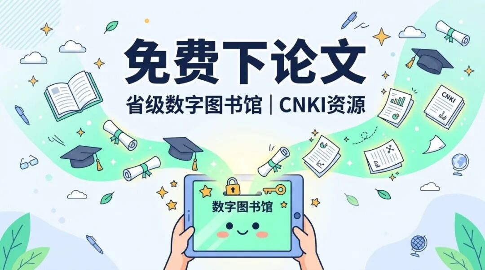

# 免费：各省数字图书馆太香，知网论文免费下
> 💡 备注属性未写入，可能是备注属性名称或者类型被修改了，建议将字段类型设置为 rich_text，可以在小程序-操作-修改文章数据库页面进行调整
> 💡 原文链接:[https://mp.weixin.qq.com/s?__biz=Mzg3NTI1MjUwMA==&mid=2247491271&idx=1&sn=397c1792832db6816da79defc7259f53&chksm=cf79bdeb5c8653590570ac9db3a4406f21ec04cd0afd57d20c30c024a020e260df1d32670054#rd](https://mp.weixin.qq.com/s?__biz=Mzg3NTI1MjUwMA%3D%3D&mid=2247491271&idx=1&sn=397c1792832db6816da79defc7259f53&chksm=cf79bdeb5c8653590570ac9db3a4406f21ec04cd0afd57d20c30c024a020e260df1d32670054#rd)

这次介绍的是各省数字图书馆的线上白嫖玩法，以浙江图书馆为例。
用途就是一句话：期刊论文免费下载，包括你最头疼的知网、万方、维普。
全免费。只要你支付宝芝麻信用分达标，不用交押金，不用跑一趟杭州，手机点两下就能注册。直接拿它的读者证，在家免费上知网。
说白了，这就相当于官方给你开了一个高权限的知识库年卡。
以前我们要查点资料、写个报告，或者辅导孩子搞点深度阅读，一打开知网，看到那个按页收费的提示框，是不是感觉约等于被人打劫？
花了钱心疼，不花钱连摘要都看不全。
明明是公开的学术资源，硬是搞得像加密的商业机密。你去充值吧，感觉像是个大冤种；不充值吧，论文写不下去，工作交不了差。
很多人不知道，其实国家和地方早就把这些资源买下来了。
各个省级数字图书馆，就是官方给大家发福利的渠道。
各省数字图书馆里藏着的宝藏，远远超过你的想象。
但问题是，很多人以为必须拿着身份证，跑到当地的实体图书馆去排队办卡。
朋友们，都什么年代了，互联网早就把墙拆了。
浙江图书馆简直是数字时代的活菩萨。它和支付宝搞了深度合作，直接在线免押金办理。
这意味着，不管你人在哪，只要手机里有支付宝，你就能拥有一个浙江图书馆的读者证。
拿着这个证，你就能长驱直入，合法合规地洗劫它的数字资源。
不仅是期刊论文免费下载，还有大量的电子书下载、外文数据库、有声书资源。
去某些平台买所谓的知网账号，说难听点就是花钱买罪受。那些号大多也是利用机构漏洞薅出来的，用不了多久就容易失效。更逗的是，很多人花钱买的账号，其实就是某些人利用各地免费渠道注册倒卖的。你花钱买了个别人白嫖来的东西，这信息差被别人赚麻了。
这信息差，如果你自己掌握了，简直就是明晃晃的省钱。
## 【适合谁】
写论文的大学生和研究生
。别再花钱去网上买什么乱七八糟的账号了，也别到处求人帮你下文献了。把这篇文章转给你们寝室还在为开题报告头秃的兄弟姐妹，他们会叫你爸爸的。
需要查行业报告的打工人
。老板让你做行业调研，你上哪找数据？去各大机构花高价买研报？用这个方法，万方的行业数据免费看。
家里有中小学生的家长
。孩子要参加科创比赛，或者需要查点科普文献，直接用这个方法。正规权威的数据源，比搜索引擎里搜出来的那些营销号靠谱一万倍。家里有中小学生的赶紧留着，迟早用得上。
## 【免费到什么程度】
彻彻底底的免费。
只要你的芝麻信用分够（一般是550分及以上），连押金都不用交。
你不需要支付办卡费，不需要支付年费。
为什么要搞芝麻信用授权？因为数字版权很贵，图书馆是花了公家的钱集中采购的。如果完全不设门槛，分分钟被恶意爬虫把整个数据库搬空。加一个实名和信用的门槛，既能保证真正需要的人能用到，又能防止资源被滥用。
只要注册成功，登录浙江图书馆官网，找到“数字资源”或者“中国知网”的入口，点进去。
你就像一个尊贵的学术带佬，看到喜欢的论文文献，直接点文献下载，PDF格式随便存。
没有扣费提示，没有充值二维码，也没有次数限制（只要你不搞恶意高并发下载）。
这就是各省数字图书馆最硬核的福利。别人靠信息差收你的钱，官方用信息差给你发钱。
## 【怎么用（具体操作步骤）】
别觉得复杂，其实比点外卖还简单。
第一步：在支付宝注册读者证
打开你手机里的支付宝，在顶部搜索栏输入“浙江图书馆”。
找到浙江图书馆的官方生活号或者小程序，点进去。
在底部菜单栏找到“服务”或者“服务大厅”，点击“新用户注册”。
按照系统提示，授权芝麻信用，填入基本信息。
搞定！系统会给你生成一个读者证号，并让你设置一个登录密码。一定要记住这个密码。
第二步：去官网进行期刊论文免费下载
最好用电脑操作，打开浏览器，搜索“浙江图书馆官网”（www.zjlib.cn）。
在官网右上角找到“登录”，输入你刚注册的读者证号和密码。（也可以直接选扫码登录，用支付宝扫一扫，更省事）。
登录进去后，找到“数字资源”板块。
在里面寻找你需要的数据库，比如“中国知网（CNKI）”、“万方数据”、“维普”。
点击链接跳过去，你就会发现，你已经是通过机构认证的合法用户了。
接着就是愉快的文献下载时间，想查什么论文直接搜。
## 【注意事项】
并发限制：这毕竟是公共的免费资源。如果赶上毕业季，知网入口可能人太多挤不进去，提示并发数达到上限。这时候别急，等一会儿再试，或者换万方、维普查查，反正都是免费的。
下载格式：知网上的论文，最好直接选 PDF 格式下载，通用性最强。如果你选了 CAJ 格式，你还得单独下一个 CAJ 阅读器，属于给自己找不痛快。
其他省份替代：除了浙江，各省数字图书馆（比如上海图书馆、广东省立中山图书馆等）也都有类似的线上注册通道和丰富的数字资源。如果浙江图书馆的口子挤不进，你可以去试试自己所在省份的官方数字资源平台，一样的香。
入口汇总：
- 注册入口：支付宝搜索“浙江图书馆”
- 网页端使用入口：浙江图书馆官网（www.zjlib.cn） -> 找“数字资源”
如果你觉得这篇内容有用，别忘了点个赞和在看，顺便星标一下我们，这样每次有新的硬核免费资源，你就能第一时间看到，不会错过官方发福利的车。
关注这个号，每周至少 3 个免费工具/资源实测，不花一分钱。下次找免费资源不用再到处搜了，我帮你整理好了。
精彩历史文章：
[免费电子书下载：日本国立国会图书馆35万册古籍免费在线读](https://mp.weixin.qq.com/s?__biz=Mzg3NTI1MjUwMA%3D%3D&mid=2247489831&idx=1&sn=284f32c29b192a4f014dfb67e78eb7dd&scene=21#wechat_redirect)
[免费电子书下载：英国最古老图书馆把镇馆手稿全部搬上网，随便看](https://mp.weixin.qq.com/s?__biz=Mzg3NTI1MjUwMA%3D%3D&mid=2247489828&idx=1&sn=877def7388a4e234b0e844e655970056&scene=21#wechat_redirect)
[免费阅读器软件：本地电子书能朗读、记笔记，还能在多设备接着读](https://mp.weixin.qq.com/s?__biz=Mzg3NTI1MjUwMA%3D%3D&mid=2247489819&idx=1&sn=eccbe04baaecda9101fc5e4a1397f13a&scene=21#wechat_redirect)
[留学不等于烧钱：欧洲一批公立大学免学费，还不用学小语种](https://mp.weixin.qq.com/s?__biz=Mzg3NTI1MjUwMA%3D%3D&mid=2247488523&idx=1&sn=0a29141efaf75d2006b2ce161636f852&scene=21#wechat_redirect)
[语言学习最大的误区：一个加拿大老头会20种语言，靠的不是天赋](https://mp.weixin.qq.com/s?__biz=Mzg3NTI1MjUwMA%3D%3D&mid=2247488421&idx=1&sn=e4dc1030aa00d73713af7496786f4ca3&scene=21#wechat_redirect)
[买编程书花了五千块才发现，GitHub上这11万星的中文书单全是免费的](https://mp.weixin.qq.com/s?__biz=Mzg3NTI1MjUwMA%3D%3D&mid=2247487919&idx=1&sn=f08b16f48b92c328d4d364518f70624d&scene=21#wechat_redirect)
[这些免费学习App，我让孩子用了一个学期，效果比报班好](https://mp.weixin.qq.com/s?__biz=Mzg3NTI1MjUwMA%3D%3D&mid=2247487735&idx=1&sn=5991e2641c98e9de8eafc81baf376c61&scene=21#wechat_redirect)
[一年花两千买书？这6个免费渠道让你一分不花读到饱](https://mp.weixin.qq.com/s?__biz=Mzg3NTI1MjUwMA%3D%3D&mid=2247487799&idx=1&sn=8c46a4d4db80e917253ce2f2f23787cb&scene=21#wechat_redirect)
[ebook-treasure-chest：一个藏了上万本电子书的「海盗宝箱」](https://mp.weixin.qq.com/s?__biz=Mzg3NTI1MjUwMA%3D%3D&mid=2247487578&idx=1&sn=950079c173204ea10f7afbef52485508&scene=21#wechat_redirect)
[B站上有个叫3Blue1Brown的数学频道，每期视频几百万播放，动画讲数学一绝](https://mp.weixin.qq.com/s?__biz=Mzg3NTI1MjUwMA%3D%3D&mid=2247487542&idx=1&sn=9e1e3b6dcdac2fc4792b2d6d982218c8&scene=21#wechat_redirect)
[教育资源的“数字宇宙”：这个4.2K星的项目藏着超100T的学习资料](https://mp.weixin.qq.com/s?__biz=Mzg3NTI1MjUwMA%3D%3D&mid=2247487157&idx=1&sn=65bd1d882c82afe7f492e081231c0b40&scene=21#wechat_redirect)
[国家中小学智慧平台的“万能钥匙”：这个5.8K星的开源工具让你一次下载所有教材PDF](https://mp.weixin.qq.com/s?__biz=Mzg3NTI1MjUwMA%3D%3D&mid=2247487148&idx=1&sn=5d4729976dc057196a8c86f01c2623ad&scene=21#wechat_redirect)
[免费教科书一键下载：这个开源工具帮你把国家智慧教育平台的课本存到本地](https://mp.weixin.qq.com/s?__biz=Mzg3NTI1MjUwMA%3D%3D&mid=2247487098&idx=1&sn=852f3e0c49a4b22671c32d2026d508e9&scene=21#wechat_redirect)
[75K星！这个开源项目把中国中小学教材全部装进了GitHub](https://mp.weixin.qq.com/s?__biz=Mzg3NTI1MjUwMA%3D%3D&mid=2247487161&idx=1&sn=34aa13332d7757789584e3757b38e386&scene=21#wechat_redirect)
[12.7万星！这个GitHub项目把全网免费服务扒了个底朝天，每年至少省5000块](https://mp.weixin.qq.com/s?__biz=Mzg3NTI1MjUwMA%3D%3D&mid=2247485291&idx=1&sn=534e537c34e00448b3468440b244f6a1&scene=21#wechat_redirect)
[免费教材下载：一个开源工具把电子课本课件音频一次搬回家](https://mp.weixin.qq.com/s?__biz=Mzg3NTI1MjUwMA%3D%3D&mid=2247488774&idx=1&sn=294fd493af4ebedd813bdb22078019c9&scene=21#wechat_redirect)
[免费下载：电子课本下载，英语教材配套听力也能找到](https://mp.weixin.qq.com/s?__biz=Mzg3NTI1MjUwMA%3D%3D&mid=2247488674&idx=1&sn=c629557cbed894769535fd2e9193f8b9&scene=21#wechat_redirect)
[把故事变成动画视频，这个开源工具免费，自媒体人看完直接收藏](https://mp.weixin.qq.com/s?__biz=Mzg3NTI1MjUwMA%3D%3D&mid=2247488560&idx=1&sn=8cc062a999b1a95b5a8c37f9f1d3eba9&scene=21#wechat_redirect)

## 摘要

（待补充）

## 我的笔记

（待补充）
