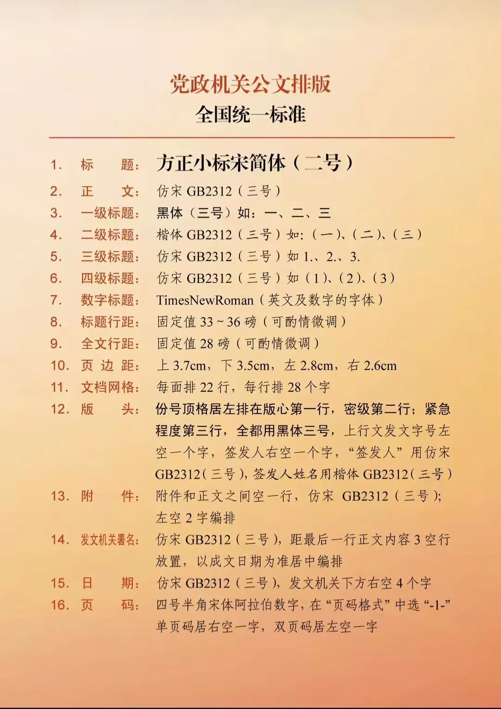

# 党政机关公文排版，全国统一标准。
> 💡 备注属性未写入，可能是备注属性名称或者类型被修改了，建议将字段类型设置为 rich_text，可以在小程序-操作-修改文章数据库页面进行调整
> 💡 原文链接:[https://mp.weixin.qq.com/s?__biz=MzYzNjI4NTY2NA==&mid=2247484609&idx=1&sn=498f7613035df9016b1d1b272be1177b&chksm=f115474f2776f0b69c86c666dff87f4f705d45d6a73c1c593d3c6d44e95a285d366c96eb57c0#rd](https://mp.weixin.qq.com/s?__biz=MzYzNjI4NTY2NA%3D%3D&mid=2247484609&idx=1&sn=498f7613035df9016b1d1b272be1177b&chksm=f115474f2776f0b69c86c666dff87f4f705d45d6a73c1c593d3c6d44e95a285d366c96eb57c0#rd)

需要注意的点：
1. 成文日期必须用阿拉伯数字，不能写“二〇二六年”。
2. 层级顺序严格：一、→（一）→1.→（1），不要混用。
3. 份号、密级、紧急程度只在涉密/紧急公文才需要，普通公文不用。
4. 不要随便用微软雅黑、宋体替代仿宋GB2312，公文要求专用仿宋。
5. 国标只规定版面行数字数，不硬性规定磅值，28磅是办公室通用实操值。
