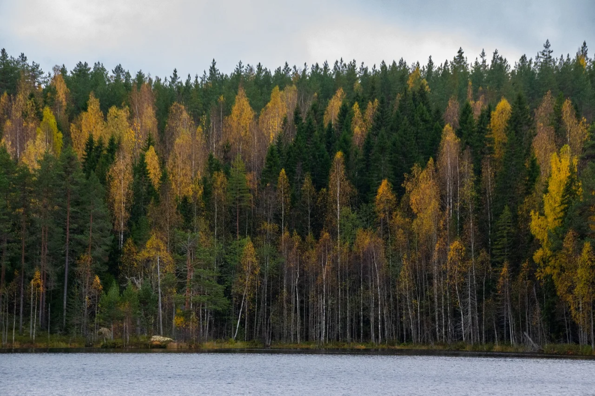
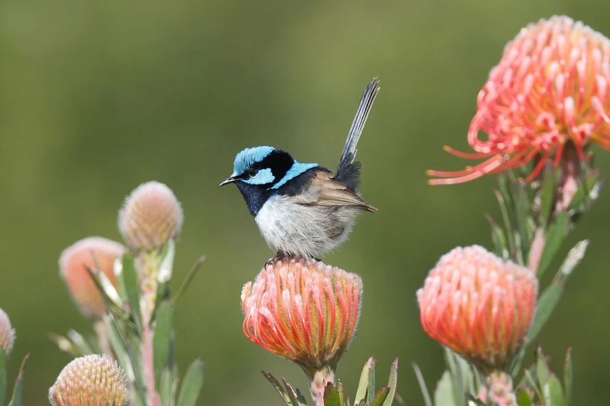

# 全国优秀短篇小说奖二十五大巅峰之作
> 💡 备注属性未写入，可能是备注属性名称或者类型被修改了，建议将字段类型设置为 rich_text，可以在小程序-操作-修改文章数据库页面进行调整
> 💡 原文链接:[https://mp.weixin.qq.com/s?__biz=MzIzNzIyMjA0NQ==&mid=2650641780&idx=1&sn=8fa9dc7131d5f66532898e68fbce5600&chksm=f121b870584199be72a820b709f3635d3edb5d9a0ed11f50a5fcadd901c97c694a32133c562a#rd](https://mp.weixin.qq.com/s?__biz=MzIzNzIyMjA0NQ%3D%3D&mid=2650641780&idx=1&sn=8fa9dc7131d5f66532898e68fbce5600&chksm=f121b870584199be72a820b709f3635d3edb5d9a0ed11f50a5fcadd901c97c694a32133c562a#rd)
1978到1988年的文学黄金十年期间，据统计全国优秀短篇小说奖共评出188篇获奖作品。评奖不是单纯专家评选，而是读者推荐+专家评议共同产生的结果：第二届收到超过25万张推荐表，第三届收到近40万份读者推荐。那十年里，短篇小说几乎就是全民阅读的中心。
**1.《班主任》｜刘心武**
伤痕文学开山之作。一个中学班主任面对被文革扭曲的学生，喊出“救救被坑害了的孩子”。当年这篇小说打开了一扇门：文学终于敢写真实的伤口。
**2.《乔厂长上任记》｜蒋子龙**
改革文学代表作。乔光朴上任后整顿工厂、打破惰性，像一记重锤砸在旧体制上。当年这篇小说以27000多票获得1979年度第一名，读者推荐或许是因为太想看到敢做事的人站出来。
**3.《伤痕》｜卢新华**
“伤痕文学”之名即由此而来。女儿因母亲被诬为叛徒而被迫决裂，九年后母亲平反，却已阴阳两隔。小说把政治运动撕裂家庭伦理的痛写得极为直接。
**4.《陈奂生上城》｜高晓声**
陈奂生卖油绳、买帽子、住招待所，通过一件件小事写尽农民面对新时代时的拘谨、自尊和茫然，是中国当代文学里最立得住的农民形象之一。
**5.《大淖记事》｜汪曾祺**
汪曾祺在全国优秀短篇小说奖中的代表作。小说写大淖边的风俗、人情和一对年轻人的爱情，语言清淡却有滋味，证明文学也可以从民间生活里长出美。
**6.《西线轶事》｜徐怀中**
新时期军事文学换代之作。小说通过描写对越自卫反击战，却不刻意渲染英雄口号，而是把战争里的普通人写得有血有肉。在1981年评选中以9万多票位居第一。
**7.《被爱情遗忘的角落》｜张弦**
写一个农村女孩在贫困、愚昧和旧观念夹缝里的爱情悲剧。这不只是爱情故事，更写出了女性如何从活着走向“想要活得像个人”。
**8.《灵与肉》｜张贤亮**
小说写知识分子在苦难中仍守住尊严、爱情和土地，后来被改编成电影《牧马人》。

**9.《春之声》｜王蒙**
王蒙借鉴意识流手法的代表作。主人公春节前夕坐在闷罐子车里，从列车声响、人群议论、城乡变化中联想到历史与现实。
**10.《乡场上》｜何士光**
乡场上的一场小纠纷，写出了农民冯幺爸从畏缩到挺直腰杆的变化。小说被《红旗》杂志破例转载，是农村改革初期农民精神觉醒的体现。
**11.《雕花烟斗》｜冯骥才**
冯骥才的成名作。描述的是一位画家在特殊年代里的遭遇，也写出了人与人之间微小却珍贵的善意。
**12.《我的遥远的清平湾》｜史铁生**
小说描写陕北插队岁月，写黄土高原、牛群、老乡和青春，有深沉的怀念和悲悯。很多读者再读史铁生，这篇短篇基本是必读的。
**13.《哦，香雪》｜铁凝**
写火车只停一分钟的台儿沟，写少女香雪对山外世界的向往。文字里没有大事件，却写出了改革开放初期普通人心里那种微弱却明亮的变化。
**14.《那山那人那狗》｜彭见明**
写一对父子邮差在山路上送信，写责任、沉默的父爱和乡村生活，被改编成同名电影。
**15.《西望茅草地》｜韩少功**
写知青农场场长张种田和一群知青的命运。体现了理想主义的热，也有蛮干、压抑和幻灭的冷，是知青文学里很有分量的一篇。
**16.《李顺大造屋》｜高晓声**
贫苦农民李顺大三起两落，几十年只想造三间屋，却一次次被时代风浪打回原点。它比《陈奂生上城》更沉重，也更像一部微型农民苦难史。
**17.《这是一片神奇的土地》｜梁晓声**
北大荒知青文学代表作之一。写荒原、青春、理想和牺牲，带着浓烈的英雄气，也带着无法回避的伤痛。

**18.《卖蟹》｜王润滋**
滨海蟹市上，一个精明的“过滤嘴”、一个朴实的“旱烟袋”和一个泼辣的卖蟹小姑娘，构成一幅鲜活市井图。《卖蟹》曾入选中学语文教材，是很多人的阅读记忆。
**19.《小镇上的将军》｜陈世旭**
一位老将军被下放到小镇，却仍保持尊严、良知和担当。这篇小说和《班主任》《伤痕》一起，常被看作伤痕文学的重要作品。
**20.《狗日的粮食》｜刘恒**
描写粮食如何支配人的命运，写饥饿、尊严和人性底线。
**21.《合坟》｜李锐**
写黄土高原上的死亡、宗族和土地。小说不像伤痕文学那样直接控诉，却把历史压在人身上的重量写得更深。
**22.《减去十岁》｜谌容**
忽然传来每人减去十岁的消息，不同年龄的人立刻重新盘算人生。小说写的是荒诞，照见的却是人对年龄、机会和命运的焦虑。
**23.《围墙》｜陆文夫**
一所单位要修围墙，围绕怎么修展开激烈的争论，把官僚主义、形式主义和人情世故写得入木三分。
**24.《塔铺》｜刘震云**
写高考复习班里一群年轻人的命运，对经历过考试改变命运的人特别有共鸣。
**25.《年关六赋》｜阿成**
写东北小城年关前后的人情世故，阿成的文字有烟火气，也有沧桑感，把普通人的体面、窘迫和善良写得自然。
这25篇放在一起，正好能看见1978—1988年中国文学的一条主线：**从控诉伤痕，到呼唤改革；从写英雄和苦难，到写普通人、小人物和日常生活，真实地记录了一个时代如何重新学会说话。**

## 摘要

（待补充）

## 我的笔记

（待补充）
