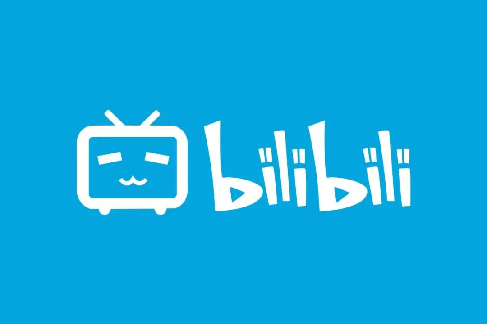
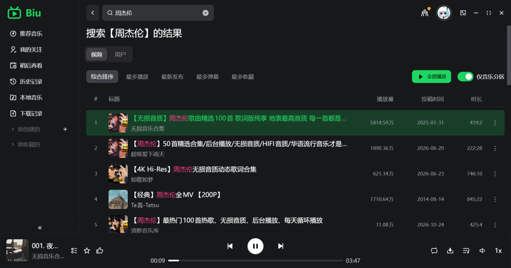
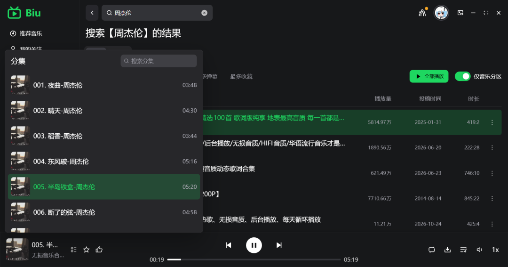
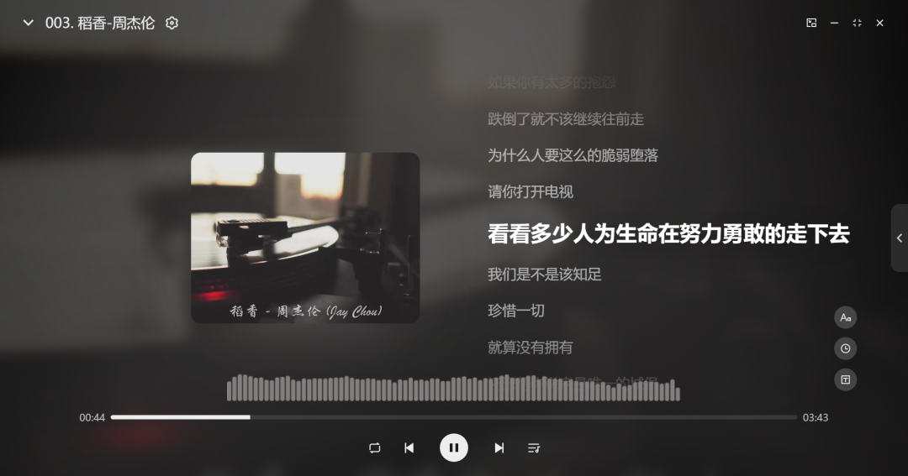
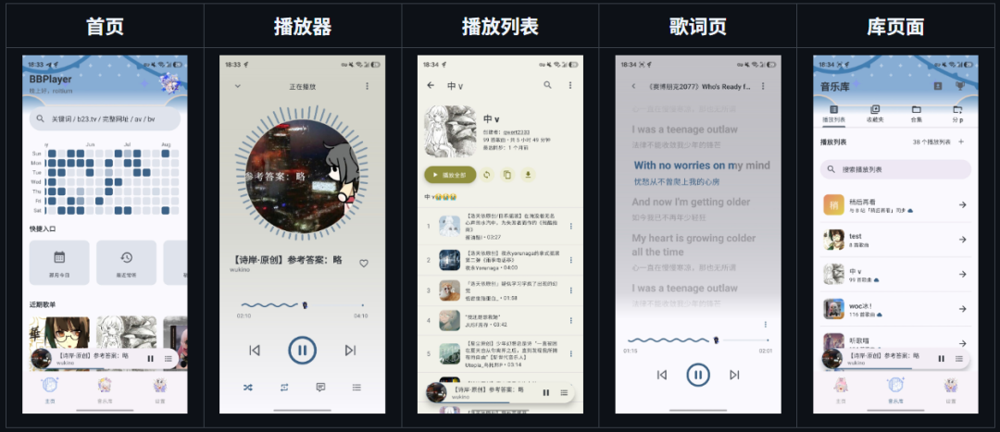

# 全网最全？听歌自由！Bilibili 音乐播放器，开源无广告！
> 💡 备注属性未写入，可能是备注属性名称或者类型被修改了，建议将字段类型设置为 rich_text，可以在小程序-操作-修改文章数据库页面进行调整
> 💡 原文链接:[https://mp.weixin.qq.com/s?__biz=MzU5NzYxMzM5MQ==&mid=2247485283&idx=1&sn=52673220558ae700a0dc6428d83d4108&chksm=fff1f87e62101a0455c32dad5addd37cc02d947cac20be3cf5fc49ce9e1804929bc271fa7c1a#rd](https://mp.weixin.qq.com/s?__biz=MzU5NzYxMzM5MQ%3D%3D&mid=2247485283&idx=1&sn=52673220558ae700a0dc6428d83d4108&chksm=fff1f87e62101a0455c32dad5addd37cc02d947cac20be3cf5fc49ce9e1804929bc271fa7c1a#rd)

众所周知，
**Bilibili** 是一个视频平台。
但没想到，有大神将它改造成了音乐播放器？
甚至保留了原汁原味的 **「一键三连」**（暗示，有人懂吗？）
电脑版和手机版的开源地址我都放在文章结尾了，记得拿~

比对了一下各大平台，**B站的音乐几乎是全网最全的**，
**各种流行音乐、付费专辑、小众歌曲应有尽有，**
**而且统统免费听！**
原理其实也很简单：B站本身就沉淀了海量的高清音乐视频，播放器只需要单独提取音频流，直接播放就够了。
比如，我搜了一下周董的歌单，全是原声放送。
并且歌曲、MV视频都支持下载到本地哦！

App 也是非常简洁，干净无广告。

你甚至还能在播放器里顺手刷刷 B 站动态，
这谁能忍？

好玩的功能实在太多，
这里就不再过多展开了。
开源地址在这里了，朋友们可以下载试试。
**https://github.com/wood3n/biu**
安卓请看这个专属项目 **BBPlayer**，
App 设计真的好好看！
**并且支持直接迁移 QQ音乐、网易云音乐里的歌单。**

开源地址如下，
朋友们使用后记得回来评论下感受哦~
**https://github.com/bbplayer-app/BBPlayer**
我们下期见~
【闲言碎语】
昨天的帖子有朋友在评论区提到洛雪音源，
它确实是一个很好的项目，
我也整理了各种版本的开源项目，
但实操了下，需要自己去配置各种音源地址，
可能对部分想开箱即用的朋友来说不太方便，放到下回分享。
---
你的行知手记，记录更多隐藏技能。
