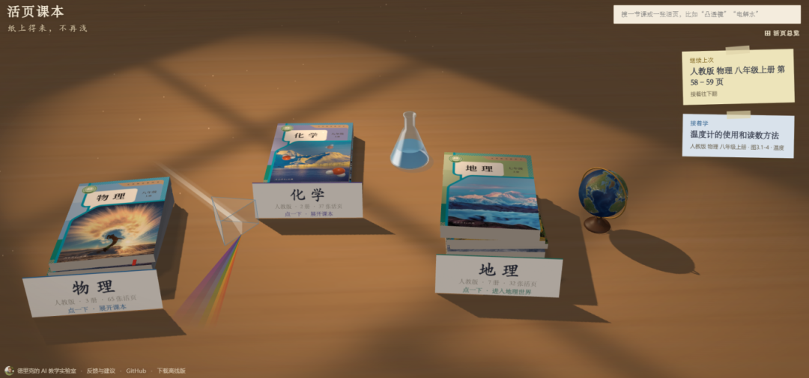
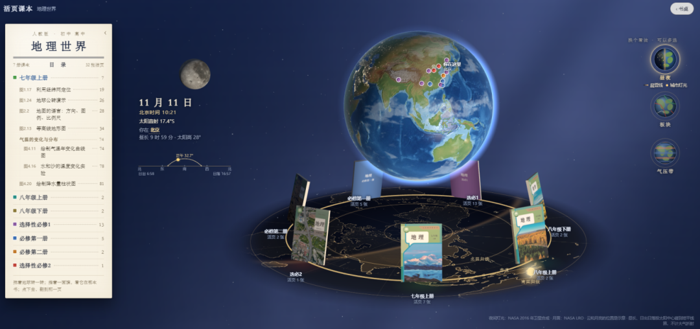
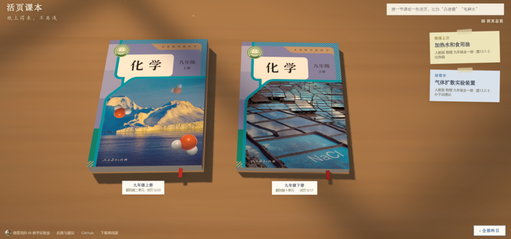
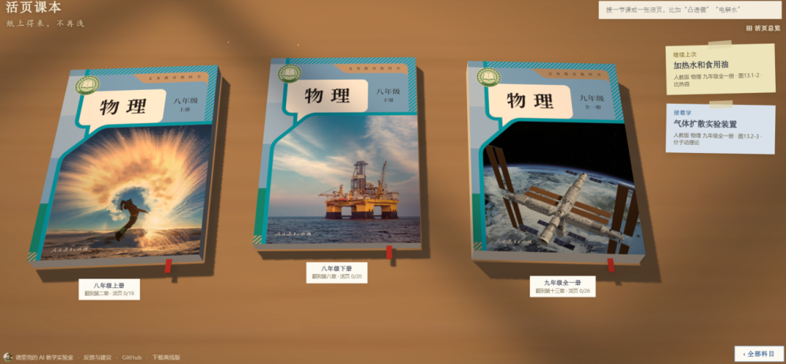

# 全网都在催的地理，终于上线！物理、化学、地理三科集齐，浏览器点开就能玩的 3D 交互式课本
> 💡 备注属性未写入，可能是备注属性名称或者类型被修改了，建议将字段类型设置为 rich_text，可以在小程序-操作-修改文章数据库页面进行调整
> 💡 原文链接:[https://mp.weixin.qq.com/s?__biz=MzYyNDAzMjAzNg==&mid=2247483812&idx=1&sn=8e60982514a582e78d6b43b6f5da2a1b&chksm=f1ce67fdbf61b51a8b4d6bb28434851cd5a76d3483a41d99fcd28bec87ba8b9020207533bc02#rd](https://mp.weixin.qq.com/s?__biz=MzYyNDAzMjAzNg%3D%3D&mid=2247483812&idx=1&sn=8e60982514a582e78d6b43b6f5da2a1b&chksm=f1ce67fdbf61b51a8b4d6bb28434851cd5a76d3483a41d99fcd28bec87ba8b9020207533bc02#rd)
点击上方【蓝色字体】关注，专门给你扒市面上那些冷门又炸裂的学习工具。
大家好，我是泡芙。
不知道你有没有发现一件特别扎心的事。
**有些知识，光靠看书根本啃不动。**
物理实验图，看着懂，一变装置就翻车；化学微观粒子，纸上画再多圆圈，也想象不出到底怎么拆分重组；最折磨人的当属地理，等高线、地球公转、板块运动，全是空间活，平面图根本撑不起来。
孩子背口诀、背示意图，忙半天，记住的只是一张画，不是背后的逻辑。
想要真的吃透，最好的方式就是动手。
但现实呢？家里凑不齐全套实验器材，课堂上也没法让每个孩子反复折腾、随便试错。
**直到我在 GitHub 挖到这个宝藏项目，直接把这件事干出圈了。**
现在物理、化学、地理，三科全部就位。
打开页面，桌面上就摊着这三本课本，随手点一本，直接开启一场立体探索。

**🌍 地理｜人教版 7 册，32 张交互活页**
再也不用盯着静态公转图硬脑补。

地球可以随便转，地轴可以调，拉动时间轴，昼夜、四季清清楚楚摆在眼前。板块碰撞、地形剖面，全部变成能拖拽的三维场景，那些以前靠想象的难点，现在一眼就能看懂。
**⚗️ 化学｜人教版 2 册，37 张交互活页**
不再死记原子示意图。

看不见的微观粒子直接可视化，物质怎么拆分、怎么重新组合，清清楚楚，把抽象的化学反应变得看得见。
**🔬 物理｜人教版 3 册，65 张交互活页**
还是那套超舒服的探究玩法。

杠杆、电路、光学实验全都能上手，先猜答案，再动手调试，一次次试错之后，规律自然就出来了，公式再也不是凭空背下来的字符。
**它最厉害的地方，不是堆一堆花哨动画**
它就是贴着人教版课本走的。书页就是熟悉的教材原文，翻到哪里，哪里的实验就"活过来"。
不用下载，不用装 APP，手机、平板、电脑，只要有浏览器就能进。还能记住你读到哪，什么时候有空，什么时候接着玩。
而且它不会直接甩给你标准答案。
**先猜，再动手，观察变化，最后自己总结。**
猜对了是惊喜，猜错了才是学习真正开始的时候。
**开源、非商用免费**
项目开源，非商用免费体验。会写代码的朋友，还能把源码拉下来，本地部署，按照自己想法改造。
在线体验地址：
https://livebook.derekfuture.club
源码仓库：
https://github.com/derekfuture/livebook
作者还在持续肝，后面还会继续上新学科。
当然要说实在的：它替代不了真实实验，也代替不了老师。
但它给了孩子一个零成本、随便折腾的地方。那些很难在课堂实现、家里又没有条件做的探究，在这里都可以反复玩。
如果你家孩子正在啃物理、化学或者地理，或者你是一直在找演示教具的老师，一定要点开试一试。
**来，评论区点名！下一门你最想要哪个？生物？还是别的？**
**觉得这个神器够顶，点赞转发，把它推给正在被理化地折磨的家长和老师，点个星标，以后挖到这类好东西，我第一时间喊你。**
**谢 谢 观 看**
**微信公众号｜👇点击关注👇**

