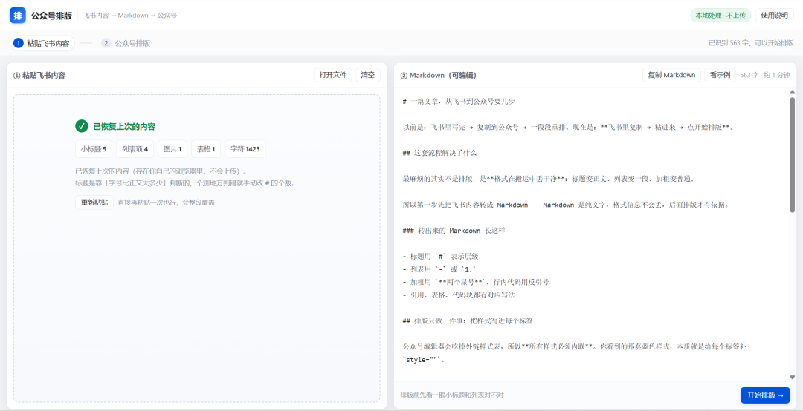
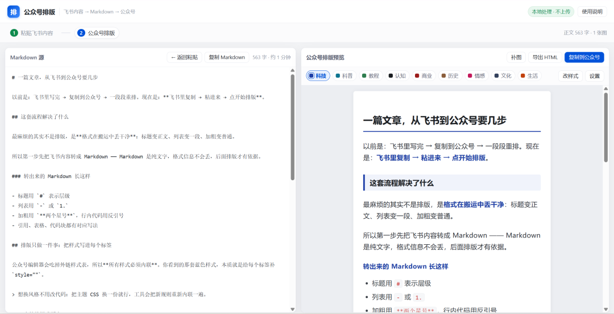
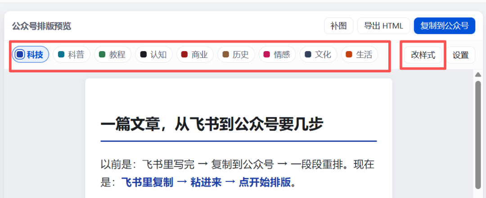
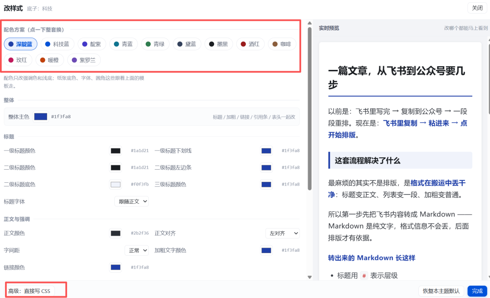

# 公众号排版工具 v1.0 已完成，免费开源
> 💡 备注属性未写入，可能是备注属性名称或者类型被修改了，建议将字段类型设置为 rich_text，可以在小程序-操作-修改文章数据库页面进行调整
> 💡 原文链接:[https://mp.weixin.qq.com/s?__biz=MzI1MjIxNTQ2OQ==&mid=2247501184&idx=1&sn=7ca885d7f8cbca77826cb4ed02aac1c2&chksm=e853b47a4be9ec7c8bdda9f02fe8dc712ed0b962abebeef9096c38d4869f62b98a6f38d7c240#rd](https://mp.weixin.qq.com/s?__biz=MzI1MjIxNTQ2OQ%3D%3D&mid=2247501184&idx=1&sn=7ca885d7f8cbca77826cb4ed02aac1c2&chksm=e853b47a4be9ec7c8bdda9f02fe8dc712ed0b962abebeef9096c38d4869f62b98a6f38d7c240#rd)

哈喽大家好！我是葉子。
前两天说的那个公众号排版工具，今天已经完成了，目前是 v1.0 版本。
我今天的文章就是用的这个工具完成排版的，也免费开源分享给大家来使用。
地址放文末了，进入即可用。
先说一下使用方法，非常简单，就两步。
**1、把飞书，或其他文档里面的内容，复制或者上传上来。**

然后排版工具会自动识别，并转化为 markdown 格式。
**2、点击右下角排版，就可以完成自动的默认排版**

是不是相当简单。也是我根据自己的使用习惯优化出来的。
我日常是在飞书里面写公众号文章的，之前的排版都是先过一下 markdown 编辑器转成 markdown 格式。
然后再针对 markdown 的格式去做排版。
现在只需要复制一次就可以完成了。
然后重点说一下模板这块。

我目前是内置了九种模板，分别对应不同的公众号文章类型。
我自己的话，是使用的科技风的这个默认模板。
大家用的话，可以根据自己的文章类型去进行选择。
选择完模板如果觉得颜色不太符合自己的需求，可以点击改样式去调整颜色。

改样式里面最上方是一键配色方案，预置了十二种颜色。
还是不满意的话，可以通过下面的调色块做细节调整。
要是想要更细致的，也懂代码的话，可以用左下方的高级功能，直接通过写 CSS 来排版。
大家还有其他需求的话，也可以直接留言，我继续迭代。
#### 使用地址：
1、单独的网页版：
https://huimengshiyezi.github.io/wechat-md/
2、我的个人站里面使用：
https://ai-huimengshiyezi.top/
大家用起来觉得不错的话，也可以多多分享给朋友使用。
感恩。
**以上。**
**今天的文章就到这里，如果觉得不错，请随手点赞、比心、转发三连吧。**
**如果想第一时间收到推送，也可以点击一下关注和星标⭐。**
**我们，明天见。**
 #AI绘梦师葉子 #AI视频 #AI短剧 #AI工具
