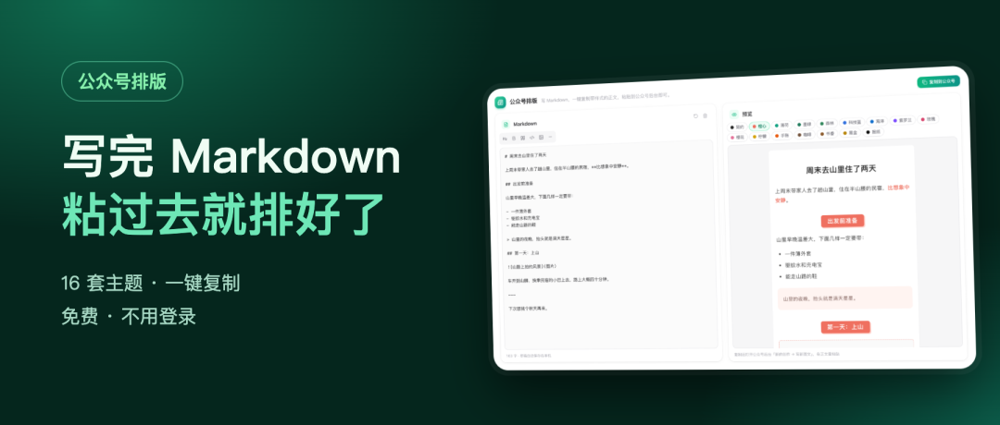
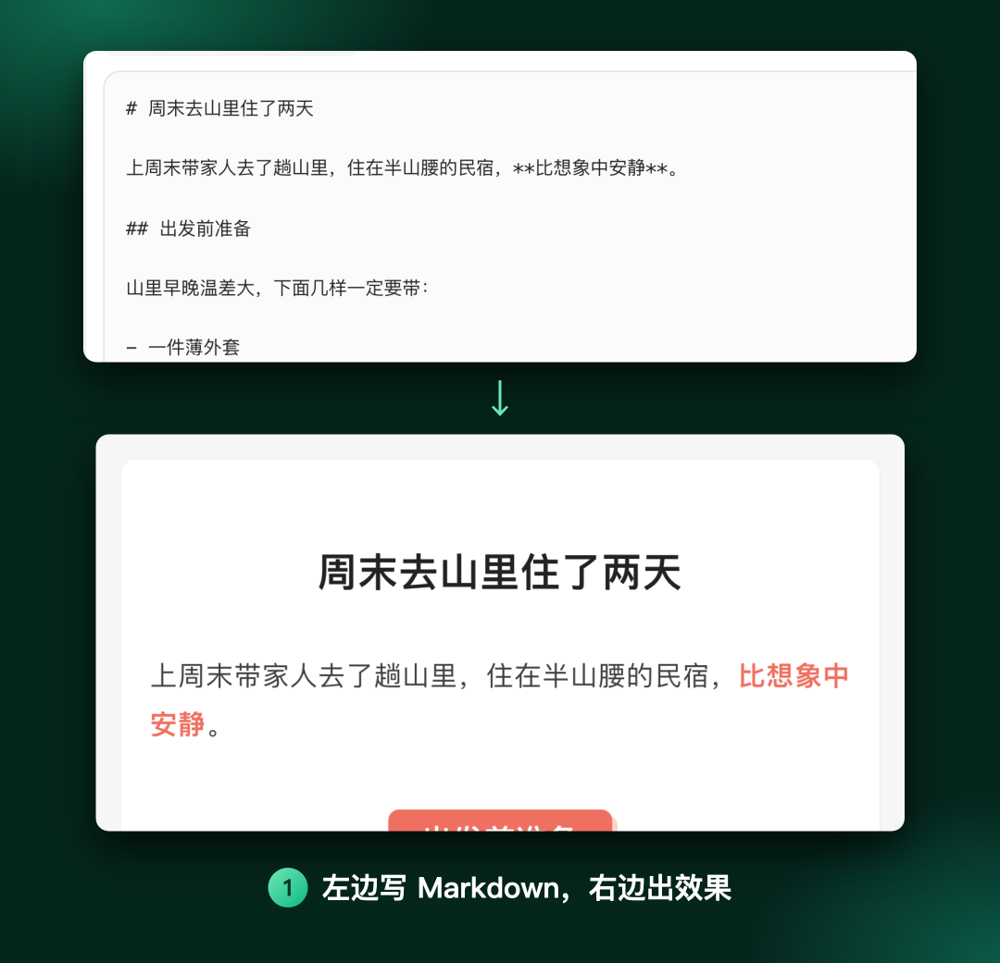
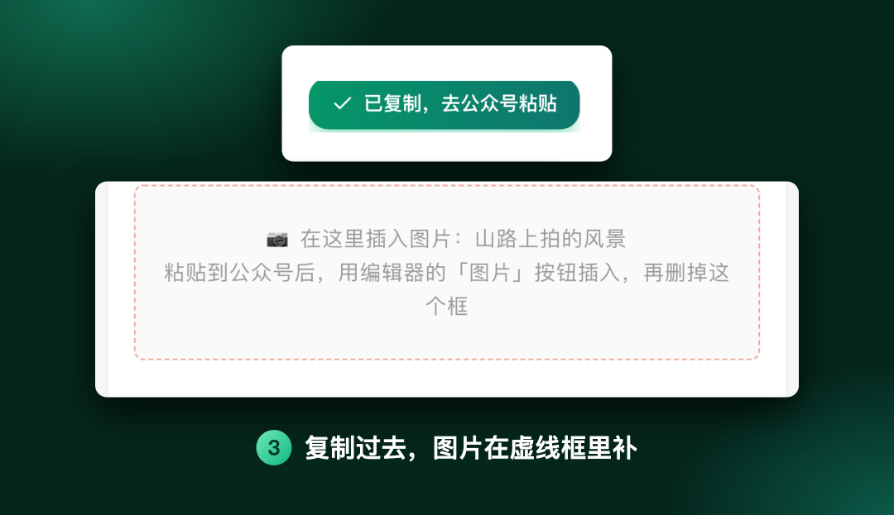

# 公众号排版，说穿了就是内联样式
> 💡 备注属性未写入，可能是备注属性名称或者类型被修改了，建议将字段类型设置为 rich_text，可以在小程序-操作-修改文章数据库页面进行调整
> 💡 原文链接:[https://mp.weixin.qq.com/s?__biz=MzUzOTczNDY2Nw==&mid=2247483946&idx=1&sn=9175941c8bc337f7642d049efa20931b&chksm=fb00b99aeef159055ab49a5e3c7fc21c5c160b99035d44250724a06ba06a91f1b333a5ab9e38#rd](https://mp.weixin.qq.com/s?__biz=MzUzOTczNDY2Nw%3D%3D&mid=2247483946&idx=1&sn=9175941c8bc337f7642d049efa20931b&chksm=fb00b99aeef159055ab49a5e3c7fc21c5c160b99035d44250724a06ba06a91f1b333a5ab9e38#rd)

~ 🌱 ~
前几期文章，用的是我老婆之前买的一个付费排版工具，一年两百多。
后来查了查才知道，这类排版说到底就是给文字加上内联样式。作为程序员，这个不难，我就借助 AI 自己写了一个「公众号排版」，明年这笔钱可以省了。
左边写 Markdown，右边直接出排好的效果，点一下复制，到公众号后台粘贴就行。希望能帮到同样有需要的人。
先说明一点：它只管文字的排版和样式，不支持直接放图片。存图片得买服务器空间，一个免费小破站的站长，钱包实在撑不起这种高级功能，图片就辛苦大家在公众号后台自己插了。
### 🌿 怎么用
电脑浏览器打开 https://www.zhaotab.com/typeset。
**第一步，左边写，右边看。**
左边是 Markdown 编辑区，可以直接写，也可以把写好的文章整篇粘进来。右边按手机屏幕的宽度实时预览，看到的就是读者在手机上看到的样子。
不熟 Markdown 也没关系，编辑区上面有一排按钮：小标题、加粗、引用、代码块、图片位置、分割线，点一下就插进去。
打开时左边有一篇示例，常用写法都在里面，照着改就行。

**第二步，挑一套主题。**
预览上方有 16 套主题：简约、橙心、薄荷、墨绿、森林、科技蓝、海洋、紫罗兰、玫瑰、樱花、柠檬、手账、咖啡、书香、黑金、报纸。
每套不只是换个颜色。小标题有胶囊、横幅、两侧短线、胶带等不同样式，引用块、分割线也各有装饰。同一篇文章点几下，挑个和自己号气质合适的。

**第三步，复制，去公众号粘贴。**
点右上角「复制到公众号」，按钮变成「已复制，去公众号粘贴」。打开公众号后台「新的创作 → 写新图文」，在正文里粘贴，样式原样保留。
文章里的图片，预览里会显示成一个虚线框，写着「在这里插入图片：xxx」。粘过去以后，用公众号编辑器自带的「图片」按钮在框的位置插图，再把框删掉。

### 🌿 还有几点
**写技术文章也能用。** 代码块自动高亮，粘过去缩进不乱，表格也能排。
**草稿自动保存在本机。** 关掉页面再打开还在，但换台电脑就看不到了，清理浏览器数据也会清掉。
**外链只保留文字。** 公众号正文里只有公众号文章的链接能点，其他网址粘过去只剩文字。
**建议用电脑。** 手机上也能写、能复制，但编辑和预览上下排列，没有电脑顺手。
~ 🌱 ~
顺便提一句，这个工具是我做的导航站「找Tab」里的一个小应用。站里还有 100 多个类似的小工具和小游戏，都免费、没广告、不用登录，都在应用商店里，感兴趣可以逛逛：www.zhaotab.com/store。
你平时排版最头疼的是哪一步？欢迎留言告诉我。下期见。

