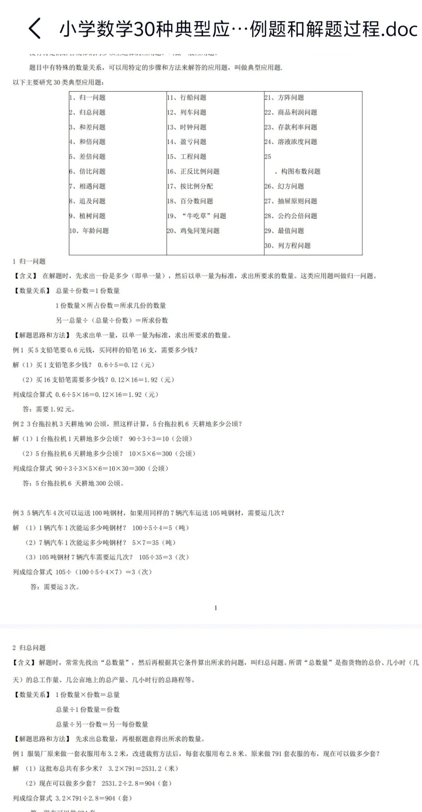
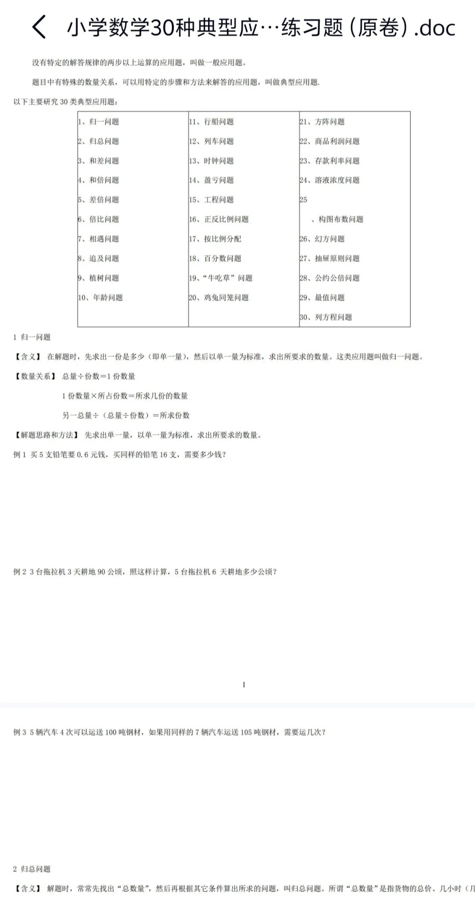

# 公益整理｜小学数学30类经典应用题，附解题思路直接打印
> 💡 备注属性未写入，可能是备注属性名称或者类型被修改了，建议将字段类型设置为 rich_text，可以在小程序-操作-修改文章数据库页面进行调整
> 💡 原文链接:[https://mp.weixin.qq.com/s?__biz=MzY0MDk5ODQ1OA==&mid=2247483679&idx=3&sn=e97d6a731414140ab429c379343b5e8a&chksm=f08d49502d35ef7395a82243f9ca971ef9cf5bee07c8a2aff8f58d6c6d496342bc6f4c6f4448#rd](https://mp.weixin.qq.com/s?__biz=MzY0MDk5ODQ1OA%3D%3D&mid=2247483679&idx=3&sn=e97d6a731414140ab429c379343b5e8a&chksm=f08d49502d35ef7395a82243f9ca971ef9cf5bee07c8a2aff8f58d6c6d496342bc6f4c6f4448#rd)

本文分享【小学数学30类经典应用题】
温馨提示：公益分享 电子版文件可免费获取
复制打开百度网盘链接(网盘转存之后下载才是无损文件)
下载链接:
https://pan.baidu.com/s/1BODNOfLPncsblNIas4kiPA?pwd=8ice 
获取教程：
①复制上面的链接到浏览器中打开转存就可获得无损版资源～
②手机有百度网盘的同学以及家长可以直接复制上面的链接打开百度网盘即可转存下载～
③点击文章结尾左下角阅读原文可直接下载所有资料~
部分资源展示

完整版资源获取方式见文章开头
点赞 关注 分享 感谢支持
欢迎评论区留言，你需要的资源本公众号会全力帮助你寻找~
版权申明：
本公众号所分享的各类资源均整理自网络，仅做免费公益分享，仅限个人学习、校内教学参考使用，严禁任何商业转载、售卖及商用盈利行为。所有内容著作权归原作者合法所有，若不慎涉及版权侵权，请您直接在公众号后台留言告知，我会第一时间核实处理，本公众号始终尊重并维护原创版权。
免费声明：
平台所有分享资料均可网盘免费下载，不收取任何资料费用。下载快慢取决于网盘自身服务器，开通网盘会员可提升下载速度；网盘会员充值属于网盘平台收费行为，与本公众号无任何关联，本公众号不会以任何形式收取资源服务费。
