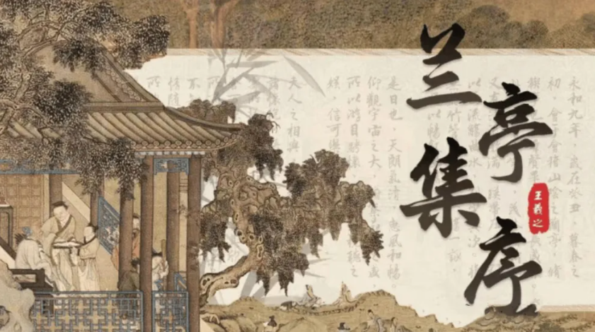
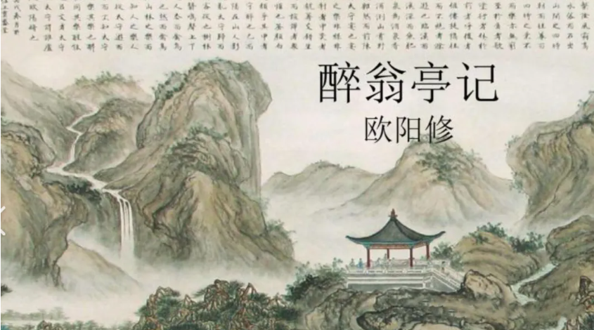

# 兰亭序讲生死、滕王阁讲始终、岳阳楼讲进退、醉翁亭讲同乐：四篇名作，撑起中国文人的精神天花板
> 💡 备注属性未写入，可能是备注属性名称或者类型被修改了，建议将字段类型设置为 rich_text，可以在小程序-操作-修改文章数据库页面进行调整
> 💡 原文链接:[https://mp.weixin.qq.com/s?__biz=MzAxNDQ0MTI0Nw==&mid=2247500917&idx=1&sn=cc6817401d7f963ecfd9f8851833d38b&chksm=9a70559e915d16d7a85e462b72a41c3a008e0fb8f475bb5791a9082d4db06f2dd819aface437#rd](https://mp.weixin.qq.com/s?__biz=MzAxNDQ0MTI0Nw%3D%3D&mid=2247500917&idx=1&sn=cc6817401d7f963ecfd9f8851833d38b&chksm=9a70559e915d16d7a85e462b72a41c3a008e0fb8f475bb5791a9082d4db06f2dd819aface437#rd)
兰亭序讲生死、滕王阁讲始终、岳阳楼讲进退、醉翁亭讲同乐：四篇千古名作，撑起了中国文人的精神天花板。

**1**

**《兰亭集序》**
东晋 · 王羲之
永和九年，岁在癸丑，暮春之初，会于会稽山阴之兰亭，修禊事也。群贤毕至，少长咸集。此地有崇山峻岭，茂林修竹，又有清流激湍，映带左右，引以为流觞曲水，列坐其次。虽无丝竹管弦之盛，一觞一咏，亦足以畅叙幽情。
是日也，天朗气清，惠风和畅。仰观宇宙之大，俯察品类之盛，所以游目骋怀，足以极视听之娱，信可乐也。
夫人之相与，俯仰一世。或取诸怀抱，悟言一室之内；或因寄所托，放浪形骸之外。虽趣舍万殊，静躁不同，当其欣于所遇，暂得于己，快然自足，不知老之将至；及其所之既倦，情随事迁，感慨系之矣。向之所欣，俯仰之间，已为陈迹，犹不能不以之兴怀，况修短随化，终期于尽！古人云：“死生亦大矣。”岂不痛哉！
每览昔人兴感之由，若合一契，未尝不临文嗟悼，不能喻之于怀。固知一死生为虚诞，齐彭殇为妄作。后之视今，亦犹今之视昔。悲夫！故列叙时人，录其所述，虽世殊事异，所以兴怀，其致一也。后之览者，亦将有感于斯文。

王羲之是东晋时期著名书法家，有“书圣”之称。曾任会稽内史、右军将军，世称“王右军”。其书法兼善隶、草、楷、行各体，风格平和自然，笔势委婉含蓄，遒美健秀，代表作《兰亭集序》被誉为“天下第一行书”。】
**写作背景**：东晋穆帝永和九年（公元353年）三月初三日，王羲之与谢安、孙绰等四十一位名士，在山阴兰亭举行修禊之礼。众人临流赋诗，各抒怀抱，得诗三十七首，汇编成**《兰亭集》**。

**2**

**《岳阳楼记》**
北宋 · 范仲淹
庆历四年春，滕子京谪守巴陵郡。越明年，政通人和，百废俱兴。乃重修岳阳楼，增其旧制，刻唐贤今人诗赋于其上。属予作文以记之。
予观夫巴陵胜状，在洞庭一湖。衔远山，吞长江，浩浩汤汤，横无际涯；朝晖夕阴，气象万千。此则岳阳楼之大观也，前人之述备矣。然则北通巫峡，南极潇湘，迁客骚人，多会于此，览物之情，得无异乎？
若夫霪雨霏霏，连月不开，阴风怒号，浊浪排空；日星隐曜，山岳潜形；商旅不行，樯倾楫摧；薄暮冥冥，虎啸猿啼。登斯楼也，则有去国怀乡，忧谗畏讥，满目萧然，感极而悲者矣。
至若春和景明，波澜不惊，上下天光，一碧万顷；沙鸥翔集，锦鳞游泳；岸芷汀兰，郁郁青青。而或长烟一空，皓月千里，浮光跃金，静影沉璧，渔歌互答，此乐何极！登斯楼也，则有心旷神怡，宠辱偕忘，把酒临风，其喜洋洋者矣。
嗟夫！予尝求古仁人之心，或异二者之为，何哉？不以物喜，不以己悲；居庙堂之高则忧其民；处江湖之远则忧其君。是进亦忧，退亦忧。然则何时而乐耶？其必曰“先天下之忧而忧，后天下之乐而乐”乎。噫！微斯人，吾谁与归？
时六年九月十五日。
范仲淹是北宋政治家、文学家。自幼丧父，家境贫寒，刻苦攻读。大中祥符八年（1015年）中进士，历任秘阁校理、右司谏、参知政事等职。庆历三年（1043年），范仲淹提出**“十事疏”**，主张改革弊政，主持**“庆历新政”，**仅一年多即告失败，被贬出朝。在文学上力主革新，散文、诗词均有很高成就，有**《范文正公集》**传世，谥号“文正”。
**写作背景：**这是范仲淹被贬郑州后，他的好友藤子京请他为重修的岳阳楼作记并附上《洞庭晚秋图》，范仲淹没去过岳阳楼，却因为一幅画写下了千古名篇。

**3**

**《滕王阁序》**
唐 · 王勃
豫章故郡，洪都新府。星分翼轸，地接衡庐。襟三江而带五湖，控蛮荆而引瓯越。物华天宝，龙光射牛斗之墟；人杰地灵，徐孺下陈蕃之榻。雄州雾列，俊采星驰。台隍枕夷夏之交，宾主尽东南之美。都督阎公之雅望，棨戟遥临；宇文新州之懿范，襜帷暂驻。十旬休假，胜友如云；千里逢迎，高朋满座。腾蛟起凤，孟学士之词宗；紫电青霜，王将军之武库。家君作宰，路出名区；童子何知，躬逢胜饯。
时维九月，序属三秋。潦水尽而寒潭清，烟光凝而暮山紫。俨骖騑于上路，访风景于崇阿。临帝子之长洲，得天人之旧馆。层峦耸翠，上出重霄；飞阁流丹，下临无地。鹤汀凫渚，穷岛屿之萦回；桂殿兰宫，即冈峦之体势。
披绣闼，俯雕甍，山原旷其盈视，川泽纡其骇瞩。闾阎扑地，钟鸣鼎食之家；舸舰弥津，青雀黄龙之轴。云销雨霁，彩彻区明。落霞与孤鹜齐飞，秋水共长天一色。渔舟唱晚，响穷彭蠡之滨；雁阵惊寒，声断衡阳之浦。
遥襟甫畅，逸兴遄飞。爽籁发而清风生，纤歌凝而白云遏。睢园绿竹，气凌彭泽之樽；邺水朱华，光照临川之笔。四美具，二难并。穷睇眄于中天，极娱游于暇日。天高地迥，觉宇宙之无穷；兴尽悲来，识盈虚之有数。望长安于日下，目吴会于云间。地势极而南溟深，天柱高而北辰远。关山难越，谁悲失路之人；萍水相逢，尽是他乡之客。怀帝阍而不见，奉宣室以何年？
嗟乎！时运不齐，命途多舛。冯唐易老，李广难封。屈贾谊于长沙，非无圣主；窜梁鸿于海曲，岂乏明时？所赖君子见机，达人知命。老当益壮，宁移白首之心？穷且益坚，不坠青云之志。酌贪泉而觉爽，处涸辙以犹欢。北海虽赊，扶摇可接；东隅已逝，桑榆非晚。孟尝高洁，空余报国之情；阮籍猖狂，岂效穷途之哭？
勃，三尺微命，一介书生。无路请缨，等终军之弱冠；有怀投笔，慕宗悫之长风。舍簪笏于百龄，奉晨昏于万里。非谢家之宝树，接孟氏之芳邻。他日趋庭，叨陪鲤对；今兹捧袂，喜托龙门。杨意不逢，抚凌云而自惜；钟期既遇，奏流水以何惭？
呜呼！胜地不常，盛筵难再；兰亭已矣，梓泽丘墟。临别赠言，幸承恩于伟饯；登高作赋，是所望于群公。敢竭鄙怀，恭疏短引；一言均赋，四韵俱成。请洒潘江，各倾陆海云尔。
王勃是**“初唐四杰”**之一。他**出身书香门第，为隋末著名学者王通之孙。**王勃早慧，六岁能文，九岁读《汉书》即能指出注疏之误。十四岁参加幽素科考试，授朝散郎，任沛王李贤府修撰。后因代沛王作《檄英王斗鸡文》触怒唐高宗，被逐出沛王府。此后漫游蜀中，曾任虢州参军，又因杀官奴犯死罪，遇赦得释，但其父王福峙受牵连被贬谪交趾。王勃前往探视，渡海时落水，惊悸而死，年仅二十七岁。
**写作背景**：是王勃前往交趾探视父亲途中路过南昌时所作。那时候大概14—16岁，正遇到洪州都督阎伯屿重修滕王阁毕，于阁上大宴宾客，饯别新任新州刺史宇文氏一行。《滕王阁序》是骈文写作的最高典范，通篇以四字句和六字句为主，对仗工整，音韵和谐，全文共七百七十三字。全文几乎是通篇用典，但用得自然而恰当，显得典雅而工巧。冯唐易老、李广难封、屈贾谊于长沙、窜梁鸿于海曲等典故的运用，既抒发了怀才不遇的愤懑，又使文章显得厚重典雅。

**4**

**《醉翁亭记》**
北宋 · 欧阳修
环滁皆山也。其西南诸峰，林壑尤美，望之蔚然而深秀者，琅琊也。山行六七里，渐闻水声潺潺，而泻出于两峰之间者，酿泉也。峰回路转，有亭翼然临于泉上者，醉翁亭也。作亭者谁？山之僧智仙也。名之者谁？太守自谓也。太守与客来饮于此，饮少辄醉，而年又最高，故自号曰醉翁也。醉翁之意不在酒，在乎山水之间也。山水之乐，得之心而寓之酒也。
若夫日出而林霏开，云归而岩穴暝，晦明变化者，山间之朝暮也。野芳发而幽香，佳木秀而繁阴，风霜高洁，水落而石出者，山间之四时也。朝而往，暮而归，四时之景不同，而乐亦无穷也。
至于负者歌于途，行者休于树，前者呼，后者应，伛偻提携，往来而不绝者，滁人游也。临溪而渔，溪深而鱼肥；酿泉为酒，泉香而酒洌；山肴野蔌，杂然而前陈者，太守宴也。宴酣之乐，非丝非竹，射者中，弈者胜，觥筹交错，起坐而喧哗者，众宾欢也。苍颜白发，颓然乎其间者，太守醉也。
已而夕阳在山，人影散乱，太守归而宾客从也。树林阴翳，鸣声上下，游人去而禽鸟乐也。然而禽鸟知山林之乐，而不知人之乐；人知从太守游而乐，而不知太守之乐其乐也。醉能同其乐，醒能述以文者，太守也。太守谓谁？庐陵欧阳修也。

欧阳修号**六一居士**，北宋政治家、文学家、史学家；与韩愈、柳宗元、王安石、苏洵、苏轼、苏辙、曾巩合称**“唐宋八大家”**，并与韩愈、柳宗元、苏轼合称“千古文章四大家”。谥号“文忠”，世称“欧阳文忠公”。
**写作背景：**那时欧阳修正任滁州太守，由于声援范仲淹等人遭贬斥，出知滁州；感觉贬就贬吧，正好自由了，滁州山水优美、丰物阜，还过上了安稳的生活。当时北宋王朝虽政治开明、风调雨顺，却不思进取、沉溺于现状，一些有识之士都被统统打击。《醉翁亭记》被称作是欧阳修代表作之一，是逆境中的一种精神上的自我超越，与民同乐、士大夫“达则兼济天下，穷则独善其身”精神写照。
这四篇都是中国古典散文最珍贵的精神遗产，四篇古文让人感触最深的从来不是华丽的辞藻，而是四个人在人生至暗时，命运给出的问题及答案，怎么活？**王羲之**在兰亭的曲水边看见了死，于是更用力地活；**王勃**在滕王阁的盛宴上看见了散，于是更倔强地进；**范仲淹**在洞庭湖的烟波里看见了退，于是把天下扛在肩上；**欧阳修**在滁州的山水间看见了苦，于是把苦酿成了与民同乐的酒。千年后我们在读这些句子，其实是在读此刻的自己，寻找光和灯；在人生的窄处，是这些文字一次又一次的拯救我们。
