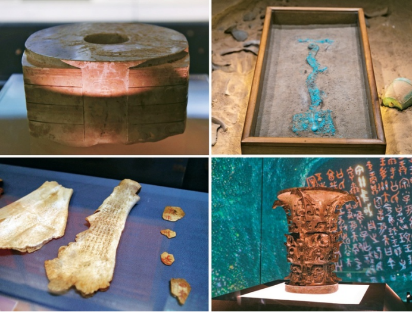
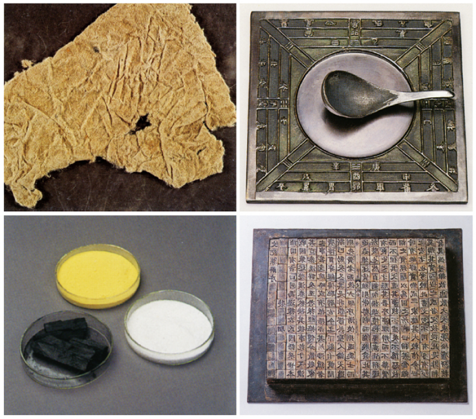
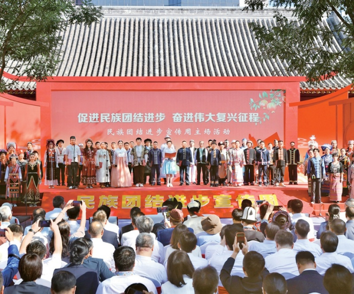
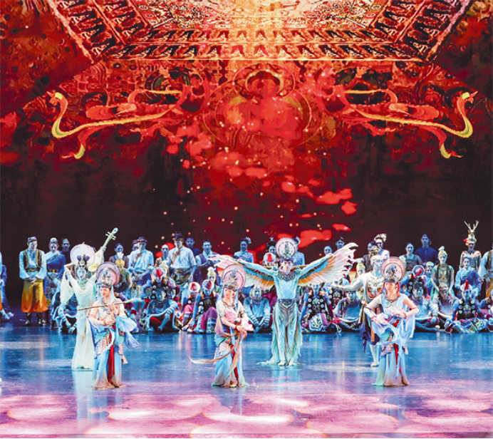
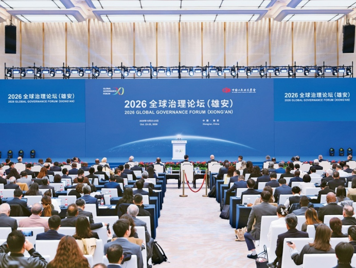

# 关于中华文明突出特性，《求是》连续刊发5篇研究成果
> 💡 备注属性未写入，可能是备注属性名称或者类型被修改了，建议将字段类型设置为 rich_text，可以在小程序-操作-修改文章数据库页面进行调整
> 💡 原文链接:[https://mp.weixin.qq.com/s?__biz=MjM5NjQ1NjY4MQ==&mid=2663691294&idx=1&sn=69f1fae5a9316cd81d563ce789724604&chksm=bc14b88075beee00b7d0d52dcc679871a41e99fde5e4a69c4d3ffe433e6382e1af333b99eb3b#rd](https://mp.weixin.qq.com/s?__biz=MjM5NjQ1NjY4MQ%3D%3D&mid=2663691294&idx=1&sn=69f1fae5a9316cd81d563ce789724604&chksm=bc14b88075beee00b7d0d52dcc679871a41e99fde5e4a69c4d3ffe433e6382e1af333b99eb3b#rd)
**编者按：**中国文化源远流长，中华文明博大精深。2023年6月2日，习近平总书记在文化传承发展座谈会上强调指出，中华优秀传统文化有很多重要元素，共同塑造出中华文明的突出特性，首次概括并系统阐释了中华文明的突出特性：连续性、创新性、统一性、包容性、和平性。
《求是》杂志从2026年第17期起，“文化中国”专栏连续刊发了5篇专家学者的相关研究成果。小编汇总推出，方便大家集中学习。
**（一）**
**钟金实：**[**深刻把握中华文明突出的连续性**](https://mp.weixin.qq.com/s?__biz=MjM5NjQ1NjY4MQ%3D%3D&mid=2663687272&idx=1&sn=f779f927e6d35ba64cbdc6431782b850&scene=21#wechat_redirect)
**【摘要】**
中华文明突出的连续性，并非仅指线性维度上的连绵不绝，还具有极为广泛而深刻的含义，是中华文明区别于其他许多古老文明的重要标志，与创新性、统一性、包容性、和平性相互贯通，共同塑造出中华文明突出特性的整体图景。深刻把握中华文明突出的连续性，把古代中国、现代中国、未来中国贯通起来，对坚定文化自信、走自己的路、实现伟大复兴，意义重大而深远。

**（二）**
**李卓：**[**深刻把握中华文明突出的创新性**](https://mp.weixin.qq.com/s?__biz=MjM5NjQ1NjY4MQ%3D%3D&mid=2663688032&idx=1&sn=9e6550e0d49f37c867e05e8297f95abf&scene=21#wechat_redirect)
**【摘要】**
中华文明突出的创新性，从根本上决定了中华民族守正不守旧、尊古不复古的进取精神，决定了中华民族不惧新挑战、勇于接受新事物的无畏品格。深刻把握中华文明突出的创新性，对于坚持“两个结合”，在新征程上大力推进理论创新、实践创新、制度创新、文化创新以及其他各方面创新，具有重要意义。

**（三）**
**李震：**[**深刻把握中华文明突出的统一性**](https://mp.weixin.qq.com/s?__biz=MjM5NjQ1NjY4MQ%3D%3D&mid=2663688706&idx=1&sn=78ef648407bd3f00451b5ba7ed3a3200&scene=21#wechat_redirect)
**【摘要】**
中华文明突出的统一性，不仅塑造了中华民族坚实的政治根基与牢固的精神内核，更与连续性、创新性、包容性、和平性共同造就了中华文明多元一体、可久可大的雄浑气象。深刻把握中华文明突出的统一性，对于铸牢中华民族共同体意识、推进祖国统一大业、实现中华民族伟大复兴，具有重要意义。

**（四）**
**钟哲：**[**深刻把握中华文明突出的包容性**](https://mp.weixin.qq.com/s?__biz=MjM5NjQ1NjY4MQ%3D%3D&mid=2663689436&idx=1&sn=abfc9be3f1ca87bb7bb7cfd6aa08b667&scene=21#wechat_redirect)
**【摘要】**
中华文明突出的包容性，从根本上决定了中华民族交往交流交融的历史取向，决定了中国各宗教信仰多元并存的和谐格局，决定了中华文化对世界文明兼收并蓄的开放胸怀。深刻把握中华文明突出的包容性，对增强文化自信、推动文明交流互鉴具有重要意义。

**（五）**
**钟哲：**[**深刻把握中华文明突出的和平性**](https://mp.weixin.qq.com/s?__biz=MjM5NjQ1NjY4MQ%3D%3D&mid=2663690743&idx=1&sn=a0509aabbc9d231304afa27737b10a40&scene=21#wechat_redirect)
**【摘要】**
深刻把握中华文明突出的和平性，才能从根本上理解为什么中国始终是世界和平的建设者、全球发展的贡献者、国际秩序的维护者，为什么中国坚持合作、不搞对抗，决不搞“党同伐异”的小圈子，不会把自己的价值观念与政治体制强加于人，这对于促进世界和平发展、推动人类文明交流互鉴，具有重要意义。

---
来源：求是网
责编：周昭成 许文嫣
策划：王雅雯 韩辰
视觉：江玥
审核：李达 林经纬

