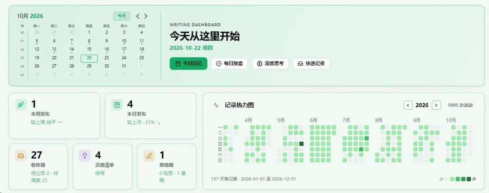

# 写作系统改到了11版，但内容我一字没写
> 💡 备注属性未写入，可能是备注属性名称或者类型被修改了，建议将字段类型设置为 rich_text，可以在小程序-操作-修改文章数据库页面进行调整
> 💡 原文链接:[https://mp.weixin.qq.com/s?__biz=Mzk1Nzc0NjU3OQ==&mid=2247484247&idx=1&sn=3e97a6f17dae2a02161bec8c89aa612d&chksm=c229782197a1171d1f647f4fc7510124f88004c9b71b7583c2c9301436d5237f1cfdfbcc8a25#rd](https://mp.weixin.qq.com/s?__biz=Mzk1Nzc0NjU3OQ%3D%3D&mid=2247484247&idx=1&sn=3e97a6f17dae2a02161bec8c89aa612d&chksm=c229782197a1171d1f647f4fc7510124f88004c9b71b7583c2c9301436d5237f1cfdfbcc8a25#rd)

10 月 21 日，晚上十一点四十。
我在“转构思”按钮上点了一下。小圈转了六秒，弹出来一行字：
“无法定位 Claudian 输入框。”
我盯着看了两秒，然后把这句话复制下来，发给了 AI。
那天我本来要写第 3 期建造日志。第 2 期发在 9 月 29 日，隔了 23 天。这 23 天，我写了四篇内容，收了二十多篇讲怎么写文章的东西，把写作系统从第 6 版改到第 11 版。
然后我坐回电脑前，打开草稿。
空的。
二十分钟后，按钮修好了。六条备用路径，全都通了。那天晚上我睡得很好。
我一直以为，那叫工作。
这 23 天我不是没写。国庆回家，和爸妈说了不到 100 句话，写了一篇。内容越垂直死得越快，写了一篇。三本日记改不了命，写了一篇。写作崩溃的真相，写了一篇。四篇，三篇讲内容，一篇讲家里。
没有一篇讲这 23 天我在干的事。
10 月 16 日，我往收件箱里搬了十几篇。学习齿轮、卡片笔记、双向钢人、互联网已死。加上之前收的，二十多篇，都在教我怎么做事。收的时候每一篇都有用。收完躺在收件箱里，很少再打开。
10 月 12 日到 18 日，工作台从 v0.6.2 改到 v0.11.1。扫描范围、属性选题、来源粒度、状态编码、时间戳。每天都有东西坏，每天都有东西修好。坏了能修，修完能测，测完全过。
三件事我都很忙。忙完以后，想写的那篇，还是空的。
修工具这段里，有一个 bug 值得记一笔。
它是我报的。给选题换编号之后，14 个文件开始打架：工作台认一个号，日记插件认另一个号。同一个文件，在两个程序眼里是两个人。
我照旧把现象说了一遍。它改完，再点，一条报错都没有。
我干了什么？我点了按钮，看了结果，把不对的地方说清楚。
一行代码没写。
有人会说，那不叫修，那叫使唤。
对。可使唤也要花时间。我花了 23 天使唤它，就是不肯花一个下午写那篇文章。
**我不是在解决问题。我是在给自己找一件能解决的事。**
那天晚上，工具改完，我打开草稿。
光标在闪。
我想了很久，这是不是只有我这样。后来发现不是。买了三十本书没拆封的，报了课看到第二节的，笔记软件换了四个的。他们都不懒。懒人不焦虑。他们很勤奋，勤奋地用在一件不会失败的事上。
更难看的是，我早就知道该写什么。9 月 10 日的复盘写着，工具资源类效率 24.1，全账号第一；建造日志 10.8，是内容类平均的六倍；我写得最用力的情绪结构类，0.83，全类型最低。建议是工具类提到 40%，个人叙事建造日志化。
六周过去，我发了九篇。工具资源类零篇，建造日志第二期之后没再动。
修工具，就是给“还没写”找一个体面的理由。
我最大的问题不是不知道写什么。我最大的问题是，我知道，而且写下来了，然后没做。
接下来的 23 天，三条规矩。
先输出，再输入。每天写 500 字，写完再看别人的文章。
先写，再修。工具能用就行，坏了记下来，周末统一修。
第 4 期只报三件事。写了什么，发了什么，没写什么。不报版本号。
**工具没有罪。有罪的是顺序。我把一件能立刻给我反馈的事，放在了一件真正重要的事前面。然后我告诉自己，我在打基础。**
你有没有一直在准备，却迟迟不动手的事情，评论区聊聊~
谢谢你看我的内容，我们下次再见💗~
