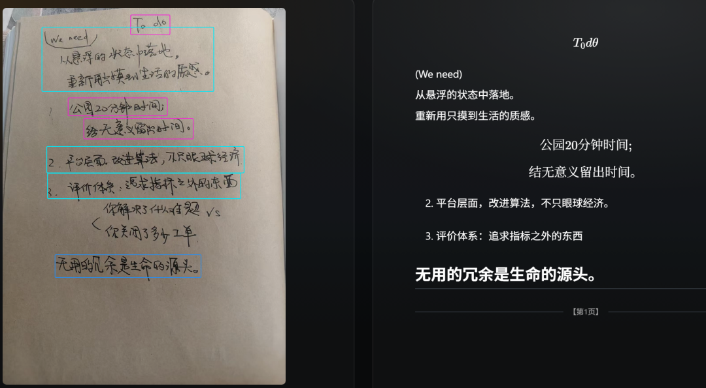

# 写在书边上、便签上的手写笔记，这个新工具帮你转换为电子版
> 💡 备注属性未写入，可能是备注属性名称或者类型被修改了，建议将字段类型设置为 rich_text，可以在小程序-操作-修改文章数据库页面进行调整
> 💡 原文链接:[https://mp.weixin.qq.com/s?__biz=MzU2OTU0MzU1MQ==&mid=2247484932&idx=1&sn=b31b96b86a45236438cb717acc62a187&chksm=fd75d499479f75635b3d1548dbb869538e088015b06ac22f93c64a7c43ef52aabcfc58af704e#rd](https://mp.weixin.qq.com/s?__biz=MzU2OTU0MzU1MQ%3D%3D&mid=2247484932&idx=1&sn=b31b96b86a45236438cb717acc62a187&chksm=fd75d499479f75635b3d1548dbb869538e088015b06ac22f93c64a7c43ef52aabcfc58af704e#rd)
**READING NOTES**2026 / 11 / 08
**写在书边上、便签上、本子角上 · 这些字终于能搜到了**
一页写满涂改和箭头的手写笔记，怎么从纸变成能搜到的字。
DOODLE
写字的人，做笔记的人，大概都攒着这么一叠。
**手写笔记 · 一次实测写在纸上的字**
上一篇写完 Personal Agent，我回头看了一眼桌上的本子，有点尴尬。
讲了半天让 AI 替我盯折扣、替我整资料、替我把活按点干完，可我自己随手写在纸上的那些东西，大部分从来没进去过。不是忘了录，是压根没打算录：书读到一半在页边划的一句，开会时笔记本上记的三个词，等电梯想到的一句话，都是写在离手最近的地方，写完就翻过去了。
它们没丢。纸还在，本子还在，偶尔收拾桌子还会翻出来（顺带翻出几张不知道什么时候塞进去的发票）。但它们不在任何能被搜到的地方。
写字的人，做笔记的人，大概都攒着这么一叠。
**01**
**PART**
**想法最不挑地方，也最容易被地方困住**
THE PROBLEM
我以前不是没试过把这些字搬进电脑。
试过拍照存进相册，结果相册里多了一堆叫 IMG_2048 的文件，跟没存一样。试过一个字一个字敲进去，敲到第三行就烦了——手写的那点意思，一半在字里，一半在它跟旁边那段印刷字挨着的位置，敲成纯文本就散了。也试过手机上的 OCR，规规矩矩抄在横线本上的那几页还行，一旦写到书页边上、写到一页纸的角落、字和字之间还画了箭头，出来就是一堆按错的顺序排好的碎片。
后来我想明白一件事：不是我懒，是这些工具默认我先把字排成它认识的样子，再交给它认。
可人写字的时候，从来不是先想好版式的。想法来得最快的那几秒，手边有什么就写什么。你不可能跟自己说，等一下，我先把这句挪到页首、标好层级再落笔。
**写得越随手，越不可能被整理；越不可能被整理，就约等于没写。**
举个例子，我那本读到一半的书，页边有一句当时觉得特别准的话，划线划到了下一行，旁边还补了个箭头指回上一段。这句我记了两年，每次想引用都得从头翻一遍书。它一直在，但从来不能被我找到。
最近让我重新看这件事的，是 SoMark 团队十月开源的一个东西，叫 OXR。吸引我的不是榜单，是官方演示里那页手写笔记——写满推导和涂改，公式上下标混着，边角还有竖着写的小字批注。那张纸长得太像我的本子了。
**02**
**PART**
**换了一个字母，多出来的是整页纸**
THE SHIFT
OXR 的全称是 Optical Everything Recognition。
我们熟悉的 OCR 是 Optical Character Recognition，中间的 C 是 Character，字符。OXR 把这个 C 换成了 Everything。名字取得挺狂，但看它干的活，这个狂是有根据的。
如果你不信，不妨来他们官方网站试一下；每个月有免费 500 张的额度，用完了你会来感谢我的。
https://somark.cn/playground
以前的思路是：把一页纸上的字一个个认出来，交给你一串文本。OXR 的顺序不一样——它先整页看一遍，圈出哪块是标题、哪块是正文、哪块是表格、哪块是挤在边角上的批注，标好边界，再判断先读哪块、后读哪块，最后才逐块认字。认完输出的是 Markdown 或 JSON，还带着每块内容在原页上的坐标。
对写东西的人来说，差别就在这儿：那句划在书边上的话，能带着“它挨着哪一段”一起出来，而不是被扔进一锅乱炖的文本里。
它能认的东西也杂，一共十三类：手写、竖排、表格、公式、代码块、化学方程式，甚至化学结构式。官方演示里有 A3 整页试卷、有多栏报纸（读完一栏要拐到下一栏那种），有中文手写也有英文手写。报纸那个例子我多看了一会儿——阅读顺序用折线标出来，蛇着走，右边输出就按这个顺序排好了。我那页画着箭头的书边，难的其实也是这件事。
主模型 1.3B 参数，从零预训练。1.3B 参数是什么概念呢？大致就是说，就算是你的笔记本只有 8G 的内存，理论上本地都能跑起来。当然，如果你没有强力的硬件，调用官方的 API 服务也是一个不错的选择。
看一下我的一个手写笔记的实际识别效果。

**OCR 认的是字，OXR 认的是这一页纸当时是怎么被用的。**
**03**
**PART**
**但我要坦白它的另一面**
THE OTHER SIDE
先把不好听的说了。
连笔连到一塌糊涂的字，它照样认不出——这是所有 OCR 到今天都没解决的通病，不是它一家。生僻字容易大面积翻车，竖排在第三方实测里出现过内容缺失，跨页的长表格也有被拆成两段的例子。三榜第一是团队自己测的，官网技术附录里写得很老实：公开榜单取的是固定快照，对手分数引其公开成绩，没有在同一环境全面重跑。免费 API 那条也标了可能排队、不保证稳定，日常使用没问题，不建议用于公司级应用。
我反倒因为这几行愿意推它。一个把评测口径和自家短板都摊在页面上的团队，比一个只喊第一的可靠。官方发布页上还有一句话我挺喜欢：世界没有为了让模型读懂文档，而统一它的排版。另一句是，让每一次读错，都成为下一次读对的起点。
不过还有一层，跟模型没关系，跟笔记方法有关。
**识别解决的是字进不进得去，没解决你想不想得起来。**
把一页纸变成干净的 Markdown，只是第一段路。它进哪个文件夹、跟哪条旧笔记连得上、半年后你会不会再搜到它，OXR 一概不管。我那个攒了一两百篇的笔记库里，真正被翻出来二次用过的，永远是当初顺手多写了半句“为什么记它”的那几条。字认得再准，没有这半句，也只是换了个地方继续吃灰。
所以真要上手，我建议先别急着把整箱旧本子都传上去。挑一页，就一页，跑完看三件事：
**先问自己三件事**
**1. 你写东西的地方，有几处是事后根本不会再翻的？** 先只救这些。书边角、会议纸、临时便签，价值密度最高，也最容易彻底消失。
**2. 你想救回来的是字，还是当时那一整页的顺序和涂改？** 如果只是抄了句名言，手机拍一张就够；如果那句话得靠着旁边的段落才看得懂，才轮到这种带版面和阅读顺序的工具上场。
**3. 救回来之后，它们有地方去吗？** 没有固定的落点，就先别批量导。多出来一百条没人再看的 Markdown，比一叠纸还难收拾。
想清楚这三问，再去 https://free-oxr.somark.cn 传那页纸，几分钟的事。开源仓库在 https://github.com/SoMarkAI/OXR，真有兴趣可以顺手翻翻演示页，那十二种场景比我讲得直观。
现在我照样在书边上写字，想到就划，不挪位置，不先排版。只是不再觉得写完翻过去就等于白写了。**工具能替我把字搬进电脑，替不了我决定哪句值得留下。**
你上一次翻出自己半年前写的一页纸，是什么时候？上面那句，现在还认得出来吗？
——————————————————————————————————————-——————————
我是云峰，平时喜欢折腾工具、记录方法，也写点踩坑和翻车。
**如果你觉得今天这篇有收获，欢迎 点赞、在看、转发 三连，我们下篇见**
赞
在看
收藏
THANKS FOR READING
