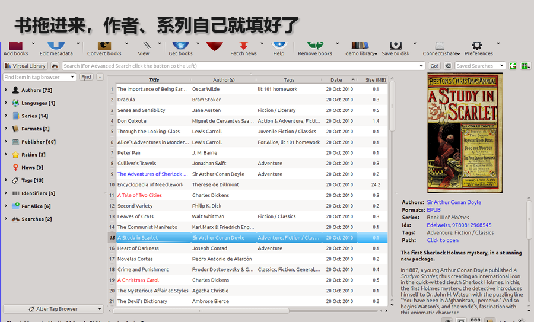
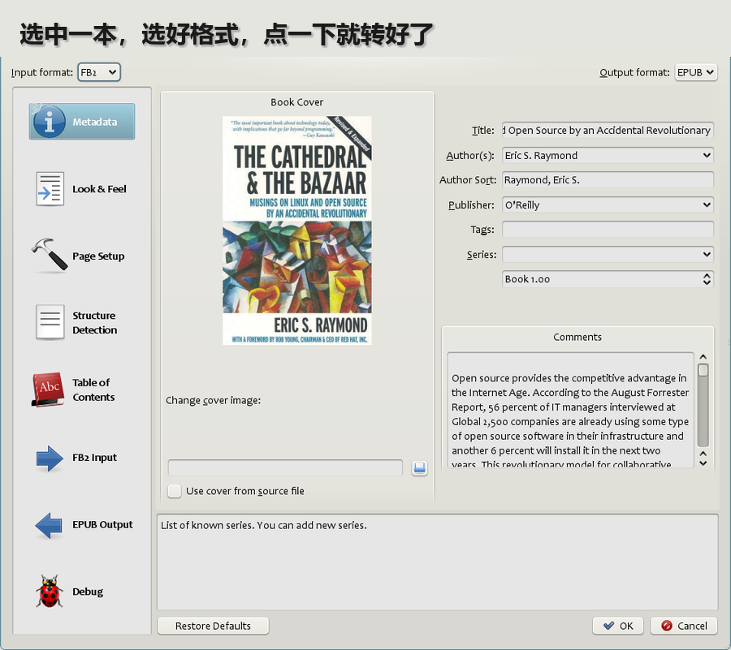

# 几百本电子书找不到、格式读不了？拖进去，点一下就转好
> 💡 备注属性未写入，可能是备注属性名称或者类型被修改了，建议将字段类型设置为 rich_text，可以在小程序-操作-修改文章数据库页面进行调整
> 💡 原文链接:[https://mp.weixin.qq.com/s?__biz=MzY5MTIzMzM1MQ==&mid=2247485070&idx=1&sn=8a19de9ba588aa6930e473d2238ec4ba&chksm=f5b5b9b903d7ebcef4a62be3740291be0ff1f5197314f615df71f3dde00bbd61f2b0ccfb1646#rd](https://mp.weixin.qq.com/s?__biz=MzY5MTIzMzM1MQ%3D%3D&mid=2247485070&idx=1&sn=8a19de9ba588aa6930e473d2238ec4ba&chksm=f5b5b9b903d7ebcef4a62be3740291be0ff1f5197314f615df71f3dde00bbd61f2b0ccfb1646#rd)
硬盘里攒了几百本电子书，文件名是乱码，格式一个 epub 一个 pdf 一个 azw3。想在手机上看的那本，偏偏打不开。
calibre 干的就是这件事：书拖进去，它按作者、系列自己站好队；设备读不了的格式，选中点一下「转换书籍」就转好。开源、GPL-3.0，10 月 9 日刚发了 9.16，这一版专门给大书库提速。
### 先看效果
把装着书的文件夹整个拖进窗口，书一本本落进主列表——书名、作者、格式、封面都填好了，左边那栏是作者和系列的索引。选中其中一本，点「转换书籍」，右下角的小图标开始转，转完点「查看」，就是一本能在你设备上打开的书。

一句话总结：**书拖进去，它按作者、系列自己排好队；设备读不了的格式，点一下就转。**
### 点一下，书就变成设备能读的格式
最省事的一处是「发送到设备」：把阅读器插上，等 calibre 认出来（十几秒），点「发送到设备」——如果你前面没手动转换，它会**自动把这本书转成你设备认得的格式**再传过去。格式这件事不用你记，也不用去查「XX 阅读器支持什么」。
这是我留下它的理由：电子书最烦的从来不是「读」，是设备和格式之间那点破事，而这部分它全接走了。
其余值得知道的两件事：
- ✦**大书库终于不卡了**。9.16 明确提速了启动、批量删书、按系列排序、搜索、标签浏览器刷新这几项。书越多，这个提升越明显。
- ✦**内容服务器**。开一下，同一 WiFi 下的手机浏览器就能直接看书库里的书，不用先把文件倒来倒去。
至于联网抓封面和元数据——国内站点未必抓得到，别指望。
### 我的判断：谁该试，谁别碰
**值得装的**：攒了几十上百本 epub / pdf / azw3 / mobi 的人；手里有阅读器、每次传书都要先查格式的人；想把乱七八糟的书整理成一个能搜索的书架的人。
**先别碰的**：只看微信读书这类 App 的人——书在别人家 App 里，calibre 管不着，也不该去碰；只是偶尔想打开一本 pdf 的人，为一个阅读需求装一个功能密到发指的软件，不值。
**门槛**：低。Windows 下一行命令装好，十来分钟能跑完「加书 → 转换」一轮。
坑也说三个：PDF 转成 epub 的排版别抱太高期待，效果取决于源文件干不干净；它自带的「抓新闻做成电子书」是给国外站点用的，国内基本用不上；第一次打开界面会很懵，功能按钮多到劝退——先只用「加书」和「转换」两个按钮就行。
### 怎么开始
**一行装好（Windows）**
```
winget install calibre.calibre
```
本机 winget 源里就是 9.16.0，装完直接是最新版；装不上也可以去官网 https://calibre-ebook.com/download 拿安装包。
**拖三本书，跑一次转换**
- ✦打开 calibre，选好书库目录（第一次会让你选，随便一个空文件夹就行）
- ✦把几本书拖进主窗口，看它们自动带上作者和封面
- ✦选中一本，点「转换书籍」，右上角选输出格式（EPUB 最通用），右下角等图标转完
- ✦点「查看」，确认能正常打开

**传到设备（可选）**
插上阅读器 → 等 calibre 识别 → 「发送到设备」，剩下的转换它自己来。
只做完前两步，也能判断它值不值得留在你电脑里；完整试一轮建议 20～30 分钟。成功标准：把一个原来打不开的格式，变成你手机上能读的那本书。装不上或转换报错，把系统和报错前半句留言给我。
### 项目地址
- ✦**项目名称**：calibre（电子书管理、格式转换、传书到设备）
- ✦**GitHub**：https://github.com/kovidgoyal/calibre
- ✦**官网**：https://calibre-ebook.com
- ✦**Star**：约 2.6 万（截至发文，以仓库为准）
- ✦**许可**：GPL-3.0（以仓库 LICENSE 为准）
电子书这件事，没有哪个云厂商会替你长期管好，反而是自己硬盘上的一份书库最稳。calibre 属于那种老到不太有人讨论、但真要整理书时绕不开的工具。
如果你觉得今天的内容有帮助，点击上方账号名片关注我，每天更新精选开源项目，让你少走弯路。

## 摘要

（待补充）

## 我的笔记

（待补充）
