# 出版业真正的矛盾：新需求与旧模式的错位
> 💡 备注属性未写入，可能是备注属性名称或者类型被修改了，建议将字段类型设置为 rich_text，可以在小程序-操作-修改文章数据库页面进行调整
> 💡 原文链接:[https://mp.weixin.qq.com/s?__biz=Mzg4MDgyOTg5OQ==&mid=2247517899&idx=1&sn=99f3dcdb66e89f6c6d2866e81e0f7a76&chksm=ce5d6aab0d05165c0744b689aac48296fd9a4bb065c81ea1f1731e9b76d3092caec570f5755e#rd](https://mp.weixin.qq.com/s?__biz=Mzg4MDgyOTg5OQ%3D%3D&mid=2247517899&idx=1&sn=99f3dcdb66e89f6c6d2866e81e0f7a76&chksm=ce5d6aab0d05165c0744b689aac48296fd9a4bb065c81ea1f1731e9b76d3092caec570f5755e#rd)

本文作者

**晴 山**
《打造爆款书》《兜底》《我大于一切》作者
金声玉韵（北京）文化传媒创始人
前段时间，我写了一篇《[出版不会消失，而是在系统升级](https://mp.weixin.qq.com/s?__biz=Mzg4MDgyOTg5OQ%3D%3D&mid=2247517376&idx=1&sn=154f85329402194e364e884bf1ab9c7c&scene=21#wechat_redirect)》。在文章中我提出一个观点：出版不会消失，而是在系统升级。文章发表以后，收到很多出版界的前辈、领导和朋友的关注，很多人找我讨论。
跟大家聊过一圈之后，让我越来越确定一件事：**今天出版人真正需要的，也许不只是更多关于“行业下滑”“市场萎缩”“书卖不动了”的数据和情绪。**我们更需要回答另外一个问题：如果旧的出版模式真的有压力，那么**出版新的价值到底在哪里？有什么新的出版模式可以满足这个新的需求？**
我们正在经历这样的一个时代。首先，图书市场持续下滑，传统渠道收缩，人们的注意力被短视频、直播、社交媒体不断切断，AI又以前所未有的速度生产和提供知识。其次，**人对于知识、思想和精神内容的需求永远不会消失**，正如人类对交通的需求从未变化，但如今高铁四通八达，马车也有，但仅仅存在在公园或马戏团供大家娱乐。最后，中国生产力各方面正在不断跃迁，科技突破了线性的增长，这样科技的飞速发展必然伴随着本土文化的快速崛起，中国文化会重新呈现和绽放，必将推动世界文明的发展。
**AI发展日新月异，科技越发达，人的内心流失得越快**，所以人类从来没有像今天这样，被如此海量的信息包围甚至吞噬；也从来没有像今天这样，需要判断、需要系统、需要归类、需要意义，需要回归文化，需要有人帮助我们从海量、混乱的信息中重新建立秩序。
所以，今天出版行业真正发生的，或许并不是简单的“需求消失”。而是：**需求正在升级，价值正在位移。**如果我们仍然用过去的出版模式去满足今天已经发生变化的需求，自然会感到越来越难。这才可能是出版行业今天更深层的结构性矛盾：
**新的社会需求已经出现，新的价值正在形成，新的内容生产力也已经具备，但我们组织这些价值的方式，仍然大量停留在旧的出版模式里。**
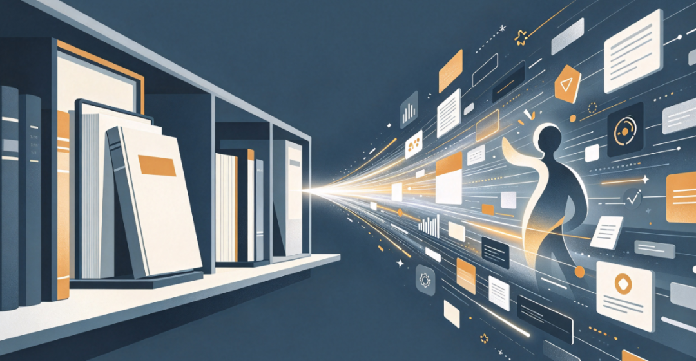
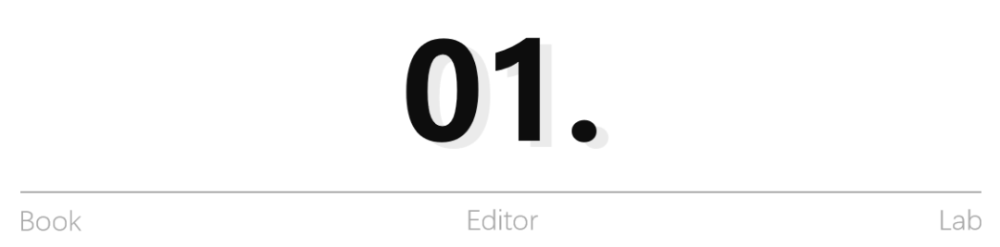
**当知识唾手可得之后**
**人们为什么反而更需要深度内容**
过去很长一段时间，出版承担着一个非常重要的社会功能：提供知识。知识曾经是稀缺品。我们要了解一个陌生领域，最重要的方式之一就是去找一本书去学习。出版社编辑的重要价值，也是从海量信息和作者资源中进行筛选、组织、加工和传播。但是今天，知识的供给方式发生了根本变化。
搜索引擎、新媒体、各种知识平台已经极大降低了知识获取成本，而AI的发展又把这件事情向前推进了一大步。今天，一个创业者想知道“如何布局一人公司？”，一个职场人想了解“怎样进行职业生涯规划”，一个妈妈想知道“如何跟青春期孩子沟通”，都可以直接向AI提问。几秒钟之后，一个结构完整、逻辑清楚的答案就会出现。
那么问题来了：**当答案变得如此容易获得，我们为什么还需要一本书？**
我认为，这恰恰是出版行业今天必须重新思考的问题。因为人的需求已经开始从：“我不知道，请你告诉我。”逐渐走向：**“我能一下子得到这么多信息，但我究竟应该选择相信哪个？”**进一步走向：“这些东西如果结合我的人生、企业和真实处境，我到底应该怎么做？”再进一步：“我怎样才能真正发生改变？”
这背后其实发生了一次非常重要的需求升级：**从获得知识，走向理解系统；从寻找答案，走向建立坐标，形成判断；从掌握方法，走向真实行动；从一次阅读，走向改变和成长。**
这也是为什么我越来越认为：**AI无法消灭深度内容的价值，反而引发了我们来重新定义**——什么样的内容才真正有价值？当标准答案越来越唾手可得，判断力就越来越精贵；当碎片知识越来越多，系统思考就越来越稀缺；当AI越来越擅长总结已有知识，而正在经历的人生，哭过、痛过、恨过又穿越过的鲜活经验，反而越来越珍贵。
所以未来内容行业真正的稀缺资源，也许不再是“谁知道得更多”。而是谁真正做过，谁真正思考过，谁客观地验证过，谁形成了自己对世界独特而完整的解释。
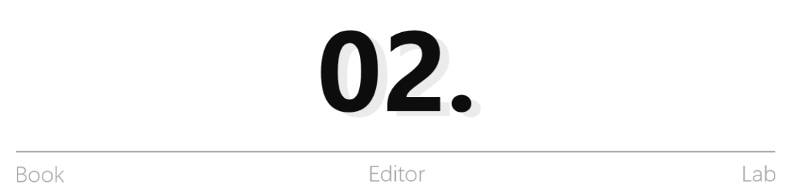
**出版没有失去价值**
**价值只是迁移了位置**
这是我最近越来越强烈的一个判断。很多时候，当我们说一个行业正在衰退，其实需要先问：究竟是这个行业的价值真的消失了，还是价值流动了，换了一个地方存在？就像报纸发行量下降，并不意味着人类不再需要新闻；传统电视收视率下降，也不意味着人类不再需要视频内容；实体唱片、磁带录音机的消失，也不是意味着人类不需要音乐。
**需求并没有简单消失，价值只是换了载体、换了结构、换了实现方式。**出版今天也正在经历类似的过程。我至少看到了四个非常明显的价值迁移。
**第一，从“知识供给”迁移到“思想体系”**
过去知识稀缺，所以“告诉读者一个不知道的东西”本身就有价值。今天，这种单纯的信息差正在被快速抹平。但知识越多，人越容易陷入另外一种困境：知道很多，却没有自己的认知体系，仍然过不好一生；收藏很多，却不知道如何消化和使用；看过无数观点，反而越来越不知道到底什么真正适合自己。所以未来真正高价值的内容，不只是更多的知识，而是帮助一个人把知识重新组织起来，真正用起来。
一位真正优秀的作者，不只是告诉读者100个答案。他应该能够提供一个观察世界的坐标系，一套经过实践验证的方法，以及面对复杂现实进行判断的能力。因此知识没有消失，但价值的重心正在从“提供知识”，向“建立思想体系”迁移。
**第二，从“书稿加工”迁移到“思想资产萃取”**
这可能是我作为一个做了十几年出版的人，又做了畅销书作者，站在我的双重叠加的身份上，感受尤其深的一点。传统出版的生产往往从“一部书稿”开始。作者交来书稿，出版社完成策划、编辑、三审三校、排版装帧、印刷发行。这套体系在过去创造了巨大的价值，而且直到今天仍然不可或缺。
但是，当我越来越多地接触行业专家、企业家、创始人、咨询师和成熟IP以后，我发现：**他们最有价值的东西，往往不自知。**它在哪里？在一次次经营决策里；在失败之后形成的判断里；在跟客户打交道的细节里；在几十年产品迭代里；在会议、课程、演讲、聊天甚至某种无法言说的直觉里。
一个企业家可能经营了20年企业，却从来没有系统总结过：为什么我总是在某些关键节点作出这样的判断？一个行业专家可能解决了上千个真实问题，却从来没有把这些案例背后的共同规律抽象出来。这些才是真正宝贵的隐性知识与思想资产。
**所以未来出版的一部分高价值能力，需要继续向上游迁移**：从等待作者交稿，走向发现作者；从加工既有内容，走向萃取隐性经验；从整理知识，走向提炼方法论；从生产一本书，走向帮助一个人建立自己的思想体系。
我把这个过程称为——种一棵“思想树”：
树根，是一个人的使命、价值观、世界观和真实实践的过程；
树干，是他逐渐形成的核心思想、方法论和独特判断；
树枝，是围绕核心思想生长出来的主题体系；
树叶，是文章、短视频、演讲、直播等不同内容表达；
而书，是这棵思想树结出的一个极其重要的果实。
过去，我们可能更擅长处理“果实”。未来的新出版，还要有能力看见地下庞大而隐秘的根系以及从树根到树干到枝叶。
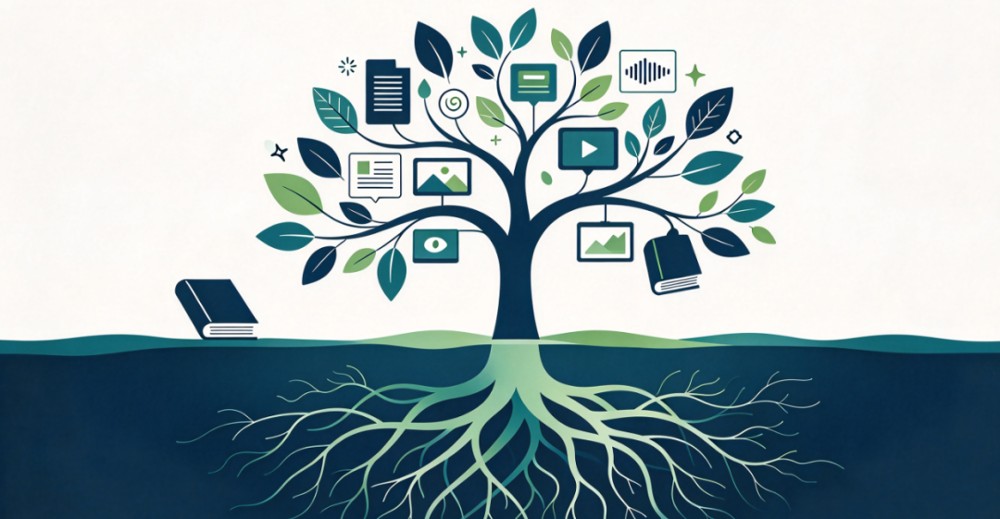
**第三，从“图书销量”迁移到“行业话语权、品牌与信任资产”**
销量当然重要。一本好书能够进入更多读者手里，本身就是出版最重要的价值之一。但是，当我们面对企业家、行业专家、知识型IP时，如果仍然只用“这本书卖了多少册”衡量一本书的全部价值，就可能低估出版真正能够创造的东西。一本书可能只卖了几万册，却帮助一位行业专家第一次完整提出了自己的方法论；一本书可能没有成为百万册畅销书，却帮助一家企业重新解释了自己的行业价值；一本书也可能成为一个创始人的高级名片，让客户第一次真正理解：这个人为什么能够把这件事情做成？
**所以书还可以沉淀什么？思想资产、专业信用、品牌认知、行业话语权，以及长期信任。**对于一些传统的作者来说，图书销量可能是最大的商业结果；但对于另一些作者来说，书本身可能只是整个价值链的开端。
所以未来我们评价一本书，或许需要同时问两个问题：有多少人购买了它？它又为作者、读者和社会沉淀了什么长期资产？这两者并不冲突。恰恰相反，真正优秀的出版应该让二者相互增强。
**第四，从“单一的出版载体”迁移到“多元载体思想传播”**
过去，思想主要依靠图书被系统保存和传播。今天，一套思想拥有了前所未有的表达可能。它可以成为一本书；也可以成为一系列的文章；可以成为一系列的短视频；可以成为多次直播、一场演讲、一门课程；甚至可以进入一个持续生长的AI知识系统。
这意味着什么？意味着我们过去习惯的：从内容到图书正在逐渐变成：**从思想到图书、文章、视频、音频、课程、社群、AI……**
这里发生的不是书籍价值的消失。恰恰相反，我越来越认为，在一个高度碎片化的内容时代，书反而可能成为一个人思想体系最重要的“母体”之一。
因为短视频擅长传播一个观点，却很难承载一整套思想；新媒体适合建立高频连接，却天然具有碎片性；AI可以帮助整理、生成和调用知识，却仍然需要高质量的思想源头。而一本真正经过深度思考、系统组织和专业出版的书，可以成为所有这些内容的源头。所以未来可能不是：书被其他媒介取代。而是：书从唯一的中心载体之一，变成一个思想生态中的“深度母体”和“信任中枢”。
**这恰恰可能重新放大出版的价值。**
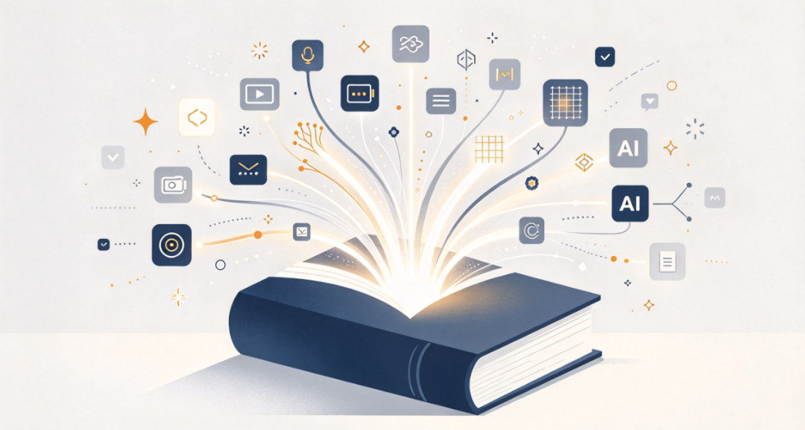
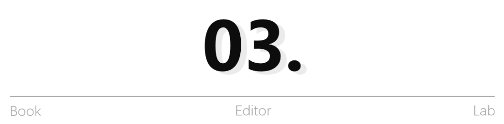
**AI和新媒体不是出版的敌人**
**而是新的内容生产力**
那么，**AI和新媒体究竟给出版带来了什么？**过去几年，行业里很多人认为AI和新媒体是洪水猛兽，因为它们抢走了纸媒的流量：短视频抢走了大家的注意力；直播改变了销售渠道；投流就是公开作弊；AI抢了编辑的工作，能写作、总结、翻译、生成内容、编校、设计。
当然，这些变化会带来冲击。但是换一个角度看：**它们也第一次让我们拥有了过去难以想象的内容的生产能力。**一场两小时的深度访谈，可以借助AI完成整理、分类和初步结构化；一本20万字的书，可以进一步拆解成几十个甚至上百个传播主题；同一套思想，可以根据不同平台被转化为文章、短视频、演讲、直播等不同表达；作者过去散落在课程、会议、演讲和文章中的内容，也可以被重新聚合、整理和调用。更重要的是，**AI和新媒体让作者与读者之间第一次拥有了如此低成本、长期、高频的连接方式。**
过去一本书出版之后，出版社甚至很难知道究竟是谁买了它。今天，一个读者可能因为一本书认识作者，又通过公众号、视频号、直播、社群继续与作者发生深度的连接。
书和人之间，第一次可以形成真正长期的关系。所以我越来越不愿意把AI和新媒体理解成出版的敌人。它们更像是：**这个时代提供给深度内容铺设的一套全新的基础设施。**技术真正改变的，不只是“写得更快”。而是让思想拥有了被持续萃取、持续生产、持续传播、持续连接的可能。
那么，真正的问题出现了：**生产力已经变化，我们组织生产的方式变化了吗？**
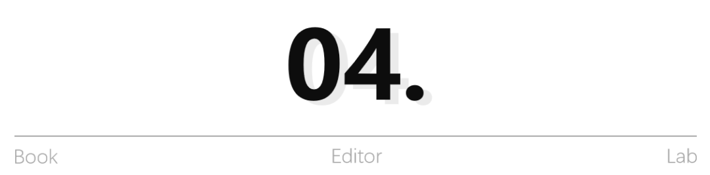
**真正的错位：新价值已经出现**
**旧出版关系还没有改变**
传统出版形成了一条非常成熟的链条——从“作者交稿”到“出版社加工出版”到“渠道发行”到“读者购买”。在知识稀缺、传播渠道有限、信息不对称、图书作为核心内容载体的时代，这是一套高度有效的生产组织方式。
但是今天，前面三个条件都在变化：**作者不再只是书稿提供者；读者不再只是通过图书获得知识；出版社也不应该只在一本书进入生产流程之后才开始创造价值。**可是大量出版项目依然遵循作者把稿子交过来、出版社把书做出来、渠道把书卖出去、销售周期结束、合作也基本结束。
于是就出现了一系列错位：**作者**真正需要的可能是思想资产化，得到的却主要是一次出版；**读者**真正需要的可能是系统理解和持续成长，得到的却主要是一次的阅读；**技术**已经能够支持长期内容生产和用户连接，我们却仍然按照一次性的传统方式交付价值。
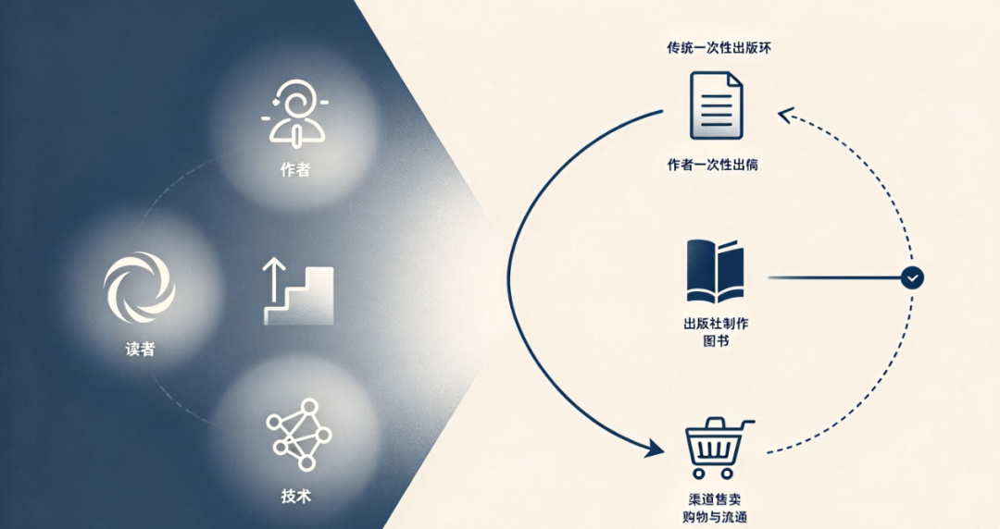
这才是我认为今天出版行业真正需要面对的问题——不是没有新的需求，不是没有新的价值，不是没有新的生产力，而是**新的需求、新的价值和新的生产力，在等待一套新的出版关系来承载**。这也是为什么，仅仅“用AI提高编辑效率”，还远远不能称之为出版升级。如果AI只是帮助我们更快地完成过去的工作，短视频只是帮助我们换一个地方卖书，那么改变的仍然只是工具。**底层价值链并没有改变。**

**出版必须重新向价值链两端蔓延**
那么新的出版关系应该是什么？我现在还不想过早给它下一个绝对定义，因为一个真正的新出版体系，一定是在大量实践中不断生长出来的。但至少，我已经越来越清楚地看到两个方向：**向上，走向思想源头；向下，走向长期价值。**
**向上，是从“书稿加工”到“思想萃取”。**我们不再只是等待一部成熟书稿，而是更早进入作者的场景、经验与实践世界：发现真正有价值的人和有价值的点；通过深度访谈、资料研究和教练提问，帮对方看见自己的价值；帮助他找到最核心的命题；建立方法论；形成思想体系；最终再通过出版完成系统表达和公共呈现。
**而向下，则意味着“一次出版”到“经营作者的长期价值创造”。**一本书出版之后，合作不必结束。书中的核心思想可以继续进入内容营销；进入文章、短视频、直播和演讲；进入作者的个人品牌和企业品牌；进入公域传播和私域连接，赋能作者的商业部分；对于有商业承接能力的作者，还可以进一步进入课程、咨询、企业服务和产品体系。
于是出版的整个链条开始发生变化：从“思想发现” 到“思想萃取” 到“内容资产化”到“出版确权”到“多媒介传播”到“用户连接”到“价值转化”到“新的实践”到“新的思想”。它不再是一条走到“出版完成”就停止的线性，**开始成为一个不断生长的循环。**
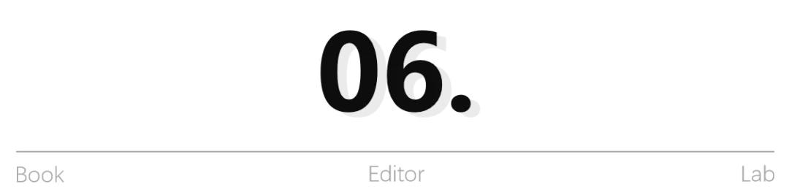
**新出版真正经营的，到底是什么？**
如果沿着这条路继续往下想，出版行业最终可能需要重新回答一个非常根本的问题：我们究竟在经营什么？如果答案只是“图书”，那么我们自然会感到整个行业都在萎缩。
**但如果出版真正经营的是：人，那么引申下去就是内容、思想、信任以及人与人之间深度的精神连接**，那么我们会看到一个完全不同的世界，书仍然重要，专业编辑仍然重要，出版社的专业判断、内容判断和出版标准仍然重要，甚至在AI内容大量涌现之后，这些能力可能更加重要。只是这些能力不必再被局限在一本书从立项到上市的有限周期里。它们可以向前进入思想发现和作者孵化；向后进入传播、连接与长期运营；横向进入不同内容媒介；最终建立思想资产×作者资产×用户信任×建立生态。
**这可能才是“新出版”真正值得探索的方向。**它不是让出版社什么都做。更不是让所有出版社都去做IP、做课程、做商业。不同机构当然会拥有不同定位。但是整个行业需要重新思考：在新的社会需求下，我们究竟应该占据价值链的哪一个位置？哪些旧价值正在下降？哪些新价值正在上升？我们过去最珍贵的专业能力，怎样迁移到新的价值高地？这也许比单纯讨论“今年还能卖多少书”，更值得出版人认真思考。
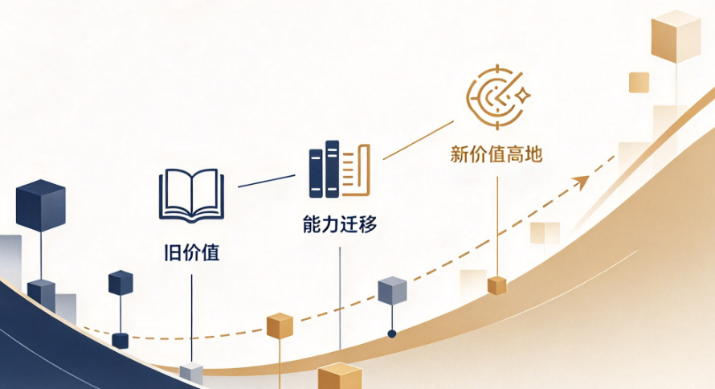
写到这里，我越来越理解为什么[**上一篇文章**](https://mp.weixin.qq.com/s?__biz=Mzg4MDgyOTg5OQ%3D%3D&mid=2247517376&idx=1&sn=154f85329402194e364e884bf1ab9c7c&scene=21#wechat_redirect)**（点击查看）**发表之后，会引发大家的讨论。也许大家真正想寻找的，并不是一句乐观的话，而是一个确定：出版的未来究竟在哪里？
今天，我想把上一篇的判断再向前推进一步：
● 出版不是简单地失去价值，而是在经历一场深刻的价值迁移，向上游，向下游；
● 当知识获取越来越容易，价值就向更深的思想迁移；
● 当标准答案越来越丰富，价值就向独立判断迁移；
● 当单一载体的边界被打破，价值就向多元传播与长期连接迁移；
● 当一次简单的交易越来越难以承载全部价值，出版就需要走向更长的价值链。
所以我依然相信：出版不是衰退，而是在系统升级。只是所谓升级，从来不是给旧机器安装几个新工具，就像高铁和绿皮火车的区别，绿皮火车是由车头的动力带动的，而高铁是每一节车厢都带有动力源，从绿皮火车升级到高铁，相应的铁轨、信号系统、站台全部都要升级。
真正的升级，是当社会需求改变、价值迁移、生产力变化之后，我们重新回答：出版究竟应该为什么人、解决什么问题、创造什么价值？
**真正会衰退的，是无法继续承载新价值的旧模式。**真正会生长的，是那些能够重新发现思想、组织思想、出版思想、传播思想，并让思想与真实世界持续发生连接的新出版力量。
就像狄更斯在《双城记》里的那句名言：**这是一个最好的时代，也是一个最坏的时代。**而我们这一代出版人，也许恰恰站在这样一个交界点上：旧地图正在失效，新的需求已经出现，新的工具已经到来，新的价值正在位移，而接下来我们真正需要做的，不是哀叹旧世界为什么会离我们而去，而是去回答：新的价值在哪里？以及，我们怎么抵达？
- THE END -
课程预告
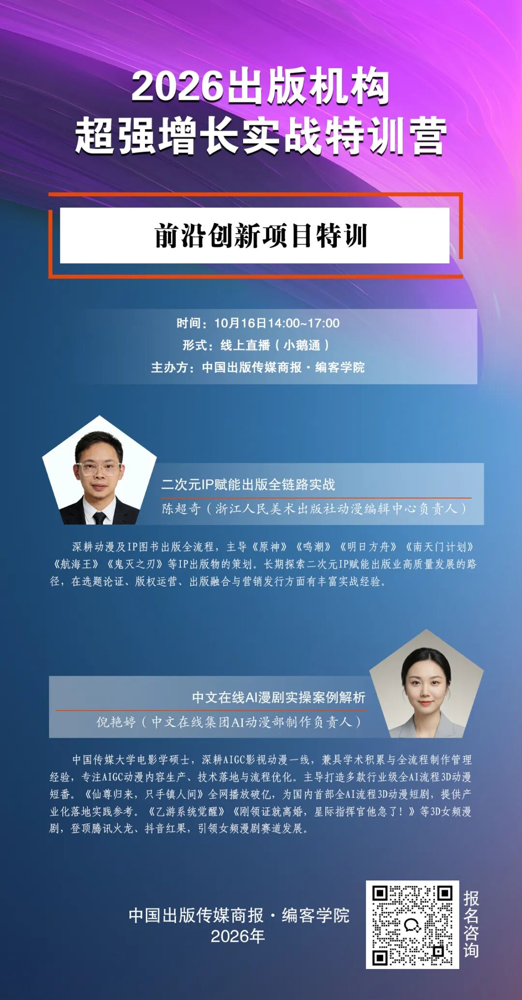
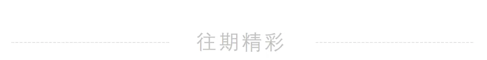
[「书摊不收我不休」：编辑地坛书市观察实录](https://mp.weixin.qq.com/s?__biz=Mzg4MDgyOTg5OQ%3D%3D&mid=2247517783&idx=1&sn=ac843ba6220de9f97b7705f9108471a1&scene=21#wechat_redirect)
[地坛书市，各家宠粉福利大汇总！](https://mp.weixin.qq.com/s?__biz=Mzg4MDgyOTg5OQ%3D%3D&mid=2247517604&idx=1&sn=420ed2ec403df8d45437074a980393ac&scene=21#wechat_redirect)
[深度长文：从“十五五”规划，看出版业发展七大关键](https://mp.weixin.qq.com/s?__biz=Mzg4MDgyOTg5OQ%3D%3D&mid=2247517876&idx=1&sn=cfa619941aafc83300d9e92de2da14fb&scene=21#wechat_redirect)
[告别传统出版，他去开了家买手店](https://mp.weixin.qq.com/s?__biz=Mzg4MDgyOTg5OQ%3D%3D&mid=2247517859&idx=1&sn=a978055fa3870715029a47f1c18ba62e&scene=21#wechat_redirect)
编辑：王媛媛
初审：张聪聪
复审：孙 珏
终审：郑 甜
欢迎爱书的编辑大大们多多投稿
邮箱:cbbrbkzx@163.com
微信:13601185425
13521322168
▼点击下方名片关注我们

## 摘要

（待补充）

## 我的笔记

（待补充）
