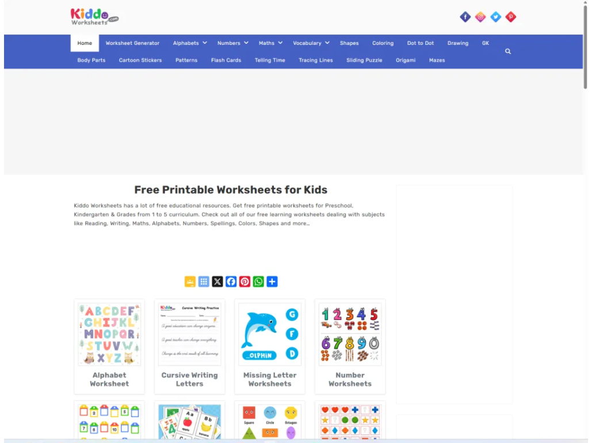
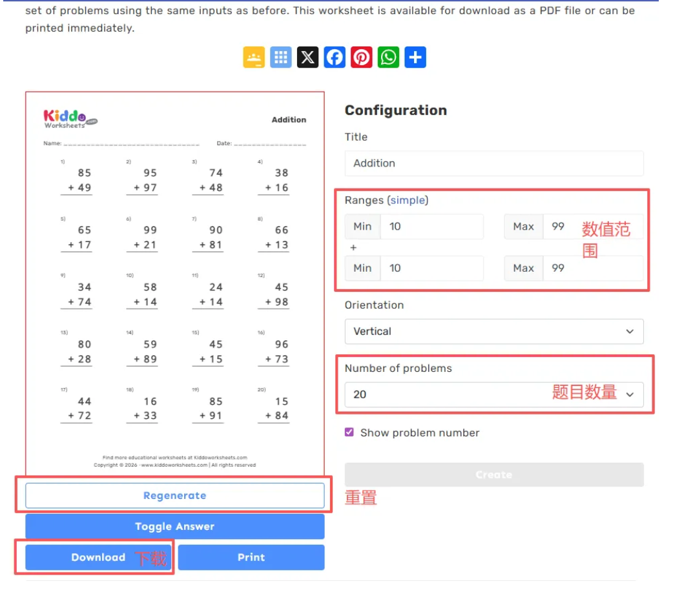
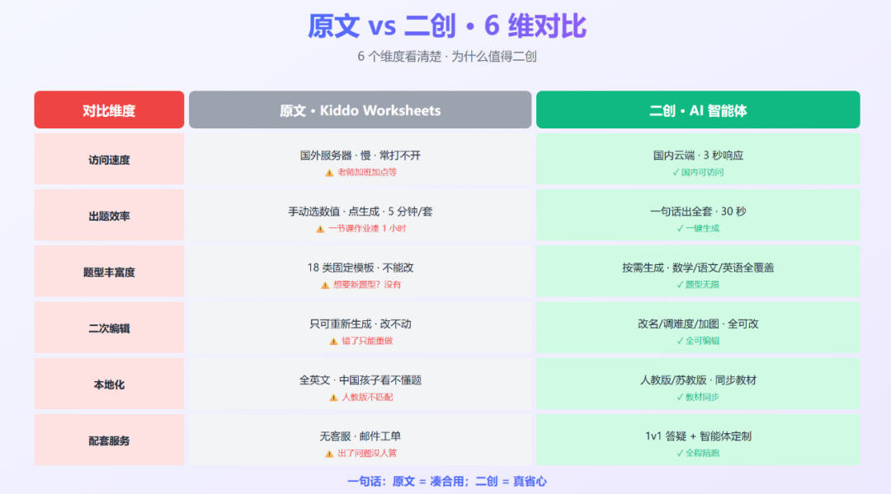
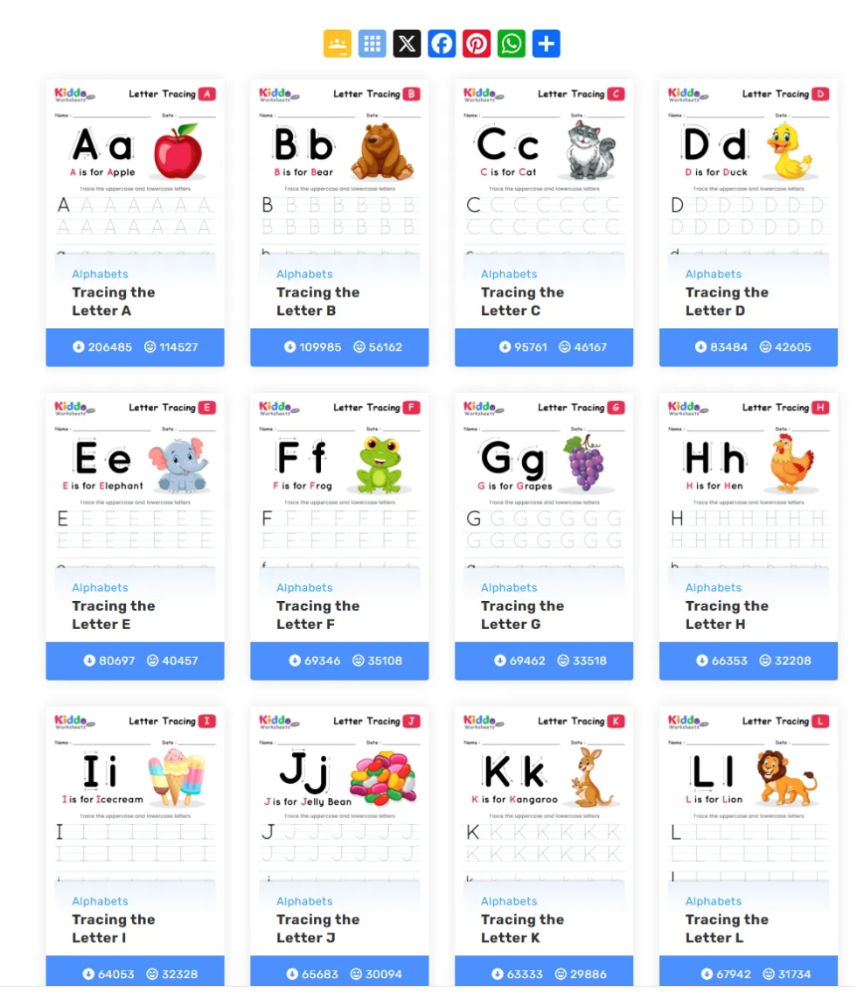
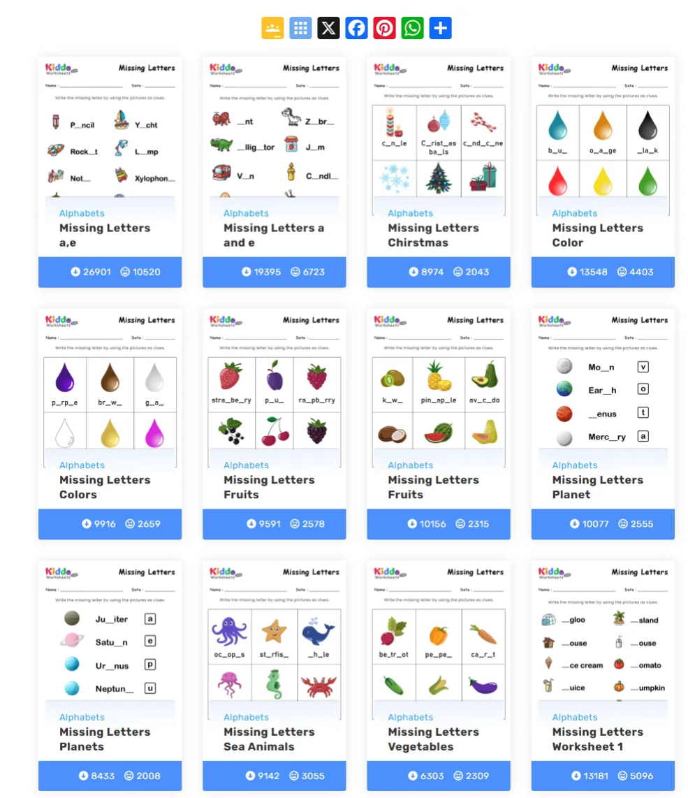
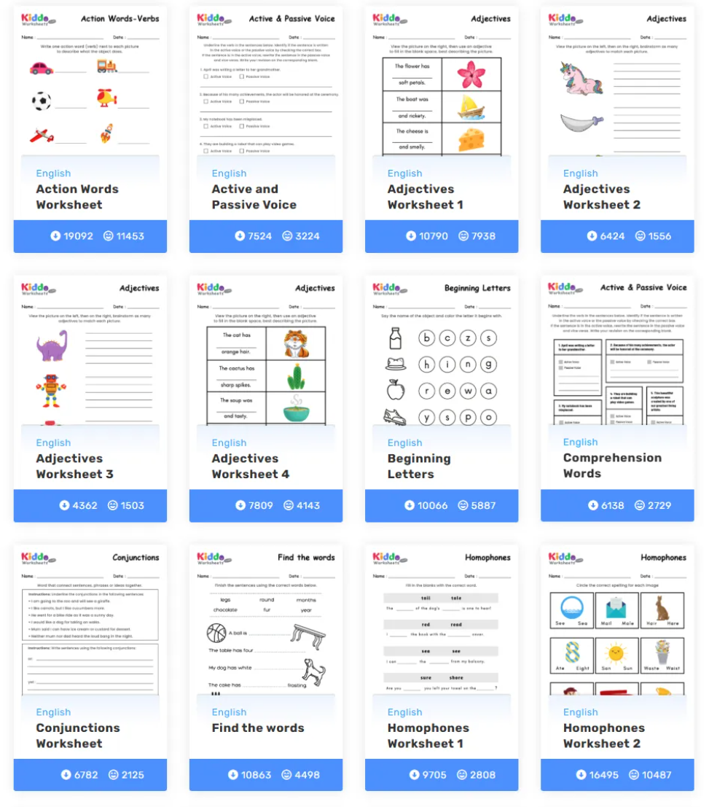
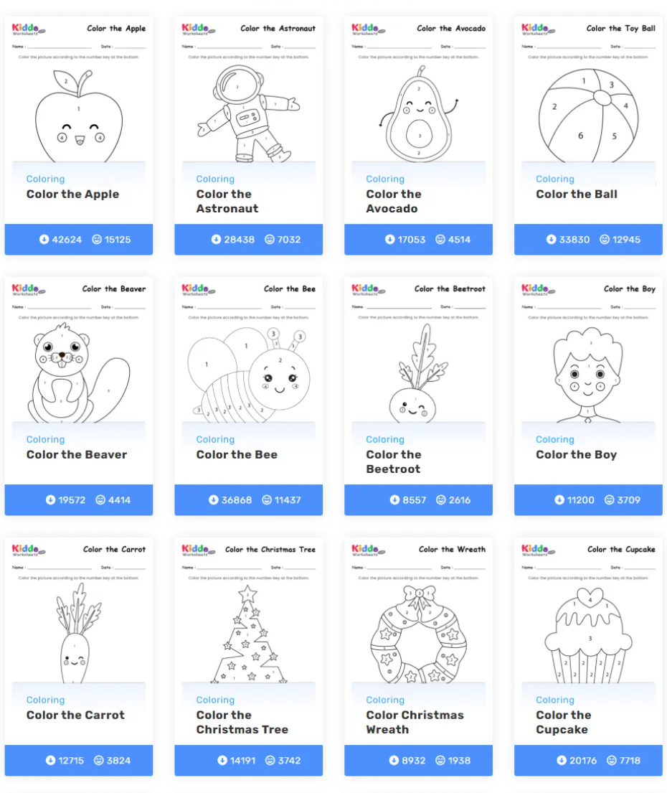
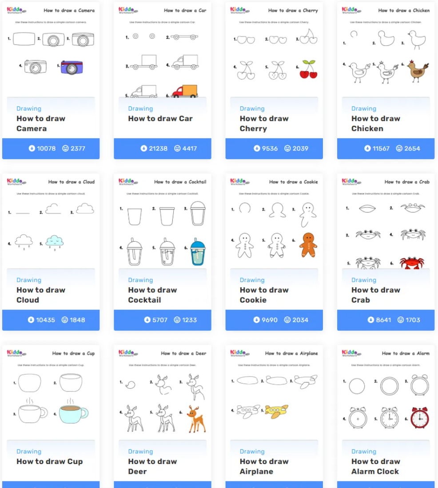
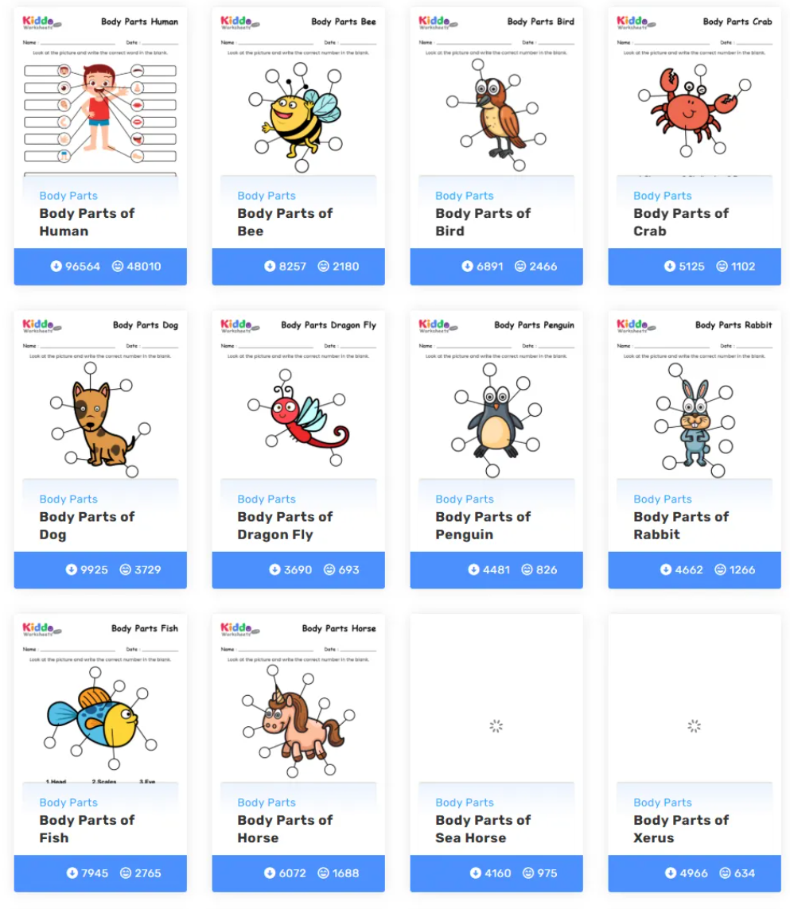
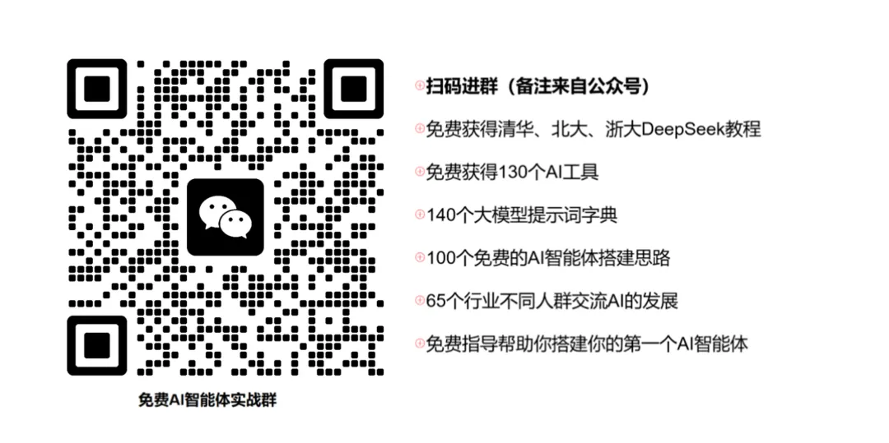

# 分享1个免费网站包含1-6年级全科的学习资料
> 💡 备注属性未写入，可能是备注属性名称或者类型被修改了，建议将字段类型设置为 rich_text，可以在小程序-操作-修改文章数据库页面进行调整
> 💡 原文链接:[https://mp.weixin.qq.com/s?__biz=MzkzNjg5OTA2Mg==&mid=2247487618&idx=1&sn=d80d6dce2367f8669653c141e4641065&chksm=c339bd809d189bcb4373f4772573ff6afde790357b06aedaeb1a6a4014c2df124665b0c88fd9#rd](https://mp.weixin.qq.com/s?__biz=MzkzNjg5OTA2Mg%3D%3D&mid=2247487618&idx=1&sn=d80d6dce2367f8669653c141e4641065&chksm=c339bd809d189bcb4373f4772573ff6afde790357b06aedaeb1a6a4014c2df124665b0c88fd9#rd)
最近发现一个网站，叫 Kiddo Worksheets。
`网站：`
> https://www.kiddoworksheets.com/
> 
**18 类练习题模板**，数学、语文、英语、美术都有。
老师家长都可以用。

### 这网站长啥样
打开就是一堆题。
加法、字母描红、看图写话、找词游戏、涂色卡……小学阶段用得到的题型基本都在。
按学科分一下：
| **主题** | **题型** |
| 数学 | 加减乘除、应用题、几何、单位换算 |
| 语文 | 字母描红、拼音、看图写话、缺失字母 |
| 英语 | 单词听写、句型翻译、找词游戏 |
| 美术 | 数字涂色、简笔画步骤 |
看着挺全。

### 它解决了什么
出作业这事，挺费时间。
一节课的作业，要从 4-5 个网站拼。
翻译、改数字、调整格式、打印。
加一块儿，一节课作业 1-2 小时就出去了。
这网站把 18 类题型做成模板。老师选好参数，点一下就生成 PDF。
一套题 5 分钟。

### 怎么用
**第一种：直接拿现成的**
美术涂色、英语找词游戏这种"不挑语言"的题型，下下来直接打。
PDF 自带答案，批改也方便。

**第二种：复制模板自己改**
数学题、语文题这种需要"对齐国内教材"的，把模板复制到 Word 或者 Excel。
改数字、改文字、改格式。
熟悉之后 30 分钟一套。

### 真实操作
拿二年级数学"两位数加法 20 道"举个例子：
先打开模板，把 20 道题的数字全改成 100 以内不进位的。
再改 4 个地方：
- 顶部加"班级___ 姓名___ 日期___"
- 题目数字打散，不要连着 5 道都是 35+12
- 末尾加 3 道 ★ 拓展题
- 另存一份教师版，标答案
操作记录大概是：
> 8:50 打开 Kiddo，找到两位数加法模板 8:55 复制到 Excel，开始改数字 9:10 20 道题改完 9:15 另存教师版，标答案 9:20 加 3 道拓展题，排版打印
> 
30 分钟，一节课作业出来了。

### 哪类题用起来最省事
按学科分一下：
| **学科** | **题型** | **难度** |
| 美术 | 数字涂色画 | ⭐ 直接用 |
| 英语 | 单词听写 | ⭐ 直接用 |
| 数学 | 加减乘除 | ⭐⭐ 改数字 |
| 语文 | 拼音练习 | ⭐⭐ 改文字 |
| 数学 | 应用题 | ⭐⭐⭐ 改场景 |
| 语文 | 看图写话 | ⭐⭐⭐ 改图片 |
⭐ 越少越省事。
美术涂色和英语单词听写，是最"拿来就能用"的。

### 找资源的小习惯
- 美术、英语这种"不挑语言"的题型，**直接用 Kiddo 模板**
- 数学、语文的常规题型，**复制模板自己改**
- 看图写话、应用题这种**得改场景**的，国内网站更顺手
- 自己改完的模板存一份，下次直接套

### 顺便说一句
这网站是国外老师常用的。
**题型设计是真的漂亮**——不花哨，但每个都对孩子有用。
国内老师用起来门槛不高：会 Word 就能改，会 Excel 更顺手。
家长自己在家辅导娃也够用——选年级、选题型、下载、打印，四步搞定。

里面内容很多，大家可以用用看，评论区聊聊你最喜欢哪个模块。
## 关于我
大家都叫我小胖，硕士研究生，还上过央视呢！现在专门研究AI+教育的落地应用。到目前为止，我已经做了📚 100多个AI+教育智能体，帮助🥇 15位+以上的老师在公开课中使用AI获奖，8位老师AI智能体比赛市级一等奖。
如果你还没有加入AI教育大家庭，抓紧行动吧。

