# 分享6个最新良心软件
> 💡 备注属性未写入，可能是备注属性名称或者类型被修改了，建议将字段类型设置为 rich_text，可以在小程序-操作-修改文章数据库页面进行调整
> 💡 原文链接:[https://mp.weixin.qq.com/s?__biz=MzAwNjU0MDQxNw==&mid=2652488599&idx=2&sn=a39643912e876e3028167e85aa37718c&chksm=81dfb64d7f027c4a7993b58bc0f8667d85b1a4326ac585a16f188eb2b37bc18c792f7e4089d1#rd](https://mp.weixin.qq.com/s?__biz=MzAwNjU0MDQxNw%3D%3D&mid=2652488599&idx=2&sn=a39643912e876e3028167e85aa37718c&chksm=81dfb64d7f027c4a7993b58bc0f8667d85b1a4326ac585a16f188eb2b37bc18c792f7e4089d1#rd)
本期软件目录如下：
## 1、Ventoy 网络版 iVentoy（网络装机）
## 2、sniplite（截图贴图）
## 3、Linkit（AI 书签）
## 4、Speech Studio（离线配音）
## 5、GlassDesk（液态玻璃Dock）
## 6、忆窗（窗口布局）
## 
## 1、Ventoy 网络版iVentoy 网络批量装机
地址：6https://www.iventoy.com/cn/index.html
以前使用Ventoy制作启动U盘，一台机器装完拔掉再插上，很麻烦。iVentoy 是官方推出的网络版，同在一个局域网中，只要有一台电脑连接到网络上，并且这台电脑已经开启了 PXE 模式的话，那么其他的任何一台开启 PXE 模式的电脑就可以从网络中启动并安装系统了，而 U 盘则可以被省去了。
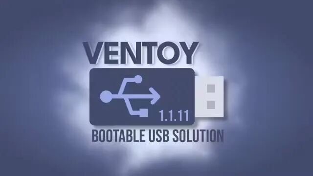
功能▼：Windows、Linux ISO 直接挂到列表中去；PXE网络启动；DHCP 代理模式不需要修改路由器；带有网口驱动注入、中文官方界面。
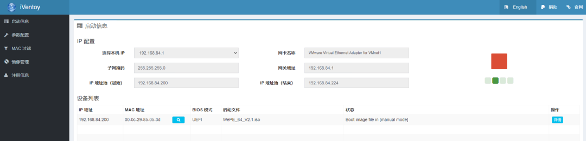
上手就三步：官网下载安装 → 挂上 ISO、选好网卡点开始 → 待装电脑开机进入 BIOS，把 Network Boot 调成第一启动项。
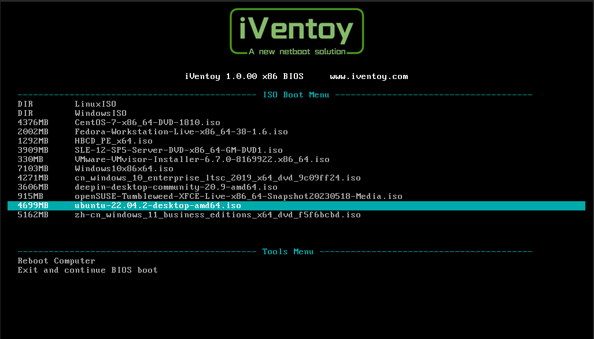
提醒：待装电脑需要连接网络，不能使用无线局域网（WLAN）或者无线个人局域网（WPAN）。ISO里面并没有和网卡驱动相对应的内容，在安装系统的时候就会出现网络中断的情况。
## 2、sniplite 非常轻量的截图和贴图
地址：https://github.com/MrTangLuyao/sniplite
Snipaste 很好，但是安装包越来越大。sniplite 是它的开源替代品，主要使用汇编语言和C语言编写，整个软件只有280KB大小，F1截屏、F3贴图，比大多数截图工具都要快。
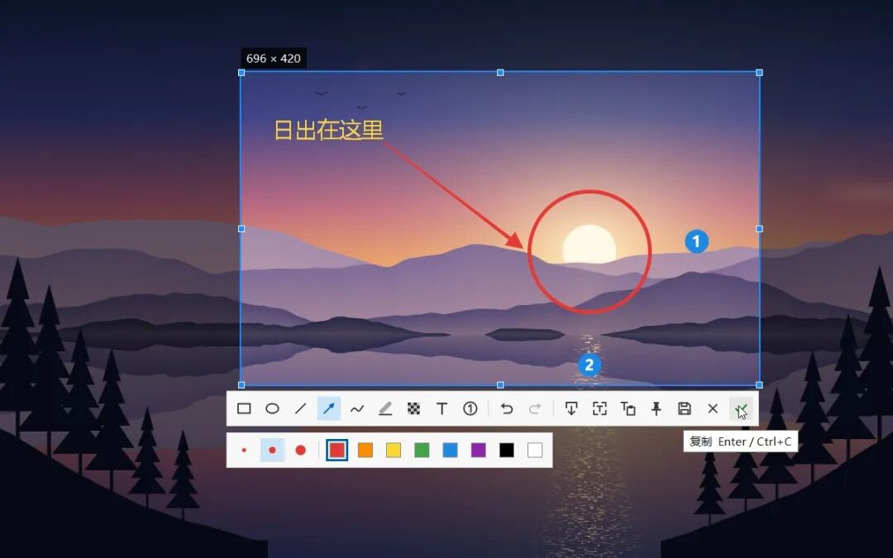
功能▼：F1 自动识别鼠标所指的窗口、控件，并带有放大镜；画圈、箭头、文字、序号、马赛克；F3 把图片或者文字钉在屏幕最上面，用滚轮来放大和缩小；可以选择本地OCR识字；长截图会自动拼接起来；8 种语言跟着系统走；没有广告，也不收集任何个人信息。
上手就三步：从Release下载解压→双击运行→按F1截图、按F3贴图。
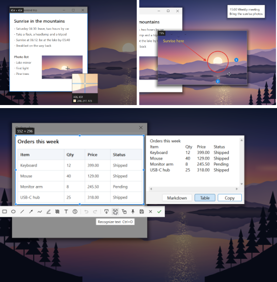
提醒：这是新的项目，功能还在增加中，复杂的标注不如Snipaste全；OCR 为可选模块，需要单独下载。
## 3、Linkit AI书签管理器
地址：https://github.com/blue-idea/linkit
浏览器收藏夹中有两三千条，再也找不到 ——Linkit可以解决这个问题。存链接的同时它会自动读一遍内容给你写摘要，以后想找什么直接说人话，语义搜索就给你捞出来。

 功能▼：AI 自动摘要；语义搜索、知识图谱、死链检测与重复删除等；一键导入Chrome、Edge、Firefox书签；本地优先存储、可选自建同步、MIT开源。
上手只需要三步：官网下载安装 → 一键导入浏览器书签 → 粘贴API或者接入本地Ollama，开始存。
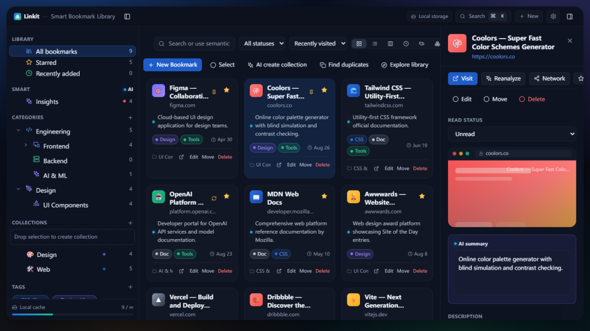
提醒：AI 功能需要自己接一个 OpenAI 兼容接口或者本地大模型，否则只能当作普通的书签管理器使用。
## 4.Speech Studio 免费离线AI配音工作室
地址：https://github.com/timoncool/speech-studio
想要为视频配上旁白，但是又不想把自己的文字上传到网络上？该软件全部运行在用户自己的电脑上，给一段参考音频，它就会按照这个声音把你的台词读出来。
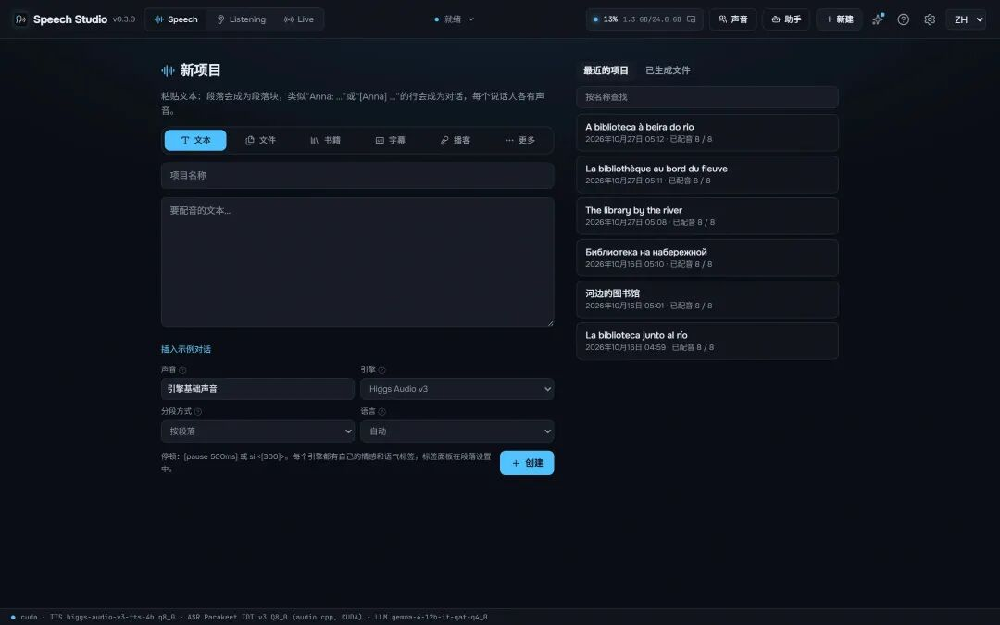
功能▼：从短音频中克隆出声音；台词逐句编写；情绪标记；多人对话一次合成；全部离线本地运行；Windows、macOS、Linux 都可以使用；Apache-2.0开源。
上手只需要三步：Release 下载安装 → 导入一段干净的参考音频 → 写台词点合成，导出音频。
提醒：需要提前下载本地语音模型，第一次会比较大一些；克隆的声音不要拿来随便模仿别人，自己配音自己使用最稳定。
## 5、GlassDesk 液态玻璃 Windows Dock
地址：https://glassdesk.cn/
Windows 11的任务栏已经很熟悉了？GlassDesk 会给你的桌面底部或者侧面添加一条液体玻璃质感的Dock，启动台会随着桌面一起同步文件，图标间距、横竖停靠都可以调节。
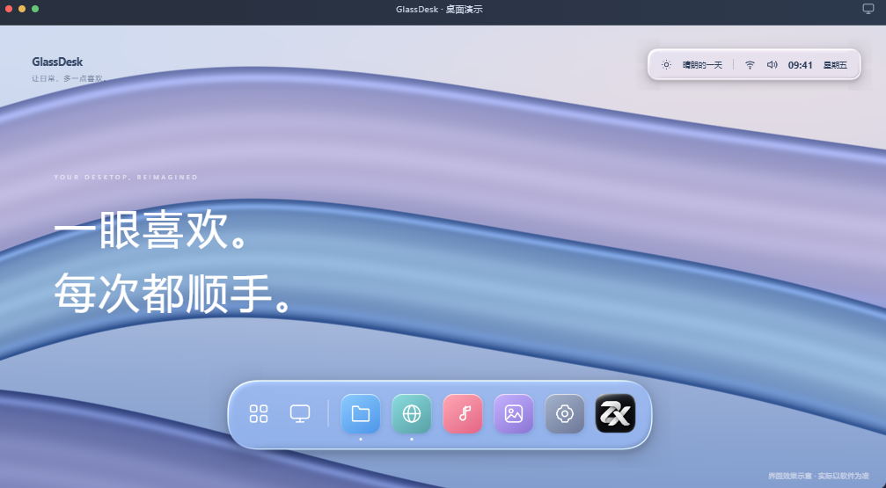
功能▼：液态玻璃折射质感；Dock 栏、启动台等；图标之间的距离可以调节，在 0 到 24 之间都可以；支持左、右纵向停靠；启动的时候会同步桌面文件、文件夹和快捷方式；局域网可以和LocalSend设备互相传输文件。
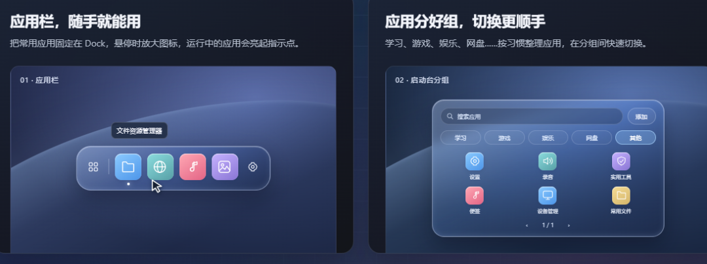
上手只需要三步：Release 下载安装 → 拖常用软件进Dock → 在设置里调好间距和停靠位置。
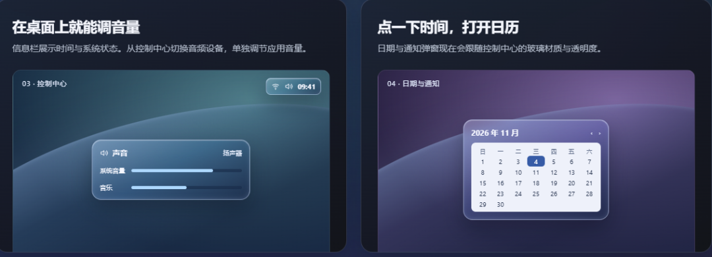
提醒：它是一个闭源软件，在 GitHub 上发布了安装包但是源码另外维护；只能运行Windows 10 19041及以后版本、Windows 11 x64系统，太旧的系统不能安装。
## 6、忆窗WinSizeX 常驻托盘窗口布局
地址：https://winsizex.x2m.net/
两个窗口并列比较，你拖了半个小时边框还是对不齐；外接的大屏幕，只要有一个窗口被最大化之后就会占据整个屏幕。忆窗常常驻留在托盘上，双击左Alt键，然后按下任意一个键，窗口就会立刻回到原来的位置。
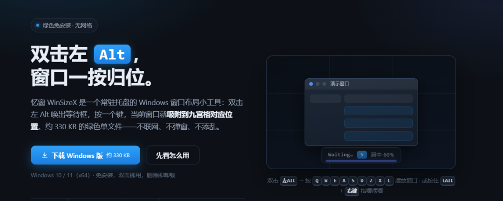
功能▼：双击左 Alt + 单键，Q/W/E/A/S/D/Z/X/C 九宫格归位；S 键窗口居中占六成；P 键置顶、U 键免打扰；左 Alt + 鼠标右键点击哪里就放哪里；高DPI、多显示器独立适配；大约 330KB 的绿色单文件，不联网、不弹窗。
上手就三步：官网下载单文件双击运行 → 图标进托盘 → 双击左 Alt，按字母键摆窗口。
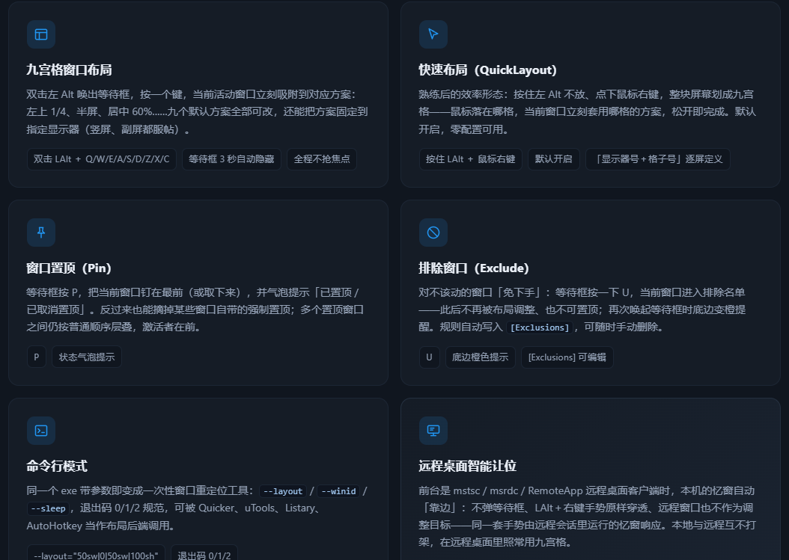
提醒：这是一款由个人开发者免费制作的小工具，并非开源软件；快捷键要习惯左手按，用了两天就会觉得很自然了。
觉得有帮助的话可以点个收藏，重装系统、换电脑按照上面的方法来操作；也可以转发给一个每天都要面对桌面杂乱无章、窗口拥挤不堪困扰的朋友。
