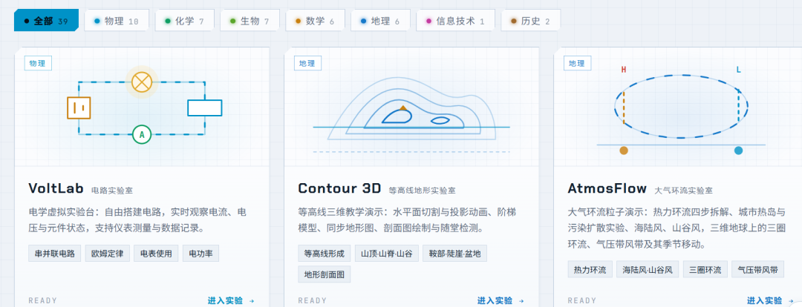
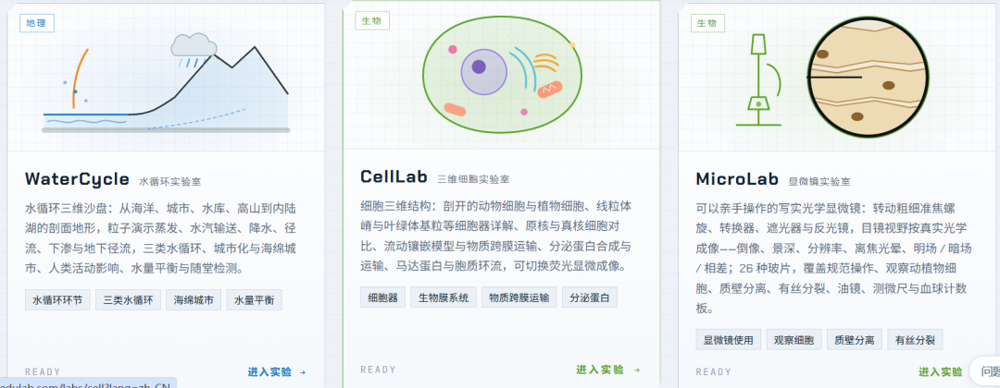
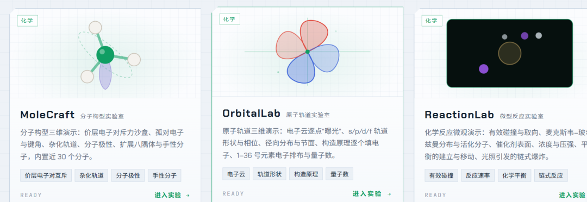
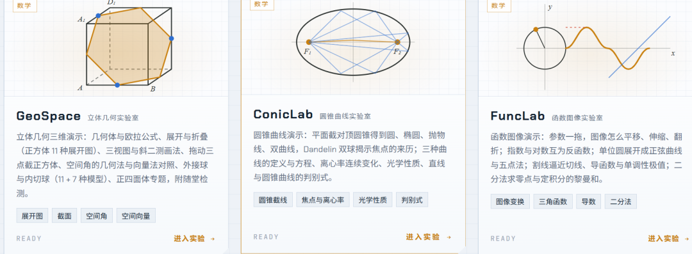
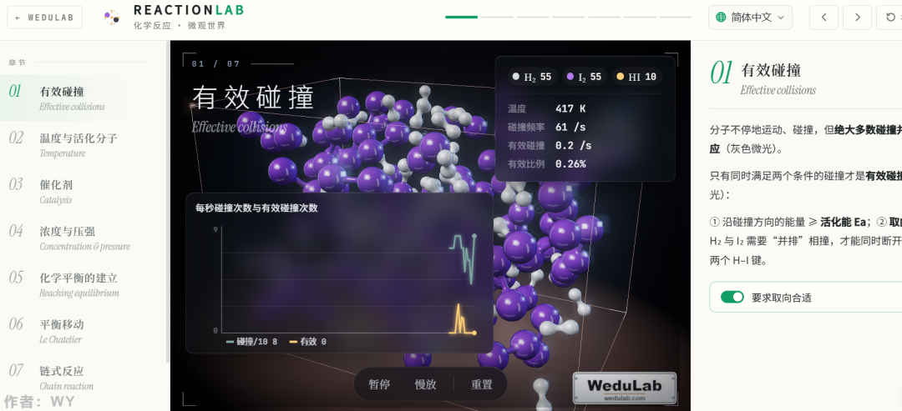

# 分享一个看着强大的初中教学工具集
> 💡 备注属性未写入，可能是备注属性名称或者类型被修改了，建议将字段类型设置为 rich_text，可以在小程序-操作-修改文章数据库页面进行调整
> 💡 原文链接:[https://mp.weixin.qq.com/s?__biz=MzI0NDE2NTQ4Ng==&mid=2652114296&idx=1&sn=7058f90f14c2929976cdfbf02f4ef3b5&chksm=f398c29c1165864d8d1ab3b92907a79cc6f2eff6c5593aed61197c6ac059a99972de608c1bda#rd](https://mp.weixin.qq.com/s?__biz=MzI0NDE2NTQ4Ng%3D%3D&mid=2652114296&idx=1&sn=7058f90f14c2929976cdfbf02f4ef3b5&chksm=f398c29c1165864d8d1ab3b92907a79cc6f2eff6c5593aed61197c6ac059a99972de608c1bda#rd)

之前分享了一个初中物理仿真实验库 [分享一个公益的在线初中物理仿真实验库](https://mp.weixin.qq.com/s?__biz=MzI0NDE2NTQ4Ng%3D%3D&mid=2652114251&idx=1&sn=16bff1c3266bde48a2920e7fb18231e4&scene=21#wechat_redirect) ，看着反向比较好，转发的朋友也挺多的。
这次分享的这个是一个教学结合的工具，不清楚是适合老师还是学生用的。
看起来挺专业的，包含的专业领域也比较多：
物理10化学7生物7数学6地理6信息技术1历史2

点进去实验的话，看起来也是相当的专业：

其他的就不一一展示了，大家可以根据自己需要去研究研究。欢迎大家转发，希望帮助到更多需要的朋友。
访问地址: https://wedulab.com/?lang=zh-CN ,也可以通过左下角“**阅读原文**”直接访问。

