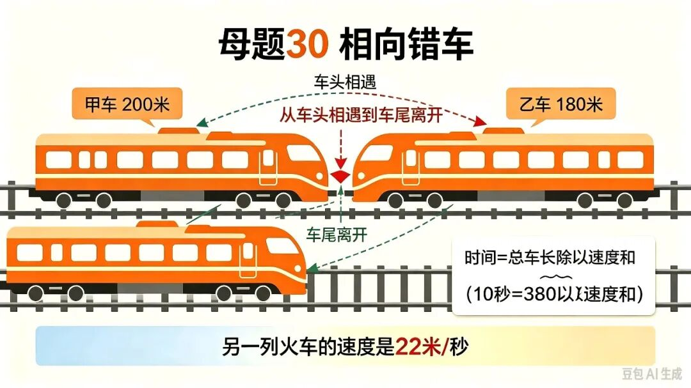
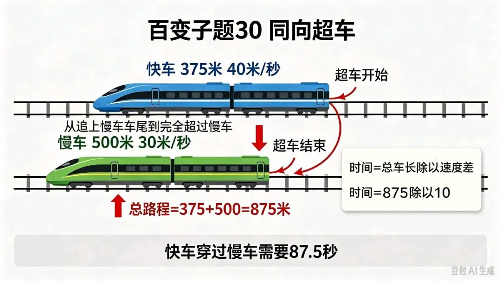

# 列车问题｜火车过火车
> 💡 备注属性未写入，可能是备注属性名称或者类型被修改了，建议将字段类型设置为 rich_text，可以在小程序-操作-修改文章数据库页面进行调整
> 💡 原文链接:[https://mp.weixin.qq.com/s?__biz=MzU5MjM1NjU4Nw==&mid=2247491010&idx=1&sn=7b1bf3c8dcb28baa72189cb4f58a6149&chksm=ffc88f3766aa3023e01e1bdb42c933347912b6c8c9dcddbed0f44c2ae2d16d277b44e4a043b7#rd](https://mp.weixin.qq.com/s?__biz=MzU5MjM1NjU4Nw%3D%3D&mid=2247491010&idx=1&sn=7b1bf3c8dcb28baa72189cb4f58a6149&chksm=ffc88f3766aa3023e01e1bdb42c933347912b6c8c9dcddbed0f44c2ae2d16d277b44e4a043b7#rd)
核心母题30｜火车过火车（相向错车）
两列火车长度分别为200米和180米，相向而行，它们在双轨铁路上从车头相遇到车尾离开的时间为10秒。已知一列火车的速度为16米/秒，则另一列火车的速度是多少？
 画图法

已知：
① 两车车长：200米+180米
② 错车时间：10秒
③ 其中一车速度：16米/秒
求：另一列火车速度
💡思路
两车面对面相向错车，从车头碰上到车尾分开，一共走的路程 = 两列车长之和。
相向而行，用速度和。
速度和 = 总路程 ÷ 错车时间
另一车速度 = 速度和 − 已知车速
📝规范解答
(200+180)÷10-16
=380÷10-16 
=38-16 
=22（米/秒）
答：另一列火车的速度是22米/秒。
✨解题妙招
相向错车，理解总路程为两车车长之和，根据速度和求得另一列火车的速度是解题的关键。
百变子题30｜火车过火车（同向追及超车）
📖题目
快车长375米，每秒行40米，慢车长500米，每秒行30米。两车同向并行，从快车车头追上慢车车尾开始计时，快车穿过慢车需要多少秒？
画图法

 已知：
① 快车长375米，速度40米/秒
② 慢车长500米，速度30米/秒
③ 同向行驶，快车车头追上慢车车尾开始算
求：快车完全穿过慢车的时间
💡思路
同向超车，快车要整个超过慢车，需要多走的路程 = 快车长+慢车长。
同向追及，用速度差。
追及时间 = 总路程 ÷ 速度差
📝规范解答
(375+500)÷40-30)
=875÷10 
=87.5（秒）
答：快车穿过慢车需要87.5秒。
✨解题妙招
同向超车：总路程依旧是两车长度相加，但是用速度差！
📌一句话对比总结
✅相向（面对面错车）：路程和 ÷ 速度和
✅同向（快车超慢车）：路程和 ÷ 速度差
