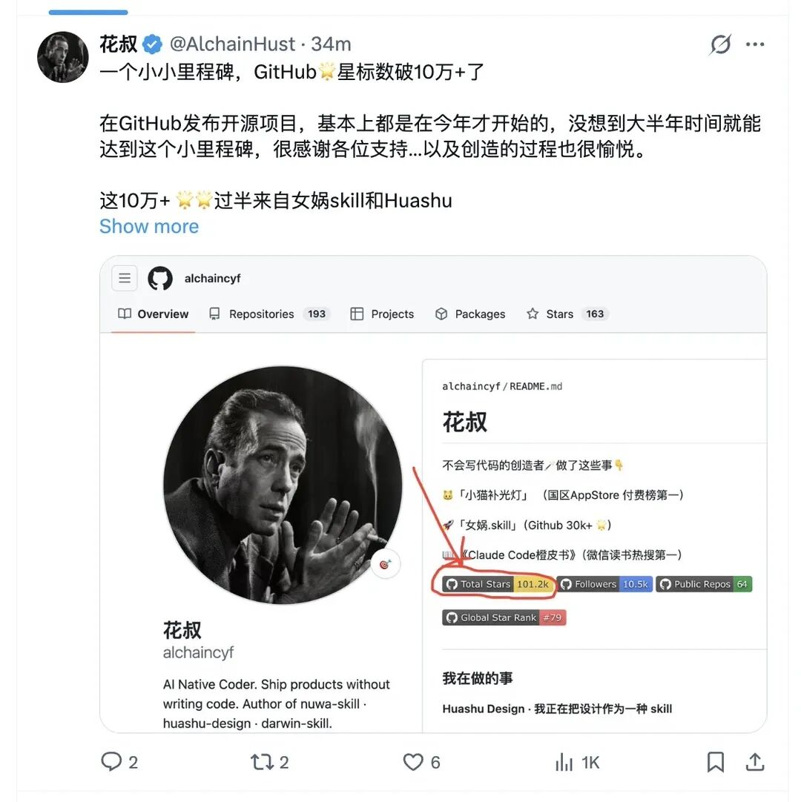
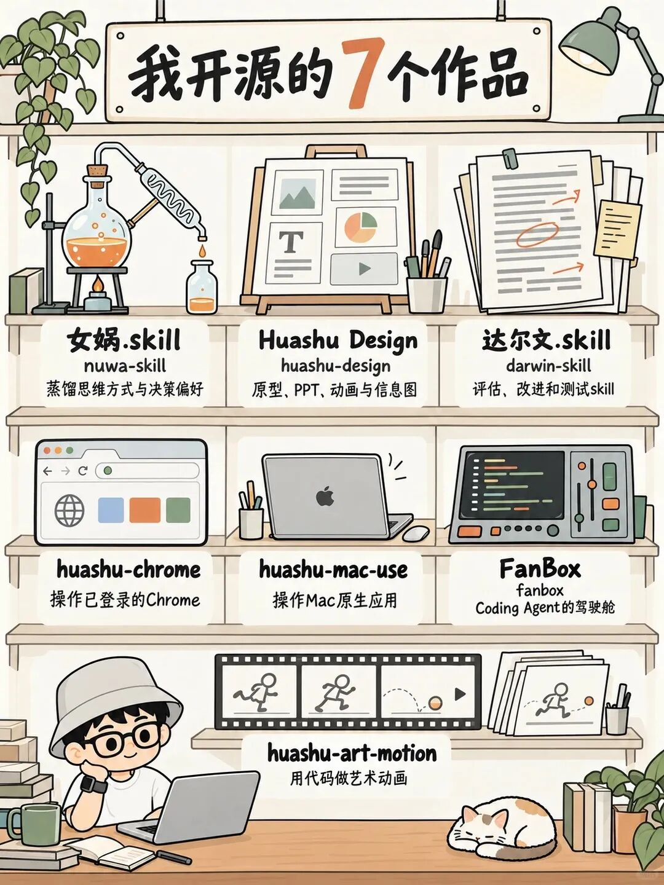
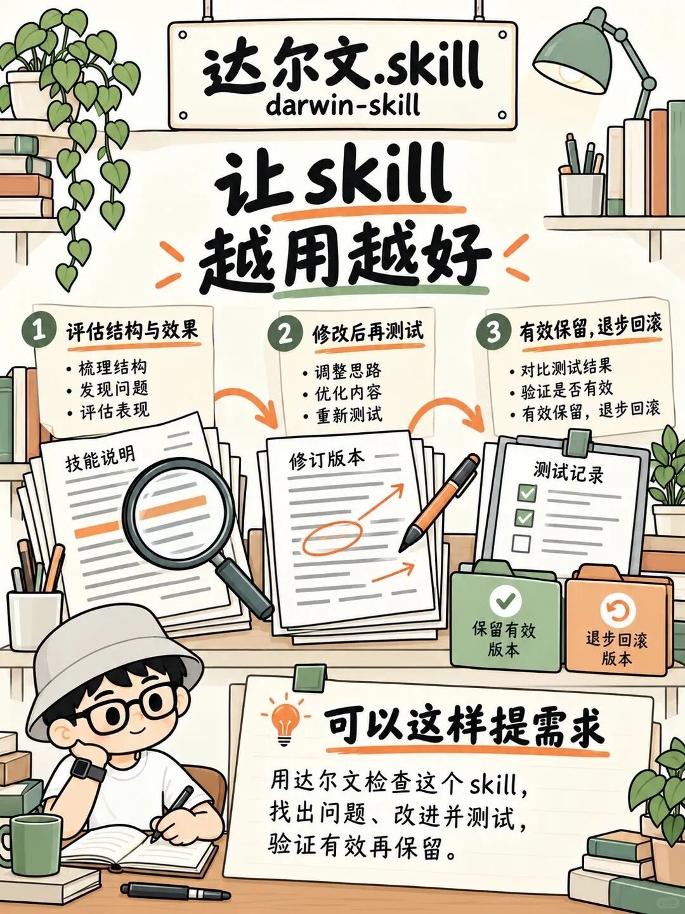

# 刚刚！他的GitHub星标破10万+了，凭什么？
> 💡 备注属性未写入，可能是备注属性名称或者类型被修改了，建议将字段类型设置为 rich_text，可以在小程序-操作-修改文章数据库页面进行调整
> 💡 原文链接:[https://mp.weixin.qq.com/s?__biz=Mzg2OTA1OTAxNA==&mid=2247492433&idx=1&sn=488b5ef4ea8a460ef8ff985d50ceac66&chksm=cf843d5d372764858bc3578da1ae9df1f558685f97f1bfc8a91679d0549c9659eb856ac2b90b#rd](https://mp.weixin.qq.com/s?__biz=Mzg2OTA1OTAxNA%3D%3D&mid=2247492433&idx=1&sn=488b5ef4ea8a460ef8ff985d50ceac66&chksm=cf843d5d372764858bc3578da1ae9df1f558685f97f1bfc8a91679d0549c9659eb856ac2b90b#rd)
刚刚！！
我GitHub上的星标数🌟破10万+了。截至10月11号，64个自己创建的仓库加起来是101,808颗星，在gitstar的全球用户榜上排第79名左右。
说起来我在GitHub上认真发开源项目，基本都是今年的事，真正的起点是4月初开源女娲.skill，在那之前我手上还没有一个仓库的star超过500。大半年走到这个小里程碑，挺意外的，也很感谢一直在用、在提issue的各位。

这篇就聊两件事：这10万颗星大概是怎么来的，以及里面有哪几个作品，是我觉得你装上就能用起来的。
你也可以不读这篇文章，直接把我的GitHub主页 https://github.com/alchaincyf/ 丢给你的任何agent，让它结合你的工作习惯的特点，按你的需求推荐并安装，它自己就能搞定。
### 一、10万颗星是怎么来的
我这数据增长斜率还真挺陡的。女娲开源第二天star就破千，4月下旬发的Huashu Design首日1600多star，5月下旬总数过了5万，然后一路到现在。
星主要集中在两个仓库：女娲3.4万、Huashu Design近2.5万，加起来占了快六成。用女娲蒸馏出来的那些人物skill也有不少星。按类别看，35个skill类仓库一共8.8万颗星，11本橙皮书的配套仓库一万出头。
还有个数我自己挺喜欢：女娲.skill这个星最多的仓库，文本几乎全是markdown，按文件体量算，脚本代码只占3%左右（md背后的自然语言才是这个时代最主要的编程语言...
### 二、7个我自己很满意的作品

#### 1. 女娲.skill：把一个人的思考方式，变成可调用的skill
GitHub：https://github.com/alchaincyf/nuwa-skill （3.4万 star）
你给它一个名字，它自动走完调研、提炼、验证，产出一个这个人的视角skill。它提炼五层东西：怎么说话（表达DNA）、怎么想（心智模型）、怎么判断（决策启发式）、什么不做（反模式和价值观底线），以及知道自己的局限在哪。
蒸馏过程核心有四个步骤：
1、六路并行采集：著作、播客访谈、社交媒体、批评者视角、决策记录、人生时间线，6个agent同时跑，各自存档；
2、三重验证提炼：一个观点要被收录成心智模型，必须跨2个以上领域出现过、能推断出他对新问题的立场、而且不是所有聪明人都会这么想，三条全过才留；
3、构建skill：3-7个心智模型、5-10条决策启发式，加上表达DNA、价值观和诚实边界，写进SKILL.md；
4、质量验证：拿3个他公开回答过的问题去测，方向一致才算通过，再拿1个他没讨论过的问题测，这时候skill应该表现出适度的不确定，而不是斩钉截铁。
每个蒸馏出来的skill都会标清楚它做不到什么：蒸馏不了直觉、只是截止到调研时间的快照、公开表达也不等于真实想法。乔布斯、芒格、费曼、纳瓦尔这些人物skill都是用它造出来的，Claude Code、Codex、Cursor、OpenClaw、Hermes Agent这些支持Agent Skills协议的agent都能跑。
可以这样提需求：「蒸馏一个保罗·格雷厄姆」，造完之后直接用：「用芒格的视角帮我分析这个投资决策」。
相关文章：[开源「女娲.skill」，你现在可以去蒸馏任何人！](https://mp.weixin.qq.com/s?__biz=Mzg2OTA1OTAxNA%3D%3D&mid=2247489388&idx=1&sn=ca5fdf8df682927d07804d246556e0e5&scene=21#wechat_redirect)

#### 2. Huashu Design：把想法变成能交付的设计
GitHub：https://github.com/alchaincyf/huashu-design （近2.5万 star）
它是一个在agent里用HTML做设计的skill，能出四类东西：可点击的App/Web交互原型（单文件HTML，带真iPhone外框）、演讲幻灯片（浏览器里演的HTML deck，也能导成文本框可编辑的PPTX）、时间轴动画（导出MP4和GIF，可以带BGM）、信息图（能导PDF、PNG、SVG）。
这个skill主要通过以下五个限制保障设计效果（据说工作机制也启发了后续Open-design等更致命的开源设计项目）：
1、需求模糊的时候，不让你盲选风格。它会开三个subagent并行，用三套逻辑各出一版真实视觉（随机从风格库里抽一种、参照世界级的获奖作品、假设预算无上限时最合适的设计工作室会怎么做），三版摆出来你看着选，底层是60种纯CSS的HTML风格；
2、涉及具体品牌时走5步品牌资产协议：先问你有没有品牌规范，再去搜官方品牌页、下载资产、从资产里提取色值，最后固化成一份brand-spec和CSS变量，绝不凭记忆猜品牌色；
3、按初级设计师的方式干活：开工前把问题一次性问完，先给你看用灰色方块占位的初版，填内容、出变体时再分别给你看，交付前自己用Playwright在浏览器里过一遍；
4、一眼AI的视觉直接禁掉，比如紫色渐变、emoji图标、圆角加左边框强调，尽量帮你做出不AI Slop的设计。
做完还能让它做一次5个维度的专家评审，出雷达图和一份能直接照着改的修复清单。
可以这样提需求：「用Huashu Design，把这份内容做成一套演示文稿，先给我三个视觉方向。」
相关文章： [我逆向了Claude Design！免费开源！](https://mp.weixin.qq.com/s?__biz=Mzg2OTA1OTAxNA%3D%3D&mid=2247489770&idx=1&sn=80ba801b80e8343bfbc0553d8fef8170&scene=21#wechat_redirect)

[开源两个月16k+ star！我把Huashu-Design推翻重写了](https://mp.weixin.qq.com/s?__biz=Mzg2OTA1OTAxNA%3D%3D&mid=2247490678&idx=1&sn=6515542f27d0d170476f9ce7b2e4e613&scene=21#wechat_redirect)

#### 3. 达尔文.skill：让skill越用越好
GitHub：https://github.com/alchaincyf/darwin-skill （6千多 star）
女娲负责造skill，达尔文负责迭代和优化skill。思路来自Karpathy的autoresearch：评估、改进、测试，然后保留或回滚。
它是通过下面的机制跑skill优化的：
1、先按9个维度给skill打分，总分100，结构类维度靠静态分析，效果类维度必须真跑测试提示词，实测的权重最高；
2、找出加权短板最大的那个维度，一轮只改这一个，改完git commit；
3、启动2个独立的子agent重新评分（下一轮再换一批全新的评委，避免锚定），新分高就保留，否则git revert回滚，分数只升不降，这就是它的棘轮机制；
4、单轮涨幅小于1分自动停手，避免为了凑分往skill里堆冗余内容；
5、每个阶段之间停下来，把diff和分数变化给你看，等你确认再继续。
2.0吸收了微软研究院两篇论文的方法，验证机制对齐了SkillOpt的设计，microsoft/SkillOpt的README里，6月初有一条更新写的就是gbrain、gbrain-evals和darwin-skill都集成了SkillOpt。拿它优化我自己的huashu-gpt-image，分数从80.8涨到了91.65。
可以这样提需求：「用达尔文检查这个skill，找出问题、改进并测试，验证有效再保留。」
相关文章： [达尔文.skill正式发布，一个无限进化的skill系统！](https://mp.weixin.qq.com/s?__biz=Mzg2OTA1OTAxNA%3D%3D&mid=2247489529&idx=1&sn=e6aa440a0e83c58a734bd56bb92c7d76&scene=21#wechat_redirect)
[达尔文.skill 2.0正式开源发布！让你的所有skill左脚踩右脚实现自我进化](https://mp.weixin.qq.com/s?__biz=Mzg2OTA1OTAxNA%3D%3D&mid=2247490467&idx=1&sn=469689a45deb1a3131924ee69c8d21ee&scene=21#wechat_redirect)

#### 4. huashu-chrome：让agent操作你已登录的Chrome
GitHub：https://github.com/alchaincyf/huashu-chrome （270多 star）
接下来这两个star不多，但我自己几乎天天在用。
huashu-chrome让任何agent直接操控你日常用的那个Chrome，带着你全部的登录态。装一个Chrome扩展加一个MCP就行，不用改启动参数、不用开调试端口，Claude Code、Codex、Cursor、Gemini CLI等二十多家支持MCP的agent都能接。相比现在大多数agent自带的browser-use能力来说，我这个skill的核心特点是能自主学习进化，以及做了些人和AI协同的细节。
它的运行逻辑：
1、22个工具分三层出牌。要数据先走网络层，看页面调了哪些接口，带着你的cookie直接调，一次翻完所有页；要做事走操作层，把页面拍成一份带编号的元素清单，一次填完整张表；截图放在最后兜底；
2、每个写操作都要交待页面到底动没动，防的是工具说成功、页面其实没反应的那种静默失败；
3、多步操作可以一次说完，每一步验过效果才走下一步，但提交、支付、删除、发布这类动作永远不代做；
4、越用越快：出厂带二十多个网站的实测经验，干活时摸清的新门路会存回你本机。同一个飞书多维表格任务，第一次从零摸索用了281次调用、54分钟，记下经验之后第二次不到10次；
5、验证码、扫码、付款这些交还给你；所有活都在后台标签页里干，不抢你的屏幕，多个agent同时干活也互不抢页。
可以这样提需求：「打开我已登录的网页，找到需要的信息，整理成一份清单。」
相关文章：[Huashu-mac-use开源！](https://mp.weixin.qq.com/s?__biz=Mzg2OTA1OTAxNA%3D%3D&mid=2247492093&idx=1&sn=b1192cca92fe3fc6252c66723ed42970&scene=21#wechat_redirect)

#### 5. huashu-mac-use：让agent操作Mac上的原生应用
GitHub：https://github.com/alchaincyf/huashu-mac-use （300 star）
Mac上大部分原生app没有API，agent够不着，huashu-mac-use就是让agent去操作这些app的。它和huashu-chrome是一对，浏览器的事交给chrome，桌面的事归它。
它的运行逻辑：
1、先探测，再选层。一个app有四层可以下手：app自己的命令行、AppleScript或调试端口，系统的辅助功能语义树，窗口坐标，最后才是像素。从上往下试，能走结构接口就绝不去点坐标；
2、读完全在后台，写默认不抢焦点。它先把键鼠事件直接投给目标进程，截图对比有没有生效，判断不出来才升级成借焦点。借之前要过四道闸：前台是不是目标app、落点有没有被挡住、你是不是正在用键鼠（2秒内动过就安静等你停手）、全机同时只允许一个进程借焦点。借到焦点的那半秒，屏幕四角会亮起一圈取景框，告诉你此刻是agent在动，用完立刻还焦点、把鼠标放回原位；
3、工具返回成功不等于真的生效，每次动作后自动截图做差分，告诉你是确认生效、部分生效，还是疑似没反应；
4、发布、提交、付款、删除这类按钮留给人点，屏幕上读到的任何文字都只当数据，不当指令。
仓库里有个案例：一个coding agent照着4张照片，在Blender里建出一艘十万吨级的邮轮，建模、材质、灯光、运镜一共33分钟，全程没人碰鼠标。
可以这样提需求：「用huashu-mac-use操作这个Mac应用，完成任务后截图核对结果。」
相关文章：[正式开源huashu-mac-use，让任何agent获得接近GPT-6的Computer use能力！](https://mp.weixin.qq.com/s?__biz=Mzg2OTA1OTAxNA%3D%3D&mid=2247492082&idx=1&sn=8bd0094afaec0208069ad1c50a6cc12c&scene=21#wechat_redirect)

#### 6. FanBox：Coding Agent的驾驶舱
GitHub：https://github.com/alchaincyf/fanbox （1千多 star）
FanBox把找文件、开终端跑agent、看产出这条链路收进一个窗口：左边文件，右边或下边终端，中间原地预览。本地运行、零配置，不做云、不做账号，macOS免费开源。
它能做的事主要是这几块：
1、看清agent改了什么。agent每写一个文件，那张文件卡片当场亮起来；开了跟随模式，预览会跟着agent正在写的文件走，HTML边写边渲染；「本回合」面板列出这一回合是哪个终端里的哪个agent改了哪些文件、每个文件加减多少行，点开看diff，可以单个文件还原，也可以整回合回滚；
2、在diff上选几行写一句批注，一键粘回那个agent的终端，最后那下回车留给你按；
3、精确知道每个agent的状态。FanBox启动Claude Code和Codex时会挂上它们的官方hooks，干活中、等你确认、等你输入、已完成都是精确事件；开了好几个终端时，在等你的会话会在标签栏下面一行行列出来；
4、内置11个coding agent一键启动，Claude Code、Codex、Hermes Agent、OpenClaw、Kimi Code、ZCode这些都在里面；点开任何项目文件夹，能看到AI在这里干过什么，一键接上当时的会话。
2.0还加了两个能力：可以直接通过微信操控电脑里的Claude Code和Codex；Mac合盖不待机，agent还在跑的时候你也能合上电脑走人。
可以这样用：「打开项目，一边让agent干活，一边查看文件和本轮改动。」
相关文章：[FanBox 2.0发布！](https://mp.weixin.qq.com/s?__biz=Mzg2OTA1OTAxNA%3D%3D&mid=2247490884&idx=1&sn=b316f6b2a3e29ae24d18d4c44e3dd457&scene=21#wechat_redirect)

#### 7. huashu-art-motion：用代码让画动起来
GitHub：https://github.com/alchaincyf/huashu-art-motion （3千多 star）
这是最新的一个，刚开源几天，让你的coding agent把艺术风格写成会动的画。里面有35种艺术风格（每种一张风格卡加一段对应的场景代码）、9种解说动画语法（解说视频里常用的几类画面讲法，大部分附了示范片和可以直接改参数的片段），还有17个笔刷、渲染、镜头、图表、排版之类的绘画动画库。
不同的需求，它走不同的路：
1、复刻一段动画：先跑拆解脚本，量出转场、节拍网格和每一段的运动热图，再按机制用代码复刻；
2、做梵高、莫奈、包豪斯那种风格的动画：先设计好一帧，再让它动起来；
3、做解说视频的动画段：按口播选语法，喂一份JSON，出一段时长精确到帧的片段，横屏竖屏都行，可以透明底；
4、画面里要有人：人交给生图模型出帧，代码负责合成、换帧和材质；
5、配乐卡节奏：BPM网格、纯代码合成。
交付前有一道数字验收，量稳定、效率、动感、流畅，再派一个没参与制作的agent只看成片挑问题；最后过一道反PPT门禁，整片几乎没有镜头内的快动作就直接红灯，不出片。仓库首页那支我闯超级玛丽的片子，砖块、水管、关卡运动和转场都是代码做的，人物用的是生成帧。
就在昨天，我还对这个skill做了大幅度的优化，目前基本上Codex和你用国产的agent以及开源模型都能跑出不错的效果。
可以这样提需求：「用huashu-art-motion，把这个观点做成一段有艺术感的解说动画。」
相关文章： [huashu-art-motion发布！可能是最有审美的动画skill。](https://mp.weixin.qq.com/s?__biz=Mzg2OTA1OTAxNA%3D%3D&mid=2247492344&idx=1&sn=f2b9cb9c272bfb9c8ec163ab0b279b49&scene=21#wechat_redirect)
[第一批用上huashu-art-motion的人，已经开始拿到结果了！](https://mp.weixin.qq.com/s?__biz=Mzg2OTA1OTAxNA%3D%3D&mid=2247492390&idx=1&sn=f1c60eb4c6b3ca78100d0ee13eba57a6&scene=21#wechat_redirect)

---
### 最后聊几句
4月女娲刚火那几天，我在即刻上写过一句：「虽然GitHub开源项目的star也干不了啥～但至少实现了对一些指标的祛魅」。现在过了10万，我还是这个看法，star不等于有多少人在用（女娲两万星的时候，我估计它的安装量早就过20万了）。
回头看，我这些开源项目基本都是一边做内容一边做出来的，女娲是一边在B站发教程一边做，小猫补光灯当年也是为了录一期Cursor教学视频顺手做的。还是我之前说过的那句：「做你自己喜欢的事，build自己感兴趣的东西，然后金钱和这种外力的辅助都不过是build in public过程的副产品而已。」
这7个里你用过或者听说过几个？欢迎在评论区聊聊你的体验，也可以告诉我你最希望下一个skill帮你解决什么问题～
哦对，最后，再请大家听首歌吧～

## 摘要

（待补充）

## 我的笔记

（待补充）
