# 初一上期中前，数学丢分的孩子问题基本出在这12处
> 💡 备注属性未写入，可能是备注属性名称或者类型被修改了，建议将字段类型设置为 rich_text，可以在小程序-操作-修改文章数据库页面进行调整
> 💡 原文链接:[https://mp.weixin.qq.com/s?__biz=MzE5MTA4MDYwNA==&mid=2247484919&idx=1&sn=2d43d84fd4b4840bf9fd336d8027dfa1&chksm=97b9662aa7ec82585d991d6164ba4d67a1bee0a9a8c5585adca64d00a4ee5662e40bfd1c682d#rd](https://mp.weixin.qq.com/s?__biz=MzE5MTA4MDYwNA%3D%3D&mid=2247484919&idx=1&sn=2d43d84fd4b4840bf9fd336d8027dfa1&chksm=97b9662aa7ec82585d991d6164ba4d67a1bee0a9a8c5585adca64d00a4ee5662e40bfd1c682d#rd)
**初一上期中前，数学丢分的孩子
问题基本出在这12处**
有理数7个坑 + 整式5个坑，每个坑配一道广州真题，拿月考卷直接对照
晓理工作室 · 广州 · 中小学数学精品教学
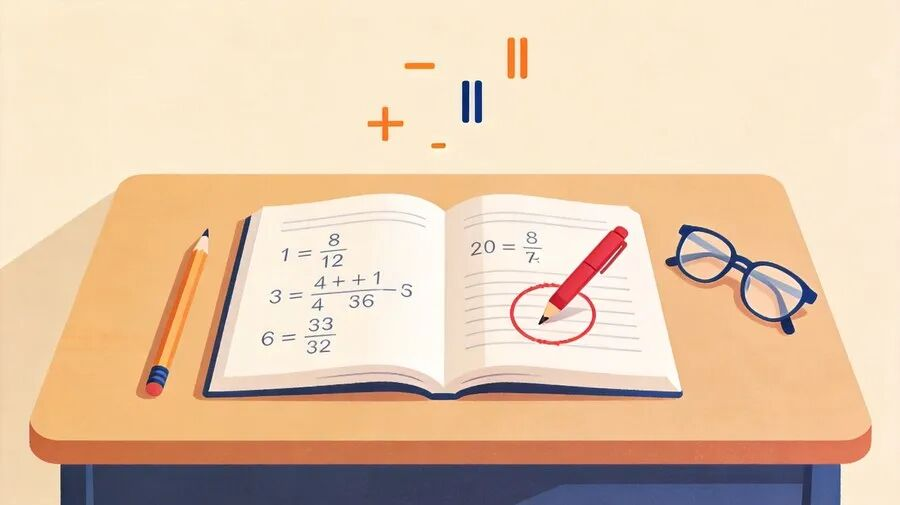
第一次月考结束，期中考就在眼前。不少家长拿着孩子的卷子来问：小学数学一直不差，怎么上了初一，成绩说掉就掉了？
我带了这么多年初中数学，可以很直接地说：初一上学期出问题，绝大多数不是孩子变笨了，而是**有理数和整式这两个单元里，一个个具体的小坑没有填上**。坑不在多难，而在隐蔽——每一处单看都不起眼，叠在一起，分数就掉了。
更要注意的是：很多家长看完卷子，最后归结成一句"这孩子就是**马虎**"。这句总结最耽误事——所谓马虎，十有八九是上面这些具体的坑还没填上。坑是具体的，就能一个个补；"马虎"是笼统的，除了批评孩子没有任何用处。所以这篇文章不谈态度，只给你**诊断依据**：拿着卷子，对出孩子到底卡在哪几个坑。
**有理数部分，孩子最容易栽在这7处：**
① 减号和负号分不清　② 乘方算错　③ 混合运算跳步　④ 带字母的符号问题靠硬猜　⑤ 分类讨论只答一种　⑥ 绝对值、动点两大综合没吃透　⑦ 知识点本身不扎实
**整式部分，还有5处：**
⑧ 整体思想不会用　⑨ 去括号符号错　⑩ "不含某项 / 与字母取值无关"没见过　⑪ 列代数式列不出　⑫ 找规律题扣分多
下面一处一处说清楚：**坑长什么样、为什么掉进去、怎么爬出来**。建议家长收藏，考前拿孩子的月考卷逐一对照。
**一、有理数：7个坑**
**坑①｜减号还是负号？——有理数计算的第一道坎**
很多孩子算有理数，一会儿把这个"−"当减号，一会儿当负号，始终定不下来到底按减法算还是按负号处理。一犹豫，符号就错；符号一错，整题归零。
**★ 怎么破：**读式子时先"定性"——这个符号是运算符号还是性质符号，落笔前嘴里说一遍。定性定得越快，符号错越少。
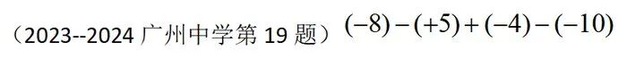
（题源：2023–2024 广州中学期中第19题）
**坑②｜乘方计算出错**
乘方是新学的运算，底数是负数时括号在不在、指数管到哪一层，孩子经常糊。负数的奇数次幂、偶数次幂符号搞反，是这一块最高频的错误。
**★ 怎么破：**(−2)³ 和 −2³ 不是一回事，先分清"底数是谁"再动笔，把这类对比题集中练一组，比刷十页卷子管用。

（题源：广州各区期末/月考真题）
**坑③｜混合运算跳步——最普遍的计算失分**
有理数混合运算涉及五种运算类型，复杂程度比小学高一大截。孩子一求快就跳步，稍不留神错一步，整道题没有分。计算能力的要求，初中是真真切切提上来了。
**★ 怎么破：**复杂计算一定要"慢下来"。慢下来不是写字慢，而是**一次只算一步**——每步只做一件事，写完整，再进行下一步。正确率就是这么练出来的。
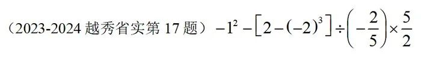
（题源：2023–2024 越秀省实期中第17题）
**坑④｜带字母的符号问题，只能靠硬猜**
比如两个数相除，结果是大于0还是小于0？带字母的式子怎么去绝对值？孩子面对这种"字母形式"的题，往往没有解题路径，全靠猜。这是**符号化思维**还没建立起来——从"数"到"式"的跨越，是初一第一次真正的思维升级。
**★ 怎么破：**最实用的办法是**举例子**——给字母代入具体的数，把抽象的式子变成具体的算式，结果大于0还是小于0、绝对值怎么开，立刻就清楚了。会举例的孩子，这类题不慌。
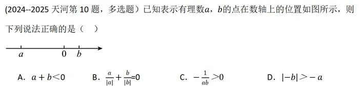
（题源：2024–2025 天河期中第10题）
**坑⑤｜分类讨论只算一种结果**
很多孩子习惯了"一道题一个答案"，遇到要分情况讨论的题，只算了一种就把另一种漏了，扣分扣得冤。
**★ 怎么破：**见到"绝对值、字母取值范围、位置不确定"这类信号词，先停一秒问自己：**有几种可能？**把可能的情形列出来再动笔。

（题源：广州各区期末/月考真题）
**坑⑥｜绝对值、动点两大综合题没吃透**
有理数单元的两类综合题：绝对值的化简计算，数轴上的动点问题。这两块是有理数的压轴难点，月考卷上基本必考其一，没吃透的孩子在这里集中丢分。
**★ 怎么破：**绝对值问题回到"到原点的距离"这个本义；动点问题养成"每动一步、用一个式子表示位置"的习惯，别在脑子里凭想象跳。
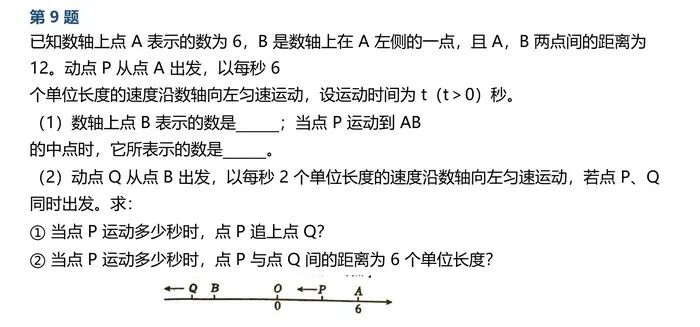
（题源：广州各区期末/月考真题）
**坑⑦｜知识点本身掌握不扎实**
最后也是最普遍的一类：概念、法则本身就没记牢、没理解透，做题自然错。前面六类是"会了但错"，这一类是"根本还不会"——排查时要把这一类放在最前面确认。

（题源：增城区期中真题）
**二、整式：5个坑**
**坑⑧｜整体思想不会用**
典型题：告诉你一个代数式的值，让你求它几倍、加减一个数之后的值。孩子不会把整个式子当成"一个整体"来看，硬拆硬算就进了死胡同。
**★ 提醒家长：**这个思想现在可能只扣两三分，但**初一下学期、初二会大量使用**，是后面能不能学得动的重要分水岭。现在暴露，反而是好事。
先看基础考法：
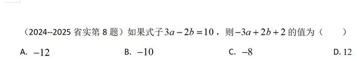
（题源：2024–2025 省实期中第8题）
再看进阶考法（先去括号、再两次整体重组）：
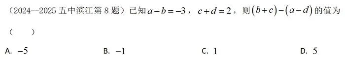
（题源：2024–2025 五中滨江期中第8题）
**坑⑨｜去括号符号错**
和有理数一脉相承：有理数里符号就没理顺的孩子，到了整式加减的去括号、添括号，符号错误会原样复现。这不是新问题，是老问题的延续。
**★ 怎么破：**括号前是负号，里面每一项都要变号——"每"一个，不是第一个。让孩子把这条写成口头禅，错一次念一次。
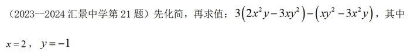
（题源：2023–2024 汇景中学期中第21题）
**坑⑩｜"不含某项""与字母取值无关"——第一次接触就懵**
这类题让孩子第一次面对"结果和字母没关系"的说法，超出了直觉，所以普遍觉得难。其实套路很固定：不含某项，就让那一项的系数等于0；与字母取值无关，就把式子整理后看字母的系数。
**★ 怎么破：**这是"型题"，题型固定、方法固定，集中讲透两三道例题就能拿下，不值得怕。
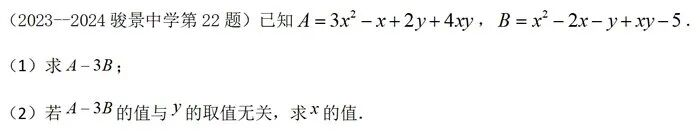
（题源：2023–2024 骏景中学期中第22题）
**坑⑪｜列代数式——和实际问题综合就卡壳**
整式和方案问题、几何问题一综合，就要先列代数式。很多孩子卡在**数量关系式列不出来**——文字读得懂，关系翻译不出，这一步断了，后面全断。
**★ 怎么破：**训练"先写关系、再写式子"：先用文字把数量关系说一遍，再逐词翻译成代数式。跳过"说关系"直接列式，就是大多数出错的来源。
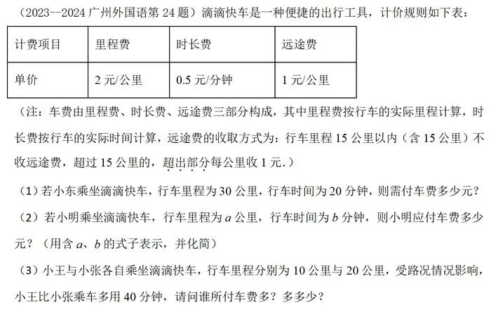
（题源：2023–2024 广州外国语期中第24题）
**坑⑫｜找规律题——从选填到解答都在考**
数字规律、图形规律、式子规律，从选择题、填空题到解答题都有，扣分点分布很广。难点在于孩子找不到"从第几个开始变"的节奏，归纳不出第n个的表示。
**★ 怎么破：**列出前几个具体结果，横着对比"每一项比上一项多了什么"，把变化的量用n表示出来——找规律的本质是**先找"不变+在变"，再翻译成n**。
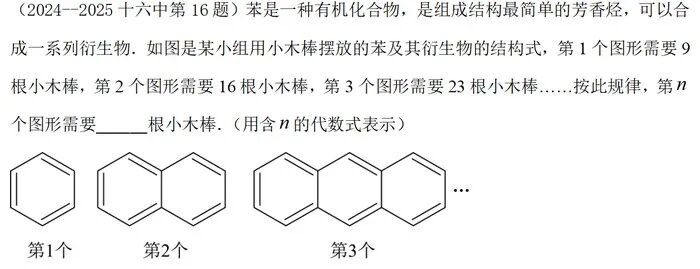
（题源：2024–2025 十六中期中第16题）
**期中考前，建议家长做这一件事：**
把孩子的月考卷拿出来，对照上面12处逐一排查：错的题落在哪个坑里？是"会但错"（坑①—⑥、⑨），还是"根本不会"（坑⑦、⑧、⑩—⑫）？**两类问题的处理方式完全不同**——前者练习惯和步骤规范，后者要回头补概念和题型。考前这段时间，补对地方比多刷十套卷子有用得多。
你家孩子这次月考，在哪一类题上栽了跟头？留言说说，下篇专门拆它。
---
— END —
晓理工作室 · 广州 · 中小学数学精品教学
增城新塘中森茗苑 · 天河公园华港商务大厦
18年一线教学经验
