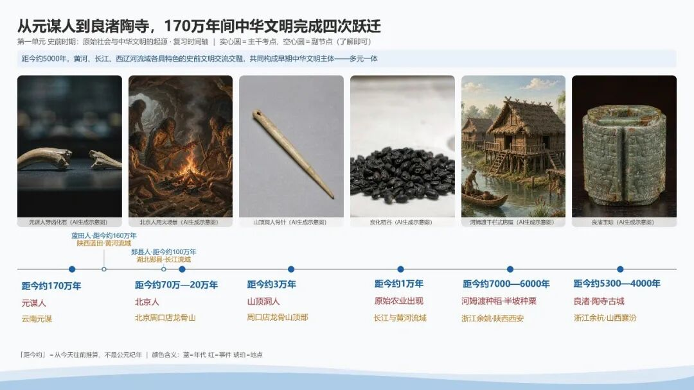
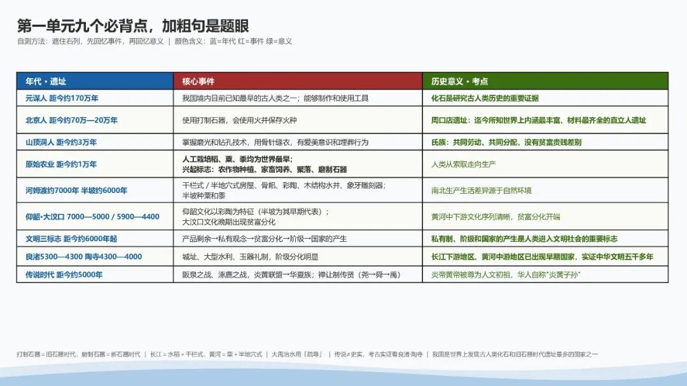
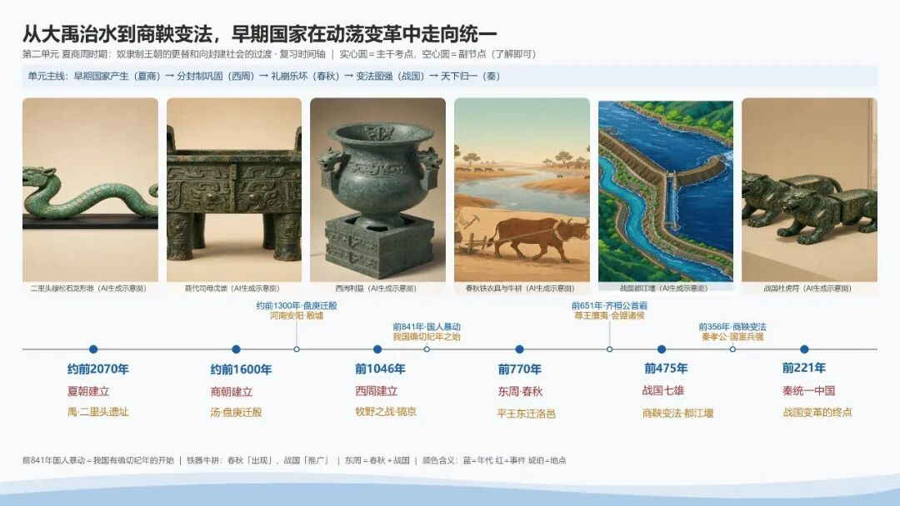
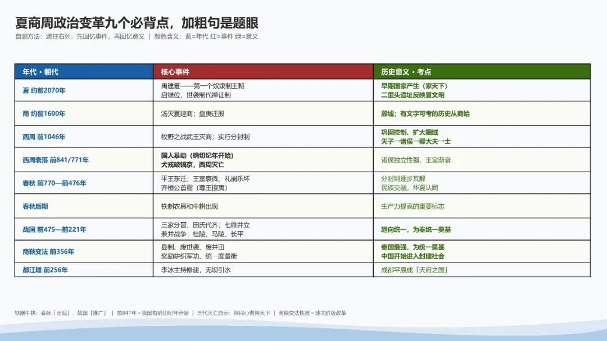
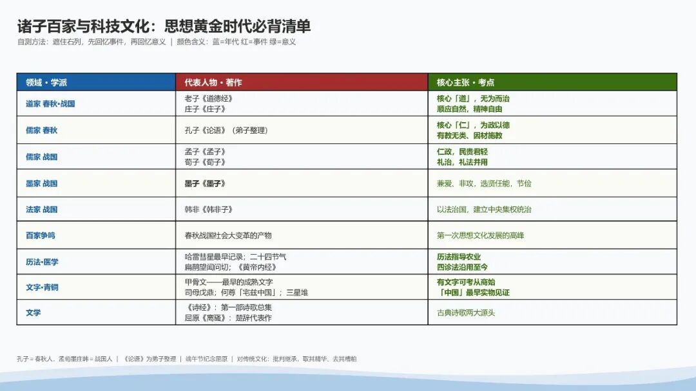
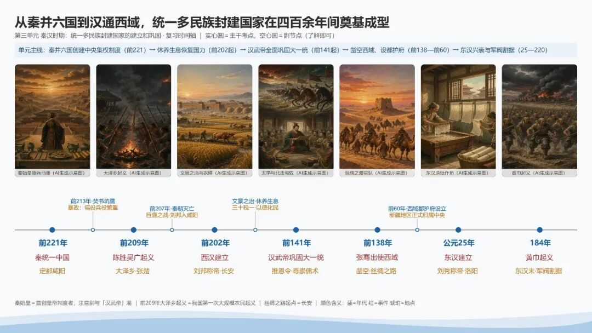
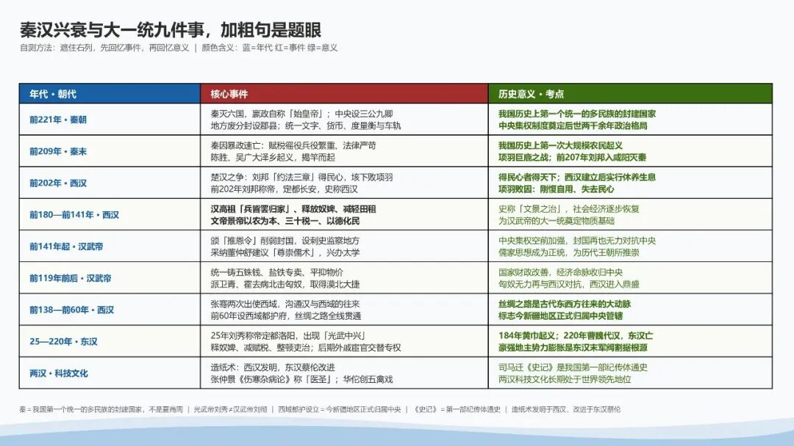
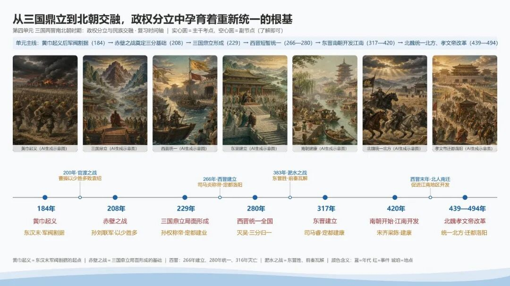
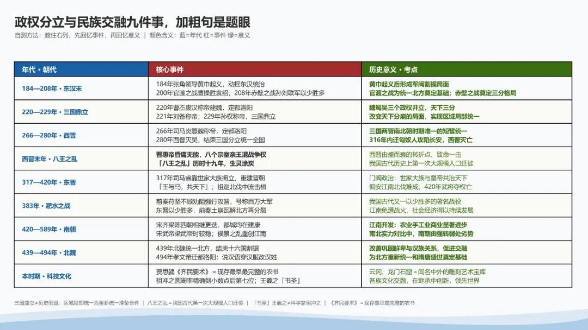

# 初一历史核心考点
> 💡 备注属性未写入，可能是备注属性名称或者类型被修改了，建议将字段类型设置为 rich_text，可以在小程序-操作-修改文章数据库页面进行调整
> 原文链接:[https://mp.weixin.qq.com/s/ZVzjqOJ7zF_zj6ICKj6izw](https://mp.weixin.qq.com/s/ZVzjqOJ7zF_zj6ICKj6izw)
## 初一历史别死记硬背： 4个单元核心考点 1张时间轴全搞定
**适用：**统编版七年级《中国历史》上册
**范围：**第一单元 史前 → 第二单元 夏商周 → 第三单元 秦汉 → 第四单元 三国两晋南北朝
**用法：**每一单元都配了「复习时间轴 + 必背清单」原图，旁边划好**题眼**（加粗那句就是考点），再补大白话解读。建议先收藏，对照原图自测。 
**长按二维码获取复习资料：**

**再看一段小视频，复习前的热身**
### 进入正题, 先看懂四根主线
● **第一单元 史前时期**：中华文明从"多元一体"的起源，走到国家的诞生
● **第二单元 夏商周**：早期国家产生（夏）→ 分封制巩固（西周）→ 礼崩乐坏（春秋）→ 变法图强（战国）→ 天下归一（秦）
● **第三单元 秦汉**：统一多民族封建国家的建立与巩固
● **第四单元 三国两晋南北朝**：政权分立与民族交融，在分裂中孕育重新统一
---
### 第一单元 史前时期：原始社会与中华文明的起源

这一单元的关键词是"从猿到人、从聚落到国家"。时间轴上，**实心圆是主干考点，空心圆是了解即可的副节点**；蓝=年代，红=事件，琥珀=地点。
顺着时间轴记四个台阶：
● **元谋人（距今约170万年）**：我国境内目前已知最早的古人类之一，能制作和使用工具。
● **北京人（距今约70万—20万年）**：使用打制石器，会**用火并保存火种**——这是人猿相区别的重要标志。
● **山顶洞人（距今约3万年）**：掌握磨光和钻孔技术，用骨针缝衣，已有爱美意识和埋葬行为。
● **原始农业（距今约1万年）**：人工栽培稻、粟、黍均为**世界最早**；兴起标志是农作物种植、家畜饲养、聚落、磨制石器——人类从"索取"走向"生产"。
南北差异记住一句：**长江＝水稻＋干栏式房屋，黄河＝粟＋半地穴式房屋**（河姆渡约7000年种稻，半坡约6000年种粟，差异源于自然环境）。
再看文明起步：**良渚（5300—4300）、陶寺（4300—4000）** 出现城址、大型水利、玉器礼制，阶级分化明显，证明长江下游、黄河中游已出现早期国家，**实证中华文明五千多年**。
最后传说时代（距今约5000年）：阪泉、涿鹿之战后炎黄联盟形成华夏族，**炎帝黄帝被尊为"人文初祖"**，华人自称"炎黄子孙"；尧舜禹的"禅让制"传贤。

---
### 第二单元 夏商周时期：奴隶制王朝的更替和向封建社会的过渡

单元主线一句话：**早期国家产生（夏）→ 分封制巩固（西周）→ 礼崩乐坏（春秋）→ 变法图强（战国）→ 天下归一（秦）**。
时间轴硬节点：
● 约**前2070年** 夏朝建立（禹、二里头遗址）
● 约**前1600年** 商朝建立（汤、盘庚迁殷）
● **前1046年** 西周建立（牧野之战、镐京）
● **前770年** 东周·春秋（平王东迁洛邑）
● **前475年** 战国七雄（商鞅变法、都江堰）
● **前221年** 秦统一中国（战国变革的终点）

必背九点抓重点：
● **夏（约前2070）**：禹建夏——第一个奴隶制王朝；启继位，**世袭制代替禅让制**（"家天下"）。二里头遗址反映夏文明。
● **商（约前1600）**：汤灭夏建商，盘庚迁殷；**殷墟**——有文字可考的历史从商开始。
● **西周（前1046）**：牧野之战武王灭商，实行**分封制**（天子→诸侯→卿大夫→士），巩固控制、扩大疆域。
● **西周衰落（前841/771）**：**前841年国人暴动＝我国有确切纪年的开始**；犬戎破镐京，西周亡。
● **春秋（前770—前476）**：平王东迁，王室衰微、礼崩乐坏；**齐桓公首霸（尊王攘夷）**；分封制逐步瓦解，民族交融、华夏认同。
● **春秋后期**：**铁制农具和牛耕出现**——生产力提高的重要标志。
● **战国（前475—前221）**：三家分晋、田氏代齐，七雄并立；桂陵、马陵、长平之战；趋向统一，为秦统一奠基。
● **商鞅变法（前356）**：县制、废世袭、废井田，奖励耕织军功、统一度量衡——**秦国最强，为统一奠基，中国开始进入封建社会**（性质＝地主阶级改革）。
● **都江堰（前256）**：李冰主持，无坝引水——成都平原成"天府之国"。
#### 附：诸子百家与科技文化（思想黄金时代）

● **道家**：老子《道德经》、庄子《庄子》——核心"道"，无为而治；顺应自然、精神自由。
● **儒家·春秋**：孔子《论语》（弟子整理）——核心"仁"，为政以德；有教无类、因材施教。
● **儒家·战国**：孟子《孟子》仁政、民贵君轻；荀子《荀子》礼治、礼法并用。
● **墨家·战国**：墨子《墨子》——兼爱、非攻，选贤任能，节俭。
● **法家·战国**：韩非《韩非子》——以法治国，建立中央集权统治。
● **百家争鸣**：春秋战国社会大变革的产物，是**第一次思想文化发展的高峰**。
● **历法·医学**：哈雷彗星最早记录、二十四节气；扁鹊望闻问切、《黄帝内经》。
● **文字·青铜**：**甲骨文＝最早的成熟文字**；司母戊鼎；何尊"宅兹中国"（"中国"最早实物见证）；三星堆。
● **文学**：《诗经》＝第一部诗歌总集；屈原《离骚》＝楚辞代表作（古典诗歌两大源头）。
---
### 第三单元 秦汉时期：统一多民族封建国家的建立和巩固

单元主线：**秦并六国创建中央集权（前221）→ 休养生息恢复国力（前202起）→ 汉武帝全面巩固大一统（前141起）→ 凿空西域、设都护府（前138—前60）→ 东汉兴衰与军阀割据（25—220）**。
时间轴硬节点：前221秦统一（咸阳）→ 前209陈胜吴广起义（大泽乡）→ 前202西汉建立（刘邦、长安）→ 前141汉武帝巩固大一统（推恩令·尊崇儒术）→ 前138张骞出使西域（凿空·丝绸之路）→ 25东汉建立（刘秀、洛阳）/ 184黄巾起义 → 220曹魏代汉。

● **前221·秦朝**：秦灭六国，嬴政自称"始皇帝"，中央设三公九卿；地方废分封设郡县，统一文字、货币、度量衡与车轨。**我国历史上第一个统一的多民族的封建国家**，中央集权制度奠定后世两千余年政治格局。
● **前209·秦末**：暴政速亡（赋税徭役兵役繁重、法律严苛）；陈胜吴广大泽乡起义——**我国历史上第一次大规模农民起义**；项羽巨鹿之战，前207刘邦入咸阳灭秦。
● **前202·西汉**：楚汉之争刘邦"约法三章"得民心，垓下败项羽；称帝长安。**得民心者得天下**；西汉建立后实行休养生息。
● **前180—前141·西汉**：汉高祖"兵皆罢归家"、释奴婢、减田租；文景之治以农为本、三十税一、以德化民——**为汉武帝大一统奠定物质基础**。
● **前141起·汉武帝**：颁**推恩令**削封国、设刺史；采董仲舒"尊崇儒术"、兴太学——中央集权空前加强，儒家成正统。
● **前119前后·汉武帝**：统一铸五铢钱、盐铁专卖、平抑物价；卫青霍去病北击匈奴漠北大捷——财政改善、经济命脉收归中央，西汉进入鼎盛。
● **前138—前60·西汉**：张骞两次出使西域；**前60年设西域都护府**，丝绸之路全线贯通——丝绸之路是东西方往来大动脉，**标志今新疆地区正式归属中央管辖**。
● **25—220·东汉**：25年刘秀"光武中兴"；后期外戚宦官交替专权；184黄巾起义、220曹魏代汉——豪强地主膨胀是东汉末军阀割据根源。
● **两汉科技文化**：造纸术西汉发明、东汉蔡伦改进；张仲景《伤寒杂病论》称"医圣"，华佗创五禽戏；司马迁《史记》＝**我国第一部纪传体通史**。
---
### 第四单元 三国两晋南北朝时期：政权分立与民族交融

单元主线：**黄巾起义后军阀割据（184）→ 赤壁之战奠定三分基础（208）→ 三国鼎立形成（229）→ 西晋短暂统一（266—280）→ 东晋南朝开发江南（317—420）→ 北魏统一北方、孝文帝改革（439—494）**。
时间轴硬节点：184黄巾（东汉末·军阀割据）→ 208赤壁（孙刘联军·以少胜多）→ 229三国鼎立（孙权称帝·建业）→ 280西晋统一（灭吴）→ 317东晋（司马睿·建康）→ 420南朝开始/江南开发（宋齐梁陈·建康）→ 439—494北魏统一北方/孝文帝改革（迁都洛阳）。

● **184—208·东汉末**：184黄巾起义（张角）动摇东汉；200官渡之战曹操胜袁绍，208赤壁之战孙刘联军以少胜多——黄巾后形成军阀割据，官渡奠定统一北方，赤壁奠定三分格局。
● **220—229·三国鼎立**：220曹丕废汉称帝建魏（洛阳），221刘备称帝，229孙权称帝——魏蜀吴并立，实现区域局部统一。
● **266—280·西晋**：266司马炎篡魏称帝（洛阳），280灭吴统一全国——**三国两晋南北朝时期唯一的短暂统一**；316内迁匈奴攻陷长安，西晋亡。
● **西晋末年·八王之乱**：晋惠帝昏庸，八王混战争权——西晋由盛而衰的转折点，也是**我国古代第一次大规模人口迁徙**。
● **317—420·东晋**：317司马睿靠世家大族拥立（"王与马，共天下"），祖逖北伐；门阀政治；420武将夺权而亡。
● **383·淝水之战**：前秦苻坚攻晋，东晋以少胜多、前秦瓦解——又一以少胜多著名战役，江南免遭战火、经济持续发展。
● **420—589·南朝**：宋齐梁陈都城建康；侯景之乱重创——江南开发（农业手工业商业显著进步），南朝由强转弱。
● **439—494·北魏**：439统一北方结束十六国；494孝文帝迁都洛阳，说汉语、穿汉服、改汉姓——促进鲜卑与汉族交融，为北方重新统一和隋唐盛世奠基。
● **本时期科技文化**：贾思勰《齐民要术》＝**现存最早最完整的农书**；祖冲之圆周率精确到小数点后第七位；王羲之"书圣"；云冈、龙门石窟——各族文化交融、领先世界。
---
### 复习方法小结
● **时间轴法**：把每单元时间轴抄一遍，只记"实心圆"主干，空心圆了解即可。
● **遮右列自测**：用必背表，遮住"历史意义·考点"一列，先回忆事件、再回忆意义。
● **对比记忆**：南北差异、春秋 vs 战国、秦 vs 汉、西汉 vs 东汉、魏蜀吴并立。
● **错题本**：把容易混淆、记不牢的点抄下来，这些就是高频丢分点。
> 顺着时间轴走一遍，四单元就不再是散沙。收藏这篇，考前翻一遍时间轴＋题眼，心里就有底了。
> 
看到这里，四单元的时间轴应该已经在你脑子里串起来了。考前几天，把每单元的「时间轴原图 + 题眼」翻一遍，比盲目刷题更管用。
本文由 AI 辅助创作
考点经人工核对整理，仅供参考
如与课本有出入，请以**课本**及老师课堂讲授为准
