# 初中几何基础知识全梳理（人教版六册14章，74个知识主题）
> 💡 备注属性未写入，可能是备注属性名称或者类型被修改了，建议将字段类型设置为 rich_text，可以在小程序-操作-修改文章数据库页面进行调整
> 💡 原文链接:[https://mp.weixin.qq.com/s?__biz=MzY5OTQ4ODExMQ==&mid=2247485754&idx=1&sn=63d90be63d90149ae55f7b947266326b&chksm=f5a3ee41b13d985e1af43ea48d7e0e683eeb5bc661c3ccb04a0ed1b1c30e9a68a3b2816e6ef5#rd](https://mp.weixin.qq.com/s?__biz=MzY5OTQ4ODExMQ%3D%3D&mid=2247485754&idx=1&sn=63d90be63d90149ae55f7b947266326b&chksm=f5a3ee41b13d985e1af43ea48d7e0e683eeb5bc661c3ccb04a0ed1b1c30e9a68a3b2816e6ef5#rd)
从七年级的线段和角，到九年级的圆、相似与锐角三角函数，这篇把人教版初中六册几何笔记放在一起。学到哪一章，就翻到哪一章。
复习性质时，先问「有了这个条件，能推出什么？」复习判定时，再问「要证明这个结论，需要哪些条件？」碰到容易混淆的结论，可以对着图把条件和结论各说一遍。
**全文目录**
**01　七年级上册**　几何图形初步
**02　七年级下册**　相交线与平行线、平面直角坐标系
**03　八年级上册**　三角形、全等三角形、轴对称
**04　八年级下册**　勾股定理、四边形
**05　九年级上册**　旋转、圆、直线与圆的位置关系
**06　九年级下册**　相似、锐角三角函数、投影与视图
### 01　七年级上册
#### 第六章 几何图形初步
**立体图形与平面图形**
6.1 看图形占据的是空间还是平面
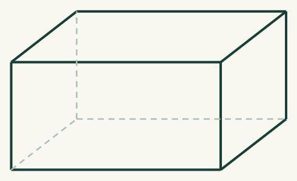
**立体图形**　各部分不全在同一平面内。 例如长方体、棱柱、圆柱、圆锥和球。
**平面图形**　各部分都在同一平面内。 例如三角形、四边形和圆。
**从不同方向观察**　同一个立体，从正面、左面和上面看， 得到的平面图形可能不同。
**立体图形的展开**
6.1 展开后可以检查各面的连接位置
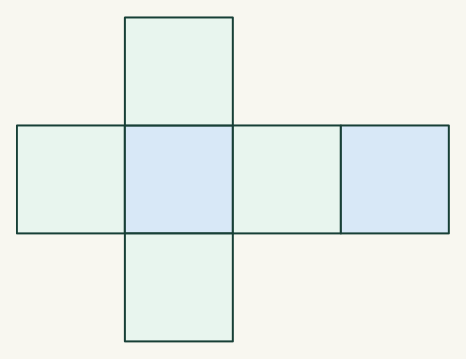
**展开图**　把一些立体图形的表面沿某些棱剪开， 展平后得到平面图形。
**正方体展开图**　六个小正方形分别对应六个面。 同一个立体可以有不同的展开方式。
**检查能否折回**　观察折叠后有没有两个面重合， 以及是否正好封住所有六个面。
**点、线、面、体**
6.1 从长方体看图形的组成

**从体到点**　包围着体的是面。面与面相交形成线， 线与线相交可以形成点。
**面与线的类型**　面有平的面和曲的面，线有直的线和曲的线。
**从运动看图形**　点运动形成线，线运动形成面，面运动形成体。 例如绕一条直角边转动直角三角形，可形成圆锥。
**直线、射线与线段**
6.2 看端点和延伸方向
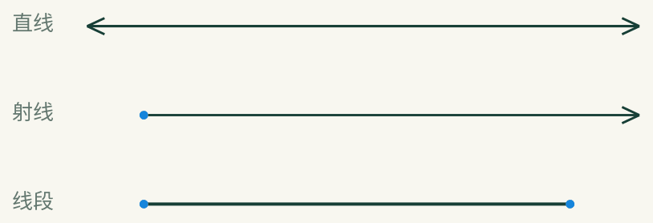
**直线**　向两端无限延伸，无端点。可记作直线 AB 或直线 l。 经过两个不同的点，有且只有一条直线。
**射线**　有一个端点，向一端无限延伸。记作射线 OA 时， 先写端点 O，再写射线上的另一点 A。
**线段**　有两个端点，长度可以度量。线段 AB 与 BA 相同。
**线段的比较与中点**
6.2 把长度相等写成符号
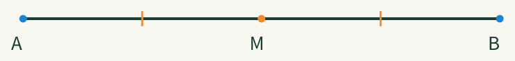
**比较与运算**　可以用度量法，也可以重合一个端点来比较。 点 M 在线段 AB 上时，AM＋MB＝AB。
**线段中点**　若 M 在线段 AB 上且 AM＝MB，则 M 是中点。 这时 AM＝MB＝AB÷2。
**两点之间的距离**　连接两点的线段长度叫作这两点的距离。 两点之间，线段最短。
**角的概念与记法**
6.3 两条射线有一个公共端点
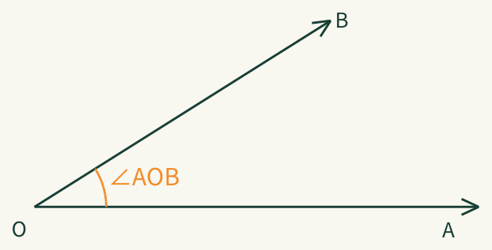
**角的组成**　公共端点是角的顶点，两条射线是角的两边。 也可以把角看作一条射线绕端点转动形成的图形。
**角的表示**　用三个字母表示时，顶点字母放在中间，如 ∠AOB。 若顶点处只有一个角，也可以记作 ∠O。
**平角、周角与单位**　转半周得 180°，转一周得 360°。 1°＝60′，1′＝60″。
**角的比较与平分**
6.3 角的大小取决于两边张开的程度
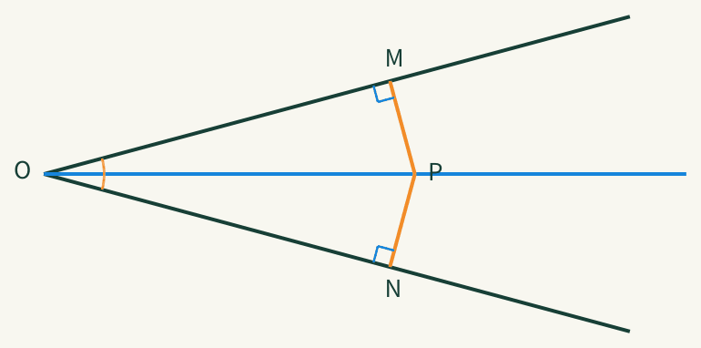
**比较角的大小**　可以度量，也可以把顶点和一边分别重合来比较。
**角的和与差**　射线 OP 在 ∠MON 内部时， ∠MOP＋∠PON＝∠MON。
**角平分线**　从顶点出发，把一个角分成两个相等的角的射线， 叫作这个角的平分线。图中 ∠MOP＝∠PON。
**余角与补角**
6.3 两角相加看 90° 或 180°
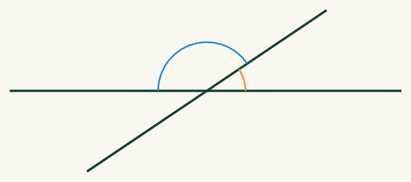
**互余与互补**　两个角的和为 90°，这两个角互余。 两个角的和为 180°，这两个角互补。
**余角与补角的性质**　同角或等角的余角相等。 同角或等角的补角相等。
**图示**　图中两个相邻角的外侧边在同一直线上， 这两个角相加是一个平角。
### 02　七年级下册
#### 第七章 相交线与平行线
**相交直线与对顶角**
7.1 先看两个角的边在什么位置
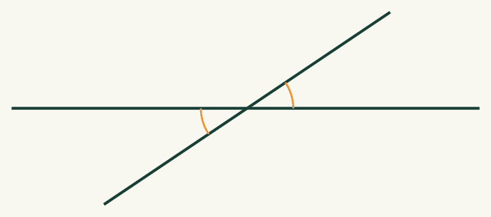
**对顶角**　两个角有公共顶点，它们的两边互为反向延长线。 对顶角相等。
**邻补角**　两个角共用一条边，另外两边互为反向延长线。 邻补角的和为 180°。
**垂线与垂线段**
7.1 直角决定点到直线的距离
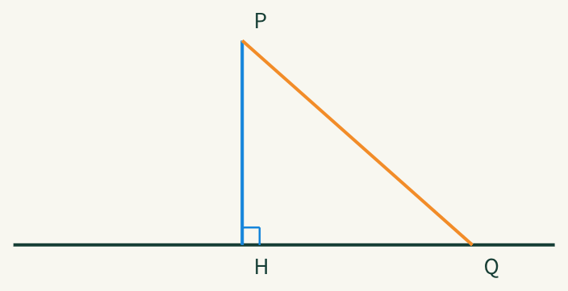
**垂直与垂足**　两直线相交形成一个直角，就说它们互相垂直。 交点是垂足。在同一平面内，过一点有且只有一条直线与已知直线垂直。
**垂线段最短**　连接直线外一点与直线上各点的线段中，垂线段最短。图中 H 是垂足，PH 是垂线段，PH 的长度就是点 P 到该直线的距离。
**截线形成的三类角**
7.1 比较两个交点附近的角
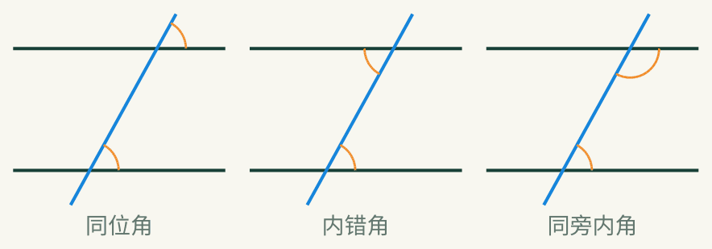
**同位角**　在两条被截直线的同一侧，在截线的同一侧。 左图标橙的是一对同位角。
**内错角**　在两条被截直线之间，在截线的两侧。
**同旁内角**　在两条被截直线之间，在截线的同一侧。
**平行线与判定**
7.2 用角的数量关系判定直线平行

**平行线与基本事实**　同一平面内，不相交的两条直线互相平行。 过直线外一点，有且只有一条直线与已知直线平行。
**平行线的三个判定**　同位角相等，或内错角相等，或同旁内角互补， 都可以判定两条被截直线平行。
**平行关系的传递**　两条直线都与第三条直线平行，这两条直线平行。
**平行线的性质**
7.2 已知直线平行，再推出角的关系
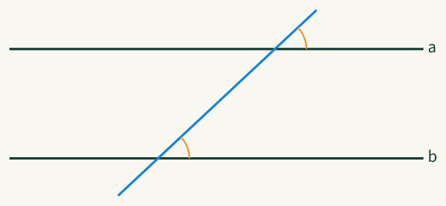
**两条平行线被第三条直线所截**　同位角相等。 内错角相等。 同旁内角互补。
**两条平行线的距离**　一条直线上的任意一点到另一条直线的距离， 都等于这两条平行线之间的距离。
**定义、命题与定理**
7.3 看懂证明中每一步的依据
**定义**　对名称或术语的含义作明确规定。
**命题**　对一件事情作出判断的语句。通常可写为 “如果……那么……”，分别对应题设和结论。
**真命题与假命题**　题设成立时，结论一定成立的是真命题。 要说明一个命题是假的，举出一个反例即可。
**基本事实、定理、证明**　基本事实可直接作为推理依据。 证明是有依据地推出结论的过程。 经过证明的真命题可作为定理。
**平移及其性质**
7.4 每个点移动同样的方向和距离
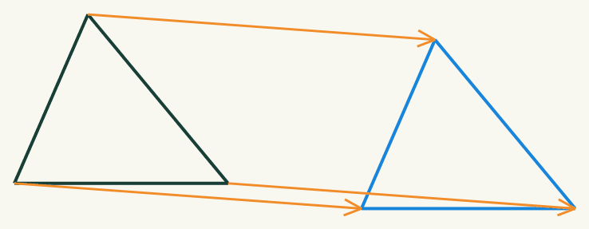
**平移**　把一个图形整体沿同一方向移动相同的距离。
**对应点**　对应点的连线平行或在同一直线上，且长度相等。
**形状和大小**　平移前后的图形全等。对应线段平行或在同一直线上，长度相等，对应角也相等。
#### 第九章 平面直角坐标系
**坐标轴、原点和象限**
9.1 有序数对可以表示点的位置
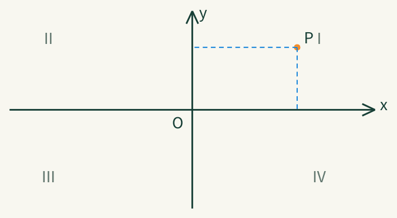
**平面直角坐标系**　两条互相垂直、原点重合的数轴组成坐标系。 横轴通常叫 x 轴，纵轴通常叫 y 轴。
**有序数对与点的坐标**　P(x, y) 先写横坐标，后写纵坐标。 x 轴上的点纵坐标为 0，y 轴上的点横坐标为 0。
**四个象限**　从右上方起逆时针依次为第一、二、三、四象限。 符号依次是（＋，＋）、（−，＋）、（−，−）、（＋，−）。
**坐标与图形的位置**
9.1—9.2 建好坐标系再读位置

**用坐标描述几何图形**　选定坐标系后，读出关键点的坐标， 用坐标确定各顶点，再按原有关系连线。
**用坐标表示地理位置**　先选参照点作原点，确定坐标轴的正方向， 再选取单位长度并标出各地点的坐标。
**用坐标表示平移**
9.2 横向改横坐标，纵向改纵坐标

**点的平移**　右移 a 个单位，(x, y) 变为 (x＋a, y)。 左移 a 个单位，横坐标减 a。 上移 b 个单位，(x, y) 变为 (x, y＋b)。 下移 b 个单位，纵坐标减 b。
**图形的平移**　对各个关键点实施同样的坐标变化，再连接。
### 03　八年级上册
#### 第十三章 三角形
**三角形的概念**
13.1 边、顶点与内角
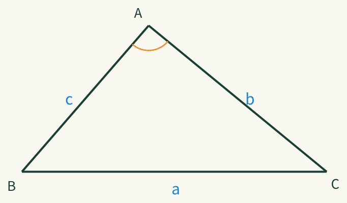
**三角形**　不在同一直线上的三条线段首尾相接，围成三角形。
**边、顶点、内角**　三条线段是边，相邻两边的公共端点是顶点。 相邻两边在公共顶点处形成的角是内角。
**表示方法**　顶点为 A、B、C 的三角形记作 △ABC。 A、B、C 的对边 BC、CA、AB 分别记作 a、b、c。
**三角形的分类**
13.1 可以按角分，也可以按边分
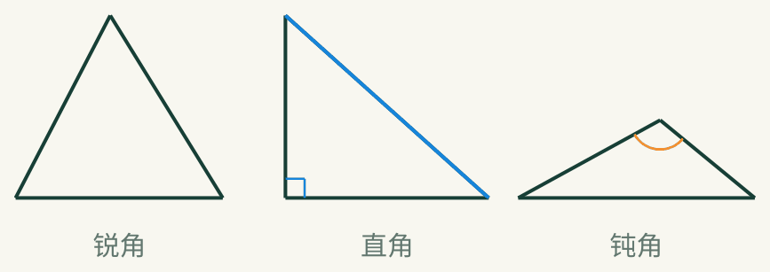
**按角分**　锐角三角形的三个角都是锐角。 直角三角形有一个直角，钝角三角形有一个钝角。 直角所对的边叫斜边，夹直角的两条边叫直角边。
**按边分**　不等边三角形的三边互不相等。 等腰三角形至少有两边相等。 等边三角形三边相等，是特殊的等腰三角形。
**三边关系与稳定性**
13.2 三条线段能围成三角形吗？
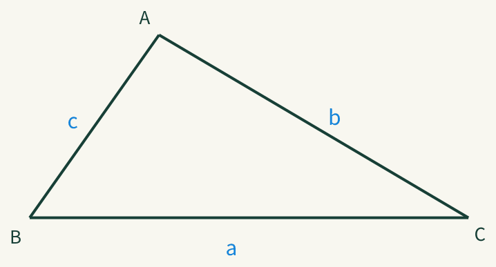
**三边关系**　任意两边的和大于第三边。 任意两边的差的绝对值小于第三边。 例如 |b－c|＜a＜b＋c。
**能否围成三角形**　只需检查较短两边的和是否大于最长边。
**三角形的稳定性**　三边长度确定后，三角形的形状和大小也确定。
**中线、角平分线与高**
13.2 三条线段分别由中点、等角和垂直确定

**中线**　连接一个顶点和对边的中点。三条中线交于重心。
**角平分线**　从顶点到这个内角的平分线与对边交点的线段。
**高**　从顶点向对边所在直线作垂线，连接顶点和垂足。 钝角三角形有两条高的垂足在对边的延长线上。
**内角和与直角三角形**
13.3 三角形的三个内角合起来是 180°

**直角三角形的性质**　直角三角形的两个锐角互余。
**直角三角形的判定**　一个三角形有两个内角互余，它就是直角三角形。
**逆命题与逆定理**　将原命题的题设与结论互换，得到它的逆命题。 原命题与逆命题都是定理时，两者互为逆定理。
**三角形的外角**
13.3 外角与哪两个内角相加有关？

**外角**　三角形的一边与它相邻一边的延长线形成的角。 图中 ∠ACD 是 △ABC 在顶点 C 处的一个外角。
**外角性质**　一个外角等于与它不相邻的两个内角之和。 图中 ∠ACD＝∠A＋∠B。
**直接推论**　外角大于任意一个与它不相邻的内角。
#### 第十四章 全等三角形
**全等与对应关系**
14.1 写全等式时，按对应顶点的顺序排列

△ABC ≌ △DEF
**全等形与全等三角形**　能够完全重合的两个图形叫作全等形。 能够完全重合的两个三角形叫作全等三角形。
**对应关系**　重合的顶点、边、角分别叫对应顶点、对应边、对应角。 图中 A 对应 D，B 对应 E，C 对应 F。
**全等三角形的性质**　对应边分别相等，对应角分别相等。
**全等判定 SAS、SSS**
14.2 有两组对应边时，先找它们的夹角

图示 SAS。两条有刻痕的边在 B、E 处夹出等角。
**边角边 SAS**　两边及这两边的夹角分别相等，两个三角形全等。 图中 AB＝DE，BC＝EF，∠B＝∠E。
**边边边 SSS**　三条边分别相等，两个三角形全等。 如已知 AB＝DE、BC＝EF、AC＝DF，可直接用 SSS。
**全等判定 ASA、AAS、HL**
14.2 先认清夹边、对边和斜边

**角边角 ASA**　两角及它们的夹边分别相等，两个三角形全等。
**角角边 AAS**　两角及其中一角的对边分别相等，两个三角形全等。
**斜边、直角边 HL**　两个直角三角形的斜边及一条对应的直角边分别相等，这两个直角三角形全等。
**尺规作图**
14.2 作一个角等于已知角

**尺规作图**　只用无刻度的直尺和圆规完成作图。
**作一个角等于已知角**　在原角两边截取相等的线段 OM、ON。 从新顶点 P 在新射线上截取 PM′＝OM。 用两段圆弧确定 N′，使 PN′＝ON、M′N′＝MN。 从 P 经过 N′ 作射线，用 SSS 可证明两角相等。
**角平分线的性质与判定**
14.3 点到角两边的距离是垂线段的长度

**性质与判定**　角平分线上的点到角两边的距离相等。 角内到两边距离相等的点在角平分线上。
**尺规作角平分线**　先在角两边截取等长线段，再以截点为圆心， 用相同半径画弧并取角内交点，连接顶点作射线。
**三条角平分线的交点**　三角形三条内角平分线交于一点，此点到三边等距。
#### 第十五章 轴对称
**轴对称图形与轴对称**
15.1 沿对称轴折叠，对应部分能够重合

**轴对称图形**　一个图形沿某条直线折叠，两侧部分能完全重合。 这条直线是它的对称轴。
**两个图形关于直线对称**　沿某条直线折叠，一个图形能与另一个完全重合。 这两个图形全等，折叠时重合的点互为对称点。
**轴对称的性质**　对称轴垂直平分任意一对不重合的对称点的连线。 对称轴上的点与自身重合。
**线段的垂直平分线**
15.1 线段中点处的垂线

**定义**　经过线段中点并垂直于这条线段的直线。
**性质**　垂直平分线上的点到线段两端的距离相等。
**判定**　到线段两端距离相等的点，在它的垂直平分线上。
**怎样找对称轴**　找到一对不重合的对称点，作它们连线的垂直平分线。
**怎样画轴对称图形**
15.2 从一对对称点开始

**画一个点的对称点**　过原来的点作对称轴的垂线，在轴的另一侧取点， 让两点到轴等距。轴上的点与自身重合。
**画整个图形**　先找原图的顶点等关键点，逐个作出对称点。 再按照原来的连接关系，把对应点连起来。
**检查作图**　图中对称轴垂直平分 AA′，两侧三角形全等。
**坐标轴对称**
15.2 关于哪条轴对称，哪一项坐标保持不变

**关于 x 轴对称**　横坐标相同，纵坐标互为相反数。 P(x, y) 对应 P₁(x, −y)。
**关于 y 轴对称**　纵坐标相同，横坐标互为相反数。 P(x, y) 对应 P₂(−x, y)。
**等腰三角形**
15.3 等边对等角，等角对等边

**腰、底边、顶角、底角**　相等的两边是腰，另一边是底边。 两腰夹成顶角，腰和底边夹成底角。
**性质**　两底角相等。顶角平分线、底边上的中线和高重合， 这叫作三线合一。
**判定**　同一个三角形中，有两个角相等，它们的对边相等。
**等边三角形与 30° 角**
15.3 用等边三角形理解斜边的一半

**等边三角形的性质**　三边相等，三个内角都是 60°，有三条对称轴。
**等边三角形的判定**　三个角都相等的三角形是等边三角形。 有一个角为 60° 的等腰三角形也是等边三角形。
**含 30° 角的直角三角形**　30° 角所对的直角边等于斜边的一半。
### 04　八年级下册
#### 第二十章 勾股定理
**勾股定理**
20.1 已知两边，可以求第三边

**勾股定理**　直角三角形的两条直角边长为 a、b，斜边长为 c， 则 a²＋b²＝c²。
**先认准斜边**　直角所对的边是斜边。图中 ∠B＝90°， 所以 AB²＋BC²＝AC²。
**应用**　知道两条直角边长时，先求平方和，再取正平方根。 求一条直角边时，用斜边平方减去另一条直角边平方。
**勾股定理的逆定理**
20.2 根据边长判定直角三角形

**勾股定理的逆定理**　一个三角形的三边长为 a、b、c， 若 a²＋b²＝c²，它就是直角三角形。
**判定步骤**　先找最长边 c，再检验另外两边的平方和。 等式成立时，最长边所对的角是直角。
**勾股数**　满足 a²＋b²＝c² 的三个正整数，如 3、4、5。
#### 第二十一章 四边形
**四边形与多边形**
21.1 顶点、边、内角和对角线

**多边形**　在同一平面内，由一些线段首尾顺次相接围成。 相邻两边的公共端点是顶点，连接不相邻顶点的线段叫对角线。
**四边形**　有四条边、四个顶点、四个内角和两条对角线。
**正多边形**　各边相等、各内角也相等的多边形。
**多边形的内角和与外角和**
21.1 从一个顶点分出若干个三角形

**内角和**　从一个顶点出发的对角线，把凸 n 边形分成 （n−2）个三角形。内角和为（n−2）×180°。 四边形内角和为 360°。
**外角和**　凸多边形在每个顶点取一个外角，外角和为 360°。
**正多边形的角**　正 n 边形的每个外角为 360°÷n。
**平行四边形的性质**
21.2 从对边平行推出等边、等角

**定义**　两组对边分别平行的四边形叫平行四边形。
**边与角**　两组对边分别相等，两组对角分别相等。 相邻两个内角互补。
**对角线**　平行四边形的两条对角线互相平分。
**平行四边形的判定**
21.2 根据已知条件选最直接的方法

**从对边判断**　两组对边分别平行。 两组对边分别相等。 一组对边平行且相等。
**从对角判断**　两组对角分别相等。
**从对角线判断**　两条对角线互相平分。
**三角形的中位线**
21.2 两个中点确定一条中位线

**定义**　连接三角形两边中点的线段叫三角形的中位线。
**中位线定理**　中位线平行于第三边，且等于第三边的一半。
**图中关系**　D、E 分别是 AB、AC 的中点。 DE ∥ BC，DE＝BC÷2。
**矩形的性质与判定**
21.3 平行四边形加一个直角得到矩形

**定义与性质**　有一个角是直角的平行四边形叫作矩形。 矩形四角都是直角，对角线相等并互相平分。
**判定**　有三个角是直角的四边形是矩形。 对角线相等的平行四边形是矩形。
**直角三角形的斜边中线**
21.3 斜边中点到三个顶点等距

**结论**　直角三角形斜边上的中线等于斜边的一半。 图中 BM＝AM＝CM＝AC÷2。
**证明依据**　将直角三角形补成矩形。矩形的两条对角线相等并互相平分，斜边中点也是另一条对角线的中点。
**菱形的性质与判定**
21.3 平行四边形加一组邻边相等得到菱形

**定义与性质**　有一组邻边相等的平行四边形叫作菱形。 菱形四边相等，对角线互相垂直平分。 每条对角线平分一组对角。
**判定**　四边相等的四边形是菱形。 对角线互相垂直的平行四边形是菱形。
**正方形的性质与判定**
21.3 正方形同时具有矩形和菱形的性质

**定义与性质**　有一组邻边相等且有一个角是直角的平行四边形。 四边相等，四角都是直角。对角线相等且互相垂直平分，每条对角线平分一组对角。
**判定**　有一组邻边相等的矩形是正方形。 有一个角是直角的菱形是正方形。
### 05　九年级上册
#### 第二十八章 旋转
**图形的旋转**
28.1 一个中心、一个方向、一个角度

**旋转的三个要素**　旋转中心是图形绕着转动的点。 转动可以顺时针或逆时针，转过的角是旋转角。
**旋转的性质**　对应点到旋转中心的距离相等。 每对对应点与旋转中心的连线所成的角相等。 旋转前后的图形全等。
**旋转作图**　按指定方向和角度作关键点的对应点，再依次连接。
**中心对称与坐标**
28.2 把一个图形绕同一点转 180°

**中心对称**　一个图形绕某点旋转 180° 后与另一个图形重合。 该点是对称中心，并平分任意一对对称点的连线。
**中心对称图形**　一个图形绕某点旋转 180° 后与自身重合。 例如平行四边形的对角线交点是它的对称中心。
**关于原点对称**　点 (x, y) 关于原点的对称点为 (−x, −y)。
#### 第二十九章 圆
**圆、弦与弧**
29.1 圆心和半径确定一个圆

**圆的定义**　平面内到定点 O 的距离等于定长 r 的点组成圆。 O 是圆心，r 是半径，记作 ⊙O。
**弦与直径**　连接圆上任意两点的线段是弦。经过圆心的弦是直径。 直径是圆中最长的弦，长度等于半径的两倍。
**弧与等圆**　圆上两点之间的部分叫弧。大于半圆的是优弧， 小于半圆的是劣弧。能重合的弧是等弧。 半径相等的两个圆是等圆。
**点与圆、三点定圆**
29.1 先比点到圆心的距离与半径

**点与圆的位置关系**　设点到圆心的距离为 d，半径为 r。 d＜r 在圆内，d＝r 在圆上，d＞r 在圆外。
**不共线的三点确定一个圆**　任取三点连成三角形，两边垂直平分线的交点为圆心。
**外接圆与外心**　经过三角形三个顶点的圆是外接圆。 外接圆的圆心叫外心，到三个顶点的距离相等。
**垂径定理**
29.2 垂直于弦的直径会平分哪些部分？

**圆的对称性**　圆关于圆心中心对称。任意一条直径所在直线都是它的对称轴。
**垂径定理**　垂直于弦的直径平分这条弦，也平分弦所对的两条弧。
**常用推论**　平分一条非直径弦的直径垂直于这条弦， 并平分这条弦所对的两条弧。
**圆心角、弦和弧**
29.2 在同圆或等圆中比较

**圆心角**　顶点在圆心的角叫作圆心角。 圆心角的度数等于它所对的弧的度数。
**圆心角定理**　同圆或等圆中，相等的圆心角所对的弧相等， 所对的弦也相等。
**反向使用**　同圆或等圆中，两弧或两弦相等， 相应的圆心角也相等。
**圆周角定理**
29.2 同一条弧对应的圆周角与圆心角

**圆周角**　顶点在圆上，两边都与圆相交的角是圆周角。
**圆周角定理**　一条弧所对的圆周角等于它所对圆心角的一半。 图中 ∠ACB＝∠AOB÷2。
**常用推论**　同弧或等弧所对的圆周角相等。 直径所对的圆周角为 90°。90° 的圆周角所对的弦是直径。
**圆内接四边形**
29.2 四个顶点都在同一个圆上

**圆内接四边形**　四边形的四个顶点在同一个圆上。 这个圆叫作四边形的外接圆。
**性质**　圆内接四边形的两组对角分别互补。 任意一个外角等于与它相对的内角。
**弧长与扇形面积**
29.3 扇形占整圆的比例是 n÷360

**弧长**　半径为 r，圆心角为 n°，弧长 l＝nπr÷180。
**扇形面积**　S＝nπr²÷360，也可以写成 S＝lr÷2。
**扇形**　由两条半径和这两条半径所夹的弧围成。
**圆锥的侧面积**
29.3 展开的扇形弧长等于底面圆的周长

**圆锥的三个量**　底面半径 r，母线长 l，高 h。 它们满足 l²＝r²＋h²。
**侧面展开**　侧面展开成扇形，半径是母线长 l，弧长是 2πr。
**面积**　侧面积 S侧＝πrl，全面积 S全＝πrl＋πr²。
#### 第三十章 直线与圆的位置关系
**相交、相切与相离**
30.1 比较圆心到直线的距离与半径

**相交**　有两个公共点，圆心到直线的距离 d＜r。
**相切**　只有一个公共点，d＝r。公共点叫作切点。
**相离**　没有公共点，d＞r。
**切线的性质与判定**
30.1 切点处，半径与切线垂直

**切线的性质**　圆的切线垂直于经过切点的半径。
**切线的判定**　经过半径的外端且垂直于这条半径的直线， 是圆的切线。
**图中关系**　T 在圆上，若直线经过 T 且垂直于 OT， 则这条直线是圆在点 T 处的切线。
**切线长定理**
30.1 从同一个圆外点引出两条切线

**切线长**　从圆外一点向圆作切线，该点到切点的线段长度叫作这条切线的切线长。
**切线长定理**　从圆外同一点引圆的两条切线，切线长相等。 圆心与该点的连线平分两条切线所成的角。
**图中关系**　PA＝PB，∠APO＝∠OPB。
**三角形的内切圆**
30.2 内心到三边的距离相等

**内切圆**　与三角形的三条边都相切的圆叫内切圆。 三角形叫作这个圆的外切三角形。
**内心**　三条内角平分线的交点是内心。 内心到任意一边的距离等于内切圆半径。
**正多边形与圆**
30.3 把圆周等分，再连接相邻分点

**中心、半径和边心距**　外接圆的圆心是正多边形的中心。 中心到顶点的距离是半径，到一边的距离是边心距。
**中心角**　相邻两顶点与中心连线所成的角。 正 n 边形的每个中心角为 360°÷n。
**面积**　周长为 p、边心距为 a，面积 S＝pa÷2。
### 06　九年级下册
#### 第三十一章 相似
**相似图形与相似比**
31.1 形状相同的图形可以有不同大小

**相似多边形**　对应角分别相等，对应边成比例的多边形相似。
**相似比**　相似多边形对应边的比叫作相似比。 交换前后两个图形，相似比也取倒数。
**相似的表示**　用 ∽ 表示相似，如 △ABC ∽ △DEF。 写相似式时，对应顶点写在相同位置。
**平行线分线段成比例**
31.2 截在两条直线上的对应线段成比例

**比例线段**　如果 a÷b＝c÷d，则 a、b、c、d 成比例， 也可以写成 ad＝bc。
**平行线分线段成比例**　三条平行线截两条直线，所得对应线段成比例。
**三角形里的平行线**　图中 DE∥BC，故 AD÷DB＝AE÷EC， 也有 AD÷AB＝AE÷AC。
**相似三角形的判定**
31.2 已知对应角或对应边时怎样证明相似

**两角分别相等**　两个角分别相等，两个三角形相似。
**两边成比例且夹角相等**　两组对应边成比例，且它们的夹角相等。
**三边成比例**　三组对应边成比例，两个三角形相似。
**平行线得到相似**　一条直线平行于三角形的一边，截另外两边或其延长线，所得三角形与原三角形相似。
**相似三角形的性质**
31.2 长度看 k，面积看 k²

**对应角与对应边**　对应角相等，对应边成比例。
**线段与周长**　对应高、中线、角平分线的长度比都等于相似比。 周长比也等于相似比。
**面积**　面积比等于相似比的平方。
**相似三角形的应用**
31.3 找到能测量的长度，再建立比例式

**建立相似关系**　先从平行、直角或公共角找到两组等角。 确定对应关系，再列比例式求未知长度。
**测高度的一个例子**　同一时刻阳光可视为平行。竖直标杆与竖直物体分别和影子形成相似三角形。 物体高度÷物体影长＝标杆高度÷标杆影长。
**位似与位似作图**
31.4 对应点连线经过同一个位似中心

**位似**　对应点的连线经过同一点，对应线段平行或共线， 这样的相似图形是位似图形。该点叫位似中心。 位似比等于相似比。
**位似作图**　选定位似中心，按给定比例在对应射线或反向射线上找各关键点的像，再按原来的连接关系连线。
**用坐标表示位似**　位似中心为原点时，同侧对应点为 (kx, ky)， 异侧对应点为 (−kx, −ky)，k＞0。
#### 第三十二章 锐角三角函数
**正弦、余弦与正切**
32.1 先相对于指定的锐角认清三条边

**正弦**　sin θ＝对边÷斜边。
**余弦**　cos θ＝邻直角边÷斜边。
**正切**　tan θ＝对边÷邻直角边。 图中 sin θ＝a÷c，cos θ＝b÷c，tan θ＝a÷b。
**三个特殊角的函数值**
32.1 从含 30° 的直角三角形和等腰直角三角形得到
**30°**　sin 30°＝½，cos 30°＝√3÷2，tan 30°＝√3÷3。
**45°**　sin 45°＝cos 45°＝√2÷2，tan 45°＝1。
**60°**　sin 60°＝√3÷2，cos 60°＝½，tan 60°＝√3。
**变化规律**　锐角增大时，正弦与正切增大，余弦减小。
**解直角三角形**
32.2 从已知边角求出其余边角

**什么是解直角三角形**　由已知元素求出直角三角形其余的边和角。
**三类关系**　三边满足勾股定理，两锐角互余。 边与锐角通过正弦、余弦或正切联系。
**选择哪一个比**　看已知边和待求边在指定锐角旁的位置。 例如已知邻直角边 b 和锐角 θ，对边 a＝b·tan θ。
**仰角、俯角与坡度**
32.2 从水平线出发建立直角三角形

**仰角与俯角**　视线在水平线上方时，视线与水平线的夹角是仰角。 视线在水平线下方时，相应的夹角是俯角。
**坡度与坡角**　坡度 i＝铅直高度÷水平距离。 坡面与水平面的夹角为坡角 α，i＝tan α。
**方向角**　例如北偏东 30°，从正北向东转 30°。
#### 第三十三章 投影与视图
**投影与正投影**
33.1 影子的形状由光线和投影面决定

**投影**　物体在光线照射下，在某个平面上形成的影子。 照射的光线叫投影线，影子所在的平面叫投影面。
**平行投影与中心投影**　投影线互相平行是平行投影。 投影线从同一个点发出是中心投影。
**正投影**　投影线垂直于投影面时形成的平行投影。
**三视图与位置关系**
33.2 用三个方向的正投影描述立体

**三视图**　从正面看得到主视图，从左面看得到左视图， 从上面看得到俯视图。
**对齐关系**　主视图与俯视图长对正。 主视图与左视图高平齐。 俯视图与左视图宽相等。
**线型**　可见轮廓画实线，被遮挡的必要轮廓画虚线。
**由三视图还原立体**
33.2 对照三个方向的信息

**先找外轮廓**　主视图给出长度和高度，左视图给出宽度和高度， 俯视图给出长度和宽度。
**再核对细节**　结合三个方向的位置关系，判断哪些面凸出、 哪些位置凹入，核对虚线所表示的遮挡。
**从立体反查**　试着把想象出的立体从三个方向重新投影， 看所得轮廓是否都与题给视图一致。
---
### 阿慢几何视频号正式上线！
每日更新几何讲题视频
讲清每一条辅助线的来源与理由
欢迎关注「阿慢几何」视频号
⬇️⬇️⬇️

