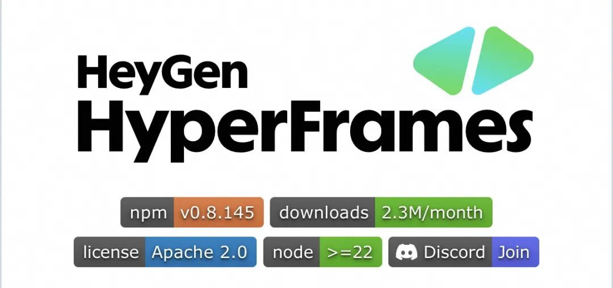
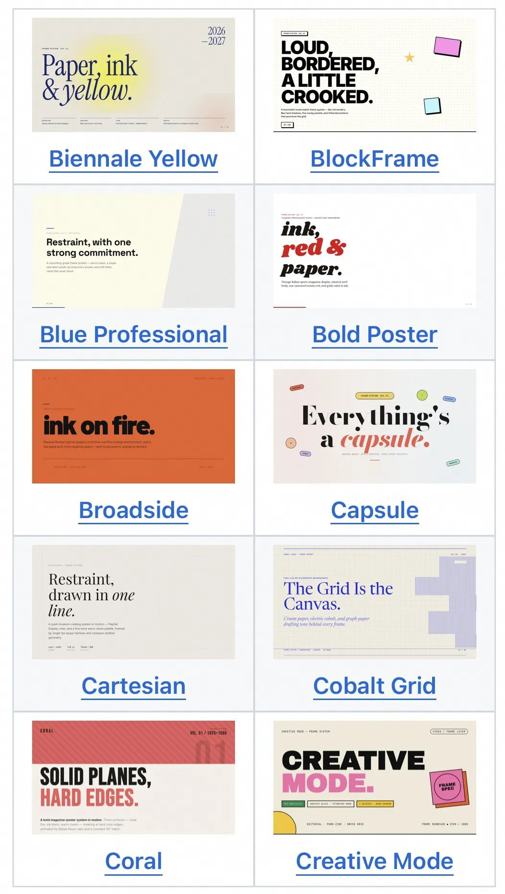
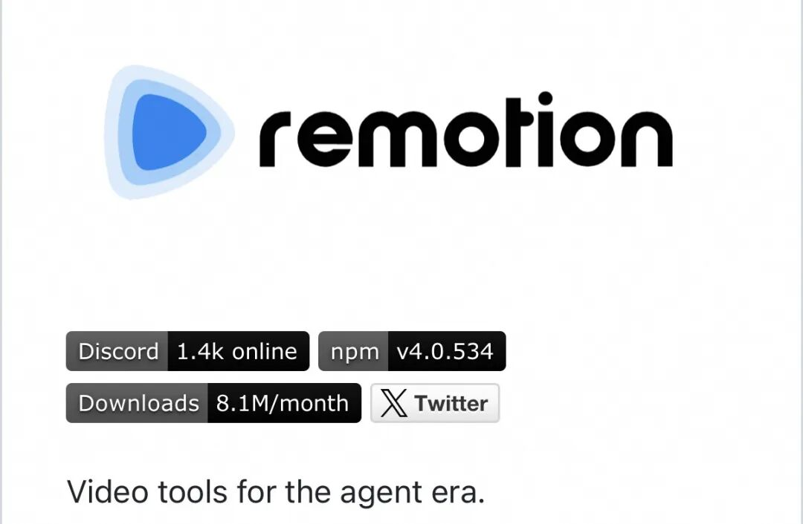
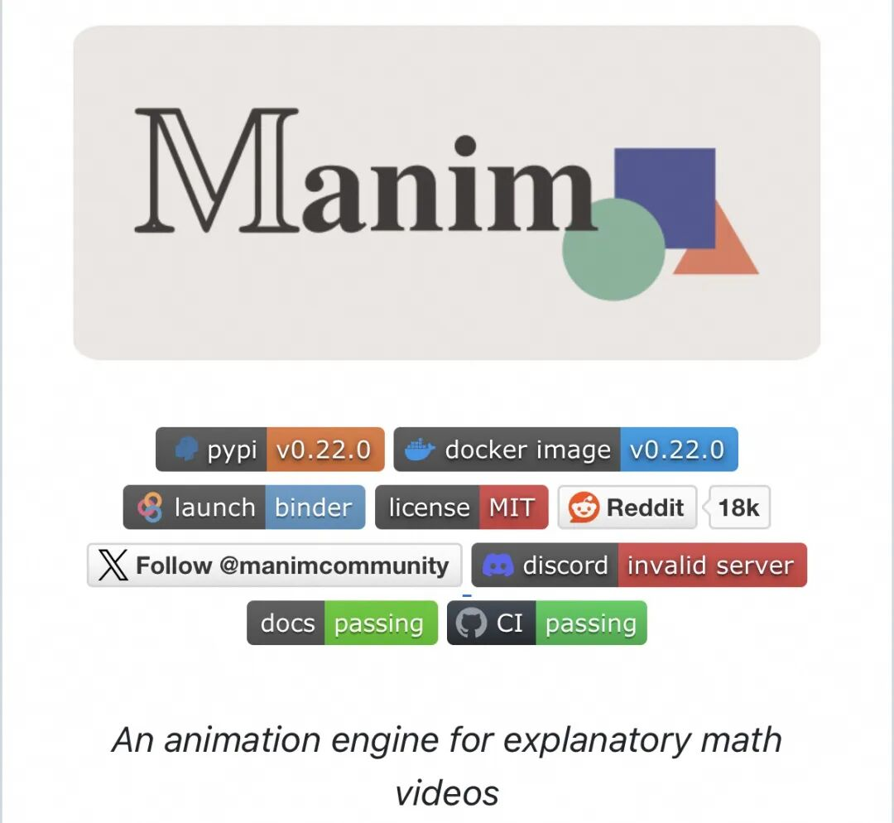
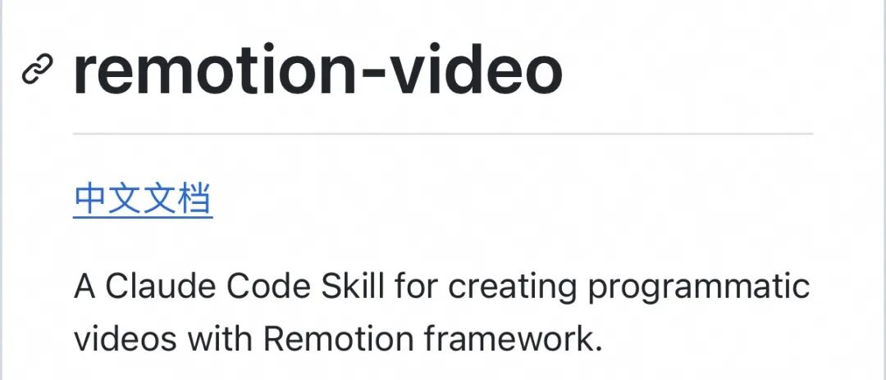

# 别再花钱用 AI 生视频了，GitHub 上这 5 个开源项目，代码就能生成视频
> 💡 备注属性未写入，可能是备注属性名称或者类型被修改了，建议将字段类型设置为 rich_text，可以在小程序-操作-修改文章数据库页面进行调整
> 原文链接:[https://mp.weixin.qq.com/s/PmsTd-dj9slYPnNtwe86pw](https://mp.weixin.qq.com/s/PmsTd-dj9slYPnNtwe86pw)
### 我们是不是把 AI 视频这件事想复杂了
### 
这两年做 AI 视频，大多数人走的是同一条路。打开某个生成模型的界面，敲一句提示词，等上几十秒，然后看着屏幕里那只多长了一根手指的手沉默。
它确实强。但它也有毛病，而且这些毛病到今天也没被彻底治好。
贵。按秒计费在试一条视频的时候毫无感觉，一旦你要做系列、要改第十版，账单会来教你做人。
不可控。你想让它展示注意力矩阵，它还你一坨发着蓝光的科幻球体，画面漂亮，讲的却是另一件事。
还有文字。这大概是知识科普最致命的短板。**生成模型几乎写不对中文，你想让屏幕上出现「梯度下降」四个字，它给你四个谁也认不出的象形符号。**而科普视频最需要的，恰恰是准确出现在画面上的字、公式和图表。
所以我最近一直在琢磨另一条路。**既然 AI 写 HTML、写 React、写 Python 已经写得比大多数新手好了，为什么非要它一帧一帧去画画面？**让它直接写一个会动的网页，再把这几千帧渲染成 MP4，不行吗。
想讲 Transformer，代码能让 token 一个一个排进画面，箭头一根一根连过去，注意力矩阵里每个格子的明暗真的对应那个权重数值。想讲扩散模型，程序可以把一张图真的一步步加噪、再一步步去噪，中间任何一帧能暂停、能改、能重来。
**下面这五个 GitHub 项目，就是这条路上的五块砖。各自的坑我也会一并说，不藏着。**

**01HyperFrames，一句话让 AI 写出一整段动画视频**

这是今年我看到的、离「**一句话生成一整段科普视频**」最近的一个项目。
HeyGen 开源的，口号写得简单粗暴，「Write HTML. Render video. Built for agents」。你写一个 index.html，一个 div 就是时间轴上的一段素材，什么时候出现、出现几秒、盖在哪一层，全写在 data-start、data-duration、data-track-index 这几个属性上。**渲染器把页面丢进无头 Chrome，一帧一帧定位、一帧一帧截图，最后交给 FFmpeg 编码成 MP4。**

逐帧定位这个设计是关键。它不是录屏，所以同一份代码永远渲染出同一支片子，像素级一致。对要做自动化内容管线的人来说，这一条比任何炫技都值钱。
它最聪明的地方，是给 AI 准备了一套说明书。仓库里发布了 21 个 skills，其中一个叫 /faceless-explainer，专门伺候没有产品、没有网页、纯粹讲一个概念的场景，画面里的排版、示意图、数据图表全由模型自己长出来。你跟 agent 说一句「**用 HyperFrames 做一条 10 秒的片头，标题淡入，配背景音乐**」，它会自己把规划、写 HTML、接动画、lint、预览、渲染这一整圈走完。
我写这篇的时候是 2026 年 10 月 10 日，仓库挂着 60119 颗星。这个库 3 月 10 日才建，七个月到这个数。Apache-2.0，**本地渲染不收费，门槛是先把 Node.js 22 和 FFmpeg 装好。**
**GitHub 地址**
https://github.com/heygen-com/hyperframes
**样片参考**
https://hyperframes.heygen.com/showcase

**02Remotion，让 AI 用 React 写专业视频**

如果说 HyperFrames 是今年的新贵，Remotion 是这条路上修了六年多的老基建。**2020 年 6 月建仓，现在 62986 颗星，比前者还多。**
它的思路是让 React 组件直接成为画面。函数先知道现在是第几帧，剩下的位置、透明度、颜色全由这一帧算出来，useCurrentFrame、interpolate、spring 三个 API 撑起了绝大部分动效。字幕、图表、分镜、多轨道合成，本质都是组件。
这套东西早就在生产环境里跑过了。公开报道里被提到最多的两个使用者，一个是 GitHub Unwrapped 那种给程序员生成的年度总结视频，一个是 Fireship 那些节奏极快的技术短片。它的强项就在这里，画面是数据渲染出来的，改一个数字换一张图，不需要重跑一遍美术。
今年 1 月官方单独开了一个 skills 仓库，remotion-dev/skills，4994 颗星，一条命令装完，`npx skills add remotion-dev/skills`。装好之后你不用自己记那堆最佳实践，让 agent 用 /remotion-create 建工程、/remotion-markup 写画面、/remotion-captions 处理字幕、/remotion-render 出片，人只负责说要什么和挑毛病。**它还有官方 Studio 能在浏览器里实时预览、选中元素直接改属性，这也是代码视频最被低估的一个卖点**，视频第一次变成了可以点着改的东西。
两句实话。一是它绕不开 React，完全没碰过前端的人会卡一段。二是它的许可证不是标准开源协议，个人和三员工以内的公司免费用（商用也算免费），规模再大要买公司授权。
**GitHub 地址**
https://github.com/remotion-dev/remotion
**官方Skills**
https://github.com/remotion-dev/skills

**03Manim，数学与科学科普视频的神器**

**五个里面最「专」的一个。**
**Manim 是一个用 Python 写数学动画的框架**。它是 3Blue1Brown 那批视频背后的引擎，Grant Sanderson 为了自己的频道写了它并开源，社区从他的仓库 fork 出现在这个社区版，2020 年 5 月建库，41393 颗星，MIT 协议。社区版自己的 README 里就写了，推荐大多数人用这一版，因为更新更勤、文档更全。
用法是在一个 Scene 类里摆 Mobject，用 self.play 把 Create、Transform、FadeIn 这些动画按顺序放出来。圆变成方，坐标系里一个矩阵把单位圆压成椭圆，曲线上的切线慢慢转成导数的定义，公式里某一项被方框圈住再搬到等号另一边。LaTeX 原生支持，画面上那个公式是真的排出来的公式，不是贴图。讲梯度下降、讲线性代数、讲神经网络里矩阵的形状怎么一层层变，几乎找不到比它更合适的工具。
它过去最大的门槛从来不是思路，是环境。Python、FFmpeg、LaTeX、cairo 一个一个装，报错信息还难看懂。为三分钟的视频磨一整天脚本属于常态。
而 Manim 恰好是 AI 最擅长补的那类代码。API 规整、示例海量、报错高度模式化。让 agent 写一个 Scene，渲染失败把报错原样贴回去，它自己改，比自己翻文档快太多。**再配个 manim-voiceover 插件，连配音时长都能跟动画绑在一起。**
**GitHub 地址**
https://github.com/ManimCommunity/manim
**在线体验**
https://try.manim.community

**04remotion-video-skill，连配音和字幕都能一起做**

**前面三个解决的都是画面，这一个把配音、字幕、时间轴一起打包了。**
它是 GitHub 用户 wshuyi 做的一个 Claude Code Skill，2026 年 1 月 25 日传的仓库，394 颗星。作者把自己改造过的那套流程整份放了出来，把文件夹拷进 skills 目录就能用。触发方式很随意，跟 Claude Code 说「用代码做视频」「编程视频」，或者直接打 /remotion-video 都行。
裸用 Remotion 的时候，AI 给你的是一条能跑的工程，音轨、字幕、每段场景多长，还得自己接。这个 Skill 把中间那层流程固化了。你说一句「帮我做一个讲解 Python 装饰器的教程视频，5 分钟左右」，它自己把文案拆成场景，逐个生成对应的 React 组件，把讲稿喂给 TTS 出配音，再用 ffprobe 量出每条音频的真实时长反过来定这一场要多少帧，字幕跟着音频走，最后渲成 MP4。
配音给了两条路。Edge TTS 免费，装一条 pip 命令就能出中文声音，适合先把流程跑通。**MiniMax 要 API Key，好处是能克隆自己的音色，长期做号的人大概会走这条。**
它是个人的小项目，星数也说明了这点，别把它当基础设施，也别指望长期维护。它真正值钱的地方是把「文案到成片」这条链完整示范了一遍，代码摊开看半小时，你就能改成自己栏目的形状。
**GitHub 地址**
https://github.com/wshuyi/remotion-video-skill

**05video-shotcraft，让 AI 生成的视频不再像 PPT**

**最后这个，治的是另一种病。**
用 agent 写过 Remotion 的人大概都见过同一种成品，白底，居中，一段段文字依次淡入淡出，工整得像公司年会 PPT。它没错，可它就是不像一支片子。AI 视频的坑从来不是「做不出来」，是「能看，但不好看」。
video-shotcraft 是 2026 年 7 月 19 日才建的库，现在 11130 颗星，涨得很凶。**它把动效设计拆成了配方卡。README 上的数字是 157 张镜头配方卡、214 个样式、214 条动态样片，外加一套已经验收过的成片模板。**每张卡是完整配方加原生 Remotion 组件，动画由归一化进度 t 驱动，逐帧确定。你要哪种感觉，先挑卡，agent 按卡里写的方法去实现，而不是自由发挥。
它给的东西恰好就是那层电影感，真实页面捕获、2.5D 运镜、节奏卡点、电影级音效。8 月一口气加了 48 张卡，9 月又加了动效工作台，片子交付以后 skill 会主动打开一个剪映式的浏览器界面，整支片子按原始镜头拆成镜头、转场、字幕、音效好几条轨，选中任意镜头在属性面板里逐字改文案、调字号颜色，预览和渲染逐帧一致，改完一键导出。它甚至能导出成剪映工程草稿，README 写了在 Mac 剪映 11.2 上实测验收。
同一作者还有个系列作叫 **video-talkcraft，专做口播视频，里面那句「七层反 PPT 镜头系统」，我觉得是这一整年对 AI 视频最精准的一句吐槽。**
要说清楚，它不是渲染引擎，底层还是 Remotion。它是一份喂给 agent 的审美说明书。
**GitHub 地址**
https://github.com/Vincentwei1021/video-shotcraft
**样片总览**
https://vincentwei1021.github.io/video-shotcraft/

**把这五个串起来，一条参考工作流**
**选题加科普脚本，交给大模型**，比如《扩散模型为什么能从噪声生成图片？》。
**分镜加动画代码，HyperFrames、Remotion、Manim 三选一。**讲数学原理优先 Manim，要页面感和图表动效看前两个。
**中文配音加字幕同步**，Edge TTS 或者直接用 remotion-video-skill 这一整套。
**镜头优化加最终渲染，video-shotcraft 补运镜和音效，FFmpeg 出 MP4。**
我得给一句实话。这条链路里最耗时间的不是生成，是调。指望 agent 一次就出完全满意的片子，概率很低。更现实的预期是第一次出个六十到七十分的东西，改两轮到八十五分。所以真要做系列，先把风格钉死做成模板，之后每期只换内容和数据，边际成本才会真往下掉。
也别一次装五个。Manim 一条腿，HyperFrames 一条腿，够走很远了。
### 视频创作，可能不等于视频生成
写到这里，我更想说的是三个判断。
**视频创作不等于视频生成。**对知识科普而言，准确的信息、有逻辑的动画、清楚的声音，比逼真的画面要紧。一支片子把注意力权重画错了，它再像电影也是废的。代码这条路在「正确」这件事上有天生优势，画面上每个数字都是算出来的。
**改起来便宜太多。**字打错了改字符串，曲线不好看改函数，图表换数据改 props，重跑一次渲染就行，不必为了一个错别字把整段视频重新生成一遍。这种可控性，在长期做内容的人眼里，比惊艳重要。
**门槛正在塌。**三年前做这种片子得会前端，得懂动画，Manim 那条还得跟 LaTeX 环境搏斗。现在 AI 编程 agent 承担了相当一部分编码，剩下的活是审美和判断，而这两样恰好是人比模型稳的地方。
这两条路的根本分别在这儿，生成式模型是向模型要一个「看起来像」的结果，代码是告诉程序「它就是这么运作的」。前者给你惊喜，后者给你答案。
所以我觉得 AI 视频的未来，也许不只是让模型学会生成每一帧画面，而是让 AI 真正学会像导演、像设计师、像程序员那样去创作视频。
至于哪条路对，取决于你要的是「看不出来是 AI 做的」，还是「说的每一句话都站得住」。

**我是Orisynth AI，关注我，一起见证AGI时代的奇迹！**

## 摘要

（待补充）

## 我的笔记

（待补充）
