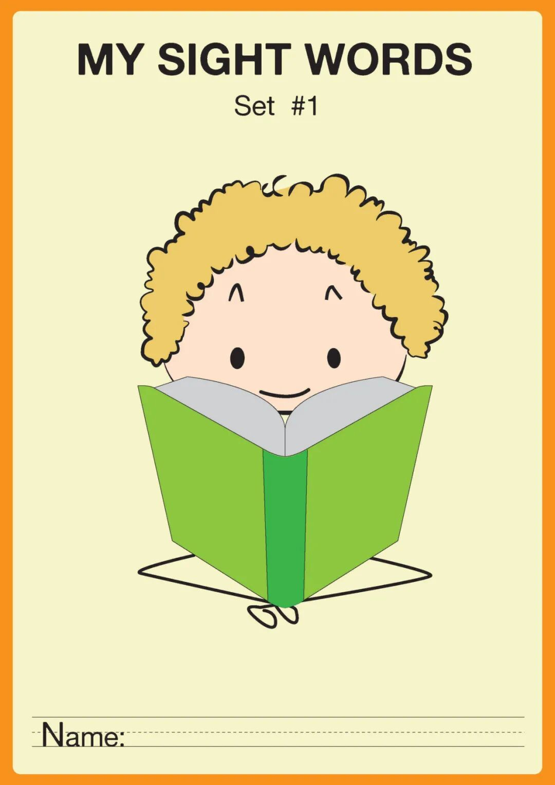
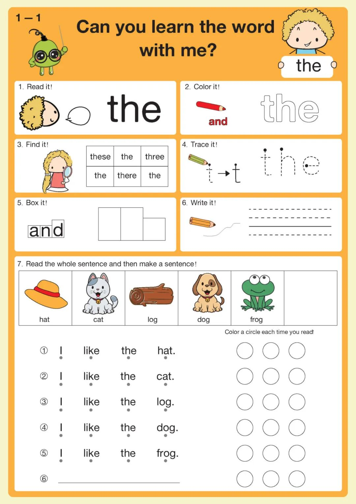
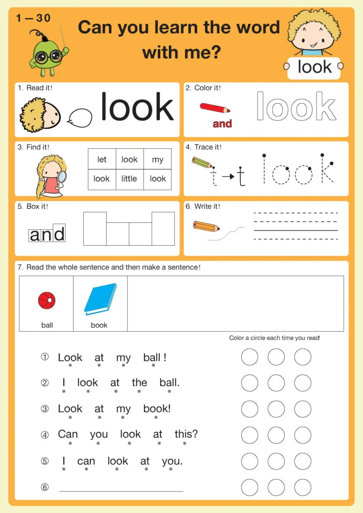
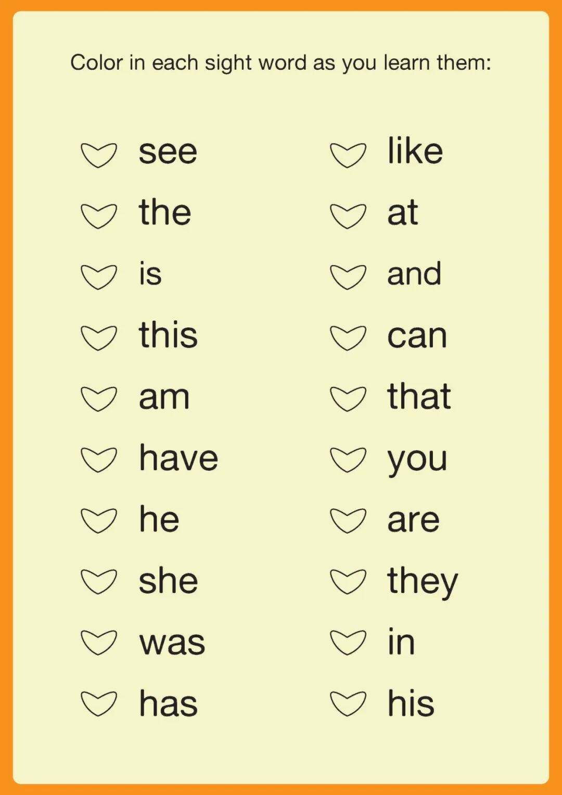
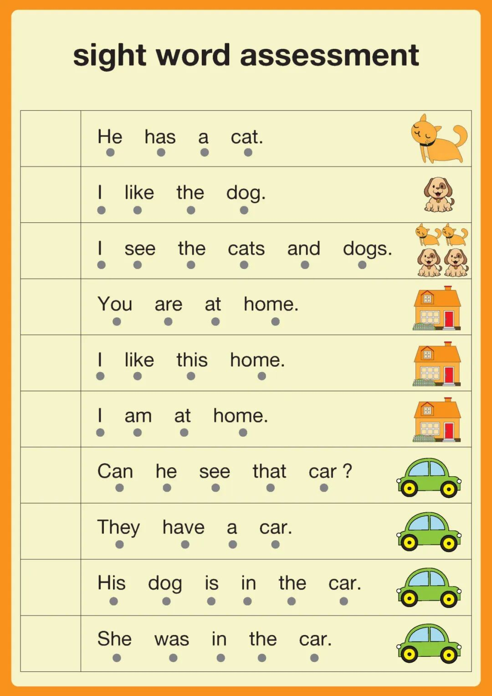
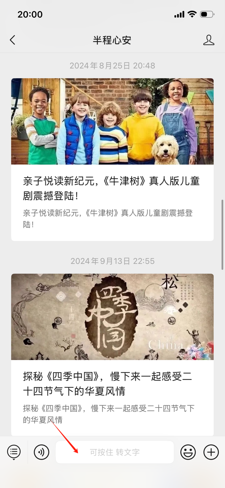

# 别再让孩子抄单词了！高频词这样“玩”，7步就能记牢
> 💡 备注属性未写入，可能是备注属性名称或者类型被修改了，建议将字段类型设置为 rich_text，可以在小程序-操作-修改文章数据库页面进行调整
> 💡 原文链接:[https://mp.weixin.qq.com/s?__biz=MzkxMjY5NTgwNg==&mid=2247484852&idx=1&sn=48127e6d63e0de777c12d8ce417b7e8f&chksm=c0cbc6520913e2667558e4c73cdde3704fd3e46849a54dcbc48436add19a025208a94a6330c4#rd](https://mp.weixin.qq.com/s?__biz=MzkxMjY5NTgwNg%3D%3D&mid=2247484852&idx=1&sn=48127e6d63e0de777c12d8ce417b7e8f&chksm=c0cbc6520913e2667558e4c73cdde3704fd3e46849a54dcbc48436add19a025208a94a6330c4#rd)
**点击上方蓝色关注我，在陪娃路上一起加油！**
家里英语启蒙进行过一段时间的爸爸妈妈，一定绕不开一个词——
**Sight Words 高频词**
随手翻开一本英语分级读物，你会发现一句话里**一半以上的单词都是高频词**。它们就像中文里的"的、了、是、在"——出场率超高，却又特别"不讲道理"：**the、said、one、was……**大多不符合自然拼读规则，没法靠"拼"读出来，只能靠反复见面**混个脸熟**。
可"混脸熟"这件事，用闪卡干巴巴地刷，孩子两分钟就跑了；普通抄写本抄十遍，词是记住了，兴趣也没了。
所以今天想给大家分享这套**高频词复习宝典**——它把"记单词"变成了一场闯关游戏：一个词、一页纸、7种玩法，孩子画着涂着找着，不知不觉就把词装进了脑子里。

▲ 整册封面，还有专属的 Name 栏，写上名字就是孩子自己的书
**一、这套资料里都有什么？**
先说整体印象：整册是**暖橙+奶油黄的配色**，戴眼镜的绿色小毛虫和两个卷毛小朋友贯穿全书，画风软萌可爱，完全没有"刷题"的压迫感。
一册在手，实际上是**四件套**：
① **42页逐词练习**——一个词一页，覆盖40+个英语启蒙必学高频词；
② **专属封面**——男孩版、女孩版各一张，写上名字更有仪式感；
③ **爱心进度打卡表**——学会一个词，就给它的爱心涂上颜色；
④ **句子测评页**——学完验收，能不能读出来，一目了然。
接下来重点说说它的核心：**一页纸，把一个词练7遍**。
以第一页的目标词 **the** 为例，从上到下一共 7 个环节：
**1. Read it**｜跟着卡通小嘴巴，大声读出来
**2. Color it**｜给空心字母涂色，边涂边记字形
**3. Find it**｜六宫格里找出目标词，**the、three、there** 混在一起考眼力
**4. Trace it**｜带笔顺提示的描红，写法不出错
**5. Box it**｜把字母装进"单词积木"，高低胖瘦一眼辨
**6. Write it**｜四线格独立默写
**7. Read & Make**｜读5个地道小句子，再自己造一句

▲ 单词 the 的完整练习页：读、涂、找、描、拼、写、造句，一次到位
个人最喜欢的两个细节：
**一是"找一找"环节埋了形近词陷阱。**练 **see** 时旁边混着 **six、seven、show**，练 **look** 时混着 **let、little、my**——孩子必须逐字母仔细比对才能找全，这正是高频词最需要的"精细辨认"。
**二是句子环节自带"朗读打卡圈"。**每句话的每个词下面都有小圆点，提醒孩子指读；右侧每读一遍就给一个圆圈涂色，读满三遍，句子也就顺了。最后还有图片词库（hat、cat、dog、frog……）帮孩子造出自己的第一句英文，成就感拉满。

▲ 单词 look：句子里反复复现 the、you、can 等学过的词，滚雪球式巩固
更妙的是，句子环节会**不断复现之前学过的词**：第3页的 **is** 出现在 **The hat is blue** 里，后面的句子又把 **the、see、can、you** 一个个带回来——学新词的同时旧词也在打转，这就是高频词学习最需要的"重复而不枯燥"。
**二、这套资料怎么用？**
好资料也要用对方法。结合这套练习的设计，给大家一套**"四步使用法"**：
**第1步：定节奏——每天1页，10分钟**
零基础的孩子一天吃透1个词刚刚好；已经有基础、坐得住的孩子可以一天2页。建议固定在每天同一时间（比如晚饭后），10分钟内完成，**宁少勿贪**——高频词靠的是见面次数，不是单次时长。
**第2步：按"先听说、后读写"走完7个环节**
1~3环节（读、涂、找）动口不动笔，先让耳朵和眼睛认识这个词；4~6环节（描、拼、写）再动笔，把字形刻进手里；**第7环节一定要留出亲子时间**：家长读一句、孩子跟一句，读完把句下的圆点涂掉，最后鼓励孩子看着图片词库造一句自己的话——说错了也没关系，敢开口就是赢。
**第3步：让进步"看得见"**
拿到资料先让孩子在封面写上名字；每学完一个词，就去打卡表给对应的爱心涂上颜色。别小看这个动作——**孩子看见爱心一颗颗多起来，比任何表扬都上头**，追着要"再学一个"的场面真的会发生。

▲ 爱心打卡表：学会一个，涂一个，进度肉眼可见
**第4步：滚动复习 + 周末验收**
孩子记得快、忘得也快，推荐按 **1—2—4—7** 的间隔做"回滚"：学到第2天回头读第1页，第4天再读，第7天再读。回滚不用重做全页，只做第1和第7环节，每页2分钟即可。
每周末拿一张**测评页**验收：测评页把高频词全部编进了短句里，孩子能流畅读出句子，就说明词是真的认识了；卡壳的词记下来，下一周回到对应页面再玩一遍。

▲ 测评页：所有高频词藏在短句里，读得顺才算真的会
**🍊 使用小贴士**
① 建议A4彩色打印，效果最佳；黑白打印也完全可用，涂色环节让孩子自己上色反而更香；
② 打印后左侧装订成小册子，就是孩子的第一本"高频词练习书"；
③ 适合英语启蒙期～小学低年级的孩子；有自然拼读基础的孩子可以做得更快。
42个高频词，每天一页，一个多月就能刷完一整册。到时候再翻开分级读物，孩子会突然发现——**"妈妈，这本书上的词我都认识！"**这种"我能自己读"的成就感，才是英语启蒙最珍贵的起点。
**📄 资料领取方式见文末菜单栏**
第一步：识别下方二维码关注公众号

第二步：在对话框**回复“高频词”**参与领取

END
