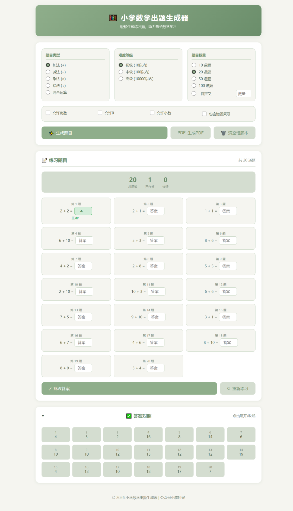
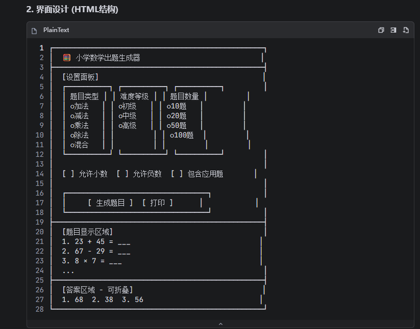
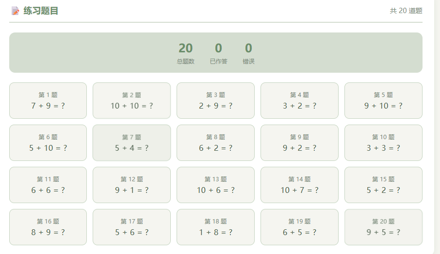
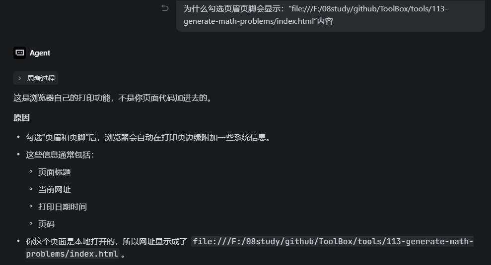
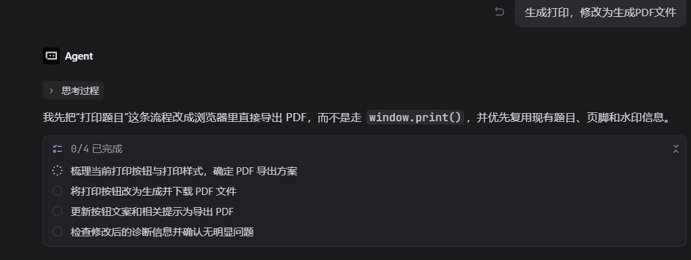
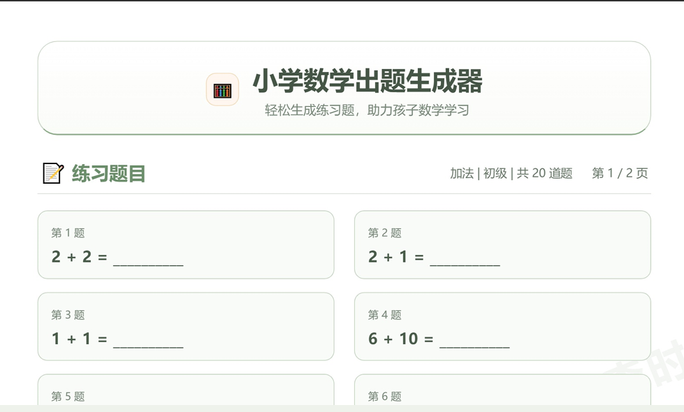

# 制作一个小学数学出题生成器，附制作过程
> 💡 备注属性未写入，可能是备注属性名称或者类型被修改了，建议将字段类型设置为 rich_text，可以在小程序-操作-修改文章数据库页面进行调整
> 💡 原文链接:[https://mp.weixin.qq.com/s?__biz=MzkzNzU0MDM5Mg==&mid=2247485814&idx=1&sn=161629bd7bc84bf03284579b435fdabd&chksm=c3bd11e987a302858be6673ce16023180b3304bd03cbb44b00ba5c73ac97af84f26cb95c90c3#rd](https://mp.weixin.qq.com/s?__biz=MzkzNzU0MDM5Mg%3D%3D&mid=2247485814&idx=1&sn=161629bd7bc84bf03284579b435fdabd&chksm=c3bd11e987a302858be6673ce16023180b3304bd03cbb44b00ba5c73ac97af84f26cb95c90c3#rd)
制作一个 10、100、10000 范围加减乘除运算出题生成器工具，可自定义出题数量，支持下载 PDF 文件。同时，也支持在线进行练习，可查看每题的答案。
最终效果如下图，

制作步骤
在 Trae 工具对话框中生成小学数学出题器的设计方案，对话内容如下，

它会给出完整的设计方案，同时也给出了页面的布局，

设计方案确认没有问题后，根据方案生成代码，这里主题色使用兰迪绿色系，对话内容如下，

生成代码后，运行 index.html 文件，点击生成题目，可看到成功的生成了对应数量的题库。

修改等式后面显示"？"，对话内容如下，

不断的对页面内容进行调整，刚开始生成的是通过调用浏览器的打印功能，在预览的过程中会出现如页脚会显示网址的问题，根本原因如下，

最终，选择生成 PDF 文件的方式下载，对话内容如下，

这样每页的标题和页脚内容就是可以自定义，下载的文件效果如下，

感兴趣的小伙伴，可通过下述链接体验使用，链接：
https://xlsgtools.cn/tools/113-generate-math-problems/generate-math-problems
**二、小程序**
拼图处理魔法盒小程序，制作了一些实用工具和益智工具，如图片九宫格、数字华容道、舒尔特方格工具等你来探索。
微信搜索「拼图处理魔法盒」。关注我，一起探索 AI 编程世界！
