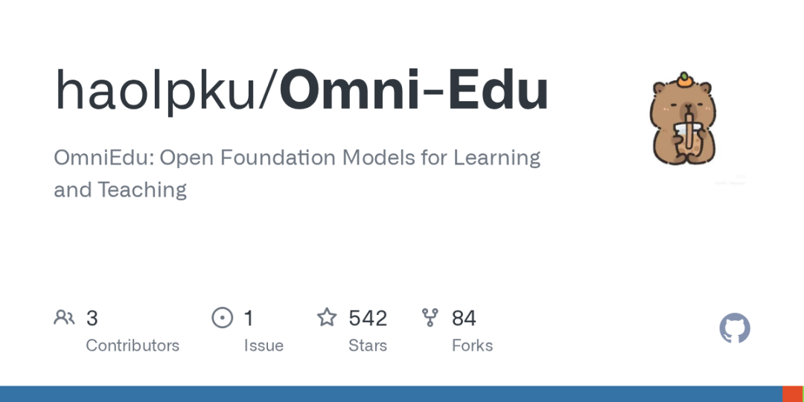
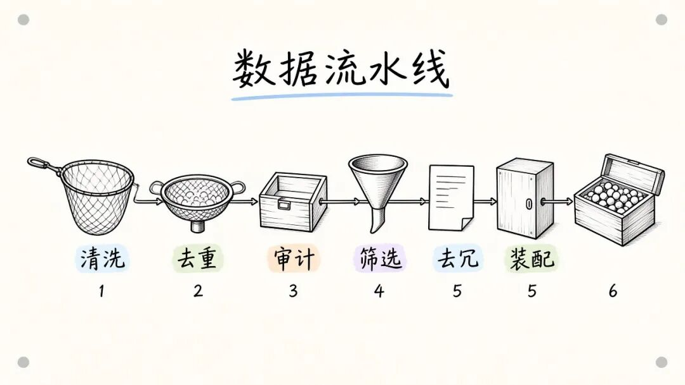
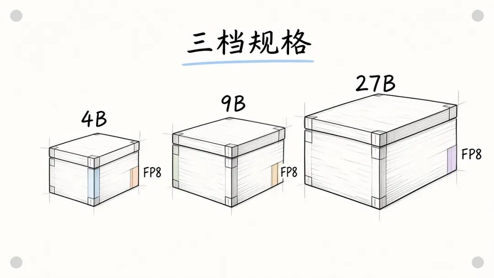

# 北大开源 K12 教育模型：对齐课标，找出你没学牢的概念
> 💡 备注属性未写入，可能是备注属性名称或者类型被修改了，建议将字段类型设置为 rich_text，可以在小程序-操作-修改文章数据库页面进行调整
> 原文链接:[https://mp.weixin.qq.com/s/u3N6FlWBLzJhaj71i0qWHA](https://mp.weixin.qq.com/s/u3N6FlWBLzJhaj71i0qWHA)
北大放出一个教育大模型，专做中小学那套事。
题目能解，错因能找，还知道这题挂在哪个课标上。
叫 Omni-Edu，4B 到 27B 三档，全开源。
北大、中科院、中关村学院七个作者，挂了篇 arXiv，编号 2609.23088。9 月中权重就放了。

### 0101 它是什么
一个面向 K12 的学习加教学模型，带一篇 arXiv 论文，编号 2609.23088。
**542** 个 star，Apache-2.0 协议，Python 写的，9 月中建的仓，10 月补上 FP8。
它不是一般的大模型套个教育壳。
训练目标拆成四块，每块干一件事。

一块是解题，跨科目跨输入形式。
一块是课标对齐，题目、概念、解法都能挂到课程标准和前置知识上。
一块是诊断，找错因，找没学牢的前置概念。
一块是教学，给反馈、追问、讲解，按情况调支持方式。
后三块，通用模型和大厂教育模型都不做这么结构化。
训练是全参 SFT，LLaMA-Factory 跑，序列长度拉到 32768，模板用 qwen3_5_nothink。
举一条 README 里的例子。一个初二学生说夏天更热是因为地球离太阳近。
模型得先点破这个误区，再给一个引导问题，然后才解释。
顺序不能乱，先诊断后讲解，这正是教学模型和答题模型的分界。
### 0202 数据流水线
它最厚的一块，是数据。
69999 条指令样本，15.96M 个监督 token。来源 100 多个，其中 60951 条是教育专用的，9048 条是通用的。
这批数据不是抓来就训，过了六道关。

第一道定能力分类，把各来源的原始数据按四种能力归档，放到Hugging Face 上。
第二道规则去重加答验，不调模型。
去重键按任务族分。数学是题干加选项，简答是题干加学生答案，阅读是文章加题干，对话是规范化后的消息 JSON。
同一个 key 才判重。
然后用 vLLM 起服务，让 LLM 逐条判保留、改写、丢弃。
第四道按来源做多样性压缩，用 BGE-M3 的 k-center 把候选压到预算内。
再按 1 到 5 分打分过滤，每个任务族各有自己的 rubric。
第五道按 token 预算做多样性挑选，在 BGE-M3 嵌入上贪心选，只留教育专用的那批。
第六道给每条配上 19 套教学指令里的一套，再合入 9048 条通用数据，一起进训练。
六阶段全在仓里，脚本能跑，不藏。
### 0303 三档规格
模型分 4B、9B、27B 三档，每档又出 BF16 和 FP8 两种权重，六个 checkpoint 全在 Hugging Face 上，随时能拉下来看。

4B 的 BF16 权重 8.46 GiB，FP8 只有 5.14 GiB，省了 39%。
9B 的 BF16 是 17.53 GiB，FP8 11.09 GiB，27B 的 BF16 是 50.96 GiB，FP8 28.30 GiB。
8G 显存的卡，FP8 的 4B 是能跑的。
FP8 走 128 乘 128 分块量化，视觉塔和几个投影层不量化，其余不变。
### 0404 考得怎样
论文拉了 16 个模型对比，里面有 GPT、Claude、GLM、Kimi，还有 Confucius3-Math、MuduoLLM、EduChat 三套教育专用模型。
OmniEdu-27B 在课标对齐那几张表里，K12-Bench 精确匹配和 F1**都是第一**。
解题那组，GAOKAO-Bench 拿 94.87，K12-Bench 的 F1 是 76.69。
多模态那两张也看，EXAMS-V 整体 69.52，MDK12-Bench 57.76，27B 都在前列。
教学那组，MathTutorBench 的脚手架胜率 78.74，第二。
LongTutor 的教学评分 3.02，证据覆盖 78.20，都是对比组里靠前的。
教育微调后通用能力没掉。IFEval、GPQA、MMMU-Pro 三张表，三档都只升不降，27B 的 GPQA 从 74.24 到 77.78。
### 0505 怎么上手
Transformers 直接加载 BF16，vLLM 起一个兼容 OpenAI 的接口，或者装仓里那个 omniedu 的 SDK。
SDK 支持 pip 装，能接本地模型，也能接任何 OpenAI 兼容的服务。
五个子命令各管一摊，chat 走对话，task 传教学指令，batch 跑 JSONL 批处理，eval 拉 12 张 benchmark 表，judge 给开放式答题打分。
vLLM 那条命令里写死了 enable_thinking 为 False，这是它的训练模板，别改。--max-model-len 跟 32768 对齐。
它还能吃图。把学生作业拍照传进去，让它挑错、给逐步提示，vLLM 那条命令把 --limit-mm-per-prompt 调到一张图就行。
没有推理服务也没关系，omniedu serve 能替你拼出那条启动命令。
### 0606 项目结构
```
Omni-Edu/
├── data_preparation/   六阶段数据流水线，从分类到装配
├── sdk/                omniedu 工具包，推理、多模态、评测
├── training/           LLaMA-Factory 全参微调，4B 9B 27B
├── pyproject.toml      打包配置
├── index.html          项目主页
└── style.css           主页样式

```
data_preparation 占最大头，六个 stage 目录各自带 README 写清了输入输出。
training/automation 里有个 train.py，启动前先验数据，69999 条的 JSONL 结构、引用的图片、条数，全核一遍才起 torchrun。27B 那档要两节点，launch_27b_node.sh 按节点分叉。
### 07值不值得
最打动人的是那个定位。
课标对齐加诊断缺漏，这块通用模型没有。大厂教育模型多为闭源 API，它把权重、数据、流水线、SDK 四件全放出来，Apache-2.0。
FP8 走 LLM Compressor 加 compressed-tensors 出的，128 乘 128 分块，权重下载直接小 37% 到 44%。
短板也清楚。
谁该用。做教育产品、要本地跑、想自己接课标的。
谁别碰。指望它直接当正式教学用的，这还在验证的路上。
数据集叫 Omni-Edu，在 Hugging Face 上能直接拉，12 张 benchmark 表跑起来要自己下各家的数据集，SDK 里只放评测框架，不带数据。
### 08写在最后
把课标、诊断、教学目标拆成四个训练维度，再喂给模型。
这个思路比单纯堆题量有意思。
https://github.com/haolpku/Omni-Edu
