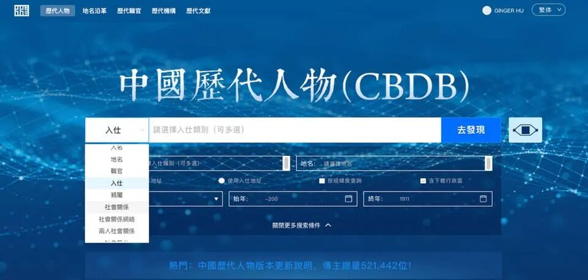
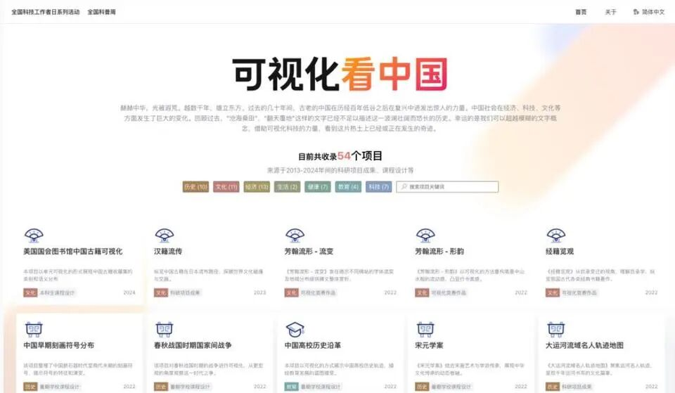
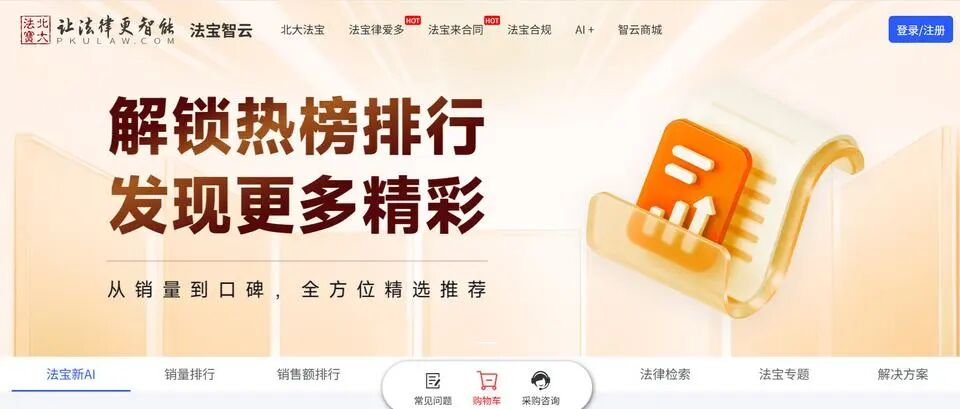
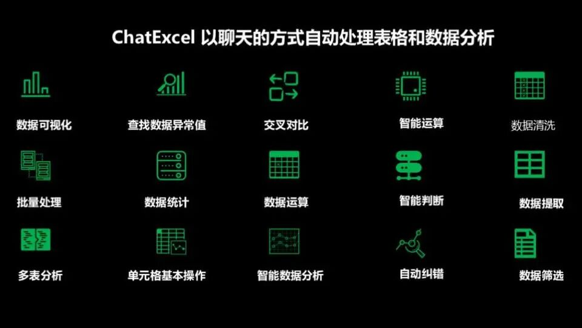
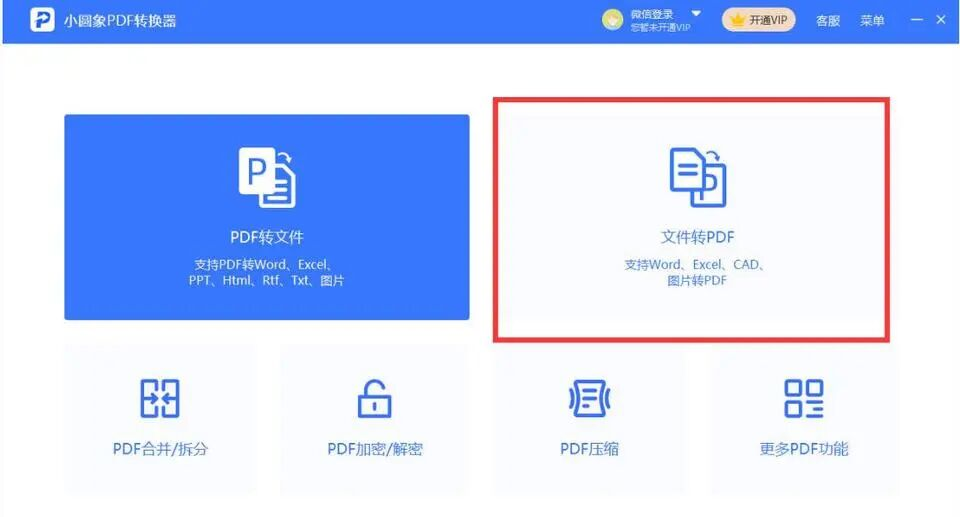
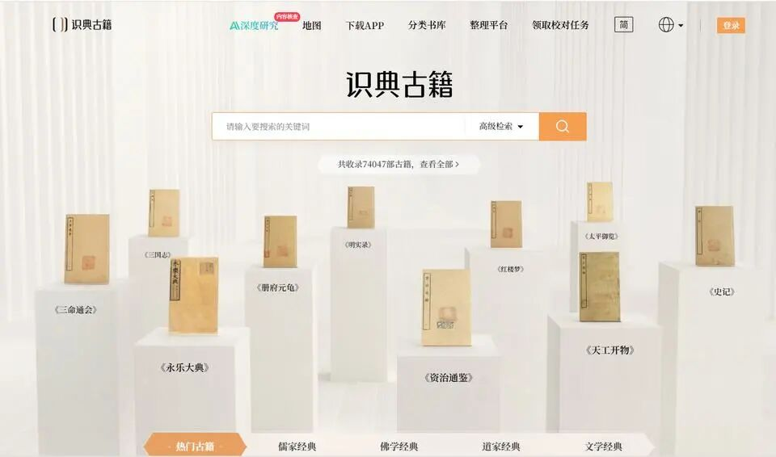
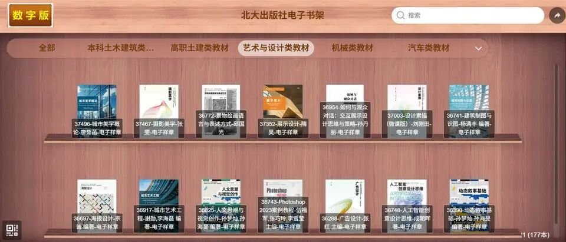
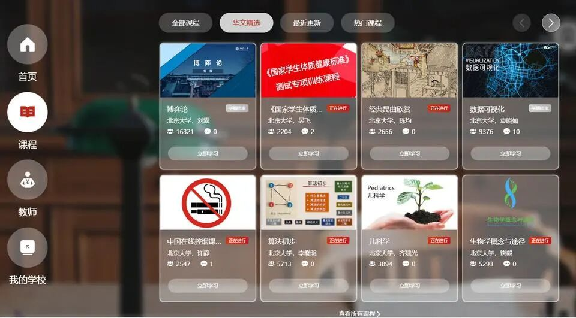

# 北大悄悄做了 8 个免费网站，我挨个试了一遍
> 💡 备注属性未写入，可能是备注属性名称或者类型被修改了，建议将字段类型设置为 rich_text，可以在小程序-操作-修改文章数据库页面进行调整
> 💡 原文链接:[https://mp.weixin.qq.com/s?__biz=MzY4MjQ2NjQ1OQ==&mid=2247485847&idx=1&sn=f050031c1f5745d164427053211da894&chksm=f227ca092c724486b40908f7136a085d138b3f52c1715bc040d2cc5150ad2911ee4181f1508f#rd](https://mp.weixin.qq.com/s?__biz=MzY4MjQ2NjQ1OQ%3D%3D&mid=2247485847&idx=1&sn=f050031c1f5745d164427053211da894&chksm=f227ca092c724486b40908f7136a085d138b3f52c1715bc040d2cc5150ad2911ee4181f1508f#rd)
国家级的免费网站，我盘过两轮了——9 个学习网站、10 个官方 App，后台加起来几万个收藏。
这次换个思路：**不按“级别”盘，按“学校”盘。**
北京大学自己做的、或北大团队做的、对外开放的网站，我挨个试了一遍，留下这 8 个。
**丑话说在前面：8 个里 6 个完全免费，2 个要注册登录、免费额度也有限——是哪两个、边界在哪，下面每个都标清楚。文里的截图都是我自己登录后截的。**
先收藏，再慢慢看。
**PART 01**
**查资料：写论文、查历史、查法条**
**01 · CBDB 中国历代人物传记资料库免费**
projects.iq.harvard.edu/cbdb
哈佛大学、中研院、北大三家共同维护，收录约 
65 万位历史人物
——师承、亲属、社会关系一查便知，还能导出数据。研究任何一个唐宋明清人物，先来这里查他的“朋友圈”；写历史类文章、做人物关系图，一个库顶十本书。

▲ 实测首页 · 截图时收录 52.1 万位，截至 2025 年 5 月已更新至约 65 万位
**02 · 可视化看中国免费**
vis.pku.edu.cn/vis4china
北大可视化实验室出品，五十多个项目：大运河名人轨迹、宋元学案、120 年铁路建设、历年十大考古发现……
用一张图讲一段中国
。不是工具，是养眼开脑子的——做 PPT、找选题灵感、带孩子看，都合适。

▲ 实测首页 · 目前收录 54 个可视化项目
**03 · 北大法宝部分免费**
pkulaw.com
从 1985 年做到现在的法律数据库：法律法规、司法案例、法学期刊。
免费边界说清楚：基础的法规和案例检索免费够用
；类案检索报告、期刊全文下载等深度功能要 VIP。不是法律行业的，免费部分就够；真要天天用的，先试免费额度再说。

▲ 实测首页 · 右上角需登录后使用
**PART 02**
**干活：处理文档和表格**
**04 · 酷表 ChatExcel需登录 · 额度有限**
chatexcel.com
北大团队开发，
用聊天的方式处理表格
——说一句“把这一列按数值排序”，它自己动手。
免费边界说清楚：要注册登录才能用
；免费版只支持处理 3 张表，日常偶尔用一用够；量大、高频的要充值（官方月卡 25.9 元、年卡 99 元）。一年处理不了几次表格的人，一分钱不用花。

▲ 官方功能页 · 以聊天方式处理表格和数据分析
**05 · 小圆象 PDF 转换器需登录 · 额度有限**
xiaoyuanxiang.cn
PDF 和 Word、Excel 之间来回转换，合并拆分、加密压缩。
免费边界说清楚：要注册登录才能用
；网页版单文件 10M 以内免费、无水印，再往上就要会员。偶尔转个文件够用。另外提醒一句：它是第三方商业产品（广州小飞驼），试用时留意会员续费的默认勾选，用完不需要就关掉。

▲ 实测客户端界面 · 右上角需登录，未开通 VIP 有功能限制
**PART 03**
**读书上课：古籍、教材、课程**
**06 · 识典古籍免费**
shidian.yangque.com
北大与抖音公益共建，
已收录 7.4 万部古籍，其中免费开放超 4.7 万部
——《史记》《资治通鉴》《天工开物》都在，简繁切换、全文检索，每月有两百多万人在用。想读古籍又怕版本不靠谱的，从这进；它还开放校对任务，你甚至可以参与整理一部古籍。

▲ 实测首页 · 页面显示已收录 74,047 部古籍
**07 · 北大出版社电子书架免费**
pup6.yunzhan365.com/bookcase/jmyr/index.html
北大出版社官方数字书架，土木建筑、艺术设计、机械汽车等专业的电子教材，网页直接翻，体验接近纸书。
大学教材可以先不买
——至少把这门课翻完了再决定买不买。

▲ 实测书架页 · 上架教材可整本在线翻阅
**08 · 华文慕课免费**
chinesemooc.org
北京大学官方慕课平台：饶毅的生物学、汤超的物理、博弈论、昆曲欣赏……
在家蹭北大，就差点开这一下。
注意：课程按学期开，不是永久挂在那，看到想学的先注册，跟着开课节奏走。

▲ 实测课程页 · 多数课程正在开课中，点“立即学习”就能进
**PART 04**
**三个提醒**
**提醒 01**
**认准这几个域名**
同类模仿站很多，网址以本文为准，别搜错进了高仿。
**提醒 02**
**“北大出品”分两种**
有学校官方平台（华文慕课、法宝、出版社），也有北大实验室和团队做的（CBDB、可视化、ChatExcel、识典），都是正经来路，但性质不一样，每个里我都写明了主办方。
**提醒 03**
**要登录的两个，别白花冤枉钱**
ChatExcel 和小圆象都要注册登录，免费额度也有限（一个 3 张表、一个单文件 10M）——先按免费额度用，碰到明确不够用了再考虑充值，别反过来。
**PART 05**
**最后**
有人问：一个读书号，为什么老发这些网站？
因为“读书”不只是读书——查得到资料、看得进古籍、学得动课程，都算。国家给的是底座，学校给的是精品，**你能免费用到的，比你以为的多得多。**
这 8 个站的完整清单（含网址），后台私信回复【北大】领取。
上两篇没看的：《9 个免费学习网站》《10 个官方 App》，私信回复【网站】【App】补课。
