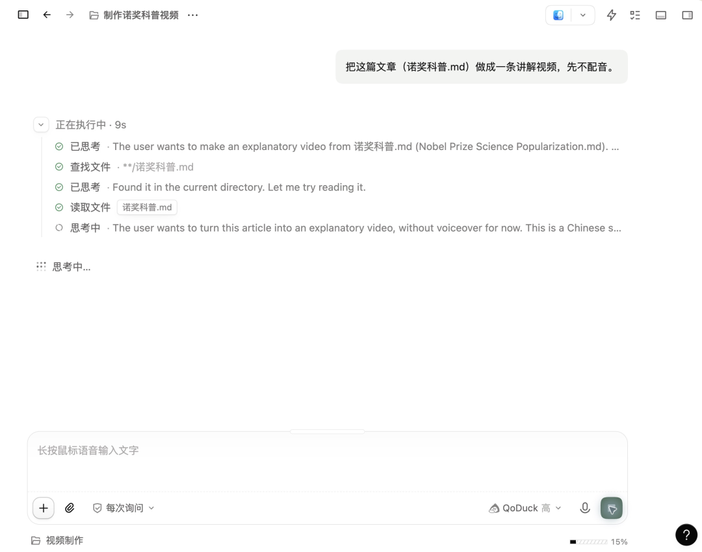
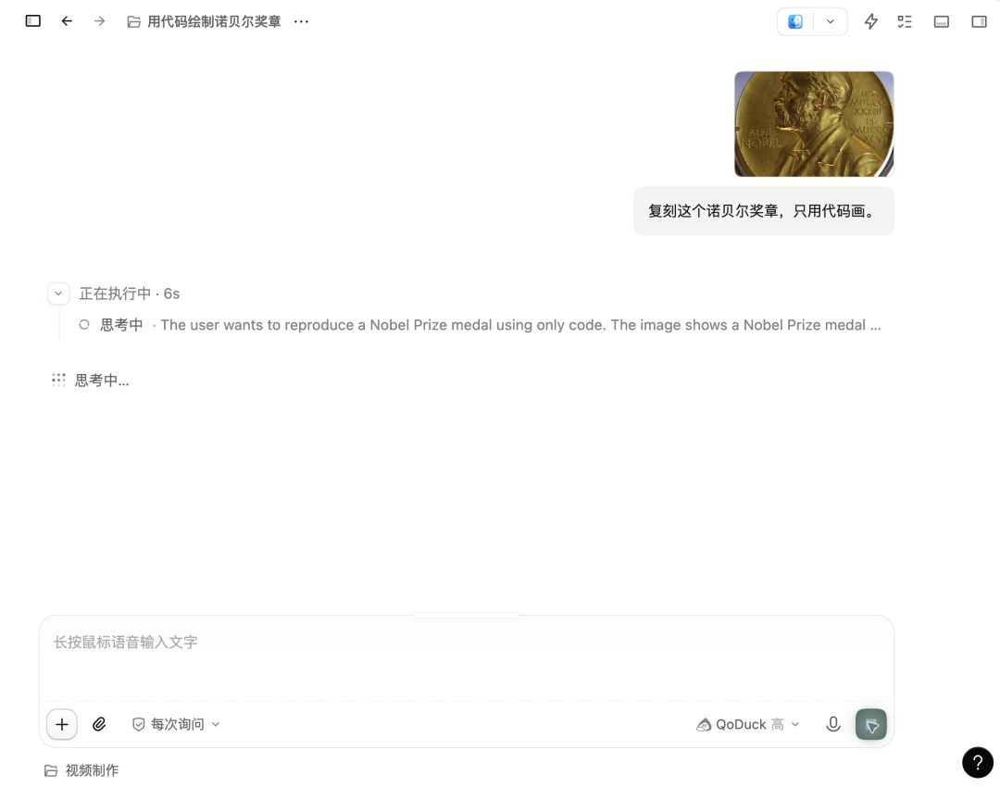
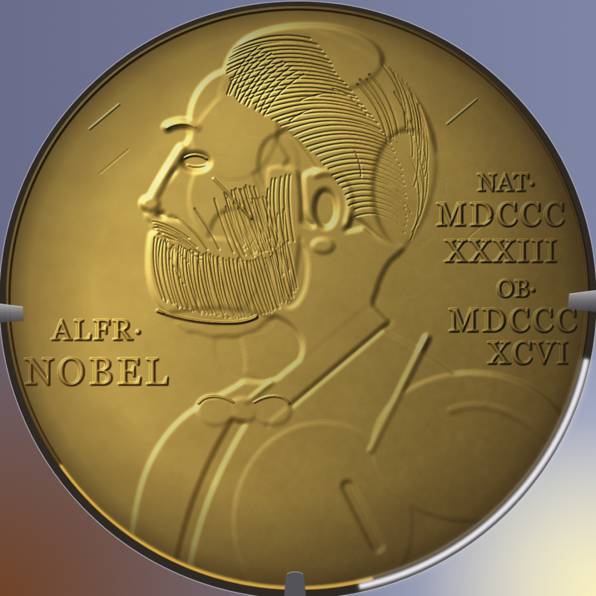
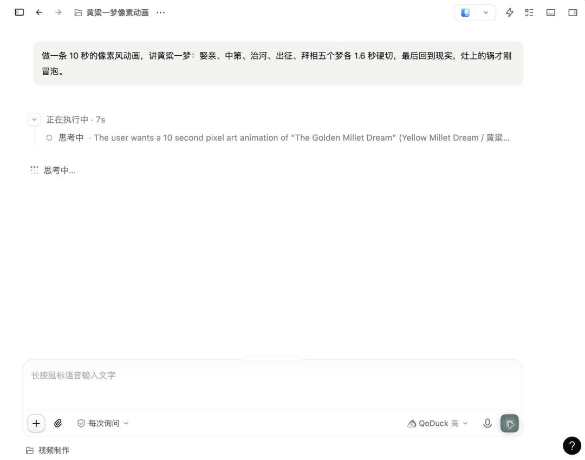
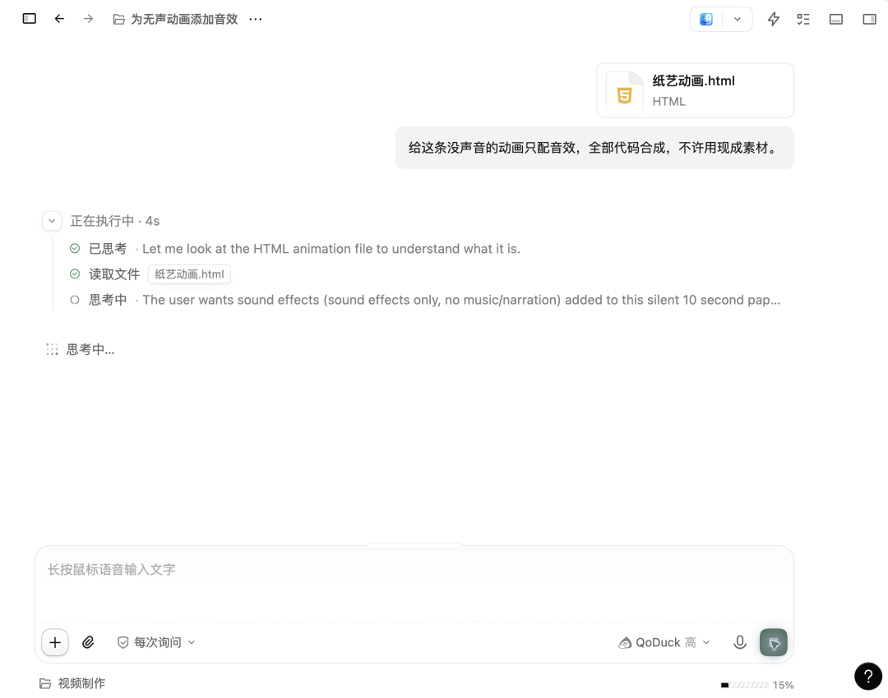
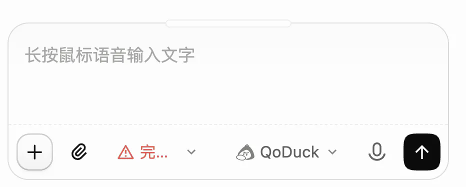

# 匿名模型Qoduck一句话做动效视频，国产顶级！免费账号也能用
> 💡 备注属性未写入，可能是备注属性名称或者类型被修改了，建议将字段类型设置为 rich_text，可以在小程序-操作-修改文章数据库页面进行调整
> 💡 原文链接:[https://mp.weixin.qq.com/s?__biz=MzU3MjU5Mzc2Nw==&mid=2247491107&idx=1&sn=9f13eb3826bc813fe4d0045b0c7a1a93&chksm=fd498d8928976363888d45bb136404573f5c48724fecdd6f55fb725c6bb7724ef9575e622bb6#rd](https://mp.weixin.qq.com/s?__biz=MzU3MjU5Mzc2Nw%3D%3D&mid=2247491107&idx=1&sn=9f13eb3826bc813fe4d0045b0c7a1a93&chksm=fd498d8928976363888d45bb136404573f5c48724fecdd6f55fb725c6bb7724ef9575e622bb6#rd)
我发现了一个超强模型，Qoduck。
上面这个视频就是用它做出来的。
我还对他进行了一遍测验，我发现他各种任务都执行得非常好。
## 01 · 长任务执行
我手上有一篇自己写的科普，讲 2026 年诺贝尔化学奖，3286 字。
我跟它说：做成一条 讲解视频，先不配音。

20 多分钟后，片子交回来了。这个是效果
三千多字，他自己从其中分辨了主线。定义整个视频它怎么运行的。
我文章里的比喻，它都演出来了。
它还会埋线，开头抛出的问题，一直留到快结尾才揭晓。
从头到尾，字幕里的数字一个都没错。
所以他的长任务执行，还是属于第一梯队的。
## 02 · 多模态能力
我让他去复刻下面的这个诺贝尔奖头像的奖章。

这奖章难点在哪里呢？在于它的颜色相近，并且有很多阴影的部分。我就让它重绘，看一下它的识别能力还有绘图能力。
下面这个就是模型重绘的，我们仔细对比就可以发现，它对于一些文字的识别真的确实非常准，现在基本没有什么错误。

绘图能力，还是有需要精进的部分。
## 03 · 各种动效制作
我让他制作了各种各样的动效。整个动效效果来说，也是属于第一梯队的。

像素风
数据动画
数学动画
皮影戏
漫画
地铁线路图
扁平动画
## 04 · 音效制作
一条没声音的纸艺动画，我让它只配音效，全部代码合成，不许用现成素材。

结果出来是非常让我吃惊的，我觉得他这一部分，几乎跟Opus5.5持平。
它配了 90 个声音，一个个自己造出来，几乎每个动作都踩在点上。
你可以仔细听一下，看看音效是不是卡在点上。
这几个场景跑下来，Qoduck 的能力我总结成四点：
长任务：能自己把活理清楚。三千多字的文章丢给它，主线它自己定，还会埋线，20 多分钟交回一条完整的片子，字幕里的数字一个没错。
多模态：认得准，画得还差一点。奖章上的文字基本没认错，重绘的细节还要精进。
动效：懂风格，也懂怎么用画面讲事。给一句风格和一件要讲的事，整套画面语言它自己搭，抽象的知识也能变成看得懂的动作。
音效：自己造声音，还踩得上点。不用现成素材，90 个声音全是代码合成，几乎每个动作都卡在点上。
做视频要用到的这些，Qoduck 基本都接得住。
## 怎么用上
目前我们可以在qoder里面去进行使用。

每个账号每天都有免费额度，额度内不消耗 Credits，思考强度调到最高也一样；用完了第二天恢复。
国产模型猛猛冲！
以前做一条动效视频，要有人写脚本、有人做动画、有人配音效。现在一个人说一句话，画面和声音，模型写代码全做出来了。
这是国产模型在视频制作上非常好的一次进步。做视频的门槛还在往下掉，接下来比的，是你有什么想讲的。
