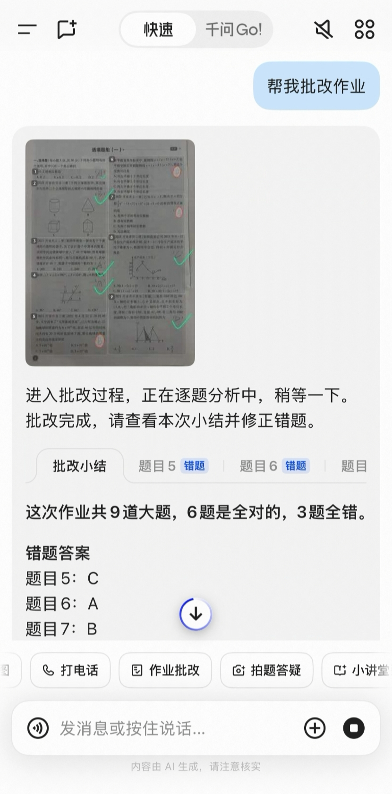
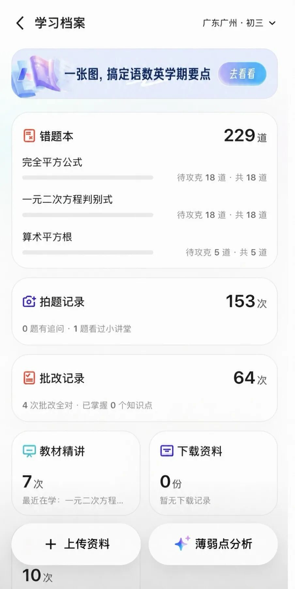
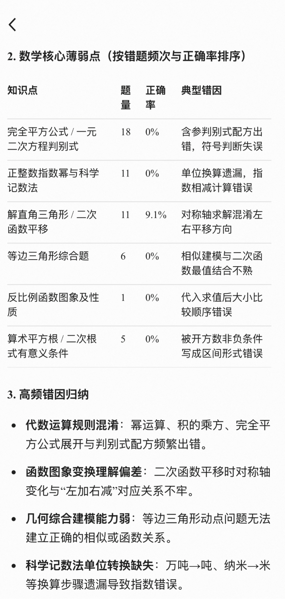
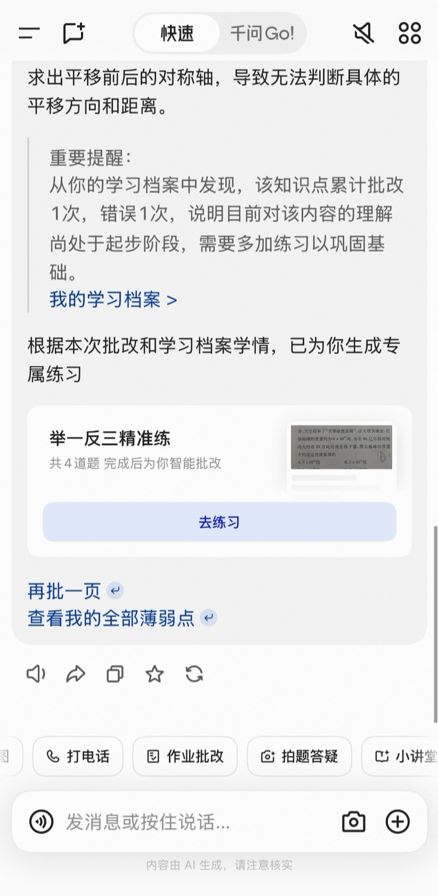

# 千问上线"学习档案"，帮孩子揪出反复出错的知识点
> 💡 备注属性未写入，可能是备注属性名称或者类型被修改了，建议将字段类型设置为 rich_text，可以在小程序-操作-修改文章数据库页面进行调整
> 💡 原文链接:[https://mp.weixin.qq.com/s?__biz=MzIzOTQxMTA2Nw==&mid=2247485954&idx=1&sn=cbfa5490c38b54b5888395ff4e092b4e&chksm=e8622b80bd8c3b70d08f0b89f064f8ccebeb266dbe4450e25528e4430ca3bd865b504303ea69#rd](https://mp.weixin.qq.com/s?__biz=MzIzOTQxMTA2Nw%3D%3D&mid=2247485954&idx=1&sn=cbfa5490c38b54b5888395ff4e092b4e&chksm=e8622b80bd8c3b70d08f0b89f064f8ccebeb266dbe4450e25528e4430ca3bd865b504303ea69#rd)
**孩子有不会的题，拍张照发给 AI，等几秒，讲解就来了。**

图 1：拍一页作业，它会逐题批改，并指出这次错在哪。（图源：深圳新闻网）
这个动作，现在很多家庭每天都在重复。
一个学期下来，手机里攒了几百条这样的记录。
但期中考试前，孩子翻开错题本，看了两页，合上了。
你问他“到底哪儿不会”，他说不清。你自己也说不清。
那些记录明明都在，为什么没用上？
因为从来没人回头看过它们。
**PART 01**
**一、那些拍题记录，其实是一份病历**
你带孩子去医院，医生不会问一句“最近怎么样”就开药。他要看化验单，看指标，看上一次的对比。
但孩子的学习，我们一直在靠“最近怎么样”。
“数学怎么样？”“还行。”
“哪儿不会？”“就是有些题不会。”
这不是孩子在敷衍。是他真的说不清。一个学期的错题摊在那儿，几百道，谁会一道道翻回去找规律？
可你跟 AI 拍过的那些题里，其实藏着答案：哪一类题他反复问、哪一类题他问了三次还没懂、哪一类题他从来不问。
**这份东西，就是病历。**
只是一直没人翻开过。

图 2：错题本 229 道、拍题记录 153 次、批改记录 64 次——记录一直在，只是没人回头看过。（图源：深圳新闻网）
**PART 02**
**二、千问这次做的，是把它翻开了**
**10 月 29 日，千问上线了「学习档案」。**
它做的事说起来不复杂：**把孩子在你千问里的拍题、作业批改、错题本、小讲堂这些记录整合起来，生成一份学情报告，分析知识点掌握情况、薄弱环节和主要错因，再自动出一套针对性的练习。**
据钱江晚报 10 月 29 日报道，广州一个初三学生用它分析了自己过去三个月的记录，结果是：
数学整体正确率 63.4%。但涉及完全平方公式、一元二次方程判别式的 **18 道题，全部答错**。
报告还进一步指出，他的问题不是“不会做题”，而是“代数运算规则混淆”“函数图像平移方向判断不清”。
最后系统生成了 15 道题，覆盖五个薄弱点。

图 3：薄弱点按错题频次和正确率排序，每一行都给出「典型错因」。（图源：深圳新闻网）
这里有个区别值得说清楚。
63.4% 这个数字，告诉你的是**结果**。
18 道全错在同一个知识点上，告诉你的是**病因**。
前者只会让人焦虑，后者才能动手。
**它不是告诉你错了多少，是告诉你——你一直在错同一类。**
**PART 03**
**三、想让它有用，有三个前提**
**前提一：你得先在千问里有记录。**
这条最容易被忽略，也最容易让人失望。它只能分析你在千问里的学习记录。如果你昨天才装，今天点进去，它给不出什么东西。
所以它是个越用越有用的东西。已经用了几个月的，现在打开就有货；刚开始的，先攒着。
入口有三个：拍照批改后的结果页、对话框里直接输入“我的学习档案”、拍题和批改页面的快捷入口。

图 4：批改完会直接给出「我的学习档案」入口，并按学情生成「举一反三精准练」。（图源：深圳新闻网）
**前提二：报告要倒着看。**
大多数人打开就看正确率。那个数字最没用。
先看“错因”那一栏。它告诉你的是：这孩子是在概念上没通，还是在运算规则上不熟，还是在审题上出问题。
这三种，补法完全不一样。概念没通要回去重讲，运算不熟只要多练，审题出问题得改习惯。
**前提三：那套练习题，不是为了做完。**
系统会给一套针对薄弱点的题。很多人做完就结束了。
正确的用法是：做完之后，再回头看一次错因有没有变。
如果错因从“概念混淆”变成了“计算失误”，说明方向对了；如果还是同一类错，说明这个知识点得回头重讲，光刷题没用。
**PART 04**
**四、但它有几个边界，得先说清**
**第一，它只看得到千问里的东西。**
学校发的卷子、孩子在纸上做的题、老师在课堂上讲的内容，它都看不到。
所以它的结论是“基于已有记录”的判断，不是全貌。数据不全的时候，结论就不能全信。
**第二，错因是推测，不是诊断。**
它说“代数运算规则混淆”，是基于错题推断出来的。这个推断大概率有用，但它不是老师，更不是医生。
它给的是线索，不是判决。
**第三，它替代不了老师。**
一个班四十个孩子，老师能记住谁哪块弱，是因为他天天看、天天批。工具要解决的是“家长看不见”的问题，不是“老师不专业”的问题。
最后一句，关于期中考试。
这几天期中考试确实近了，很多人会因为“考前”去用它。
但说实话，考前一周能补的东西有限。
**它真正的价值，不在这周。**
**PART 05**
**五、它最值钱的地方**
学习档案这个东西，我觉得最值钱的地方，不是“帮你考前突击”。
是它第一次让孩子看见：
**我不是“数学不好”。**
**我是“这一块没弄明白”。**
这两句话，对孩子来说是完全不同的两件事。
第一句是个评价。说完了就完了，还会让人泄气——因为我数学不好，所以我数学不好，这是个死循环。
第二句是个问题。问题是有边界的，有边界就能解决。
一个孩子如果从小就知道“我的问题在哪一块”，他以后遇到任何事，都不会只会说“我不行”，而会说“我这一块还不行”。
**差的就是这一句。**
这可能比一次期中考试重要得多。
如果这篇对你有用
点赞
在看
转发
谢谢你看我的文章，我们下篇再见。
