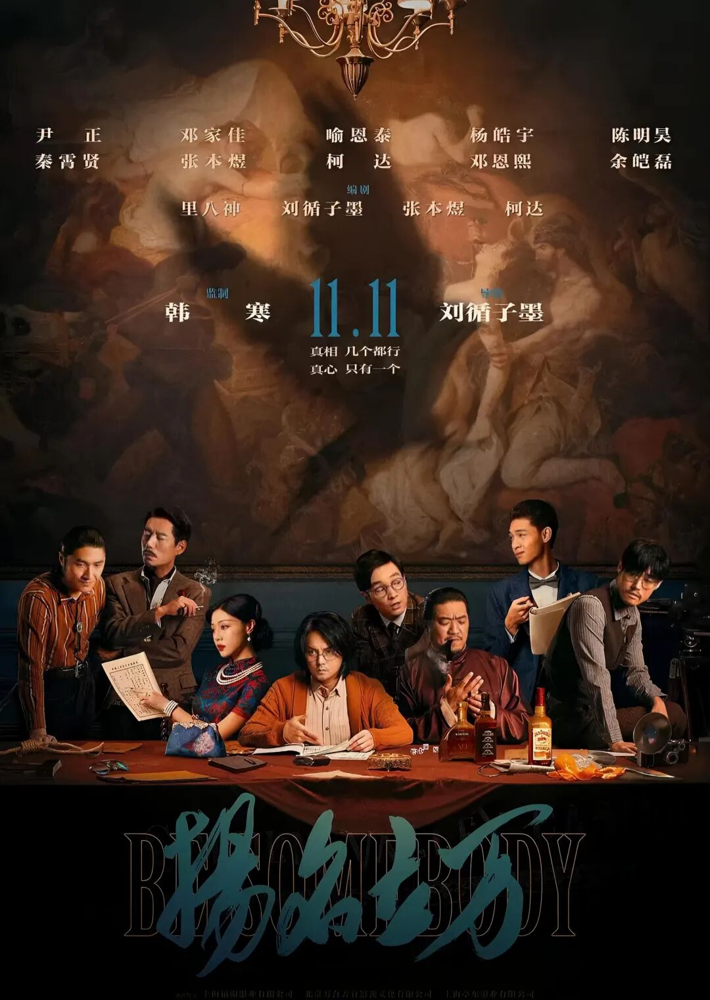
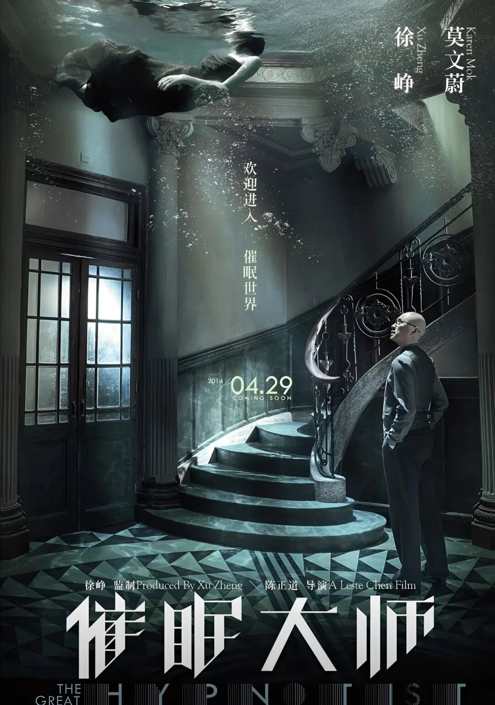
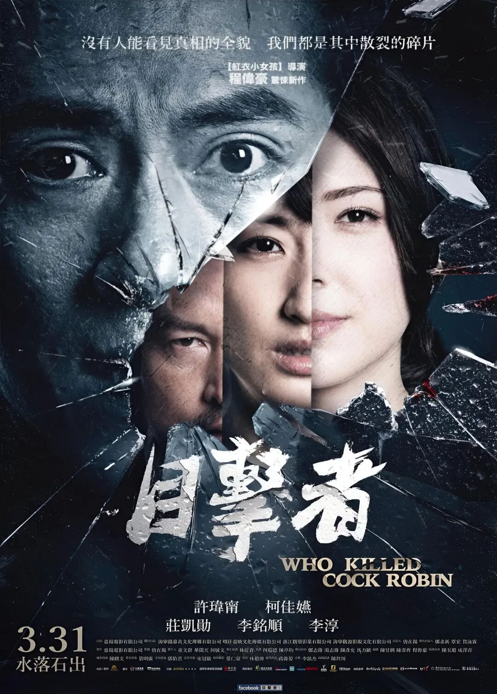
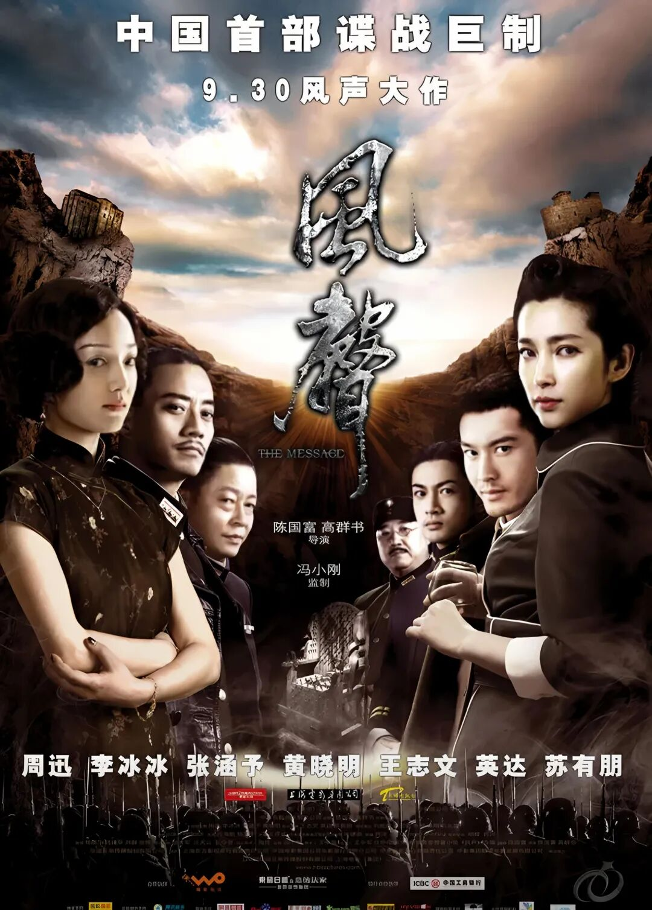
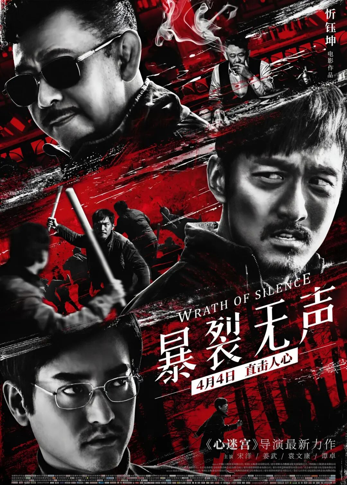
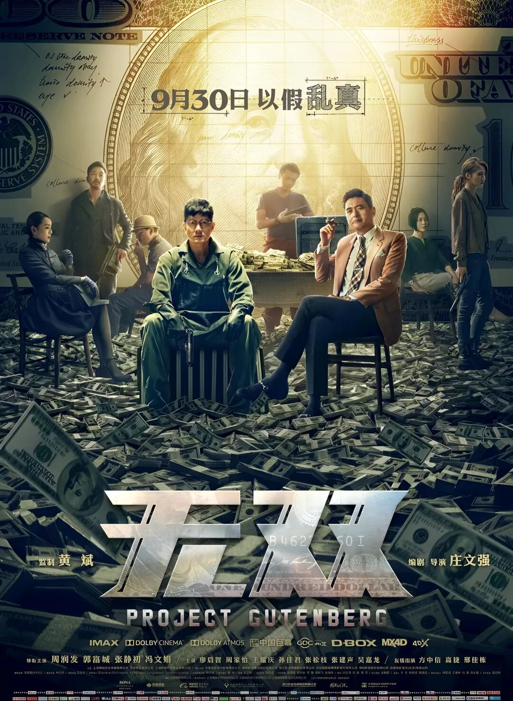
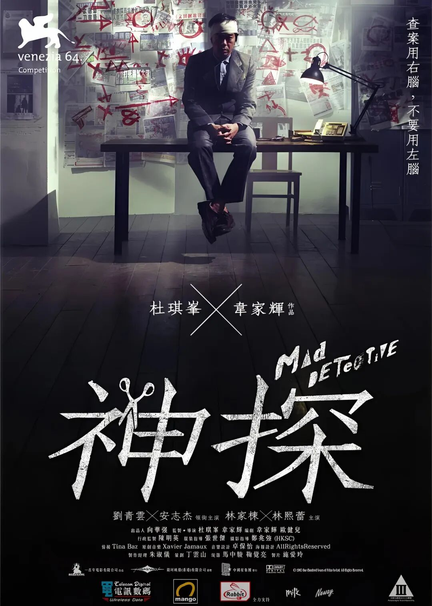

# 华语十大悬疑反转电影，每一部都烧脑封神
> 💡 备注属性未写入，可能是备注属性名称或者类型被修改了，建议将字段类型设置为 rich_text，可以在小程序-操作-修改文章数据库页面进行调整
> 💡 原文链接:[https://mp.weixin.qq.com/s?__biz=MzY4NDQ1NzM0OA==&mid=2247484321&idx=1&sn=5b67163732478664f657848d283f6a03&chksm=f28e8a6aa22476e7b3867e10f3635937e6bbf1163f0710b937eb74335320c8edb1f4b55a5824#rd](https://mp.weixin.qq.com/s?__biz=MzY4NDQ1NzM0OA%3D%3D&mid=2247484321&idx=1&sn=5b67163732478664f657848d283f6a03&chksm=f28e8a6aa22476e7b3867e10f3635937e6bbf1163f0710b937eb74335320c8edb1f4b55a5824#rd)
悬疑片的魅力，永远藏在“不到最后一秒猜不透真相”的反转里。今天这份片单，集结了十部华语悬疑反转领域的标杆之作，从本土化翻拍的惊喜到小成本黑马的惊艳，从人性幽暗的揭露到叙事诡计的极致，每一部都能让你在观影时心跳加速，看完后反复回味。

## 1.《误杀》（2019）
- 基本信息：导演柯汶利，监制陈思诚，主演肖央、谭卓、陈冲，豆瓣评分7.5。
- 剧情简述：泰国华人李维杰的女儿被督察长儿子侵害，反抗中失手杀人。李维杰利用自己的观影经验，设计了一套完美的时间伪证，将家人的嫌疑彻底掩盖，与警方展开了一场高智商的博弈。
- 影片亮点：作为印度电影《误杀瞒天记》的本土化翻拍，影片在保留核心诡计的同时，加入了更符合华语观众的情感逻辑，肖央将父亲的隐忍与狠绝演绎得极具层次感，结尾藏尸地点的反转更是细思极恐，成为国产悬疑翻拍的商业标杆。
- 演员与口碑：陈冲饰演的督察长气场全开，与肖央的对手戏张力拉满；影片上映后收获13亿票房，成为2019年贺岁档黑马，观众评价“节奏紧凑，反转合理，是难得的翻拍佳作”。

## 2.《扬名立万》（2021）
- 基本信息：导演刘循子墨，监制韩寒，主演尹正、邓家佳、喻恩泰，豆瓣评分7.4。
- 剧情简述：民国时期，一群失意电影人被投资人召集到一栋别墅，要将一桩轰动全国的血案拍成电影。在复盘案情的过程中，他们逐渐发现真凶就藏在现场，而案件背后还有更黑暗的真相。
- 影片亮点：采用“剧本杀”式叙事，将密室、戏中戏、案中案等元素完美融合，层层嵌套的反转让观众全程保持紧张感，结局的留白更是给足了想象空间，是近年国产悬疑里最惊喜的黑马。
- 演员与口碑：尹正饰演的编剧敏锐又执着，邓家佳饰演的苏梦蝶飒爽又清醒，喻恩泰饰演的导演油滑却有底线；影片最终票房9.23亿，入围第35届金鸡奖最佳导演处女作，观众评价“创意新颖，反转密集，看完后劲很大”。

## 3.《追凶者也》（2016）
- 基本信息：导演曹保平，主演刘烨、张译、段博文，豆瓣评分7.9。
- 剧情简述：西南小镇发生凶案，汽修工宋老二被列为嫌疑人，为了洗清嫌疑，他踏上追凶之路。与此同时，夜总会领班董小凤、古惑仔王友全也被卷入案件，三人从不同视角展开了一场荒诞又扎心的追逃。
- 影片亮点：采用三线叙事结构，每个视角都解锁一层真相，真凶身份的反转充满黑色幽默，用一桩凶案揭露了底层小人物的窘迫与疯狂，笑点与寒意并存。
- 演员与口碑：张译饰演的“五星杀手”董小凤极具反差感，刘烨饰演的宋老二憨厚又执拗；影片获得第19届上海国际电影节最佳男主角奖，观众评价“叙事精巧，演技炸裂，曹保平的黑色幽默玩得太到位”。

## 4.《催眠大师》（2014）
- 基本信息：导演陈正道，主演徐峥、莫文蔚，豆瓣评分7.6。
- 剧情简述：心理医生徐瑞宁接诊了一位声称能看见“鬼”的女病人任小妍，在催眠治疗的过程中，徐瑞宁逐渐发现自己才是被催眠的那个人，而任小妍的出现，是为了治愈他内心的创伤。
- 影片亮点：将催眠题材的悬疑感玩到了极致，虚实嵌套的剧情层层反转，真相不断推翻认知，全程氛围拉满，是国产心理悬疑的天花板之作。
- 演员与口碑：徐峥和莫文蔚的对手戏张力十足，两人在清醒与催眠状态下的切换极具说服力；影片上映后成为2014年年度评分最高的华语悬疑片之一，观众评价“烧脑又治愈，看完才明白什么是‘你以为的真相，只是别人想让你看到的’”。

## 5.《目击者之追凶》（2017）
- 基本信息：导演程伟豪，主演庄凯勋、许玮甯、柯佳嬿，豆瓣评分8.2。
- 剧情简述：记者王逸齐在报道一起“事故车还魂”新闻时，意外发现这起事故与九年前的一桩肇事逃逸案有关。随着调查深入，他发现案件背后牵扯出贪腐、谋杀等多重秘密，而身边的每个人似乎都在说谎。
- 影片亮点：反转密度高到窒息，每推进一层剧情就会推翻一次真相，尺度生猛，揭露了人性的幽暗面，是台湾悬疑片的巅峰水准。
- 演员与口碑：庄凯勋饰演的记者冷静又偏执，许玮甯饰演的女主管神秘又危险；影片入围第20届台北电影节最佳剧情长片，观众评价“全程无尿点，反转到最后一秒，看完脊背发凉”。

## 6.《风声》（2009）
- 基本信息：导演陈国富、高群书，主演周迅、李冰冰、张涵予，豆瓣评分8.5。
- 剧情简述：抗日战争时期，日军在司令部设下圈套，要找出代号“老鬼”的地下党。顾晓梦、李宁玉等五人被囚禁在密室中，互相猜忌、彼此试探，在酷刑与心理战中，“老鬼”的身份逐渐浮出水面。
- 影片亮点：全程悬念拉满，张力十足，结尾老鬼身份揭晓的瞬间震撼人心，谍战外壳之下，是关于信仰的极致浪漫，是国产谍战悬疑的无冕之王。
- 演员与口碑：周迅和李冰冰的对手戏堪称教科书级表演，张涵予饰演的吴志国硬汉又深情；影片获得第46届金马奖最佳女主角奖，观众评价“演员演技封神，剧情紧凑，是华语谍战片的巅峰”。

## 7.《爆裂无声》（2018）
- 基本信息：导演忻钰坤，主演宋洋、姜武、袁文康，豆瓣评分8.2。
- 剧情简述：哑巴矿工张保民的儿子失踪，他在寻找儿子的过程中，意外发现儿子的失踪与黑心老板昌万年、律师徐文杰有关。三线叙事环环相扣，线索伏笔遍布全片，结尾山洞真相的反转猝不及防。
- 影片亮点：用无声的对抗揭露了阶层的鸿沟，线索伏笔遍布全片，结尾的反转充满冲击力，是忻钰坤继《心迷宫》之后的又一佳作。
- 演员与口碑：宋洋饰演的张保民全程无台词，却用肢体语言演绎出了愤怒与绝望；姜武饰演的昌万年狠戾又虚伪；影片入围第12届FIRST青年影展最佳剧情长片，观众评价“压抑又真实，反转后劲十足，看完久久不能平静”。

## 8.《无双》（2018）
- 基本信息：导演庄文强，主演周润发、郭富城、张静初，豆瓣评分8.0。
- 剧情简述：落魄画家李问被警方逮捕，为了脱罪，他讲述了自己与伪钞集团大佬“画家”的故事。随着调查深入，警方发现“画家”的身份并不简单，而李问的讲述里充满了谎言。
- 影片亮点：叙事诡计玩到炉火纯青，结尾身份大反转彻底颠覆所有认知，周润发和郭富城的双雄飙戏张力拉满，是港产悬疑的回春神作。
- 演员与口碑：周润发重现《英雄本色》的经典镜头，郭富城将李问的懦弱与疯狂演绎得淋漓尽致；影片获得第38届香港金像奖最佳电影奖，观众评价“港片回春，反转精彩，发哥还是那个发哥”。

## 9.《神探》（2007）
- 基本信息：导演杜琪峰、韦家辉，主演刘青云、安志杰、林家栋，豆瓣评分8.5。
- 剧情简述：能看见人心“鬼”的退役神探陈桂彬，被年轻警员何家安邀请调查一桩警枪失踪案。在调查过程中，陈桂彬发现案件背后牵扯出多重人格，而真相远比想象中复杂。
- 影片亮点：全片烧脑程度拉满，结尾三分钟换枪戏堪称华语影史封神反转，把人性的复杂与幽暗推到了极致，是杜琪峰与韦家辉的悬疑封神之作。
- 演员与口碑：刘青云饰演的陈桂彬疯癫又睿智，林家栋饰演的高志伟将多重人格演绎得极具层次感；影片入围第64届威尼斯国际电影节，观众评价“华语悬疑天花板，结尾反转看三遍才看懂”。

## 10.《心迷宫》（2014）
- 基本信息：导演忻钰坤，主演霍卫民、王笑天、罗芸，豆瓣评分8.7。
- 剧情简述：河南农村的一具无名尸体，牵出了村里的连环秘密。村长肖卫国、儿子肖宗耀、村民黄欢、丽琴等人的命运被这具尸体连接在一起，多线叙事精密咬合，每个视角都解锁一层真相。
- 影片亮点：170万小成本拍出来的封神之作，多线叙事精密咬合，不到最后一秒永远猜不透全部结局，是华语反转悬疑里难以复刻的巅峰。
- 演员与口碑：全片没有明星演员，却凭借扎实的剧本和精湛的表演打动观众；影片获得第8届FIRST青年影展最佳导演奖，观众评价“小成本大能量，叙事精巧，是国产悬疑的良心之作”。
这十部华语悬疑反转电影，你看过几部？哪一部的反转最让你印象深刻？欢迎在评论区留言分享你的看法！
