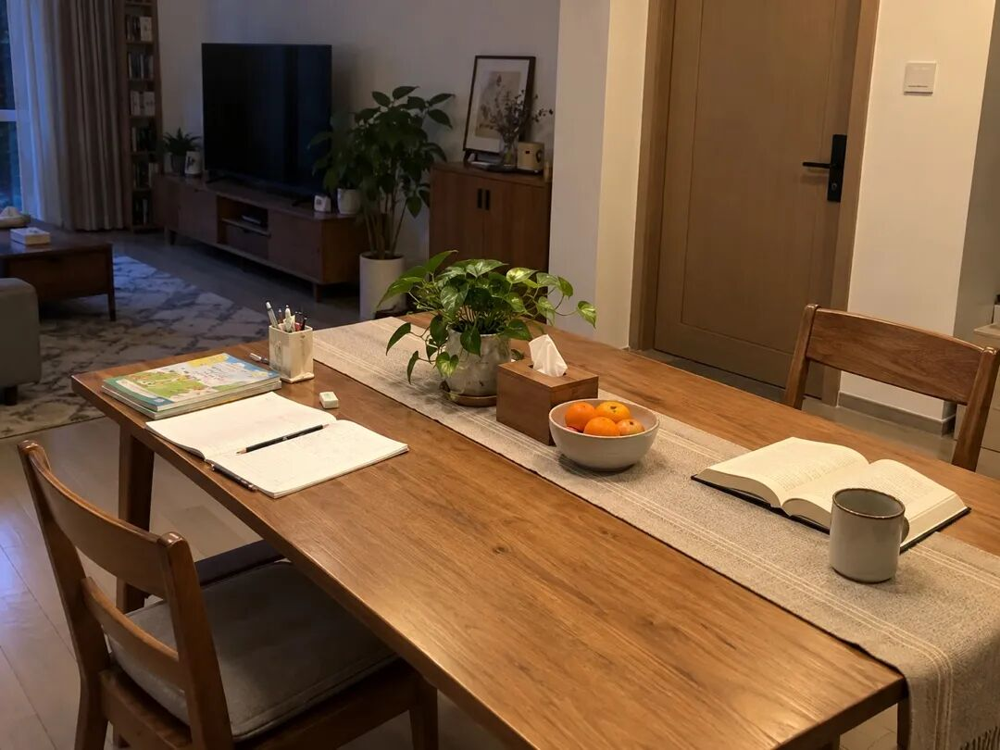

# 卧室，不准有书桌！
> 💡 备注属性未写入，可能是备注属性名称或者类型被修改了，建议将字段类型设置为 rich_text，可以在小程序-操作-修改文章数据库页面进行调整
> 💡 原文链接:[https://mp.weixin.qq.com/s?__biz=MzY5NjQ5MTYwNg==&mid=2247483696&idx=1&sn=48e7388365ea710409e83d650c07ea24&chksm=f50c9850e18732f6e46e461ba7204f6c6a42428b5142d1757e4a343d1a3142a9b3b666805f95#rd](https://mp.weixin.qq.com/s?__biz=MzY5NjQ5MTYwNg%3D%3D&mid=2247483696&idx=1&sn=48e7388365ea710409e83d650c07ea24&chksm=f50c9850e18732f6e46e461ba7204f6c6a42428b5142d1757e4a343d1a3142a9b3b666805f95#rd)
作者：帮上百个小学家庭规划过学习，孩子少走弯路、成绩稳步往上。
孩子关上房门写作业，家长在外面坐不住，隔一会儿就想推门看一眼：是在写，还是在玩？推一回，孩子烦；不推，家长慌。
有的家长干脆在门上装了一块玻璃，孩子又把书包挂在了玻璃上。
与其一次次推门，不如把孩子睡觉和学习的地方分开。学习放到客厅那张大桌上，睡觉留在卧室里，比反复检查孩子在不在学，管用得多。
“不准”两个字说得重了。家里的条件各不一样，不是每家都要搬桌子、改房间；这篇说的，是一种值得试一试的安排。
**书桌放在卧室，问题出在哪**
有位妈妈讲过她家的一个晚上：她端着水果推开孩子的房门，孩子手忙脚乱，把手里的东西往抽屉里一塞，作业本上那一行字，跟她半小时前进来时一模一样。
这件事说明不了孩子一定在摸鱼。很多孩子关上门也在认真写。可它说明了一件事：门一关，家长能看见的，就只剩一扇门了。
看不见，家长就只能猜。猜得多了，就忍不住去推门；推门推多了，孩子就学会了听脚步声。一个在里面防着，一个在外面盯着，作业还没写几道，力气全花在了这件事上。
一个晚上斗智斗勇下来，母子俩都比写作业还累。
还有一层：卧室里有床、有玩具、有零食，孩子写着写着，往床上一靠，就不想起来了。不是孩子不自觉，小学的孩子，本来就很难在一屋子好玩的东西中间坐住。
家长起初多半觉得，给孩子一个自己的房间、一张自己的书桌，是对他好。这份心意没有错。只是对小学的孩子来说，“自己的房间”和“写作业的地方”最好不是同一个地方。
房间留给睡觉、发呆、玩自己的东西，写作业换到一张大家都能看见的桌子上，两件事各有各的地方，孩子心里也分得清。
**把学习区搬出卧室，分三步**
搬桌子不难，难的是孩子愿不愿意。按三步来，比家长一句“明天起去客厅写”顺得多。
先跟孩子商量，说清为什么。别一上来就宣布，先找个不赶时间的周末，跟孩子聊一聊：“你在房间写作业，妈妈总忍不住推门，你烦，我也烦。
要不我们换个地方，你在客厅大桌上写，我就在旁边看我的书，不进进出出了，你看行不行？”说的是两个人都难受的那件事，而不是“你在里面肯定偷懒”。
孩子听到家长先承认自己也有不对，比较容易接着往下谈。
孩子要是不愿意，多半是怕被盯着。可以跟他说好：家长坐在旁边，只做自己的事，不看他的本子，不随口插话，他有问题再开口。
说到就要做到，头几天家长忍不住瞟一眼本子、插一句“这个字写错了”，孩子马上就会说：“你看，你又在盯我。”
先试两周，不说永远。跟孩子讲明白，这是试一试，两周以后一起看。客厅那张桌子上，只放这一科的书本和文具，手机、平板放到别的房间。
家长坐在同一张桌子的另一头，看书、记账、处理自己的事，电视不开。
家里没有大桌子，餐桌收拾干净也一样用；家里有小的弟弟妹妹，就挑他们睡了以后，或者另一个人带着去别的屋。

孩子要是试了两天就说“我还是想回房间”，先别急着答应，也别急着拒绝。问一句：“是哪里不舒服？”
是太吵，就把电视彻底关掉；是不想被看见写错，就跟他说好，写错了家长不吭声。
两周后，一起看要不要调。到了约好的日子，坐下来一起聊：这两周写作业是快了还是慢了？有没有被打扰？
他自己觉得怎么样？孩子说出来的不满，挑能改的改。家长也说说自己的感受：这两周是不是少操了很多心、少发了几回火。
两边都觉得好，就接着这样；有一边觉得不好，就改一改再试两周。
孩子要是两周下来还是不愿意，也不用硬压着。有的孩子确实需要安静，那就各退一步：门开着写，家长不推门、不进去，有事敲一下门框。
换个法子，目的还是一样——让家长不用猜，孩子不用防。
**孩子不愿意，怎么谈**
不管哪一步，孩子不愿意的时候，有两句话家长最好别说。
一句是“你在房间里肯定偷懒”。这句话一出口，孩子要捍卫的就不是房间，是自己的名声了，怎么谈都谈不下去。
另一句是“我是为你好”。这句话没有错，可孩子听了，只会觉得没得商量。
换成“我们一起想个两个人都舒服的办法”，孩子才会坐下来谈。
谈的时候让孩子先说，他说完了家长再说；他提的条件，比如“写完了我要在房间里看半小时书”，能答应的就答应。
孩子越大，越要尊重他的意思；到了初中，房间和隐私更是要商量着来。这件事说到底，是家长和孩子之间的一份约定，约定得两个人都点头才算数。
**桌子搬出来，家长看得见孩子卡在哪**
桌子搬出来，家长看得见孩子在写了，也更容易看见他卡在哪一题，只是看见了，不一定说得清。
有个男孩今年读五年级，去年四年级上学期，英语练习里“Does he like…?”
这样的问句，他回答总写成“Yes, he is.”，期中英语考了82分，丢分的几道都是这一类。
后来他妈妈去芒果同学找了个英语一对一老师，老师让他把错题拍照发过去，先不写答句，把这类问句开头的Does圈出来，再说一句：问的是“Does he…”，
肯定回答就用“Yes,he does.”。圈到“Does”，他自己改成了“Yes, he does.”。
后面几周，每道这类问答题都先圈Does，再写答句。那学期期末，英语考了93分，问答句一道没错。上一次课付一次费用，没什么负担。
**分开的是地方，拉近的是人**
把睡觉和学习的地方分开，分开的是两件事，拉近的是家长和孩子。家长不用再猜，孩子不用再防，作业桌上只剩作业。
写完了，孩子回到自己的房间，那里还是他自己的地方。
孩子在自己房间写作业的时候，你放心吗？

