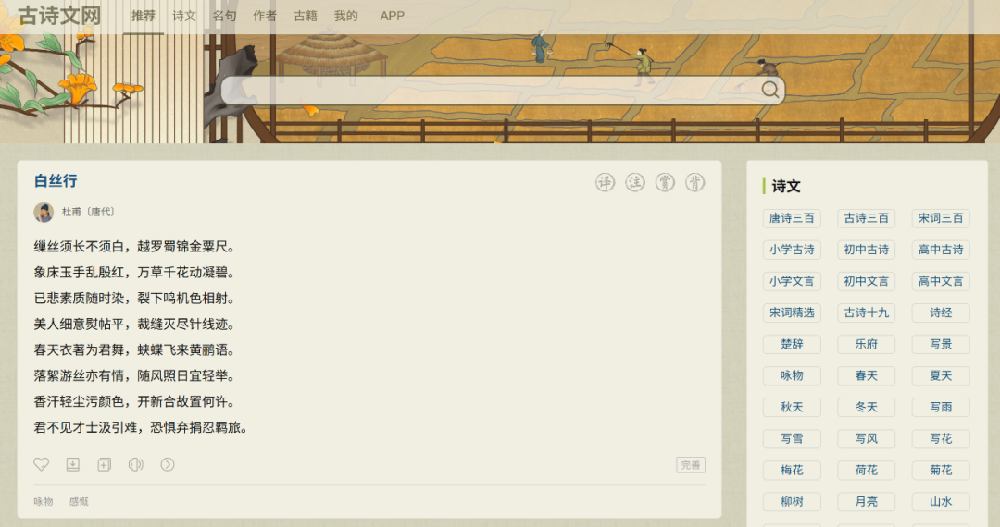
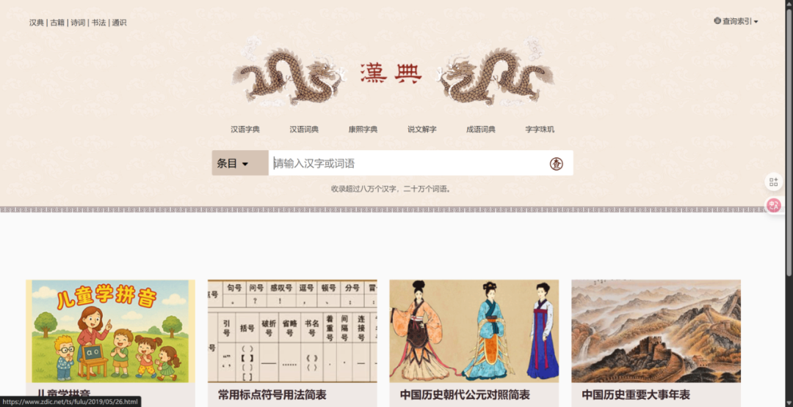
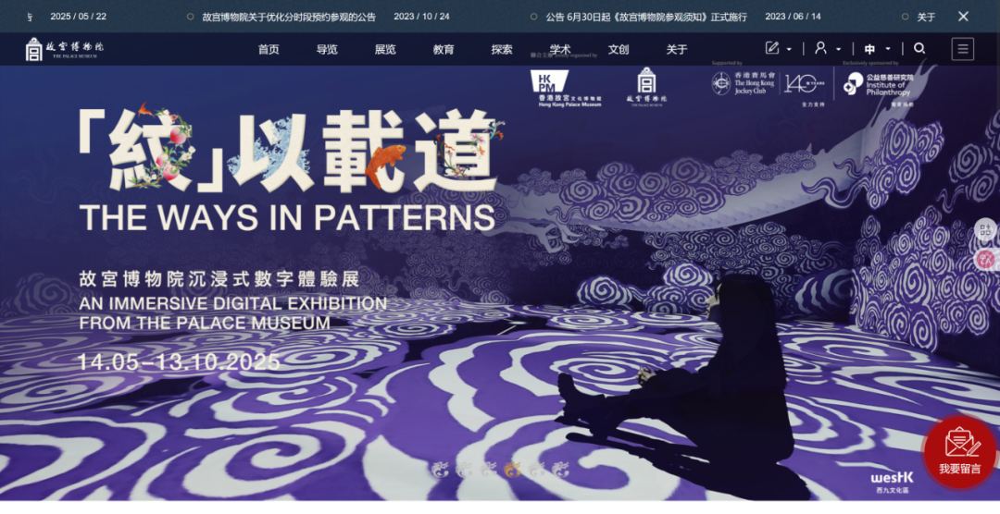
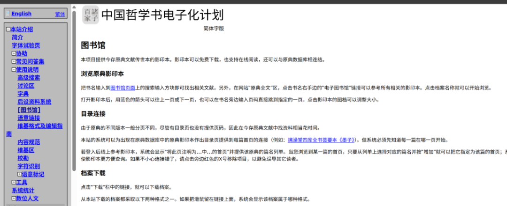

# 压箱底的7个“国学”网站和APP，今天一次性全部分享
> 💡 备注属性未写入，可能是备注属性名称或者类型被修改了，建议将字段类型设置为 rich_text，可以在小程序-操作-修改文章数据库页面进行调整
> 原文链接:[https://mp.weixin.qq.com/s/vRKrdIXkp0Ray0JjSH4WDA](https://mp.weixin.qq.com/s/vRKrdIXkp0Ray0JjSH4WDA)
**01 本期主要内容**
诗与历史，让你领略上下5000年的文化魅力，愿下面这些数字化的钥匙，为你打开通往华夏历史深处的大门，浏览岁月长河与文化交织的魅力
#### 1. 古诗文网（首推）
https://www.gushiwen.cn/
诗词爱好者的数字图书馆
**网站特点**
- 海量：从先秦到近代的数十万首诗词、古文，几乎所有名篇、名家，这里都一应俱全，你想到的它有，想不到的它也有。
- 详尽解析：作品都配有注释、白话文译文、创作背景介绍和名家赏析。
- 支持搜索：可以按作者、朝代、体裁搜索，也可以按内容和意象搜索，输入“月亮”，找到所有相关的诗词。
- 无广告：良心网站，界面极其干净，无广告

#### 2. 汉典
https://www.zdic.net/
不仅仅是字典，更是汉字的历史博物馆
**网站特点**
- 文字演变：最具特色的强大功能。查询一个字，可以看到它从甲骨文、金文、小篆、隶书到楷书的完整字形演变，直观地感受汉字在历史长河中的生命力。
- 权威佐证：释义均引经据典，引用《说文解字》、《康熙字典》等权威古籍的原文。
- 深度关联：查询一个字，会包含此字的所有成语、词语和诗词，知识网络，适合拓展学习。

#### 3. 故宫博物院官网
https://www.dpm.org.cn/ https://minghuaji.dpm.org.cn/
中华顶级文物宝库的数字化呈现
**网站特点**
- 数字文物库：故宫收藏的文物进行数字化。可以无限放大，清晰地看到《清明上河图》里的每一个人物。
- 全景故宫：虚拟漫游功能，足不出户走遍紫禁城。
- 故宫名画记：专门为欣赏中国古代绘画而设的子网站，以超高分辨率呈现传世名画，配有专家解读。

#### 4. 中国哲学书电子化计划
https://ctext.org/instructions/library/zhs
学者级的先秦两汉古籍数据库
**网站特点**
- 专业：适合先秦诸子百家、经史子集研究，这里是最专业的资源库之一。
- 双语：网站提供中英双语界面和部分文本的英文翻译，面向国际。
- 搜索：强大的搜索功能，可以模糊搜索、关联词分析。

#### 1. 西窗烛 (App)
一款高颜值的、陪伴式的诗词鉴赏应用
**APP特点**
- 推送：每天推荐一首诗词，配上精美的壁纸和简短解读
- 分类：将诗词按“节气”,“时令”,“意象”（如风、花、雪、月）,“情感”等主题进行分类
- 社区：你可以在诗词下发表自己的感悟
#### 2. 每日故宫 (App)
故宫博物院出品的“轻奢级”文物日历
**APP特点**
- 一日一赏：每天从故宫的藏品选一件，以日历的形式呈现
- 碎片学习：适合在碎片时间里欣赏和学习，每天花一分钟，日积月累学习历史文化
#### 3. 网易蜗牛读书 (App)
以严肃阅读为主的精品电子书平台
**APP特点**
- 海量资源：大量由正规出版社出版的高质量历史类书籍
- 专注阅读：提供了“每天免费畅读一小时”的模式，鼓励用户每天都能静下心来深度阅读
- 专业领读人：很多历史学者和文化名人会在这里开设“书桌”，推荐书单并撰写书评
**02 上期回顾**
[一款既科普又无用的网站，一不小心就沉浸其中！](https://mp.weixin.qq.com/s?__biz=MzU0MjYxNDIwMQ%3D%3D&mid=2247484877&idx=1&sn=6afac69562fbc84e3e3665bad9bef8df&scene=21#wechat_redirect)
[2款有趣网站，“身在格子间，眼耳能通天”](https://mp.weixin.qq.com/s?__biz=MzU0MjYxNDIwMQ%3D%3D&mid=2247484868&idx=1&sn=92f5f1ddc32aaa9f1de8c8d93ca363dc&scene=21#wechat_redirect)
**点击下方账号，你将获取AI内容分享，免费开源软件推荐，AI教程相关信息**
----------------------------

感谢大家一直以来的阅读，再看和转发。
