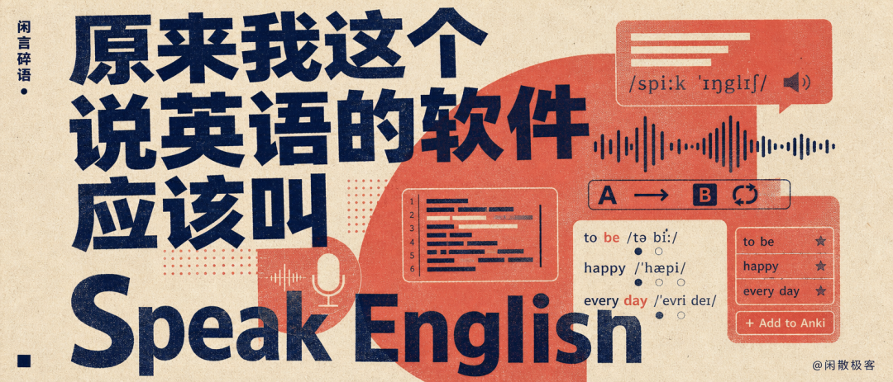
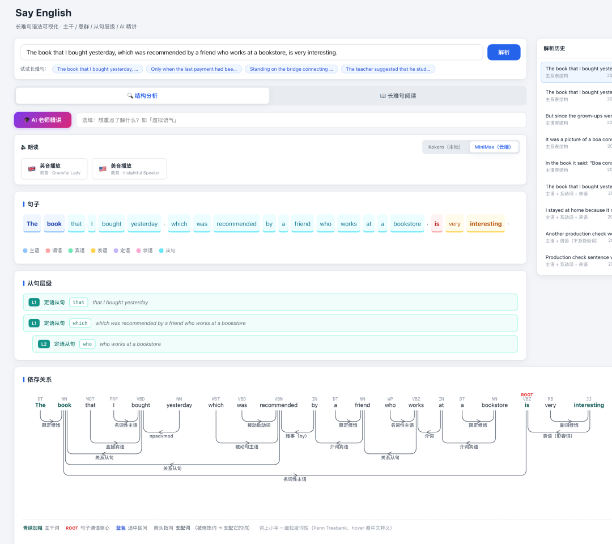
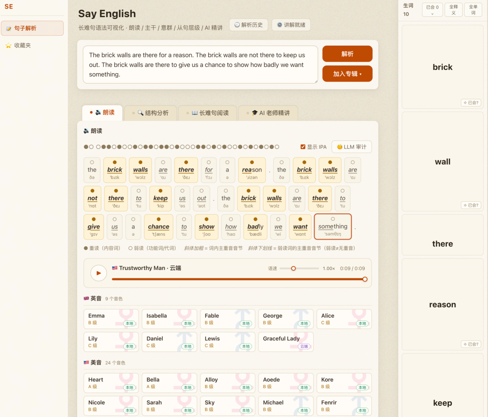
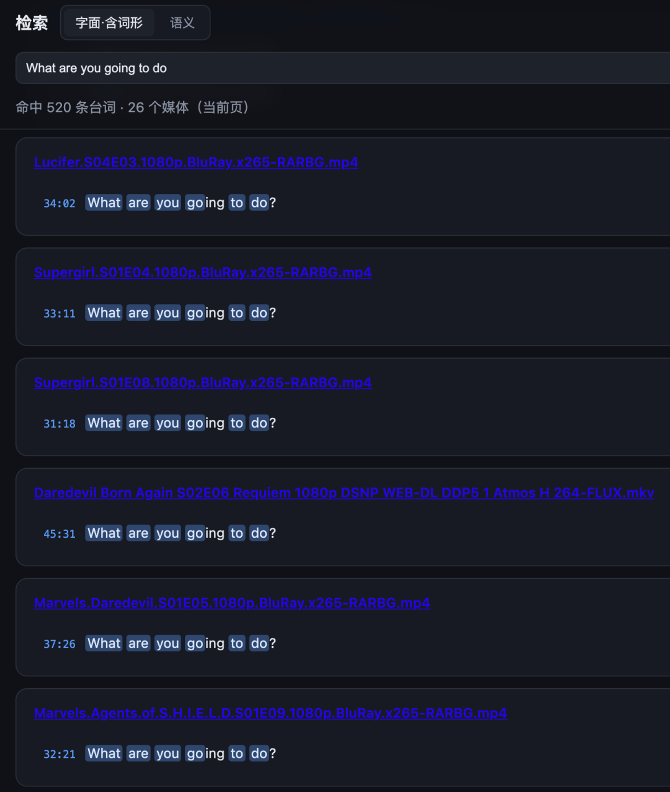

# 原来我这个说英语的软件应该叫Speak English
> 💡 备注属性未写入，可能是备注属性名称或者类型被修改了，建议将字段类型设置为 rich_text，可以在小程序-操作-修改文章数据库页面进行调整
> 💡 原文链接:[https://mp.weixin.qq.com/s?__biz=MzIyMDIyOTMwNg==&mid=2247488509&idx=1&sn=5269d719b30261f3339674694d969ced&chksm=96b2f75a82adb007dfe1312aa6f44f2db7e5a51274c352f70f528c49e16e2ed9fed19fd4e817#rd](https://mp.weixin.qq.com/s?__biz=MzIyMDIyOTMwNg%3D%3D&mid=2247488509&idx=1&sn=5269d719b30261f3339674694d969ced&chksm=96b2f75a82adb007dfe1312aa6f44f2db7e5a51274c352f70f528c49e16e2ed9fed19fd4e817#rd)

上个月我再次决定重新学习英语，这东西果然很消耗心力，搞得我没什么想写的话题了，就随便聊聊这次重启英语学习的过程吧。
之前也写过，[我从小英语就很差](https://mp.weixin.qq.com/s?__biz=MzIyMDIyOTMwNg%3D%3D&mid=2247488420&idx=1&sn=1e7822c304a880db4d32152b6f46593c&scene=21#wechat_redirect)，虽然不想放弃，但是屡战屡败，渐渐也就不愿再下什么决心了。哪怕过去一年我有了大把的时间，也没敢再碰英语，因为我知道，如果根本问题解决不了，单纯的决心是没有意义的。
那根本问题是什么呢，就是动机，我的生活中缺乏学习英语的动机。因为我的英语水平很差，所以过去十几年我已经规避掉了绝大多数需要使用英语的事情了，并且已经习惯了这样的生活。所以“学英语”这件事对我来说就成了一个没必要解决的问题。
转变的契机还是 AI，仰仗着 AI 的强大，这个世界上绝大多数的知识都变得容易获取，而且学习过程不再需要依赖特定的书、网站、老师，因为 AI 已经有能力成为你的全能教练。这时压力就给到我们自身了，如果你还学不好，那就只能是你自己的问题了。
而我其实很愿意解决自己的问题，算是一个牵强的动机吧，所以我决定再尝试一把。而且为了尽量规避掉屡战屡败带来的习得性无助，我决定这次从一个之前从未尝试过的角度切入，就是口语。再加上今年 AI 的编程能力大幅提升，而我对此有极大的兴趣，所以可以打造一个英语教练软件，从教和练两方面共同切入。
我首先在 B 站看了一些英语基础知识的视频，找的是 UP 主「英语兔」的一套语法课程和一套音标课程，一共只有十几个小时，而且讲得非常好，算是一个冷启动吧，然后开始构建我的教练系统。

我设计的一个主流程就是，我从各种来源找一些适合练习口语的句子，然后输入到系统中，由系统给出语法分析，讲解，然后提供英美两种口音的语音朗读，然后我就可以跟着它进行口语训练了。
其中涉及到的功能，当下的 AI 都能实现，但是一方面 AI 提供的内容有小概率不准，而且是非结构化的，另一方面我自己对于纯本地运行还是有一些执着的，于是又做了一波调研，发现这些功能完全可以本地实现。
于是，最终方案就是本地功能保底，确保整个系统可以离线运行，然后通过在线的 AI 大模型来拔高，在某些功能上可以提升质量，就这样做出了第一版，我给系统起名叫“Say English”。

第一版
其中语法分析使用的是 spaCy (https://spacy.io) ，这是个 NLP 库，速度快，有稳定的结构化输出，很适合做一些可视化的功能。
语音生成选择了 Kokoro，这是目前本地可运行的效果最好的 tts 了。然后又选了一个云端的 tts 是 MiniMax 的 speech-2.6-hd，主要是因为我之前买过一年它们家的 Token Plan 包括这个模型。单听 Kokoro 的效果已经不错了，不过 MiniMax 的确实更有人味一些。
然后也对接了大模型，因为我平时主要使用 Claude Code，所以这里对接了本地的 Claude CLI 和自定义的大模型接口。目前让大模型做的还只是针对语法的分析，后面肯定会再加一些有针对性的能力。
不过既然要练习口语，光能看懂听懂还不行，关键是要知道怎么读。我希望能更直观的看到每个单词的读音，句子中重音的位置。于是又改了一版，也把生词功能加了进来，顺便也得背背单词。

第二版
这里使用了三个字典，ECDICT、Wiktionary 和 CMUdict。ECDICT 提供了生词卡的主要内容，Wiktionary 主要提供了单词音标，CMUdict 提供了重读音节的位置以及一词多音的信息。这些都是 AI 做的选型，我感觉可能有些冗余了，后面再仔细看看。
这里虽然展示了生词，但是没做背单词的功能，因为背单词有 Anki 呢，就做了个按钮一键添加到 Anki 的牌组。如果以后还想做什么，基于 Anki 做就好了。
练口语有个常用的方法，就是跟读，反复听反复读，还要做对比，就像我们小时候用的复读机，所以还得做个跟读的功能，添加了 AB 循环，跟读对比。

跟读虽然有了，但是我读得对不对难道还要我自己来判断吗？也不是不行，但既然要把这个系统当作一个教练，它最好是能帮我做出判断。所以还需要一个语音评测模块。
这块只做了调研，还没开始搞。主要有微软的 Pronunciation Assessment 和科大讯飞的 ISE，讯飞的每天有免费额度，应该够个人使用了，而且说是对中式发音有针对性优化。微软的应该是按量付费，但它是唯一支持英式口语的。
语音评测目前看没有什么好的本地方案，有一个开源项目 Praat，不过它是个做语音分析的科研工具，要想做成语音评测应该还得进一步开发，不一定能达成我的目的，后面再具体看看。
练习口语的功能基本就这些了。有趣的是我给这个系统起名为 Say English，然后前两天才发现，说英语应该是 Speak English，哎呀，我这水平啊，好在这个缩写 SE 算是蒙对了。
对了，还有个口语练习的素材来源问题，目前想的是经典影视剧和技术播客。我前些年买过一台 NAS，硬盘也配满了，当年的硬盘真是便宜啊，下了不少经典电影，以及我爱看的超英美剧，还都没删。
只要把它们的字幕文件放数据库里，也可以搭配个向量库，这样就可以按需查找需要练习的句子，还能一键找到它在不同影视剧中的真人语音。网上类似的视频应该也是这么做的吧。

当前的练习素材还有一个来源，就是我每天发的朋友圈，让 AI 把它们翻译成地道的英语口语，拿自己说的话进行练习也是个不错的选择。
其实说了这么多，还有一个最最重要的问题没能解决，就是练习量。系统做得再好，你不花足够的精力去练习也是白费。
我最近半个月又开始在睡觉前刷手机了，一开始只以为是一种恶习的循环，毕竟这个事在过去几年总是反复出现，又反复克制。但过了几天我突然琢磨过味儿来，刷手机这事很可能是我白天学英语导致的，因为自控力已经被英语消耗了，所以晚上就忍不住刷手机了。
因为我练习口语和改造系统是一起进行的，所以没有记录单纯的口语练习花了多少时间，我估计每天得有一个多小时吧。但是直到我前几天把学习时间的统计功能做出来，才发现原来还不到一个小时。
我的统计比较严格，细化到秒，把所有可能的假学习、走神都尽量的排除掉了，就是想统计到真正有效的学习时间是多少。经过这几天的努力，到昨天终于能超过一个小时了。我的目标是三个小时，光靠自控力肯定是不行的，还得再想想办法啊。
最后还有一个辅助的方法，唱歌。我虽然喜欢唱歌，但是几乎没唱过英文歌，这次我决定把小时候常听的几首都学一遍，至少每个月得能学会一首吧，上个月已经把《Fly Me to the Moon》学了，唱的时候觉得还行，可是第二天一听，还是有明显的中式口音，所以提升空间还很大。这个月就学《Yesterday Once More》吧。
这个系统我是打算做成开源软件的，但目前就还只是个缝合怪，后面等我规整好了再开源吧。但说实话，开源的意义其实也不大，你把我上面提到的这些技术选型告诉 AI，让它做个参考，它也能为你写出这么一个程序来，感兴趣的朋友可以试试。
今儿就写到这吧，我再去练一会儿。
- End -
**往期推荐**

[我理想中的知识系统，终于被人做得七七八八了](https://mp.weixin.qq.com/s?__biz=MzIyMDIyOTMwNg%3D%3D&mid=2247487773&idx=1&sn=cdc7c04f07158d4239660493b6f23ce1&scene=21#wechat_redirect)
[用MiniMax翻唱梅花三弄，结果它竟然给我念经](https://mp.weixin.qq.com/s?__biz=MzIyMDIyOTMwNg%3D%3D&mid=2247487773&idx=1&sn=cdc7c04f07158d4239660493b6f23ce1&scene=21#wechat_redirect)
[使用Claude Code后，我感受到了AI软件时代的通货紧缩](https://mp.weixin.qq.com/s?__biz=MzIyMDIyOTMwNg%3D%3D&mid=2247486780&idx=1&sn=c30db9db99080cc11d43bdef5764d783&scene=21#wechat_redirect)
[浏览器是如何打开网页的，我写了一篇小白也能读懂的科普](https://mp.weixin.qq.com/s?__biz=MzIyMDIyOTMwNg%3D%3D&mid=2247486632&idx=1&sn=1b8efde85baa45f7e686f718fdbca3a4&scene=21#wechat_redirect)
[“真话不全说，假话绝不说”背后的贝叶斯思想](https://mp.weixin.qq.com/s?__biz=MzIyMDIyOTMwNg%3D%3D&mid=2247486487&idx=1&sn=76e213a14d8f5a3f9ffd9dcb20b9b004&scene=21#wechat_redirect)
[稳定币，国际金融争霸的新战场](https://mp.weixin.qq.com/s?__biz=MzIyMDIyOTMwNg%3D%3D&mid=2247486468&idx=1&sn=a5fa833a76c6460be4112ed59726475a&scene=21#wechat_redirect)‍
