# 又一个神级Skill：字幕丢进去，AI自动生成手绘动画视频
> 💡 备注属性未写入，可能是备注属性名称或者类型被修改了，建议将字段类型设置为 rich_text，可以在小程序-操作-修改文章数据库页面进行调整
> 💡 原文链接:[https://mp.weixin.qq.com/s?__biz=MzU2MTI4MjI0MQ==&mid=2247547138&idx=1&sn=05067551e9d360d3ed7a2f4e235a2694&chksm=fd1fe8e07b5da0bdd03ab897c0f65e184b5034381fed087c343b48bba7ecb63231d6f7426b7b#rd](https://mp.weixin.qq.com/s?__biz=MzU2MTI4MjI0MQ%3D%3D&mid=2247547138&idx=1&sn=05067551e9d360d3ed7a2f4e235a2694&chksm=fd1fe8e07b5da0bdd03ab897c0f65e184b5034381fed087c343b48bba7ecb63231d6f7426b7b#rd)
最近 GitHub 上刷到一个项目，srt-whiteboard-animation，涨得挺快，我去看的时候已经 3.8k Star 了。
你把字幕文件丢给它，它就能生成白板手绘动画视频。就是短视频里常见的那种，一只手握着笔在纸上边画边讲，旁白说到哪，画就画到哪。这种视频自己做一条挺麻烦的，得画图、对时间轴、再做动效。
这个项目把这几件事都包下来了，我写篇东西说说它怎么用。
## 这是个什么项目
先放张动图，作者自己做的演示，场景是猴子山抢香蕉：

旁白说到小猴，小猴就出场，说到大猴抢香蕉，大猴也出来了，最后连围观的小朋友都画上了。
这项目没界面，不是点开就用的软件，它是个 AI Skill，装给 Claude Code、Codex 这类助手用。说得直白点，就是一套写好的流程规范加几个 Python 脚本，装完以后我们说一句话，它就开始干活了。
干活的路子大概是这样：先读字幕，按内容拆成几幕，然后画线稿，再按字幕的顺序一块一块画出来，先勾线，后上色。因为画面是跟着字幕走的，声音和画面本来就是对齐的，不用做完视频再回头对时间轴。
渲染用的底图是这种线稿：
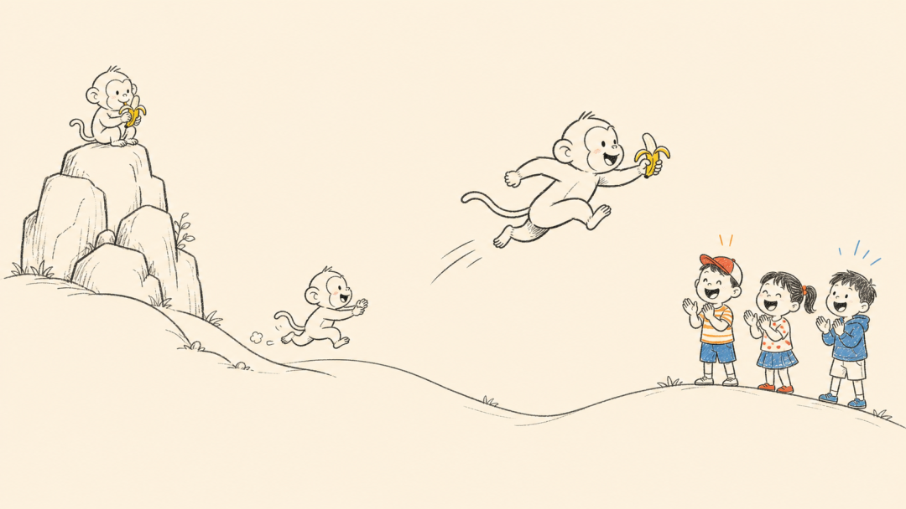
项目是 MIT 协议，商用也没问题。
## 它能做什么
字幕丢进去，它会先建议拆成几幕，一幕 25 到 35 秒，每幕讲清楚一个意思。拆完不是直接开干，会先把分镜策略给我们看，我们确认了才往下走。
画的时候，每个元素的出场顺序是按字幕来的，字幕说到谁，谁先出来，跟它在画面里站哪没关系。笔迹是连续的，画完的部分会一直留在画面上。
中间还有个预览环节。项目自带一个 preview.html，浏览器直接打开就能用，不用注册，也不用装什么服务。每个元素画在什么位置、什么时候出场、对应哪句字幕，都能在上面调，调完保存。这一步不用碰代码。
每步都得你点头，它才往下走。分镜先确认，再画线稿；线稿过了，再做标注；标注没问题才渲染。哪步不满意，就停哪步改。我自己用下来，这个设计省了不少返工。
最后每幕单独渲染成 MP4，都满意了再合并成一条完整的。
风格它也定好了：
> 暖米黄纸底，深灰素描线，红橙蓝只点一点，画面不放字和标签。
> 
做出来挺干净的。
## 快速上手
流程大概是这样，想跟着做的话照着来就行。先把项目克隆到本地，第一次用跑一下环境准备脚本，它会建一个独立的 Python 环境：
```
python scripts/prepare_env.py --check
python scripts/prepare_env.py
```
跑完会输出一个 ENV_PY 路径，记下来，后面渲染都用它。
然后解析字幕，让它给出分镜建议：
```
python scripts/parse_srt.py 你的字幕.srt --target-sec 30 --min-sec 25 --max-sec 35
```
分镜确认之后，线稿也不用我们自己画，流程里会让 AI 按统一风格生成，满意了再往下走。后面渲染命令里那张图片，就是这么来的。
确认完之后，打开 assets 目录下的 preview.html，用「打开文件夹」载入场景目录，就能在浏览器里调区域、顺序和时间了。
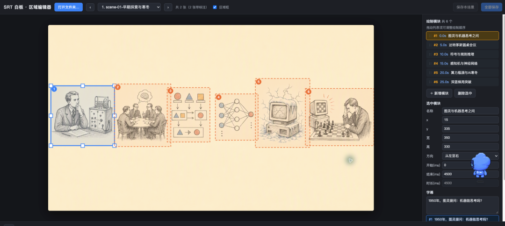
确认好了就渲染。单幕渲染用这条：
```
 scripts/render_stream_whiteboard.py 图片.png 标注.json 输出.mp4 assets/drawing-hand.png --ink-path grid --color-fill contour-wipe
```
多幕的话，等各幕都满意了再合并：
```
 scripts/merge_scenes.py --inputs 幕1.mp4 幕2.mp4 幕3.mp4 --output final.mp4
```
渲染出来的成片就是这种效果：

不想碰这些命令的话，也可以直接把它装成 Skill，让 AI 助手自己跑这套流程：
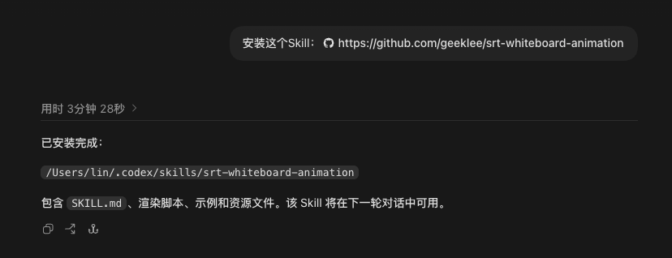
## 来看看效果
首先我自己简单写了一下 AI 发展简史，让 Codex 使用这个 Skill 去生成白板手绘动画。
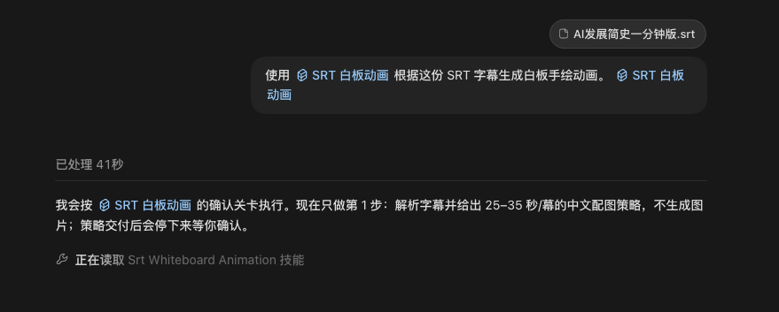
第一步，它解析字幕，给出了分镜建议：

我直接点确认，不对它做出的分镜修改，随后它完成第二步，制作了两张线稿图：
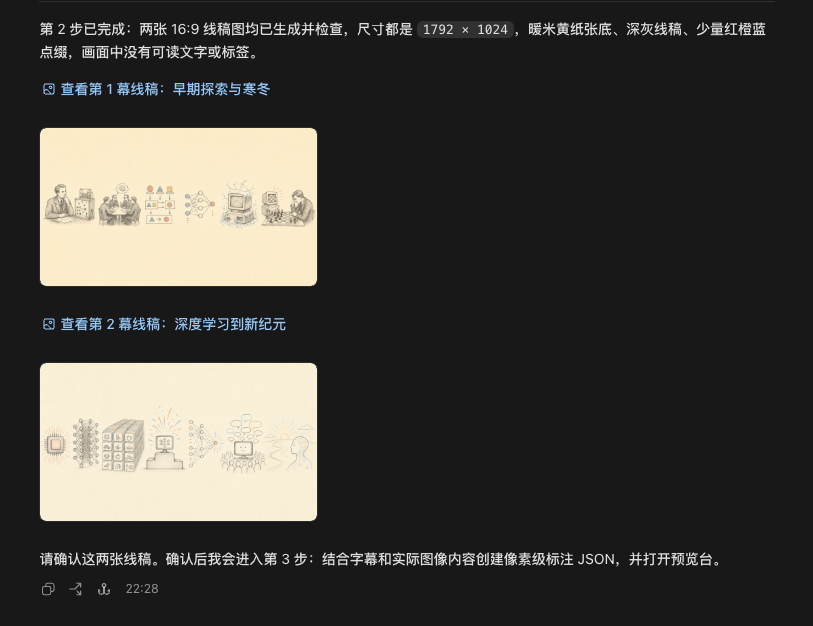
继续确认，开启第三步，结合字幕和实际图像内容创建像素级标注 JSON：
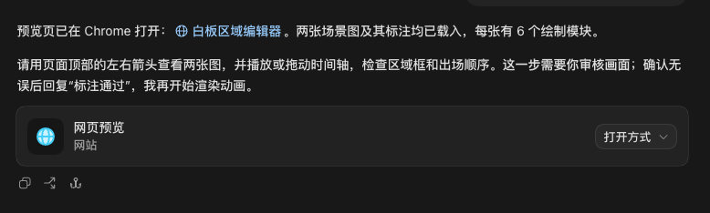
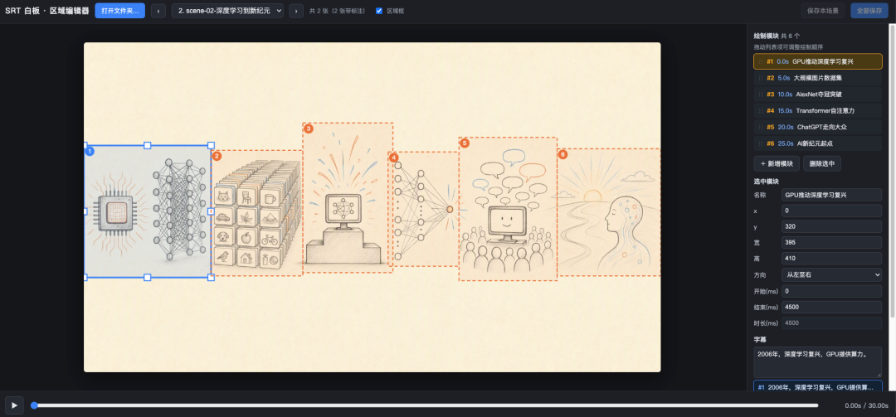
我看了一下，内容标注没问题，直接回复“标注通过”。开启第四步，生成分区与方向检查图。
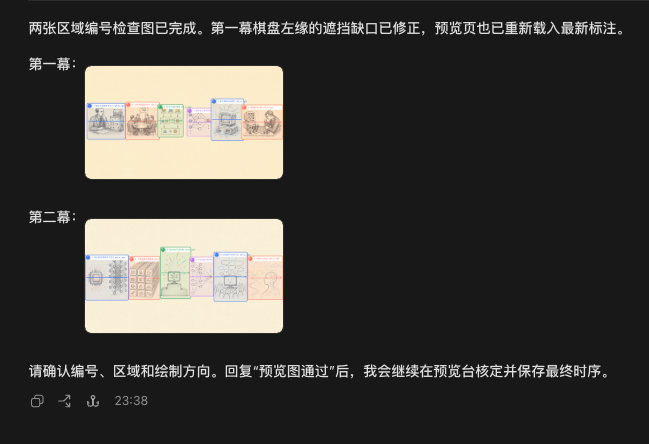
检查结果我直接通过。开启第五步，自动在预览台调整区域、叙事顺序、时序和字幕关联。
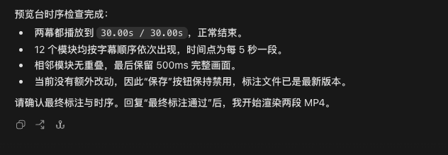
回复“最终标注通过”。开启第六步，逐幕渲染 MP4。
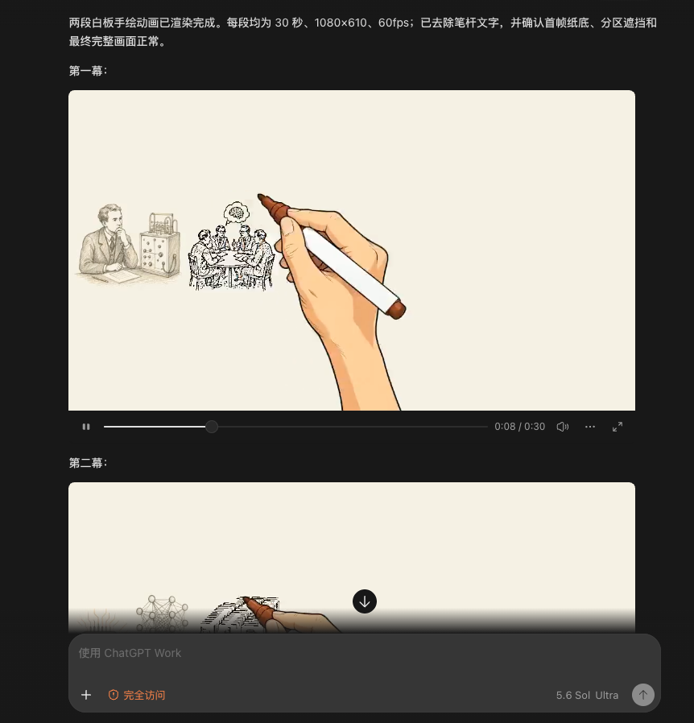
两段白板手绘动画已渲染完成，查了一下没问题，最后一步，回复“成片通过”，形成最终成果物。
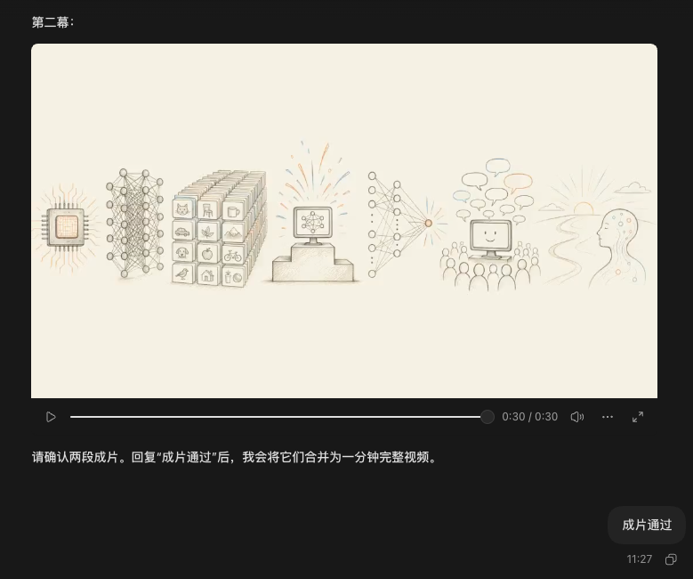
完工，效果展示：
## 最后说两句
做知识讲解、故事口播、课程字幕、短视频文案的，都可以试试。手里有现成字幕文件的最省事，字幕丢进去就能出视频，也就跑几个脚本的事。
有一点要说清楚，它现在更适合短内容，一幕几十秒那种。想做长视频也能做，就是得多幕去拼，工作量会跟着上去。
我走完一遍，没遇到啥折腾人的地方。手绘白板不新鲜，可把字幕、分镜、笔迹串成一条流水线的开源项目，我真是头回见。
## 开源地址
> https://github.com/geeklee/srt-whiteboard-animation
> 
**点击下方卡片，关注极客之家**
这个公众号长期分享实用开源项目。如果你不想逐篇翻阅历史文章，可以直接关注微信公众号“**极客之家”**，通过后台留言与我们互动交流。

