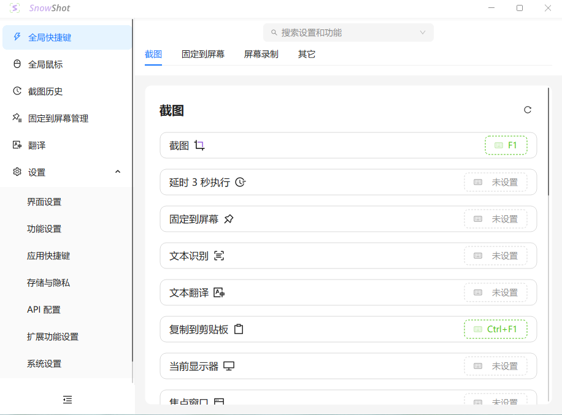
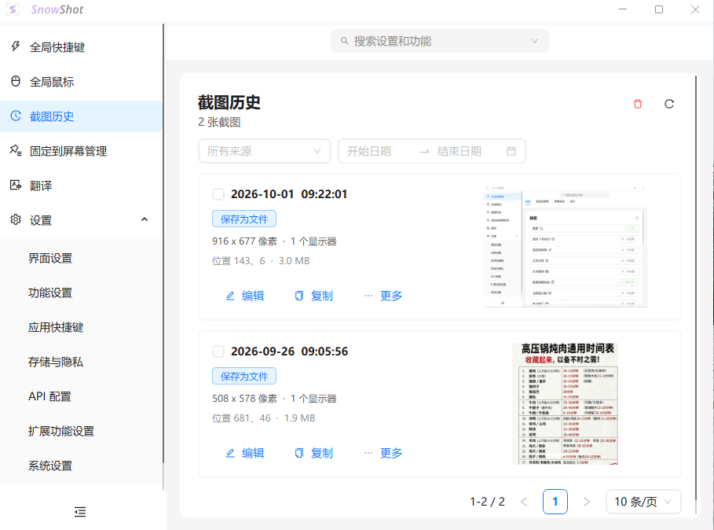
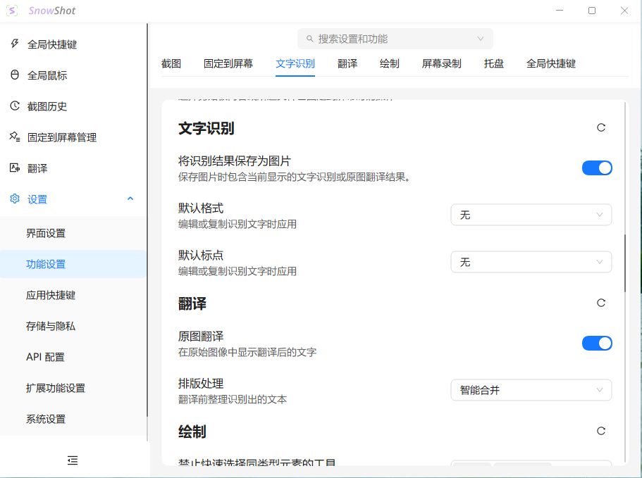

# 又一款Snow Shot 超好用的截图工具
> 💡 备注属性未写入，可能是备注属性名称或者类型被修改了，建议将字段类型设置为 rich_text，可以在小程序-操作-修改文章数据库页面进行调整
> 原文链接:[https://mp.weixin.qq.com/s/XdYwbaCC5WW_jdwUPZ_Yug](https://mp.weixin.qq.com/s/XdYwbaCC5WW_jdwUPZ_Yug)
软件性质： 开源，适配Windows，多功能，软件大小16.4MB。
**软件特色：**集成OCR文字识别、AI对话、翻译和录屏功能，支持自定义快捷键和实时编辑。同时加入ai功能打造的全新智能截图软件，在提供多种快捷屏幕截取方式的同时人工智能服务支持能够轻松识别截屏内容，能够对其实现快捷翻译、智能问答或是提取文字等操作。

**运行环境：**Windows Al

**软件功能：文本提取，截图历史，翻译，AI对话。**

**下载地址：前期推荐的软件网站有下载。**
**https://www.aichunjing.com/soft/2229.html**

## 摘要

（待补充）

## 我的笔记

（待补充）
