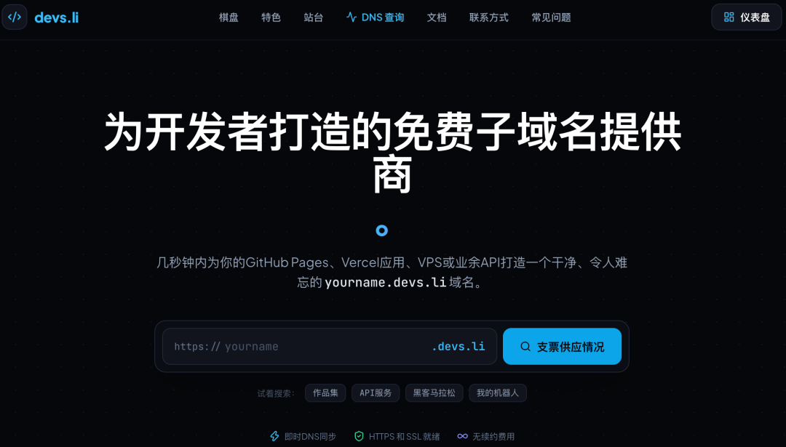
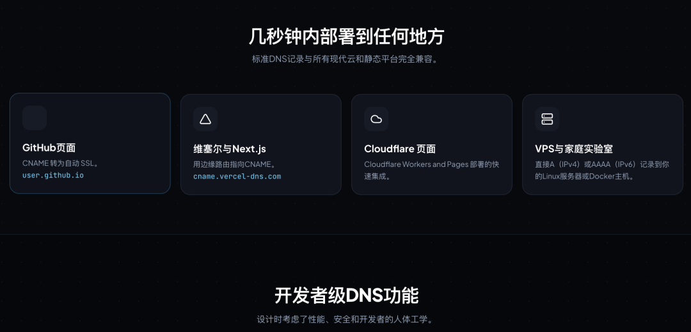
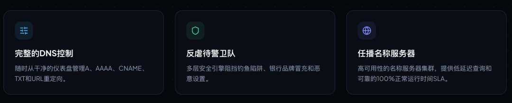
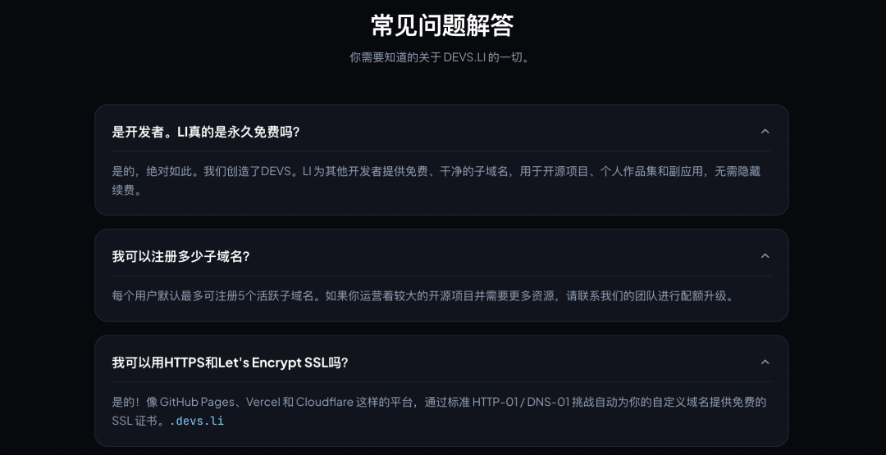

# 又发现永久免费域名宝藏新平台！每个账号最多 5 个子域名，官方标注永久免费
> 💡 备注属性未写入，可能是备注属性名称或者类型被修改了，建议将字段类型设置为 rich_text，可以在小程序-操作-修改文章数据库页面进行调整
> 💡 原文链接:[https://mp.weixin.qq.com/s?__biz=MzIwMjUyMjQ2Ng==&mid=2247485472&idx=1&sn=e692cae3785d567706a1c8fa8cac2685&chksm=979bbc234979115c88a21e9d52b7b456f9f46ba18d233a1480162a99432dd6a1a65e9a7470ce#rd](https://mp.weixin.qq.com/s?__biz=MzIwMjUyMjQ2Ng%3D%3D&mid=2247485472&idx=1&sn=e692cae3785d567706a1c8fa8cac2685&chksm=979bbc234979115c88a21e9d52b7b456f9f46ba18d233a1480162a99432dd6a1a65e9a7470ce#rd)
平时喜欢折腾网站、搭建个人博客，或者研究 Cloudflare、GitHub Pages、Vercel 的朋友，应该都遇到过一个问题：
**网站可以免费部署，但域名往往还需要自己想办法解决。**
直接购买独立域名，需要考虑注册费用和后续续费；如果只是想搭建一个个人主页、项目演示站或者测试环境，专门买一个域名，有时候又觉得没太大必要。
有没有一种更省钱的办法？
最近发现了一个面向开发者的免费子域名服务：**DEVS.LI**。
它提供 **.devs.li**后缀的免费子域名，可以用来连接 GitHub Pages、Vercel、Cloudflare Pages，甚至自己的 VPS 服务器。
根据官网介绍，该服务主打免费使用、无需支付续费费用，每个账号默认最多可以注册 5 个活跃子域名。对于喜欢折腾开源项目、个人网站和各种小工具的朋友来说，值得收藏。
### 🆓 一、DEVS.LI 到底是什么？
简单来说，DEVS.LI 是一个提供免费子域名和 DNS 解析管理的服务。
假设你注册了一个名字叫 **myproject** 的子域名，最终就可以得到类似下面这样的地址：**myproject.devs.li**
你可以把这个地址指向自己部署的网站或应用。
例如，你做了一个个人主页，可以使用它作为访问入口；你在 GitHub Pages 上部署了一个静态网站，也可以尝试绑定这个子域名；如果你有自己的 VPS 服务器，同样可以通过 DNS 解析，让这个地址指向服务器 IP。
这里需要说明一下：它提供的是 **.devs.li**下面的子域名，并不是可以独立持有的顶级域名。
不过，如果你的需求是搭建个人网站、展示作品、测试项目或者给小工具配置一个好记的访问地址，那么子域名通常已经够用了。
### 💰 二、为什么值得关注？免费，而且不需要每年续费
对于个人开发者和建站爱好者来说，最直接的吸引力就是成本。
有些项目可能只是临时测试，有些网站可能只是用来展示作品，还有些工具可能只是自己平时使用。
为了这些项目单独购买域名，未必划算。
DEVS.LI 官网明确标注了免费使用和无需续费费用。按照官网目前公布的规则，每个用户默认最多可以拥有 **5 个活跃子域名**；如果开源项目规模较大，还可以联系服务方申请提高额度。
这意味着，你可以根据不同用途安排不同的子域名，例如：
- 📝 一个用于个人博客或个人主页
- 🛠️ 一个用于开源项目展示
- 🧪 一个用于测试环境
- 🌐 一个用于在线小工具
- 🔗 一个用于 API 或其他开发项目
具体能否注册到自己喜欢的名称，还要以实际查询结果为准。
需要注意的是，免费服务仍然受平台运营情况和服务规则影响。重要网站建议保留自己的代码、配置和数据备份，不要把第三方免费子域名当作永远不会发生变化的基础设施。
### ☁️ 三、支持哪些平台？不只是拿来做个网页
DEVS.LI 的一个实用之处，是它支持常见的 DNS 记录配置，可以配合多种网站托管平台使用。
#### 1️⃣ GitHub Pages
如果你平时会使用 GitHub，应该知道 GitHub Pages 可以用来托管静态网站。
比如个人主页、项目文档、产品介绍页、博客页面等，都可以考虑使用这种方式部署。
通过配置 CNAME 记录，再到 GitHub Pages 中添加自定义域名，就能尝试使用自己的 **.devs.li**地址访问网站。
#### 2️⃣ Vercel 和 Next.js
如果你使用 Next.js、React 等技术开发网站，也可以关注 Vercel 的部署方式。
项目部署完成后，根据平台提供的要求配置 CNAME 记录，并在 Vercel 项目设置中添加对应域名即可。
如果平台要求额外的 TXT 验证记录，也需要按照提示完成配置。
#### 3️⃣ Cloudflare Pages
喜欢 Cloudflare 的朋友也可以试试。
如果你已经把网站部署到了 Cloudflare Pages，可以根据项目提供的绑定流程配置域名，让网站拥有一个更容易记忆的访问地址。
如果你正在研究 Cloudflare 免费部署、在线工具站或者个人项目展示站，这种组合会比较实用。
#### 4️⃣ VPS 服务器和家庭实验室
如果你已经有自己的服务器，也可以通过 A 记录指向 IPv4 地址，或者根据实际情况配置 AAAA 记录指向 IPv6 地址。
这样就能把子域名用于服务器上的网站、Docker 服务或其他开发项目。
不过，DNS 解析只是把域名指向对应的目标。服务器上的 Web 服务、反向代理、防火墙和 HTTPS 等配置，仍然需要根据自己的部署环境完成。
以上平台的具体配置方式，可以参考 DEVS.LI 官方文档。
### 🛠️ 四、DNS 功能也比较实用
它并不只是让你注册一个名字，然后什么都不能设置。
官网目前列出了几种常见的 DNS 配置功能：
- A 记录： 将域名指向 IPv4 地址。
- AAAA 记录： 将域名指向 IPv6 地址。
- CNAME 记录： 将域名指向另一个主机名，常用于网站托管平台。
- TXT 记录： 用于平台验证等场景。
- URL 重定向： 按服务支持的方式设置访问跳转。
这些功能对于日常建站和开发测试已经能覆盖不少常见需求。
例如，你在部署网站时需要验证域名，或者想把子域名连接到某个托管平台，就可以根据平台要求配置相应的记录。
HTTPS 方面，官网也说明了它可以配合 GitHub Pages、Vercel、Cloudflare 等平台提供的免费 SSL 证书使用。
但要注意，**注册子域名不等于自动完成整套网站部署**。不同平台对域名绑定、DNS 验证和证书签发的要求可能不同，需要按对应文档操作。
### 🎯 五、哪些人适合使用？
如果你符合下面几种情况，可以考虑收藏这个项目。
**第一种：想搭建个人博客的人。**
如果你只是想做一个简单的个人主页、技术博客或者作品展示页，可以先从免费托管和免费子域名入手，降低起步成本。
**第二种：喜欢研究 Cloudflare 的人。**
平时折腾 Cloudflare Pages、Workers 或在线工具的朋友，可以把它作为测试域名的一个选择。
**第三种：经常发布开源项目的人。**
项目开发完成后，可以给演示页面配置一个更容易记住的地址，方便放在 GitHub README、项目介绍页或者个人简历中。
**第四种：需要测试环境的开发者。**
如果你经常开发小工具、API 或实验性项目，不想每个项目都单独购买域名，也可以看看它是否符合自己的使用需求。
当然，如果你运营的是商业网站，或者项目对域名稳定性有很高要求，建议综合考虑服务稳定性、域名控制权和后续迁移成本，再决定是否使用。
### 🎬 六、我也录制了详细的视频教程
文字介绍主要是让大家了解这个项目有什么用、适合哪些场景。
如果你还不知道怎么注册、如何领取子域名，或者不清楚 DNS 记录应该怎么配置，可以跟着视频教程实际操作。
我已经录制了相关的视频教程，会带大家一步步了解领取流程。感兴趣的朋友可以结合视频进行操作，遇到配置问题时也可以对照官方文档排查。
### 🔥 趁现在知道的人还不多，喜欢短域名的可以去试试！
个人觉得，DEVS.LI 还有一个值得关注的地方：如果目前关注这个服务的人还不算多，或许可以趁早去看看有没有自己喜欢的短前缀。
比如 2～4 个字母的简短前缀，或者有特殊含义、容易记忆的英文单词，拿来做个人主页、开源项目、在线工具的访问地址，都比较清爽。
毕竟，短域名最大的优势就是**好记、好输入，也更容易给人留下印象**。如果等到越来越多人开始使用，心仪的名称可能就不一定还能注册到了。
当然，短前缀是否可用，还要以官网实际查询结果为准。如果你也喜欢折腾域名，不妨现在就去看看，说不定能找到一个适合自己的名字。
### ✨ 最后聊几句
对于喜欢折腾开源项目、个人博客和在线工具的朋友来说，DEVS.LI 是一个值得了解的免费子域名服务。
它的优势在于：提供** .devs.li**子域名、支持常见 DNS 记录、能够配合多个主流网站托管平台使用，并且官网标注无需支付续费费用。
如果你只是想给个人项目找一个访问地址，不妨先去官网看看有没有合适的名称。
## 🖼️相关截图




```javascript
视频教程地址：https://aixmb.com/1161.html
```
🔝🔝🔝
**--完--**

读到这里说明本文对你有所帮助，欢迎**置顶（标星）公众号 Ai 星码**，这样就能第一时间接收干货推送了～

## 摘要

（待补充）

## 我的笔记

（待补充）
