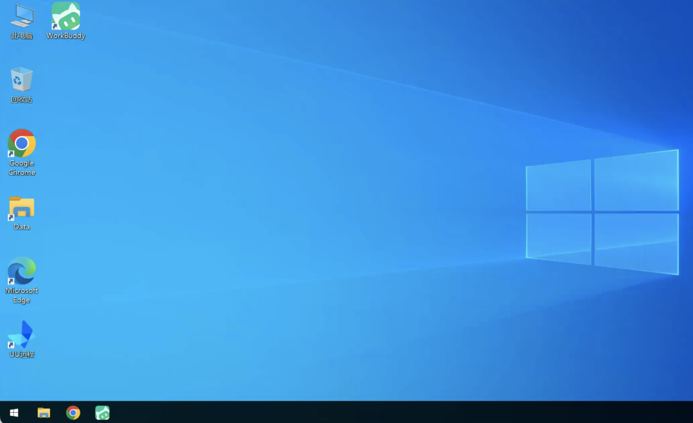

# 发现一个免费云电脑：4核8G，还能远程控制
> 💡 备注属性未写入，可能是备注属性名称或者类型被修改了，建议将字段类型设置为 rich_text，可以在小程序-操作-修改文章数据库页面进行调整
> 💡 原文链接:[https://mp.weixin.qq.com/s?__biz=MzI1NTA5OTgxMA==&mid=2247484366&idx=1&sn=be085b8ded852e6c806a1f1f0d94cc71&chksm=eb990c84fe35944e34237d7e6bfef85588b4d1e0d48cb8ee102e8450ef6d5d75baeac4ed8f64#rd](https://mp.weixin.qq.com/s?__biz=MzI1NTA5OTgxMA%3D%3D&mid=2247484366&idx=1&sn=be085b8ded852e6c806a1f1f0d94cc71&chksm=eb990c84fe35944e34237d7e6bfef85588b4d1e0d48cb8ee102e8450ef6d5d75baeac4ed8f64#rd)
今天发现一个可以免费使用的云电脑，来自中国电信推出的星辰超级智能体 TeleAgent。
注册登录后，就可以使用一台 **4 核 CPU、8GB 内存的 Windows 云电脑**。
不仅可以直接在浏览器中操作，还可以通过网易 UU 远程，用手机或者其他电脑远程控制。
今天就来分享一下具体怎么使用。
### 一、免费体验一台 Windows 云电脑
注册登录后，就可以免费使用平台提供的 Windows 云电脑。
云电脑的配置大致如下：
- • CPU：4 核
- • 内存：8GB
- • 操作系统：Windows Server 2022
- • 硬盘：约 120GB
对于日常办公、网页浏览、简单编程等用途，这样的配置还是可以用的。
而且，云电脑的计算任务在云端运行，不需要占用本地电脑的 CPU 和内存资源。
### 二、怎么获取这台云电脑？
操作也比较简单。
**第一步：打开 TeleAgent 官网**
https://agent.teleai.com.cn/teleagent
使用手机号注册并登录。
**第二步：进入 TeleAgent 网页版**
登录后，进入 TeleAgent 的操作页面。
首次使用时，平台会分配一台云电脑，可能需要等待一段时间。
**第三步：打开云电脑**
当页面右上角显示云电脑“运行中”时，点击“运行中”，就可以进入 Windows 桌面。

这样，一台运行在云端的 Windows 电脑就可以使用了。

不需要自己购买服务器，也不用在本地安装 Windows 系统。
### 三、还能通过网易 UU 远程控制
除了在 TeleAgent 网页中打开云电脑，还有一种比较方便的使用方法：
**在云电脑上安装网易 UU 远程。**
网易 UU 远程是一款远程控制软件，可以通过手机或者其他电脑，远程操作 Windows 电脑。
大致操作流程是：
1. 1. 在云电脑上安装网易 UU 远程客户端。
1. 2. 登录网易 UU 远程账号，并完成设备绑定。
1. 3. 在自己的手机或电脑上打开网易 UU 远程。
1. 4. 选择对应的云电脑，建立远程连接。
这样，就不用通过网页操作，可以直接在自己电脑或手机上通过UU远程控制。
### 四、这台免费云电脑能用来做什么？
因为是4核8G，还能应用不少场景，比如：
**1. 运行 Windows 专用软件**
有时候需要使用某些只支持 Windows 的软件，但自己的电脑是 Mac。
这时就可以尝试在云电脑上安装使用，不需要在本地另外安装 Windows 虚拟机。
**2. 搭建编程测试环境**
可以安装 Python、Git 等工具，用来测试程序、运行脚本。
也可以安装 AI agent，在云端运行任务，比如安装 Workbuddy 等。
**3. 通过手机远程操作**
搭配网易 UU 远程，可以在手机上查看云电脑的运行情况，必要时进行简单操作。
相比一直开着自己的电脑，云电脑提供了另外一种选择。
### 五、免费云电脑，可以体验一下
整体来看，这台免费的 Windows 云电脑还是挺实用的。
4 核 8GB 的配置，可以满足一些日常办公、软件测试和简单开发的需求。
再搭配网易 UU 远程，无论是在自己的电脑上，还是通过手机，都可以比较方便地操作。
不过，目前是免费体验，后续是否会收费、有没有使用时长限制，还需要以官方规则为准。重要文件也建议及时备份。
如果你平时也有使用 Windows 云电脑的需求，可以体验一下。
