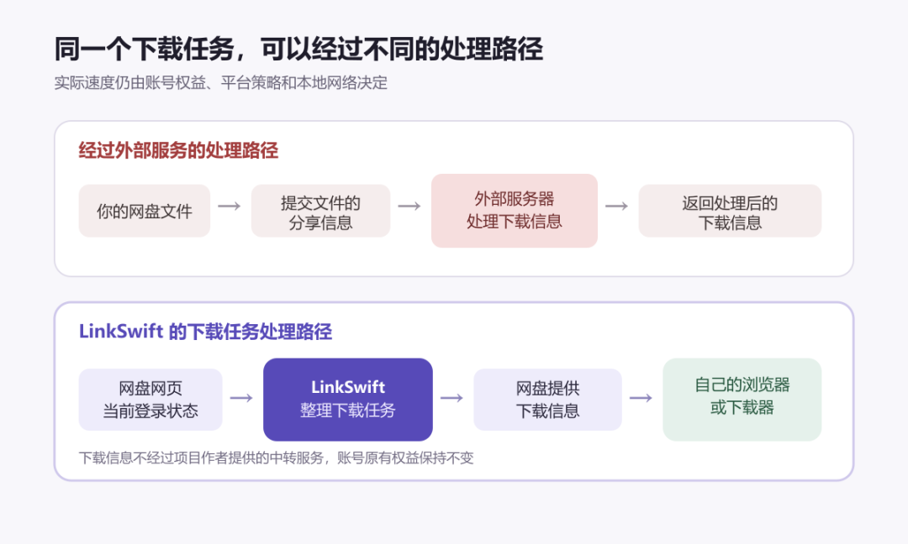
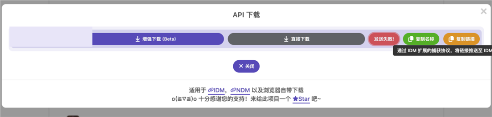
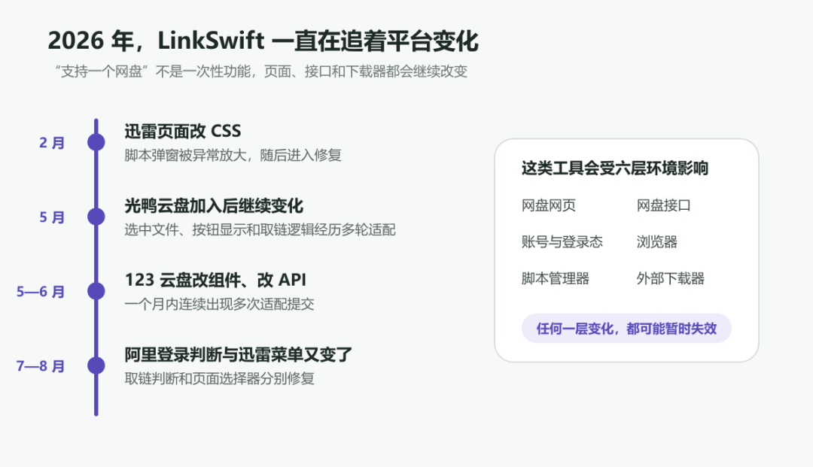

# 受够了各家网盘客户端？2.4 万 Star 的 LinkSwift，把 9 家网盘的下载任务交给 IDM、Aria2
> 💡 备注属性未写入，可能是备注属性名称或者类型被修改了，建议将字段类型设置为 rich_text，可以在小程序-操作-修改文章数据库页面进行调整
> 💡 原文链接:[https://mp.weixin.qq.com/s?__biz=Mzg3NDkzMDQxOA==&mid=2247485286&idx=1&sn=c0f6aa0bb173aa6d4a052e2b8faefd4c&chksm=cfbe4866b3b9398c45189325e23df5c1499639511bcd06f251945217ac2e3396dba666932c7b#rd](https://mp.weixin.qq.com/s?__biz=Mzg3NDkzMDQxOA%3D%3D&mid=2247485286&idx=1&sn=c0f6aa0bb173aa6d4a052e2b8faefd4c&chksm=cfbe4866b3b9398c45189325e23df5c1499639511bcd06f251945217ac2e3396dba666932c7b#rd)
第一次看到 LinkSwift，不少人会把它理解成改变网盘下载速度的工具。ScriptCat 上也有用户因为速度没有变化给出低分。可这恰好不是它要解决的问题。
项目说明第一段就写得很清楚：LinkSwift 不会改变账号原有的下载权益。实际速度仍由账号权限、平台策略和本地网络共同决定。
一个不负责改变下载速度的脚本，为什么仍能积累 2.4 万多 Star？因为它能把九家网盘网页里的下载任务，交给浏览器、IDM 或 Aria2 统一管理。
LinkSwift 安装在 Tampermonkey 或脚本猫里，支持百度、阿里、中国移动、天翼、迅雷、光鸭、夸克、UC 和 123 云盘。打开这些网盘的网页，页面里会多出一个“下载助手”。除了浏览器、IDM 和 Aria2，还能把任务交给 Motrix、比特彗星或 AB Download Manager。
**账号原有权益不会因此变化。LinkSwift 改变的是下载任务由谁接手、怎样排队和保存。它能省掉一批客户端，也减少了把文件信息交给外部转换服务的需要。**

同一个下载任务，可以经过不同的处理路径。
**它整理下载流程，不改变账号原有权益**
网盘里的文件要保存到本地，平台需要先为当前账号准备相应的下载信息。LinkSwift 负责把这些信息整理成浏览器和下载器能够接手的任务。至于实际速度，仍然遵循网盘给当前账号设定的规则。
项目作者在置顶说明里还提醒过另一类在线转换服务：用户需要把文件的分享信息提交给外部服务器，再等待对方返回处理结果。有些服务还会附带关注公众号、看广告或完成任务等步骤。
这类服务多了一层外部中转，文件分享信息也会离开用户自己的设备。只要外部服务停止维护，或者分享内容涉及不适合外传的信息，这条链路就会增加额外风险。
LinkSwift 选择把流程留在当前浏览器会话中，不依赖项目作者提供下载信息中转。账号原有权益保持不变，减少的是外部服务参与的环节。
**网页里选好文件，下载任务就能交给常用工具**
登录网盘网页版并选中文件后，LinkSwift 会沿用当前页面的登录状态，向对应网盘请求当前账号有权使用的下载信息。
不同网盘的网页实现并不相同，所以项目为各个平台分别维护适配逻辑。对普通用户来说，操作仍然是选中文件，再从“下载助手”里选择浏览器或外部下载器。
下载信息通常和当前登录状态、设备环境及有效时间有关，并不适合随意转发到其他设备。LinkSwift 会把当前任务需要的信息整理成浏览器或下载器能够识别的格式。
项目所说的“直连官方”，指的是下载信息由网盘自身的网页服务提供，不经过项目作者的中转服务。脚本本身仍需要联网，也会访问界面依赖、项目帮助页和各家网盘域名。
**地址拿到手，下载器才开始接管**
最简单的用法，是在网盘网页里勾选文件，点“下载助手”，再让浏览器直接下载。脚本也提供增强下载模式，可以在页面里显示速度、进度和预计剩余时间。
不过，源码也提醒用户别拿大文件硬撑。浏览器的线程数、内存和 Blob 大小都有上限，并特别提示了 2GB 左右的文件限制，接近或超过这个体积时可能卡顿或失败。大文件更适合交给专门的下载器，由它接手地址和请求参数。
下面这张真实界面来自 GitHub Issue #390，一位用户当时遇到了 IDM 推送失败。红色状态记录的是那次故障，但同一行也能看到增强下载、直接下载、复制链接和 IDM 等出口。

一次 IDM 推送失败时的 API 下载窗口。
LinkSwift 支持 Aria2 RPC、IDM、比特彗星和 AB Download Manager 等常见下载器。Aria2 用户可以把任务送进 Motrix 或 AriaNg；不想绑定工具，也可以复制单条或全部链接、cURL 命令。
LinkSwift 没有统一九家网盘的账号体系，统一的是下载任务的出口。文件放在哪家网盘，最后都可以回到自己熟悉的下载器里排队、设置速度、断点续传和管理目录。
**今天能用，不代表网盘改版后还能用**
这类脚本最费时间的部分，不是第一次把下载窗口做出来，而是网页和接口变了以后还能继续工作。2026 年的提交记录里，123 云盘换过组件和 API，迅雷改过菜单选择器，阿里云盘调整过登录状态判断，光鸭云盘在加入支持后也经历了连续修改。

一次“支持”不是终点，网盘页面和接口仍会继续变化。
Issue 里能看到这种拉扯。Issue #398 记录了百度网盘从正常使用到突然无法取得下载信息；Issue #375 则是迅雷页面的一次 CSS 变化，把脚本弹窗放大到无法使用。外部下载器的端口、RPC、扩展 Client ID 或网络设置不对，也会让“推送失败”看起来像脚本失效。
项目因此保留了正式版和金丝雀版。Release 页面当前的正式版是 v1.1.3，适合不想频繁遇到兼容问题的人；v1.1.4 金丝雀版会更早提供新适配，也明确提醒可能不稳定。碰到网盘刚改版，查看 issue 和更新日志，通常比反复重装更容易找到原因。
**少装几个客户端，也要接受一点配置成本**
LinkSwift 更适合经常在多个网盘之间取文件，又不想为每一家安装客户端的人。平时已经在用 IDM、Motrix 或 Aria2，这套分工会很顺手：网盘网页负责选文件，熟悉的下载器负责下载。
安装过程不用克隆仓库：在 Tampermonkey 或脚本猫中打开项目 README 列出的正式版链接即可。之后回到受支持的网盘网页，选中文件，点“下载助手”。IDM 需要配置扩展 Client ID；Aria2 或 Motrix 则要在助手设置里填写 RPC 地址和端口。
代价也需要说在前面。为了读取当前页面状态、调用网盘网页服务并推送到下载器，脚本需要页面读取和跨站访问等权限，也会接触当前登录会话的信息。开源让这些行为可以检查，却不会自动消除风险。安装时应认准 GitHub、ScriptCat 等项目列出的官方来源，不要使用来历不明的转载版本。
希望它改变账号原有下载权益的人会失望，完全不想配置下载器的人也未必需要它。它更适合愿意用一点设置换取统一下载入口，并且接受网盘更新后偶尔等待修复的人。
LinkSwift 不会改变账号原有的下载权益。它让用户不必把每次下载都交给对应的客户端，也减少了对外部转换服务的依赖。文件仍从原来的网盘出来，但由谁下载、怎样排队、保存到哪里，重新回到了用户自己选择的工具手里。
项目地址：https://github.com/hmjz100/LinkSwift

## 摘要

（待补充）

## 我的笔记

（待补充）
