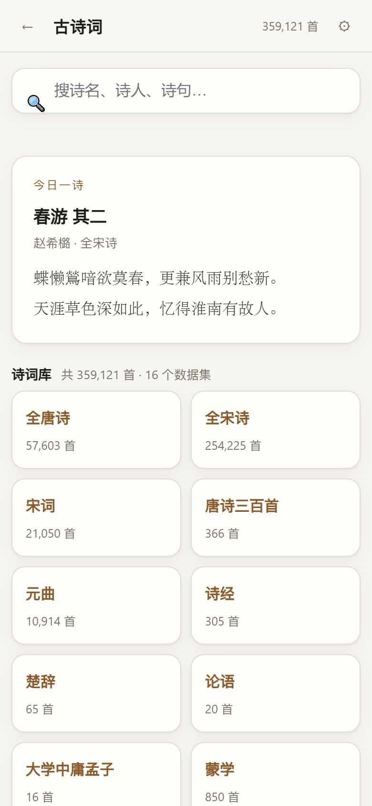
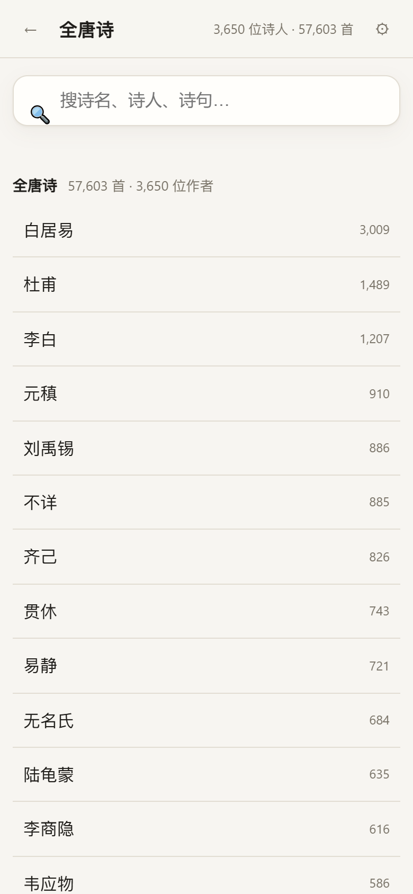
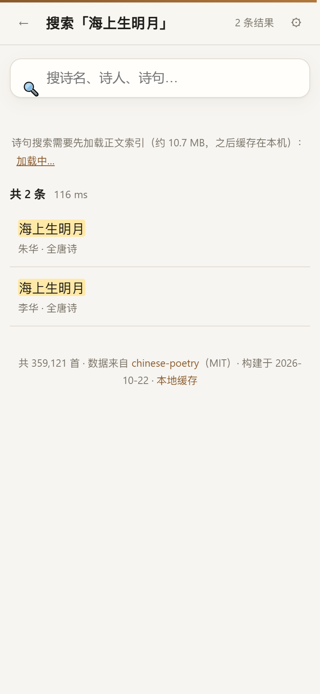
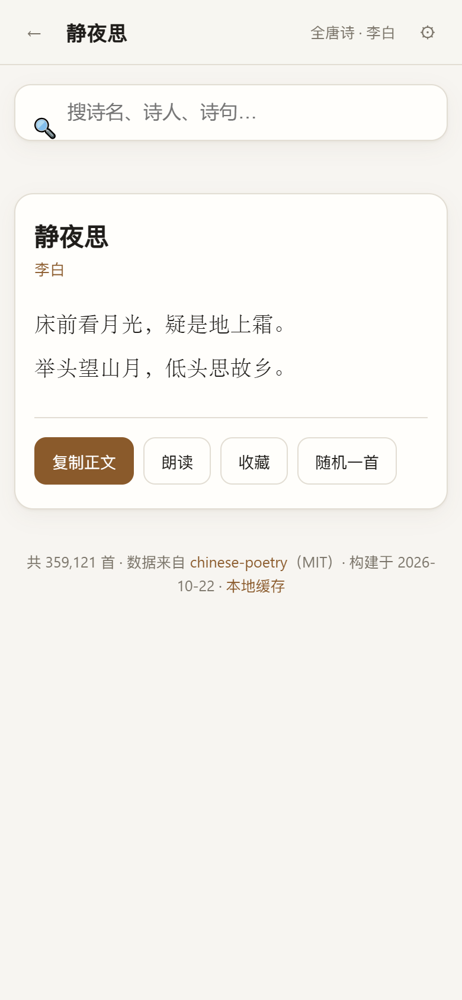

# 古诗词不用装软件：35.9 万首唐诗宋词，输一句诗就能搜到
> 💡 备注属性未写入，可能是备注属性名称或者类型被修改了，建议将字段类型设置为 rich_text，可以在小程序-操作-修改文章数据库页面进行调整
> 💡 原文链接:[https://mp.weixin.qq.com/s?__biz=MzI3MTQ0Mzc0Mg==&mid=2247484560&idx=1&sn=a6e2dec05fdc1913ab75a19350e9d14b&chksm=eb90a28ce3a9d37fd73fd151e19b4e54d311f2d99310250e53278f2fee95a2838712ed85ee10#rd](https://mp.weixin.qq.com/s?__biz=MzI3MTQ0Mzc0Mg%3D%3D&mid=2247484560&idx=1&sn=a6e2dec05fdc1913ab75a19350e9d14b&chksm=eb90a28ce3a9d37fd73fd151e19b4e54d311f2d99310250e53278f2fee95a2838712ed85ee10#rd)
有一类需求很零碎，但一直存在：
孩子念「疑是地上霜」，你想知道下一句到底怎么接；写东西想引一句宋诗，只记得半句「海上生明月」；翻到一句「人生若只如初见」，想确认是不是纳兰写的。
手机里能装的诗词 App 不少，只是大多要会员、要联网、一打开先看广告，生僻字还常常缺字。至于打开网页去搜——结果里全是「诗词名句网」的弹窗，读完一句要关三个广告。
所以我干脆把公开的诗词语料整个搬进了一个网页里。**35.9 万首，16 个数据集，纯前端，无后端，无广告，断网也能用。**

### 一、里面到底有什么
不是「精选一千首」，是能搬的都搬了：
- **全宋诗 25.4 万首** —— 很多人不知道宋诗的量是唐诗的四倍多，这里全都在
- **全唐诗 5.7 万首**，另加《御定全唐詩》1.2 万首（清代官修本，版本不同，可以对照看）
- **宋词 2.1 万首**、元曲 1.1 万首
- **唐诗三百首** 366 首（就是大家小时候背的那个选本）
- **诗经 305 篇**、**楚辞 65 篇**、**论语 20 篇**、**四书**、**五代词** 543 首
- **蒙学**：《三字经》《百家姓》《千字文》《弟子规》《声律启蒙》《千家诗》《古文观止》……共 850 段
- **纳兰性德 258 首**、**幽梦影 219 则**、**曹操 26 首**、水墨唐诗 176 首
加起来 359,121 条，全都按「标题 / 作者 / 正文」结构化好了，点进去就是整首，能复制，能朗读。

### 二、两种搜法，各有各的用处
**第一种：搜标题或诗人。** 输「李白」「静夜思」「纳兰」，边打边出结果，按完全匹配、前缀匹配排好序。这条路径只加载 4.4MB 的索引，打开页面就能用。
**第二种：只记得一句，搜正文。** 输「海上生明月」，它会去全文里捞，命中后把那一句高亮出来，还带上下文：

点进去就是完整作品，作者、所属诗集、正文一气排开。下面一排按钮：复制全文、朗读、收藏、随机一首。

**朗读**是白送的——用浏览器自带的语音合成（Web Speech API），声音来自你的系统或浏览器，不经过我的服务器，也不额外下载任何东西。Windows 上是微软的中文语音，手机上是系统 TTS。
**收藏**存在本地浏览器里，不上云，换设备不同步，但也不需要注册。
顺带说个好玩的事。你在《全唐诗》里搜「静夜思」，看到的正文是**「床前看月光，疑是地上霜。举头望山月，低头思故乡」**——不是大家背的「床前明月光」。这是宋刊本的原文，通行本是被明人改过的；同一个数据库里《千家诗》收录的版本又是「床前明月光」。几个版本放在一起，谁改了什么一目了然。
### 三、为什么一个网页能装下 260MB 的书
这是整件事里唯一需要点工程的地方，说人话：
**第一步，转简体。** 公开语料大多是繁体（「牀前看月光」「舉頭望山月」），直接给普通读者看太别扭。我在构建时统一做了繁转简，但保留了「乾、徵、藉、沈」这几个——不然「乾坤」会变成「干坤」，「宫商角徵羽」会变成「角征」，姓氏「沈」会变成「沉」。
**第二步，切块。** 35.9 万首一次塞给浏览器肯定不行。我按每 800 首切成一片，一共 449 片，每片 60–200KB。你点开哪首诗，才去取它所在的那一片——所以详情页是**几十毫秒**出来的，而不是等一整个文件。
**第三步，两级索引。** 标题/诗人索引 4.4MB，进页面就下，管全部 35.9 万首；诗句正文索引 10.7MB，**只有你点「加载并搜索」时才下**。宋诗那 27.2MB 的正文包更狠，默认根本不动，你想要了再点。
**第四步，服务端预压缩。** 所有数据文件旁边都躺着一份 `.json.gz`，nginx 直接发压缩包，省掉现场压缩的等待。
结果就是：首屏只下 3KB 的清单，0.5 秒出画面；进《全唐诗》看诗人榜 0.1 秒；搜「静夜思」0.1 秒。第二次打开，数据都从本机缓存读，不联网。
**关于缓存**：所有下过的索引和数据都存在浏览器的 Cache Storage 里，能在站内的「本地缓存」管理页看到每一个文件占多少、随时删掉。手机上空间紧张的话，删掉也不影响下次使用，只是要重下。
### 四、几个用得更顺手的技巧
- **只记得半句时，关键词越短越好**。搜「海上生」比搜「海上生明月天涯共此时」命中更快更准，模糊部分交给它自己排。
- **每一首都有独立网址**。点开某首诗后地址栏里的链接可以直接存书签、发给自己、贴进笔记，下次点开直达那一首，不用再搜一遍。
- **首页有「今日一诗」**，每天按日期换一首，随机翻到宋诗里那些冷门好句的概率比翻诗集高得多。想换一首就点「随机」。
- **加到手机桌面**。它是个标准网页，Safari/Chrome 都能「添加到主屏幕」，图标点开就是全屏诗库；数据存在本地，地铁里没信号也能翻已经看过的内容。
- **生僻字可以直接复制**。正文里的字都是 Unicode，复制到 Word、微信、笔记里不会变成方块。
### 五、几个诚实的局限
- **第一次进「全唐诗」要等一下**，那 4.4MB 索引走公网大约 10 秒，页面上有进度条，之后就是秒开。
- **繁简只做了简体**。想看繁体原文目前没有开关（原始语料在 GitHub 上是繁体，需要可以自己去看）。
- **朗读看设备**。系统没装中文语音包的话，可能用英文音色硬读，听着怪；只读整首，没有暂停/语速调节。
- **《全宋诗》没有注释和赏析**。这本来就是个原文库，不是带讲解的选本。要赏析得另配。
- 图像与 ci.db（词牌格律库）没有放进来，前者是配图，后者需要程序化查询，网页用不上。
### 六、地址
电脑、手机都能开，加个书签就是「随身诗库」：
**hwx1.gzweidu.top/tool/poetry**
备用线路（同一份数据）：**hwx2.gzweidu.top/tool/poetry**
数据来自 GitHub 上的 **chinese-poetry** 项目（MIT 协议，5.4 万 star），是一群志愿者从古籍电子化里整理出来的。我只做了繁转简、结构化切分和一层界面。
如果这个页面帮你查到了一首诗，那挺好——它本来就是为了「突然想找一句」这种时刻做的。
