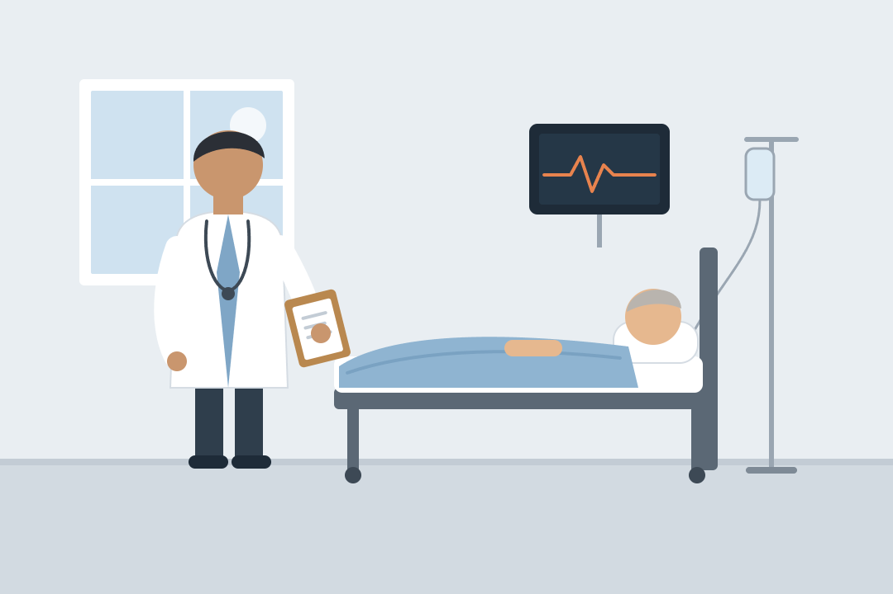
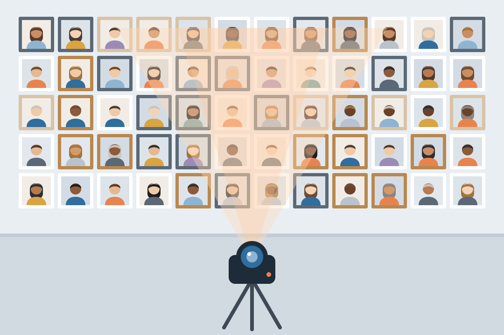
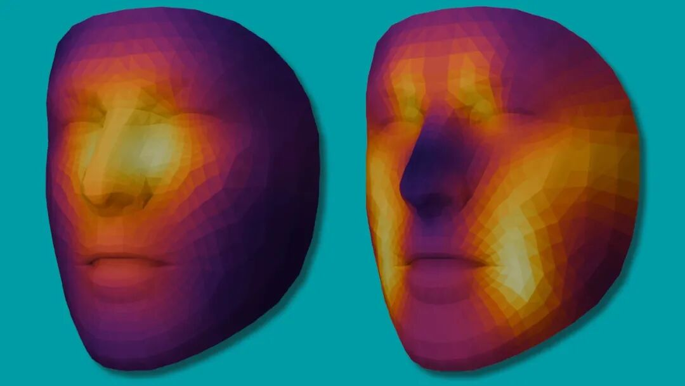
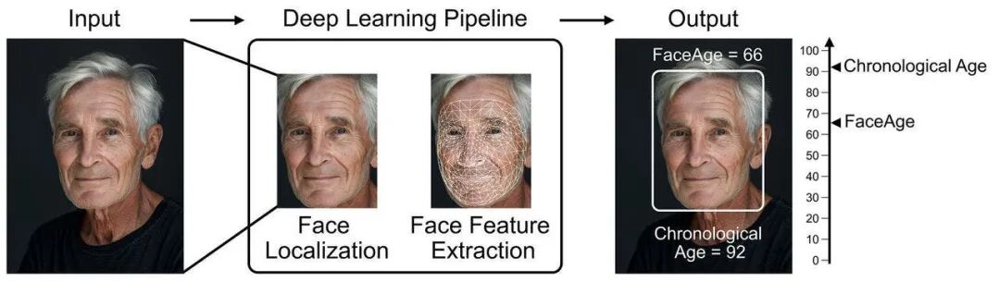

# 只看一张脸，AI预测的死亡名单，90天后应验了一半
> 💡 备注属性未写入，可能是备注属性名称或者类型被修改了，建议将字段类型设置为 rich_text，可以在小程序-操作-修改文章数据库页面进行调整
> 💡 原文链接:[https://mp.weixin.qq.com/s?__biz=MTg1MjI3MzY2MQ==&mid=2652380527&idx=1&sn=b145aa5c3bbf118e8601121d854ed16c&chksm=5cb4ead68e4019047729a39bf1bb59366eb0cd123110c941e2c837e523ef2a9e191331a29d58#rd](https://mp.weixin.qq.com/s?__biz=MTg1MjI3MzY2MQ%3D%3D&mid=2652380527&idx=1&sn=b145aa5c3bbf118e8601121d854ed16c&chksm=5cb4ead68e4019047729a39bf1bb59366eb0cd123110c941e2c837e523ef2a9e191331a29d58#rd)
**一张脸部照片，能看出一个人的生命还剩多久吗？**
美国的研究人员让一个AI给3820名癌症患者打“死亡风险分”。这些人AI从没见过，它手里的依据，只有每人一张脸部照片。
**分数最高的122人，90天后，64人离世。**
分数最低的975人，同样90天，去世的只有20人。
这些照片并没有什么特别，大多是病人接受放疗前，医院例行拍下的。

放疗前，医院会例行给病人拍照丨AI生图
而AI做的这件事，医生其实每天都在做。
雷·麦（Ray Mak）是美国麻省总医院布莱根医疗集团的放射肿瘤科医生，也是这项研究的负责人之一。他说，**医学院就是这样训练医生的：走进病房，先看一眼病人，对他的整体状况心里有个数**。
这一眼很要紧。
雷·麦接诊过一位86岁的肺癌患者，老人看上去比实际年龄年轻不少，这成了雷·麦建议他接受更积极治疗的原因之一。到去年，老人已经90岁，状况依然不错。
后来研究人员用AI分析他当年的照片，估出的年龄比实际小了整整10岁。
反过来也一样。有的人看着比同龄人虚弱，身体可能扛不住太猛的治疗。

医生的第一眼，往往影响后续的治疗方案丨AI生图
问题是，**这一眼全凭经验，而人的眼力一向不太可靠。**
在这个团队去年发表的第一代研究里，10名医生和研究人员看了100名晚期癌症患者的照片，判断他们短期内的生存情况。只看照片，他们的准确率大约六成，只比瞎猜强一点；拿到AI的分析结果后，提高到了八成左右。
这一次，他们想让AI看得更准。10月19日，新研究发表在医学期刊《柳叶刀·数字健康》上。
**先看4000万张脸**
研究人员没有一上来就教AI认病人。他们先给AI看了4000万张人脸照片，不告诉它要干什么。
看得多了，AI慢慢摸清了人脸的门道：哪些地方人人都差不多，哪些地方一人一个样。这有点像一个画了几十年肖像的画家，没学过医，却对人脸上的细微差别却已经了如指掌。

AI先看了4000万张人脸照片丨AI生图
底子打好了，研究人员才开始教它看健康。
他们先教它**估“生理年龄”**。生理年龄指的是身体的年龄，而不是身份证上的年龄。同样是60岁，有人爬五楼大气不喘，有人走几步就累，两人的生理年龄可能差得很远。
在同一个底子上，他们还练出了一个更大胆的版本：**直接看脸估死亡风险**。为此，研究人员把3.4万多名癌症患者的照片，连同他们后来的生存情况，一起交给它学习。
开头那3820人，就是特意留出来、不让AI提前学的“考生”。
结果，两个版本都没让人失望。
直接估死亡风险的本事，本文开头已经见识过了。研究团队在论文里写道，据他们所知，**这是第一个仅凭一张面部照片就能直接预测癌症患者生存情况的AI。**
估生理年龄的那个也不差。研究人员用它看了全部3.8万多名放疗患者，发现被它判定“看着比实际年龄老5岁以上”的人，就算把年龄、性别、癌症类型这些因素都考虑进去，死亡风险仍然高出21%。
更有意思的是，这两个AI出自同一个底子，给出的判断却没多大关联，各有侧重。两个分数合在一起用，比单用任何一个都准。
**人类看不懂的线索**
同一张脸，两个AI各自在看哪里？
研究人员用了一种叫“注意力图”的方法，查看AI分析一张脸时，“目光”落在了哪里。它有点像热力图：AI越在意的区域，颜色越亮。
**估年龄的AI，重点看的是法令纹**（鼻子两侧延伸到嘴角的那两道纹路），还有眉毛上方的额头和太阳穴。这在意料之中，这些部位都很容易随着年龄变化。
**估死亡风险的AI，盯着的却是眼睛下方和鼻梁周围**。

AI预测生存风险（左）和年龄（右）时的“注意力图”，颜色越亮代表AI越关注该区域丨Mass General Brigham
为什么是这里？研究者也说不清。雷·麦解释，注意力图只能告诉他们AI在看哪儿，却说不出它具体看到了什么。
是眼袋？皱纹？色斑？还是皮肤的质地？目前没法确定。
换句话说，**AI在这块区域捕捉到了某种和健康状况有关的特征**，但它到底是什么，**人类暂时还看不懂。**
不过，估年龄的那个AI，有些判断是能找到原因的。
研究人员发现，酗酒、吸毒和吸烟的人，在AI眼里都显得更老。吸烟的规律最明显：吸烟的人，看起来比戒了烟的人老；戒了烟的人，又比从没吸过烟的人老。
**坏习惯对身体的伤害，似乎真的会留在脸上，而且AI看得出来。**

AI通过面部照片评估生理年龄的流程示意图丨Mass General Brigham
换个拍照姿势，换个光线，换个表情，化个妆，估年龄的AI给出的结果都基本不变。大多数整形手术，也没能让它看走眼。
唯一的例外是鼻整形。做完鼻子的人，AI反而会估得老了一岁左右。雷·麦推测，这可能和手术造成的局部组织流失有关。
**一张自拍的分量**
雷·麦希望，这款AI将来能走进医院，给医生多提供一份参考，而不是替医生做决定。他甚至认为，医学上凡是按实际年龄做决定的地方，都可以改用这个算法。
团队已经在医院里试起来了。他们给65岁以上、即将接受放疗的早期肺癌患者拍照，看AI能不能找出那些身体比较虚弱、需要额外营养支持或康复训练的人。
它还可能充当一种预警：**如果一个人的脸开始比同龄人老得更快，也许意味着身体里正在发生什么问题。**
普通人也已经能用上了。今年3月，团队悄悄上线了一个研究网站，任何人都能上传几张自拍，几秒钟就拿到AI估出的生理年龄。到现在，报名的人已经超过1万。研究人员强调，结果只用于研究，不是诊断。
这些自拍，也会反过来帮AI继续学习。这正是它眼下最需要的：预测死亡风险的AI，学的是波士顿地区的病人照片，其中大部分是白人。换一群人，它还准不准，现在还不好说。团队希望借助公众上传的照片，让AI见识更多不同的面孔。

一张脸部照片，可以帮医生找出需要额外关照的病人，也可能被保险公司拿来决定给不给投保丨AI生图
比技术更难办的，是技术以外的问题。
美国纽约大学生物伦理学中心主任马修·廖（Matthew Liao）认为，这类工具也许能帮医生找出需要额外关照的病人；但AI也会出错，一旦把需要治疗的人误判成“没事”，这个人可能就得不到应有的照护。
他还担心另一种情况：**保险公司拿它来决定给不给人投保，雇主拿它从一群求职者里，挑出看起来“更健康”的那个**。
一张脸部照片，拍下来只要一秒，几乎每个人的手机里都有。这正是这项技术的好处，也是它让人不安的地方。
马修·廖说，在推进这项技术的同时，我们真的需要把它对社会的影响想清楚。
参考文献

[1] Can AI predict whether you’ll die from cancer from just an image of your face? Scientific American, 2026-10-19. https://www.scientificamerican.com/article/can-ai-predict-whether-youll-die-from-cancer-from-just-an-image-of-your-face/
[2] Haugg F, et al. Foundation artificial intelligence models for health recognition by use of face photographs (FAHR-Face): a model development and validation study. The Lancet Digital Health, 2026. DOI: 10.1016/j.landig.2026.101056
[3] Mass General Brigham. AI facial health recognition tools help physicians assess age and survival risk to guide personalized treatment. 2026-10-19. https://news.massgeneralbrigham.org/en/ai-facial-recognition-tools-assess-age-cancer-survival-risk
[4] Bontempi D, et al. FaceAge, a deep learning system to estimate biological age from face photographs to improve prognostication: a model development and validation study. The Lancet Digital Health, 2025. DOI: 10.1016/j.landig.2025.03.002
[5] Rahal S. You can now upload a selfie to a Mass General Brigham AI tool and it’ll estimate your biological age. The Boston Globe, 2026-10-20. https://www.bostonglobe.com/2026/10/20/metro/ai-biological-age-face-selfie-free-tool/
作者：Steed
封面图来源：Mass General Brigham

本文来自果壳，未经授权不得转载.
如有需要请联系sns@guokr.com

**点个“小爱心”吧**

