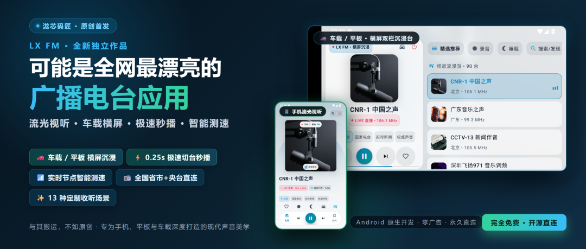
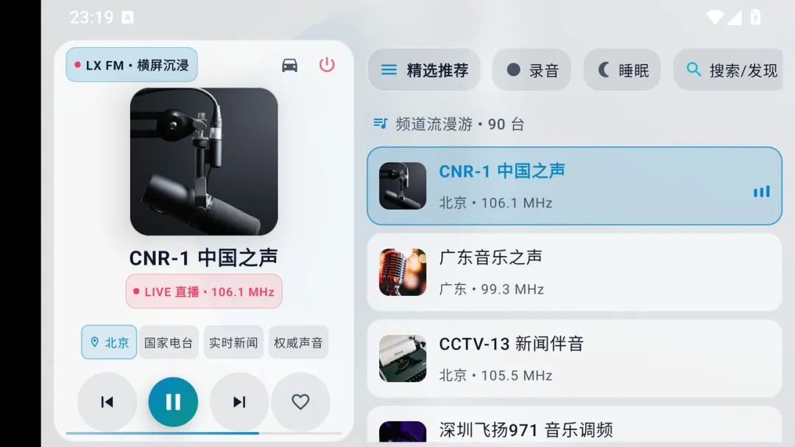
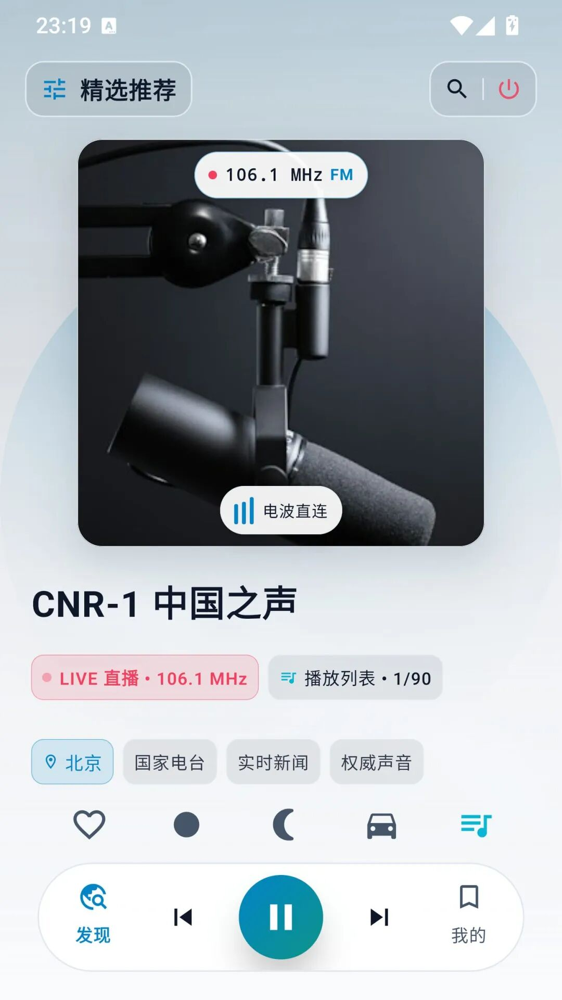
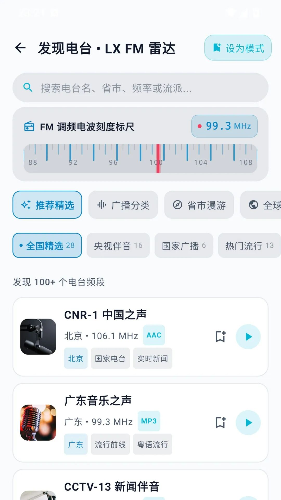
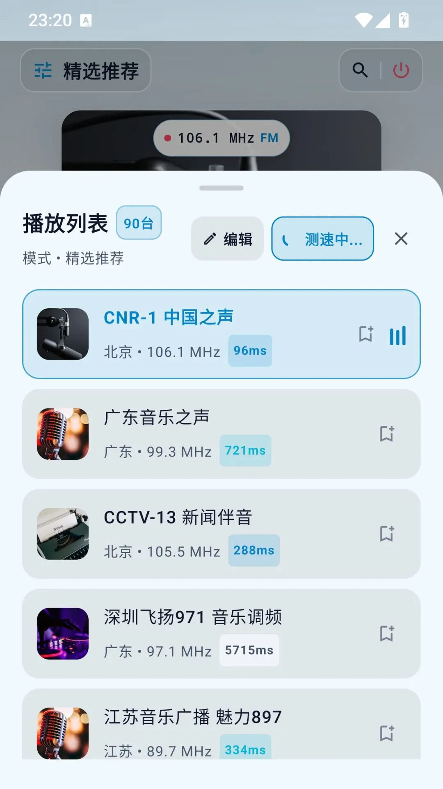
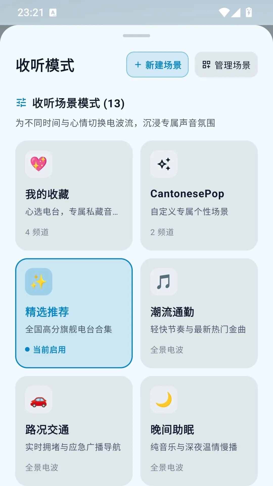
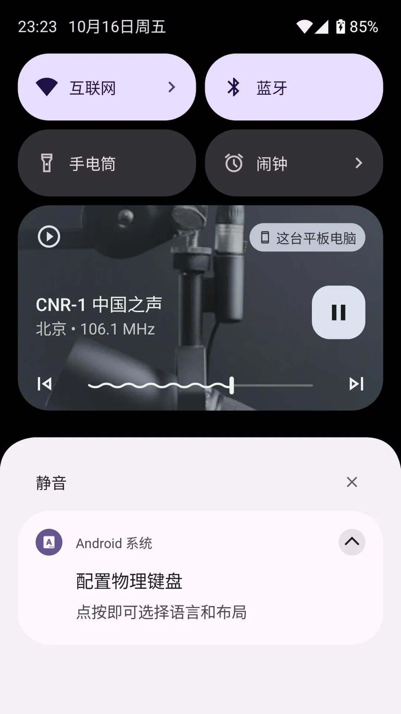

# 可能是全网最漂亮的广播电台应用！LX FM 震撼来袭：流光动效、毫秒级切台、车载横屏沉浸，重新爱上听广播
> 💡 备注属性未写入，可能是备注属性名称或者类型被修改了，建议将字段类型设置为 rich_text，可以在小程序-操作-修改文章数据库页面进行调整
> 💡 原文链接:[https://mp.weixin.qq.com/s?__biz=MzA3MzgyMjM3OA==&mid=2247487323&idx=1&sn=b71d61d2372e877d916e1bd4fdfb4d6e&chksm=9ebc0dfffd0665b1c68674b5e9b2f0c49476723e03bba3f1525b5ac9b21a5a81888f4c08288a#rd](https://mp.weixin.qq.com/s?__biz=MzA3MzgyMjM3OA%3D%3D&mid=2247487323&idx=1&sn=b71d61d2372e877d916e1bd4fdfb4d6e&chksm=9ebc0dfffd0665b1c68674b5e9b2f0c49476723e03bba3f1525b5ac9b21a5a81888f4c08288a#rd)
👆 「关注」加「星标」，每次新作品都不错过
> **与其搬运，不如原创。我们常年被传统电台 App 冗长的开屏广告、杂乱的信息流与粗糙的老人机界面所困扰。这一次，我亲手打造了一款纯粹、极速、颜值拉满的现代广播应用——LX FM。
> **
---
### 

---
### 序言：为什么在今天，我们依然需要一台好收音机？
不知道大家平时有没有戴着耳机散步、开车穿行在城市晚风里，或者深夜工作时，想在耳边开着收音机“听个响”的习惯？
在信息过载、算法推荐不断给我们投喂短视频的今天，**广播电台反而成了一种不可替代的奢侈陪伴**：
主持人的温和声线、即时路况与整点新闻、街头巷尾的偶遇旋律……那种未知的惊喜与电波特有的呼吸感，是任何冷冰冰的推荐算法都给不了的。
但环顾应用市场，现状让人哭笑不得：
- **广告漫天飞**：点进软件先看 5 秒摇一摇，切个频道还要弹各种理财与小说推广；
- **界面老气**：充斥着十年前拟物老人机的审美，要么就是花里胡哨的带货直播间；
- **换台转圈卡顿**：切个台缓冲三五秒，声音断断续续；
- **毫无横屏适配**：装在车载大屏或平板上，要么粗暴拉伸，要么直接黑边强制竖屏。
**“既然市面上找不到令人赏心悦目的电台应用，那就自己写一个。”**
这就是今天和大家见面的全新作品——**LX FM**。
---
### 一、横屏沉浸模式：车载大屏与平板的“绝配灵魂伴侣”
很多朋友都在车机、中控大屏或桌上平板里装过收音机，但体验普遍惨不忍睹。
在 LX FM 中，**横屏绝不是简单的拉伸，而是量身定制的沉浸级控制台**：

只要旋转屏幕（或在中控横屏启动），应用瞬间无缝切换为**双栏交互形态**：
- **左侧：高保真电台控制中心**——高清台标电波直连、频段信息、地理标签、大面积播放与切台手势，伸手即触，毫无阻碍；
- **右侧：频道流瀑布漫游**——90+ 精选电台即时呈现，正在播放的电台伴随实时脉冲频谱律动，想换哪台随手轻点；
- **极速状态感知**：顶栏直观常驻电台状态与休眠定时，告别误触。
#### 车载巡航 HUD 模式：开车的专属浪漫
更绝的是顶栏上的“车载模式”按钮。点开之后，屏幕将化身为极简的 **Car HUD 巡航仪表盘**：

- **超大字号调频与台标**：数百米外都能一目了然，完全不分散驾驶注意力；
- **极简拟物光影**：黑白高反差护眼设计，夜间开车绝不刺眼，真正实现盲操切换。
不管是放在仪表台手机支架上，还是直接装进安卓车机，LX FM 都会让你的座舱瞬间充满科技感与电波情怀。
---
### 二、视觉天花板：流光视听与复古调频
在竖屏日常使用中，LX FM 同样带来了令人惊艳的现代声音美学。

- **智能流光光晕（Ambient Aura）**：算法实时提取当前电台封面艺术主色调，在背景渲染出柔和流转的光晕微动效，仿佛一台散发着温润微光的真实音响；
- **悬浮玻璃拟态操作栏**：高斯模糊微质感胶囊控制条，上一台、下一台、暂停与收藏一触即达；
- **原生触控手势**：左右轻扫卡片，即可如实体旋钮般丝滑连贯地切台。
#### 复古与科技交融：调频电波刻度标尺
打开“发现电台”，你会看到一条充满机械与科技质感的 **FM 调频电波刻度标尺**：

从 88.0 到 108.0 MHz，指针随着红线精准滑移；下方支持**央视伴音、国家广播、热门流行、省市漫游与全球精选**快速分类导航，在电波海洋里尽情寻宝。
---
### 三、极客硬核黑科技：0.25s 极速切台与节点智能测速
市面上很多电台 App 之所以卡顿，是因为每次切台都要走复杂的鉴权和多重重定向。
LX FM 从底层音视频管线做了彻底重构：
1. **0.25s 极速起播优化**：预加载音频管线与超低缓冲延迟策略，切台就像转动真正的机械收音机旋钮一样干脆利落，声音瞬间喷薄而出；
1. **所有线路直连源头**：剔除中间商转码消耗，直通源头高保真音频流。
#### 独创“节点智能测速”：告别转圈圈
播放列表里到底哪个频道网速最好？点一下列表右上角的**「测速」**按钮：

- LX FM 会并发探测当前所有电台节点的物理网络延迟；
- 每个频道卡片上实时标出毫秒级响应（如 96ms、288ms、334ms）；
- 哪个流畅、哪个拥堵一清二楚，还可以一键按延迟从低到高自动重排，把最稳定的电台排在前面！
---
### 四、13 种定制收听场景：懂你的每一个时刻
电台不该是一成不变的列表。LX FM 预设并支持深度定制 **13 种收听场景**：

- **潮流通勤**：精选最动感的流行与音乐电台，伴随你的每一次地铁与驱车；
- **路况交通**：聚焦各地交通广播与应急播报，出行路况早知道；
- **晚间助眠**：纯音乐与深情慢播，搭配定时休眠关闭，伴你安心入梦；
- **自定义场景**：自由添加喜欢的频道组合，一键切换专属声音氛围。
---
### 五、原生系统级打磨：全天候后台播放与锁屏控制
作为一款长期驻留后台的收听神器，后台保活与系统集成是生命线。
LX FM 完整集成了 Android 原生 **MediaSession 媒体架构**：

- **锁屏与常驻通知卡片**：电台台标、频率、波形指示器与切台按钮一应俱全；
- **车载方向盘按键完美响应**：连接车载蓝牙后，方向盘上的上下曲按键直接支持换台，
- **耳机拔出智能暂停**：公共场合拔出耳机或断开车载蓝牙，音频瞬间静默，避免尴尬，同时也支持耳机切换上下频道；
- **电台台标智能缓存**：采用 LRU 磁盘缓存策略，断网也好看，不浪费一丝多余流量。
---
### 郑重说明
1. **纯净零广告**：LX FM 绝无开屏广告、无弹窗推广、无后台窃取隐私行为；
1. **完全免费直连**：本项目为泷芯码匠独立原创开发，所有音频内容均直连公开网络广播电波源，版权归各广播电视台所有；
1. **长期维护更新**：软件已适配各大主流 Android 手机、车载大屏与平板设备。
---
### 怎么获取？
关注微信公众号【**泷芯码匠**】，在后台回复关键字 **"LX FM"** 即可获取最新官方无广告 APK 安装包下载地址。
---
泷芯码匠 | 与其搬运，不如原创
用原创软件，为生活和工作的难题提供优雅解法。
